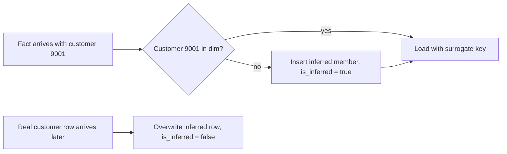

## 🎯 TL;DR

> Basic star schemas handle most questions. Advanced dimension techniques handle the messy cases: **a dimension used twice**, **a flag with no home**, **a value that lives only in the fact**, **a fact that refers to a dimension row that does not exist yet**, and **a fact that belongs to several dimension members at once**.

- **Junk dimension:** a small table of low-cardinality flags, so the fact table does not carry many boolean columns.
- **Degenerate dimension:** an identifier (like an order number) that stays in the fact table because it has no other attributes.
- **Role-playing dimension:** one dimension (like date) joined several times under different roles.
- **Mini-dimension:** fast-changing attributes split out of a large dimension so you do not create endless history rows.
- **Outrigger:** a dimension attached to another dimension (use sparingly).
- **Bridge table:** resolves many-to-many relations between a fact or dimension and a group of dimension members.
- **Late-arriving facts and dimensions:** how to load data whose parents show up after it.

## 🌱 Start simple (Junior)

> **💡 Analogy:** A library. The **fact** is "a loan happened". The **dimensions** are the book, the member and the date. Now imagine three more cases: the loan has a receipt number that is only a label (degenerate); the "date" is used as *borrow date* and as *return date* (role-playing); and some members have a "yes/no" for every flag, such as *is a student* and *has a card*. You do not want a new column for every flag on every loan. You want a small lookup table with the combinations.

Let us start with the simplest case: a **junk dimension**. A sales fact has three flags: `is_gift`, `is_express` and `payment_type` (card, cash or wallet). Each flag alone is trivial, but on the fact table they add three columns and make the table wider. The Kimball approach is to create one small table with every combination:

```sql
CREATE TABLE dim_order_flags (
  flags_key    bigint PRIMARY KEY,
  is_gift      boolean NOT NULL,
  is_express   boolean NOT NULL,
  payment_type text    NOT NULL
);
-- 2 * 2 * 3 = 12 rows, generated once and never changed
```

The fact table then stores one `flags_key`. That is a junk dimension: a dimension made from leftover flags that had no other home.

A **degenerate dimension** is the opposite case. An order number such as `ORD-2026-000184` is useful for grouping lines of the same order, but it has no attributes of its own. You do not create a `dim_order` table with a single column. You keep `order_number` directly in `fact_order_line`.

```sql
SELECT order_number, SUM(amount) AS order_total
FROM fact_order_line
GROUP BY order_number;
```

> **⚠️ Watch out:** A degenerate dimension is still a dimension. It is useful for grouping, but do not put descriptive text (customer name, status text) in it. If it has attributes, it deserves a real dimension table.

## 🔧 How it really works (Mid)

### Role-playing dimensions

A fact often has several dates: `order_date`, `ship_date`, `delivery_date`. Each one points to `dim_date`. You do not copy `dim_date` three times. You join the same table several times with different aliases. In BI tools, each alias becomes a *role*.

```sql
SELECT
  od.calendar_date AS order_date,
  sd.calendar_date AS ship_date,
  f.order_number,
  f.amount
FROM fact_order_line AS f
JOIN dim_date AS od ON od.date_key = f.order_date_key
LEFT JOIN dim_date AS sd ON sd.date_key = f.ship_date_key;
```

The `LEFT JOIN` matters: orders that are not shipped yet have no `ship_date_key`. Many teams also create views (`dim_order_date`, `dim_ship_date`) so BI users do not have to remember the aliases.

### Mini-dimensions for fast-changing attributes

A customer dimension with age, income band and credit score looks harmless. Now apply Type 2 SCD: every time the income band changes, you create a new customer row. For a big customer base, the dimension grows quickly because one attribute changes often.

The fix is a **mini-dimension**: move the fast-changing attributes into their own small table, with one row per *combination of bands*. The fact table then has two keys: the stable customer key, and the mini-dimension key that describes the customer's bands *at the time of the transaction*.

```sql
CREATE TABLE dim_customer_profile_mini (
  profile_key   bigint PRIMARY KEY,
  age_band      text NOT NULL,      -- e.g. '18-24', '25-34'
  income_band   text NOT NULL,      -- e.g. 'low', 'mid', 'high'
  credit_band   text NOT NULL
);
```

Bands are the key: a customer who moves from `mid` to `high` income gets a different `profile_key` on the next purchase, but the main customer row does not grow.

### Outriggers

An **outrigger** is a dimension that points to another dimension, for example `dim_employee` has a `hire_date_key` that joins to `dim_date`. This is a small snowflake. Kimball recommends it only for stable attributes that many dimension rows share and that you do not want to repeat, such as a fiscal calendar. Used everywhere, outriggers turn a star into a snowflake, with more joins and more confusion.

### Bridge tables for many-to-many

A joint bank account has two customers. A fact row for the account balance cannot hold two customer keys cleanly. A **bridge table** holds one row per (account, customer) pair, and a **weighting factor** that sums to 1 per account, so totals are not double counted.

```sql
CREATE TABLE bridge_account_customer (
  account_key  bigint NOT NULL,
  customer_key bigint NOT NULL,
  weight       numeric(5, 4) NOT NULL,   -- weights per account sum to 1.0
  PRIMARY KEY (account_key, customer_key)
);

-- Balance split across customer segments, without double counting
SELECT c.segment, SUM(f.balance * b.weight) AS weighted_balance
FROM fact_account_snapshot AS f
JOIN bridge_account_customer AS b ON b.account_key = f.account_key
JOIN dim_customer AS c ON c.customer_key = b.customer_key
GROUP BY c.segment;
```

Without the weight, a joint account counted under two segments would be counted twice in total.

### Late-arriving facts and dimensions

Real pipelines deliver data out of order. Two cases matter:

- **Late-arriving dimension:** a fact references `customer_nk = 9001`, but the customer row arrives tomorrow. Do not drop the fact and do not fail the load. Create an **inferred member**: a dimension row with the business key, placeholder attributes and an `is_inferred` flag.
- **Late-arriving fact:** the fact itself arrives days after its date. It must land in the right partition and the right aggregate. This is a backfill problem, not a modeling problem.



```sql
-- Inferred member created by the fact loader
INSERT INTO dim_customer (customer_key, customer_nk, name, segment, is_inferred)
VALUES (nextval('customer_key_seq'), 9001, 'UNKNOWN', 'UNKNOWN', true);

-- Later, the real record arrives: fix the placeholder in place (Type 1 style)
UPDATE dim_customer
SET name = 'Sara', segment = 'gold', is_inferred = false
WHERE customer_nk = 9001 AND is_inferred;
```

The fact row keeps the same surrogate key the whole time, so no fact needs to be reloaded. Only the dimension row changes.

## 🧠 Senior depth & trade-offs

- **Mini-dimension vs Type 2 SCD:** Type 2 keeps full history for every attribute, which is correct for slowly changing attributes. For fast-changing bands, Type 2 explodes the dimension. A mini-dimension bounds the size to the number of band combinations (a few hundred or thousands), but you lose the ability to query "the customer's exact income" without the band.
- **Junk dimension size:** the number of rows is the product of the cardinalities. Five flags with 2 values each give 32 rows. Ten flags give 1,024. Watch for accidental free-text fields that make the product explode. Generate it from the real combinations observed in the data if the set is large.
- **Bridge weights are a business decision:** equal weights, sales-based weights or "primary owner gets 100%" all give different answers. Document the rule, and store the weight with its effective date if it can change.
- **Inferred members in production:** they are the normal answer to "the fact arrived first", but they hide data quality issues if nobody counts them. Monitor the number of `is_inferred = true` rows and alert when it grows.
- **Late facts and aggregates:** when a late fact lands in an old partition, every pre-aggregated table built from it is stale. Design the load so that a partition can be recomputed (idempotent overwrite of a date partition), and check how your engine handles that (Spark dynamic partition overwrite, Iceberg or Delta `MERGE`).
- **Outriggers in practice:** most engines handle an extra join cheaply, so the real cost is maintenance and confusion, not speed. Prefer a denormalized column in the dimension unless the outrigger is shared by many dimensions.
- **When not to use these:** for a clean star with one date and no flags, these techniques add complexity without benefit. Use them when a specific pain appears: a wide fact table, a huge SCD2 dimension, or a report that double counts.

## 🧪 Try it

You are modeling a telco call-detail record (CDR) fact. Each call has: `call_id` (a unique number from the switch), `caller_key`, `callee_key`, `start_date`, `end_date`, `is_roaming`, `is_international`, `call_type` (voice, video) and a `plan_key` for the customer's plan at call time. A customer can have several phone numbers, and a number can be shared by family members.

1. Which attribute is a degenerate dimension?
2. Which flags go into a junk dimension, and how many rows does it have?
3. How do you model `start_date` and `end_date` against `dim_date`?
4. How do you attribute minutes to a *shared* number with two family members?

<details><summary>Your guess?</summary>

1. `call_id` stays in the fact table as a degenerate dimension. It has no attributes of its own and is useful for drill-through and deduplication.
2. `is_roaming`, `is_international` and `call_type` go into a junk dimension. With 2 × 2 × 2 = 8 rows (if `call_type` has two values), the table is tiny. Add more call types and the count grows multiplicatively.
3. Role-playing: join `dim_date` twice with aliases such as `start_dt` and `end_dt`. Keep both keys in the fact.
4. Use a bridge table between the number and its users, with a weight per user that sums to 1 per number. Minutes are then split with the weight, so the total minutes are not double counted.

</details>

## 💬 Interview corner

**Question: "A fact table has ten boolean columns. What do you do?"** Mid answer: "I'd move them into a junk dimension with a row per combination, and keep one key in the fact." Senior answer: "I'd check the real number of combinations first. If the observed combinations are few, a junk dimension is cheap and makes the fact narrower. If the flags have many values, I'd generate the table from the observed set and document how new combinations are added."

**Question: "A transaction references a customer who has not arrived yet. What happens?"** Mid: "I'd create an inferred member with an unknown name and a flag, then update it when the real customer arrives." Senior: "I'd also alert on the number of inferred rows, because it signals a real upstream ordering or quality issue. I'd make sure the aggregates that include this fact are recomputed when the dimension is fixed."

**Question: "How do you avoid double counting in a many-to-many relation?"** Mid: "Use a bridge table." Senior: "Use a bridge table with a weighting factor that sums to 1 per key, and state the weighting rule with the business. Without weights, totals across the group are inflated."

> **🎤 Say this in the interview:** "I keep the fact narrow. Flags go to a junk dimension, identifiers without attributes stay degenerate, and repeated dates use role-playing. Fast-changing attributes go to a mini-dimension, and many-to-many goes through a weighted bridge. For late data I use inferred members and make sure partitions can be recomputed."

## ⚠️ Common mistakes

> **⚠️ Watch out:** Joining the bridge table without weights and summing a measure. Totals for a group of customers will be larger than the real total.

> **⚠️ Watch out:** Creating a dimension row for every combination in production data without limiting cardinality. A "junk" dimension built from a free-text column is not junk, it is a second fact table.

- Using a junk dimension for a single boolean. One flag rarely needs its own table.
- Putting descriptive attributes into a degenerate dimension (for example, a customer name next to `order_number`).
- Using Type 2 SCD on a fast-changing attribute, then wondering why the customer dimension has billions of rows.
- Dropping late facts because the dimension row is missing, instead of creating an inferred member.
- Forgetting the `LEFT JOIN` for a role whose date can be empty (not yet shipped, not yet delivered).
- Building outrigger chains several levels deep, which quietly turns a star into a snowflake.

## ✅ Check yourself (quiz)

1. Which technique keeps an order number in the fact table because it has no other attributes?
   - A) Junk dimension
   - B) Degenerate dimension
   - C) Bridge table
   - D) Mini-dimension

<details><summary>Answer</summary>

**B** — a degenerate dimension is an identifier that stays in the fact table. It has no descriptive attributes, so a separate dimension would hold only one column.

</details>

2. One `dim_date` is joined twice in a fact query to give order date and ship date. What is this technique called?
   - A) Outrigger
   - B) Role-playing dimension
   - C) Late-arriving dimension
   - D) Snowflake

<details><summary>Answer</summary>

**B** — the same dimension plays several roles, each with its own alias in the query. Use `LEFT JOIN` when a role can be empty.

</details>

3. A joint account has two customers. The balance is summed per customer segment and the total is twice the real balance. What is missing?

   - A) An index on `account_key`
   - B) A bridge table with weights that sum to 1 per account
   - C) A junk dimension for the balance
   - D) A degenerate dimension for the customer

<details><summary>Answer</summary>

**B** — the many-to-many link must go through a bridge table, and the weights split each account's balance across its customers.

</details>

4. **(Senior)** A fast-changing income band on the customer dimension (Type 2) has produced hundreds of millions of rows. What is the better design and what do you give up?

   - A) Switch to Type 1 and lose all history
   - B) Move the bands into a mini-dimension keyed by band combinations; you lose the exact value of the attribute unless you store it separately
   - C) Duplicate the customer table per band
   - D) Remove the income band entirely

<details><summary>Answer</summary>

**B** — the mini-dimension bounds growth to the number of band combinations and keeps history at the fact level. The trade-off is that exact values are no longer in the same table unless you keep them as well.

</details>

5. **(Senior)** A fact loader finds a customer key that is not in the dimension yet. Which design keeps the load running without rewriting facts later, and what must you monitor?

   - A) Drop the fact and reprocess it next week
   - B) Insert an inferred member with an `is_inferred` flag and overwrite it later; monitor the count of inferred rows
   - C) Store the business key in the fact and skip the dimension forever
   - D) Create a new fact table for each customer

<details><summary>Answer</summary>

**B** — the inferred member gives the fact a valid surrogate key immediately, so no fact reload is needed. Monitoring the number of inferred rows exposes upstream ordering or quality problems.

</details>

## 🗂️ Flashcards

| Front | Back |
|---|---|
| Junk dimension | A table of combinations of low-cardinality flags, so the fact has one key |
| Degenerate dimension | An identifier kept in the fact table, with no attributes of its own |
| Role-playing dimension | One dimension joined several times with different aliases (order date, ship date) |
| Mini-dimension | Fast-changing attributes split out, keyed by band combinations, to stop SCD2 explosion |
| Outrigger | A dimension that joins to another dimension; use sparingly |
| Bridge table with weight | Resolves many-to-many; weights sum to 1 per key to avoid double counting |
| Inferred member | Placeholder dimension row created when a fact arrives before its dimension |
| Late-arriving fact | A fact that lands after its period; needs partition recomputation, not a model change |

## 🔗 Go further

- **dimensional-modeling** and **fact-table-types** cover the base star schema these techniques extend.
- **scd** explains Type 1 and Type 2 changes, which mini-dimensions and inferred members interact with.
- **star-snowflake-obt** compares star, snowflake and one-big-table designs, and when outriggers push you toward snowflake.
- **pattern-late-data** covers the pipeline side of late facts: watermarks, reprocessing and backfills.
- **modeling-problems** applies these techniques to full case studies such as telco and banking models.
