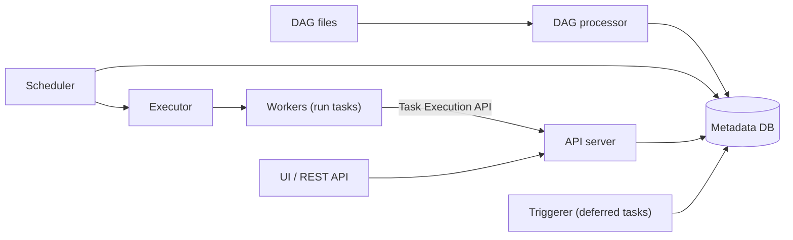

## 🎯 TL;DR

> **Apache Airflow** is a Python-based orchestrator. You describe a pipeline as a [[dag]] in code, and Airflow decides when each task runs, where it runs, what happens on failure, and what state each run is in.

- Airflow orchestrates; it should not move data itself. Tasks call Spark, a warehouse, or a script, and pass references (paths, table names) to each other.
- Core parts: a **scheduler** that decides what is runnable, a **DAG processor** that parses DAG files, an **API server** (the UI and API), a **metadata database** that holds all state, and **workers** that run tasks through an **executor**.
- A run is identified by its **data interval** (the period it processes), not by when it started. This is what makes re-runs and backfills correct.
- The interview-level rule: **every task must be idempotent and parameterized by its data interval**. Retries, reruns and backfills depend on it.

## 🌱 Start simple (Junior)

> **💡 Analogy:** Airflow is a shift manager at a factory. The manager does not assemble parts. They keep a board of what must happen, in which order, and which machine is free. When a station breaks, they retry it, and if it keeps breaking they call the supervisor.

A minimal DAG in Airflow 3 style looks like this:

```python
from datetime import datetime, timedelta
from airflow.sdk import dag, task   # Airflow 3 authoring namespace (Airflow 2: airflow.decorators)

@dag(
    schedule="0 2 * * *",           # every day at 02:00
    start_date=datetime(2026, 1, 1),
    catchup=False,                  # do not auto-run every missed period on deploy
    max_active_runs=1,              # only one period at a time
)
def orders_daily():

    @task(retries=3, retry_delay=timedelta(minutes=5))
    def load_partition(**context):
        day = context["data_interval_start"].strftime("%Y-%m-%d")  # the period this run is for
        # Overwrite exactly one partition: safe to retry and safe to backfill.
        print(f"replace partition dt={day} in fact_orders")

    load_partition()

orders_daily()
```

Three things to notice:

- The DAG is Python code, so it can be reviewed, tested and versioned like any other code.
- `retries` and `retry_delay` are per task. A transient failure is retried; a bad query eventually fails and alerts.
- The task asks "which day am I for?" through the context. It never asks "what time is it now?"

## 🔧 How it really works (Mid)

**Architecture (Airflow 3).** Airflow 3 split the older all-in-one design into services:



- **DAG processor** parses DAG files and writes the DAG structure to the metadata DB. It runs as its own process, so slow parsing does not block scheduling.
- **Scheduler** looks at the metadata DB, decides which task instances are runnable (dependencies met, time reached, pools and concurrency limits allow it), and hands them to the executor.
- **API server** replaces the old webserver. It serves the UI and the REST API, and workers report state through the Task Execution API instead of connecting directly to the metadata DB.
- **Triggerer** runs deferrable operators, which wait for an external event without holding a worker slot.
- **Metadata DB** (PostgreSQL or MySQL in production) holds DAG runs, task instances, XComs, connections and variables. Its load grows with the number of tasks and the frequency of state changes.

**Executors.** The executor decides where a task runs:

| Executor | How tasks run | Good for | Watch out |
|---|---|---|---|
| Local | Subprocesses on the scheduler machine | Development, small single-host setups | No horizontal scale |
| Celery | Tasks sent to a queue (Redis or RabbitMQ) and picked up by a worker fleet | Steady load, shared warm workers | Worker environments drift; dependency conflicts across tasks |
| Kubernetes | One pod per task | Isolation, different images per task | Pod start-up adds latency to every short task |

Other executors exist for edge or specialized setups. Choose by isolation needs and task length, not by habit.

**Operators, hooks and sensors.** An *operator* is a task template (`BashOperator`, `PythonOperator`, provider operators for databases and clouds). A *hook* is the connection layer that an operator uses to talk to an external system (credentials come from Airflow connections). A *sensor* waits for a condition. Prefer the TaskFlow `@task` style for Python logic and provider operators for external systems.

**Data interval, logical date and catchup.** Each run has a data interval: the period `[start, end)` it processes. For a daily schedule at 02:00, the run for January 1 has interval `[Jan 1 00:00, Jan 2 00:00)` and starts after `Jan 2 00:00`. The old name logical date (`execution_date`) refers to the start of this interval. Use the interval in code:

```python
# In a SQL task template: the data window for this run
SELECT *
FROM raw_orders
WHERE order_ts >= '{{ data_interval_start }}'
  AND order_ts <  '{{ data_interval_end }}';
```

With `catchup=True` (the default in many versions, so check yours), Airflow creates runs for every missed interval since `start_date` when the DAG is enabled. With `catchup=False`, it only schedules the latest interval. Set this on purpose.

**XCom.** XCom (cross-communication) passes small values between tasks. It is stored in the metadata DB. Keep XComs to IDs, paths, counts or small JSON. Large data belongs in object storage or a table; pass its location. Airflow offers custom XCom backends for storing values elsewhere, but that moves the problem rather than removing it.

**Dynamic task mapping.** `expand()` creates task instances at run time, one per item of a list, so the number of tasks depends on the data:

```python
@task
def list_partitions():
    return ["2026-01-01", "2026-01-02", "2026-01-03"]

@task
def load(day: str):
    print(f"load {day}")

load.expand(day=list_partitions())   # three mapped task instances
```

Mapped tasks are tracked individually, so a failure in one partition can be retried without rerunning the others.

**Assets (datasets) scheduling.** Instead of a clock, a DAG can run when an asset (called a dataset in Airflow 2) is updated by another DAG. This replaces fragile timing like "run at 03:00 after the other job should be done" with an explicit data dependency.

**Pools and concurrency.** A *pool* is a named set of slots. Tasks that use the pool `warehouse` share its slots, so a backfill cannot open 200 connections to your warehouse. Other limits include `max_active_runs` (per DAG), `max_active_tasks` (per DAG), and queue or priority settings.

**KubernetesPodOperator.** It runs a container image as a pod for one task. Dependencies live in the image, so teams with conflicting library versions can share one Airflow installation. The cost is pod start-up, image pulls and cluster capacity, so do not use it for every 2-second task.

## 🧠 Senior depth & trade-offs

- **The top-level code anti-pattern.** The DAG processor imports every DAG file again and again, often every few seconds. Anything at module level runs on each parse:

  ```python
  # BAD: runs on every parse, not on every task run
  import requests
  today = datetime.now()                                        # changes on each parse
  rows = requests.get("https://api.example.com/rates").json()  # network call at parse time

  # GOOD: heavy work and time-dependent values live inside tasks
  @task
  def fetch_rates(**context):
      day = context["data_interval_start"]
      ...
  ```

  This is why `datetime.now()` is the classic interview trap. The value changes on every parse, so the scheduler can see a different DAG each time, and a rerun for last month uses today's date. Use `data_interval_start` instead.

- **Idempotency with templated dates.** The safe pattern is one partition per run: `DELETE` or overwrite exactly the partition for `data_interval_start`, then insert. A retry or a rerun produces the same table. An append without a key creates duplicates on every retry; see [[dedup-idempotent-loads]].

- **Backfilling six months safely.** A backfill of 180 daily runs at 20 minutes each is 3,600 minutes of work. With 4 runs in parallel and no contention it still takes 3,600 / 4 = 900 minutes, which is 15 hours. Plan it:
  1. Confirm the tasks are idempotent and read only their interval.
  2. Limit concurrency: `max_active_runs` for the DAG and a pool for the warehouse.
  3. Run a small window first (say 3 days), check row counts and totals against the source, then run the rest.
  4. Decide whether downstream DAGs must be cleared and re-run for the same period.
  5. Mute alerts or expect noise; SLA-type alerts fire for historical runs too.
  6. Know how to stop: pause the DAG, then cancel the remaining runs.

  See [[backfill]] and [[backfills]].

- **Scaling the scheduler.** Current Airflow supports several scheduler replicas for high availability. The bottlenecks are usually the metadata DB (connection count, lock contention on task state), DAG parse time (many files, heavy imports), and scheduler loop latency. Watch scheduler heartbeat, parse duration, queue time and DB connections. Keep DAG files light and generate fewer, larger DAGs where you can.

- **Pools for protection.** Without pools, a popular DAG can saturate a database that other teams depend on. Put every external resource behind a pool, and size the pool from the resource's real limit, not from the number of workers.

- **Airflow 3 changes that interviewers ask about.** The webserver became the API server. The DAG processor runs separately and is required in every environment. Workers use the Task Execution API. DAG authors import from the `airflow.sdk` namespace. Datasets became assets. Check the upgrade guide for your version, because removed features (for example the Airflow 2 SLA mechanism) need a replacement.

- **Executor trade-off.** Kubernetes gives isolation and per-task images, but a short task pays a pod start cost. Celery gives warm workers and low latency, but a shared environment means dependency conflicts. Local is fine for development only.

- **When not to use Airflow.** Sub-second, high-frequency or continuous event processing is not Airflow's job; use a streaming engine (see [[flink]] or [[kafka-streams]]). A single cron job with no dependencies does not need a scheduler platform. Compare alternatives in [[orchestrator-alternatives]].

- **What to monitor.** Task failure rate and retries per DAG, task duration trends, queue time before execution, scheduler heartbeat and parse time, DB connection saturation, and SLA or freshness misses. Alerts should say which data period is late, not only which task failed.

## 🧪 Try it

1. **Find the bug.** This DAG runs every day. Explain what goes wrong and rewrite the task.

   ```python
   @task
   def load():
       day = datetime.now().strftime("%Y-%m-%d")
       run_sql(f"INSERT INTO fact_orders SELECT * FROM staging WHERE dt = '{day}'")
   ```

2. **Design a safe backfill.** You must load `fact_orders` for 2025-07-01 to 2025-12-31. Each run takes 20 minutes, and the warehouse allows 4 concurrent loads. Write the backfill plan: concurrency, order of periods, validation, and what you do if run 97 fails.

3. **Map it.** Write a mapped task that loads one partition per country from a list `["IR", "DE", "US"]`, and explain why one failed country does not force a rerun of the others.

<details><summary>Show solutions</summary>

**1.** `datetime.now()` gives the day the task runs, not the day it is for. A retry the next morning, or a backfill for last month, inserts the wrong partition, and a rerun can insert duplicates for today. Use the data interval:

```python
@task
def load(**context):
    day = context["data_interval_start"].strftime("%Y-%m-%d")
    # replace, do not append: the same partition can be loaded again safely
    run_sql(f"DELETE FROM fact_orders WHERE dt = '{day}'")
    run_sql(f"INSERT INTO fact_orders SELECT * FROM staging WHERE dt = '{day}'")
```

(The two statements should run in one transaction where the engine supports it.)

**2.** About 184 daily runs (July 1 to December 31 inclusive). At 20 minutes each with 4 in parallel, that is roughly 184 × 20 / 4 = 920 minutes (about 15.3 hours) if the warehouse is not a bottleneck. Set the DAG's `max_active_runs=4` and put the task in a pool of size 4 so the limit holds even with other DAGs. Run one week first and compare row counts with the source. Run 97 failing is a normal event: the partition overwrite makes it safe to clear that one run and retry it, and the other runs are unaffected.

**3.**
```python
@task
def list_countries():
    return ["IR", "DE", "US"]

@task
def load_country(country: str, **context):
    day = context["data_interval_start"].strftime("%Y-%m-%d")
    print(f"replace partition dt={day}, country={country}")

load_country.expand(country=list_countries())
```
Each mapped instance is a separate task instance with its own state and retries. If `DE` fails, only that instance is retried or cleared; `IR` and `US` keep their success state.

</details>

## 💬 Interview corner

**"Why should a task not use `datetime.now()`?"**
- **Mid answer:** "Because the DAG is run for a specific date, and `now()` gives the current time, so reruns and backfills load the wrong day."
- **Senior answer:** "Two reasons. First, the DAG file is parsed many times a minute, so a `now()` at module level makes the DAG change on every parse. Second, and more important, the value depends on when the task runs, so a retry or a backfill is not reproducible. I use `data_interval_start` and `data_interval_end` from the context, and I write each run as a replace of one partition, so the same period always gives the same result."

**"How do you backfill six months safely?"**
Start with idempotent, interval-parameterized tasks. Cap concurrency at the DAG and pool levels, so the warehouse survives. Validate a small window against the source, then run the rest in a controlled batch. Decide on downstream clears, mute noisy alerts for historical runs, and keep a way to stop. Quote the arithmetic, because it shows you have thought about wall-clock time: 180 runs times 20 minutes divided by 4 parallel is 15 hours.

> **🎤 Say this in the interview:** "I keep each task idempotent and tied to its data interval, so a retry or a backfill is just the same function for another period. For a backfill I control concurrency with `max_active_runs` and pools, validate a sample first, and then run the rest."

## ⚠️ Common mistakes

> **⚠️ Watch out:** Heavy imports or API calls at the top of a DAG file. They run on every parse, and they can take down the scheduler under load.

> **⚠️ Watch out:** Assuming `catchup` is off. Depending on your version and configuration, enabling a DAG with an old `start_date` can create a flood of historical runs. Set `catchup` explicitly.

- Appending to a table in a task that is retried, which duplicates rows.
- Passing large DataFrames through XCom, which fills the metadata DB.
- Setting `max_active_runs` too high for a backfill, which saturates the warehouse and makes every other DAG late.
- Writing a sensor in poke mode that holds a worker for hours instead of using deferrable mode.
- Using Kubernetes pods for trivial tasks, then blaming Airflow for slow pipelines.
- Using `datetime.now()` or `date.today()` anywhere in task logic.

## ✅ Check yourself (quiz)

1. A task is retried after a timeout and the table has duplicate rows for that day. What change fixes this most directly?
   - A) Increase `retries`
   - B) Replace the partition for `data_interval_start` instead of appending
   - C) Switch to the Local executor
   - D) Add a sensor before the task

<details><summary>Answer</summary>

**B** — a retry is a second execution. Replacing exactly one partition makes the outcome the same no matter how many times the task runs. More retries would only add more duplicates.

</details>

2. In Airflow 3, which component serves the UI and the REST API, and what replaced the old webserver?
   - A) The scheduler; there is no replacement
   - B) The DAG processor; it replaced the webserver
   - C) The API server; it replaced the webserver
   - D) The triggerer; it replaced the executor

<details><summary>Answer</summary>

**C** — the API server replaced the webserver and serves the UI and REST API. The DAG processor parses DAG files, and the triggerer runs deferrable operators.

</details>

3. A DAG has `catchup` enabled and a `start_date` 18 months in the past. What happens when you enable it, and why is that risky?
   - A) Nothing; Airflow runs only the latest interval
   - B) Airflow schedules runs for the missed intervals, which can flood the warehouse and alerting; set `catchup` deliberately and control concurrency
   - C) Airflow deletes the old data
   - D) The DAG fails to parse

<details><summary>Answer</summary>

**B** — with catchup on, every missed interval since `start_date` becomes a run. Without concurrency limits this is an uncontrolled backfill. Set `catchup` on purpose, and limit it with `max_active_runs` and pools.

</details>

4. **(Senior)** Your scheduler lag grows as you add DAG files, and the metadata DB CPU is high. Name two likely causes and the first thing you would measure.

   - A) The UI theme and the browser cache
   - B) Heavy top-level code in DAG files (parse time) and many task state updates hitting the metadata DB; measure DAG parse duration and DB connection/lock metrics first
   - C) Too few executors; add more Celery queues only
   - D) XCom is disabled by default, so the DB is idle

<details><summary>Answer</summary>

**B** — parse-time work and high task-state churn both load the scheduler and the DB. Measure parse duration per file and DB load before changing anything, then reduce top-level work and task count, or split DAGs and scale the database.

</details>

5. **(Senior)** Why is a pool better than `max_active_runs` alone when several DAGs load the same warehouse?
   - A) Pools make tasks faster
   - B) `max_active_runs` limits one DAG; a pool limits a shared resource across all DAGs that use it
   - C) Pools replace the executor
   - D) `max_active_runs` only works with Kubernetes

<details><summary>Answer</summary>

**B** — a pool is a shared slot count across DAGs, so it protects an external resource (a warehouse connection limit, a rate-limited API). `max_active_runs` only caps runs inside one DAG.

</details>

## 🗂️ Flashcards

| Front | Back |
|---|---|
| Data interval | The period `[start, end)` a run processes; use it instead of the current time |
| Why not `datetime.now()` | The value changes on every parse and on every rerun, so the result is not reproducible |
| DAG processor (Airflow 3) | A separate process that parses DAG files and writes their structure to the metadata DB |
| API server | Serves the UI and REST API; replaced the webserver in Airflow 3 |
| XCom | Small values passed between tasks, stored in the metadata DB; keep it small |
| Dynamic task mapping | `expand()` creates one task instance per runtime item; each is retried separately |
| Pool | A named slot count that limits concurrent tasks across DAGs using the same resource |
| Catchup | Creates runs for every missed interval since `start_date`; set it deliberately |

## 🔗 Go further

- [[orchestration-concepts]] covers the general model: DAGs, retries, sensors and SLAs, without tool details.
- [[backfills]] and [[dedup-idempotent-loads]] explain the design rules this lesson depends on.
- [[kubernetes-for-data]] covers the cluster side of the KubernetesExecutor and KubernetesPodOperator.
- [[dbt]] is often the transform step that Airflow triggers; [[pipeline-monitoring]] covers what to alert on.
- Read the Airflow upgrade guide for the version you run. Several answers above change between Airflow 2 and 3, and the exact names and defaults should be checked there.
