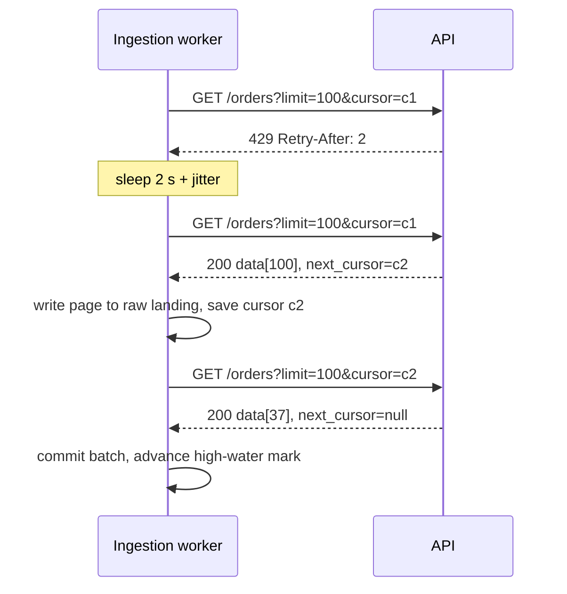

## 🎯 TL;DR

> **API ingestion** means pulling data from a remote HTTP API into your platform **reliably**: every page, every record, once, even when the API is slow, rate-limited or flaky.

- Pagination decides how you walk the data: **offset** is simple but drifts; **cursor** (keyset) is stable and fast.
- Rate limits (`429 Too Many Requests`) and server errors (`5xx`) are normal. Retry with **exponential backoff plus jitter**, and honour `Retry-After`.
- Incremental loads use a **high-water mark** (for example `updated_at`), with a small **lookback window** to catch late changes.
- Land the raw response first, checkpoint progress, and make the write **idempotent**. Then a crash means "run again", not "lose data".

## 🌱 Start simple (Junior)

> **💡 Analogy:** Copying a library catalogue from a librarian who lets you see only 50 cards at a time and gets annoyed if you ask too fast. You take a card, note where you stopped, wait when told to, and continue. If you lose your place, you must be able to restart without copying the same cards twice or skipping any.

A typical API call looks like this:

```text
GET https://api.example.com/v1/orders?limit=100&offset=0
→ 200 OK
{
  "data": [ {"id": 1, "status": "paid", "updated_at": "2026-10-12T08:01:00Z"}, ... ],
  "next_cursor": "eyJpZCI6MTAwfQ=="
}
```

Three things you must handle on every call:

1. **Pages.** One call returns at most `limit` records. You keep asking for the next page until there is none.
2. **Limits.** The API allows a certain number of calls per minute. Going over returns `429`.
3. **Failures.** Timeouts, `500`, `502`, `503` happen. A call can fail after the server already did the work.

Here is the smallest loop that reads all pages, using a cursor:

```python
import requests

def fetch_all(url, token):
    headers = {"Authorization": f"Bearer {token}"}
    cursor, rows = None, []
    while True:
        params = {"limit": 100}
        if cursor:
            params["cursor"] = cursor
        resp = requests.get(url, headers=headers, params=params, timeout=30)
        resp.raise_for_status()
        body = resp.json()
        rows.extend(body["data"])
        cursor = body.get("next_cursor")
        if not cursor:          # no next page: we are done
            return rows
```

This works, but it is not production-ready. It has no retries, keeps everything in memory, and restarts from zero if it crashes. The rest of the lesson fixes these problems one at a time.

## 🔧 How it really works (Mid)

### Pagination: offset vs cursor

| Style | Request | Pros | Cons |
|---|---|---|---|
| Offset | `?limit=100&offset=5000` | Easy to understand, jump to any page | Deep pages are slow; inserts or deletes during the walk shift rows, so you can **skip or duplicate** records |
| Page number | `?page=51&per_page=100` | Familiar | Same drift problem as offset |
| Cursor / keyset | `?limit=100&cursor=<opaque>` | Stable under concurrent writes, fast on large tables | No random access; the cursor is opaque and may expire |
| Time-based | `?updated_since=...` | Natural for incremental loads | Needs a tiebreaker when many rows share a timestamp |

**Worked example of offset drift.** Records are sorted by id. You read page 1 (`offset=0`, ids 1–100). Then the API deletes id 5. Everything after it shifts up one position, so id 101 now sits at position 99. Your request for `offset=100` starts at id 102, and **id 101 is silently skipped**. An insert near the front causes the opposite problem: a duplicate. A cursor that says "continue after id 100" stays correct after both changes.

### Rate limits and retries

A `429` response usually comes with a `Retry-After` header (seconds, or an HTTP date). Some APIs also send `X-RateLimit-Remaining` and a reset time. Respect them first. For `5xx` and network timeouts, use **exponential backoff with jitter**: wait roughly 1 s, 2 s, 4 s, 8 s, plus a random amount so that many workers do not retry at the same moment.

```python
import random, time, requests

RETRYABLE = {429, 500, 502, 503, 504}

def get_with_retry(session, url, params, max_attempts=6):
    for attempt in range(max_attempts):
        try:
            resp = session.get(url, params=params, timeout=(3, 30))
        except requests.RequestException:
            resp = None                      # network error: retry
        if resp is not None and resp.status_code not in RETRYABLE:
            resp.raise_for_status()          # 4xx other than 429 is a bug: fail fast
            return resp.json()
        if attempt == max_attempts - 1:
            raise RuntimeError(f"gave up after {max_attempts} attempts")
        wait = min(60, 2 ** attempt)         # 1, 2, 4, 8, 16, 32 seconds
        if resp is not None and resp.headers.get("Retry-After", "").isdigit():
            wait = int(resp.headers["Retry-After"])
        time.sleep(wait + random.uniform(0, 1))
```

Retry only **idempotent** calls (`GET` is safe; `POST` that creates a resource needs an idempotency key from the API, or you may create duplicates). A `400` or `401` will not fix itself; retrying it wastes quota.



### Authentication

- **API key** in a header: simple, but long-lived. Store it in a secret manager, never in code or in the repository.
- **OAuth 2.0 client credentials**: exchange client id and secret for a short-lived access token. Refresh before expiry, and treat a `401` in the middle of a run as "refresh once, then retry".
- **Per-tenant tokens** in multi-tenant APIs: one run per tenant, so one bad token does not block the others.

### Incremental loads and the high-water mark

A full reload of a large API every hour wastes quota. Instead, store a **high-water mark** (the largest `updated_at` you have safely landed) and ask for records changed since then.

The subtle part is safety:

- Records can be committed by the source **late**. A row with `updated_at = 10:00:00` may become visible at 10:00:30. If you move the mark to 10:00:00 and it was not visible yet, you miss it.
- The fix is a **lookback window**: request `updated_since = mark - 10 minutes`, then **merge** by primary key, keeping the newest version. Overlap costs a little extra read but never loses data.
- Advance the mark only **after** the batch is durable in your landing zone (see the next section).

**Deletes.** Most list endpoints do not return deleted records. You need one of: a `deleted` flag or soft-delete events, an audit or changes endpoint, or a periodic full reconciliation that compares keys. Without one, deleted rows live on in your warehouse forever. The reconciliation pattern is covered in [[pattern-reconciliation]].

### Landing, checkpoints and idempotency

A robust pipeline separates three steps:

1. **Fetch** each page and write it **as is** (raw JSON) to object storage, under a path that includes the run id and page number, for example `raw/orders/run=2026-10-13T02/page=0042.json`.
2. **Checkpoint** the cursor or mark in a small state table or file **after** the page is safely written.
3. **Transform and merge** the raw files into the curated table in a separate step, using a key-based merge so that replays do not duplicate rows (see [[idempotency]] and [[upsert]]).

If the worker dies after writing page 42 but before checkpointing, page 42 is fetched again on restart. That duplicate is harmless because the merge is keyed. This is the usual "at-least-once fetch plus idempotent write" design, which gives effectively-once results. Compare [[dedup-idempotent-loads]].

### Schema drift

APIs add fields, rename them, and sometimes change a type from integer to string. Land the raw payload so that nothing is lost, parse only the fields you need, and alert when the set of keys changes. Never let an unexpected field crash the whole run.

## 🧠 Senior depth & trade-offs

- **Quota is a shared budget.** Count calls per day, not only per minute. A backfill that uses the whole daily quota can starve the production job. Schedule historical loads in a separate window or use a second API key where the provider allows it.
- **Concurrency is limited by the API, not by your cluster.** Adding 50 Spark executors to call one rate-limited API makes things slower, because each executor gets retries. Use a token bucket shared by all workers, or one worker per API key.
- **Stop at the boundary of correctness.** Decide upfront whether you need exactly the state at a point in time (a snapshot) or the stream of changes. Snapshots cannot tell you about intermediate updates; change feeds need a retention policy on the provider side.
- **Observability.** Track per run: pages fetched, records per page, retries by status code, `Retry-After` totals, mark lag (now minus mark), and rows merged versus rows read. A growing mark lag with stable row counts usually means the API stopped publishing changes, not that your job is healthy.
- **Orchestration.** Each page-loop is a unit of work, not a DAG node. Put the state in the orchestrator or in a table so that a retry resumes from the last checkpoint. See [[backfills]] for historical loads.
- **When not to build it yourself.** For a handful of well-known SaaS sources, a managed connector (see [[ingestion-tools]]) saves weeks. Build your own when the API is unusual, the volume is high, or you need custom checkpoint semantics.

## 🧪 Try it

Use a local mock server or a public test API. Write the pagination loop from the Mid section and check it against this fake server:

```python
# fake_api.py: run with `python fake_api.py`, then call http://localhost:8000/orders
from http.server import BaseHTTPRequestHandler, HTTPServer
import json, urllib.parse

DATA = [{"id": i, "updated_at": f"2026-10-{1 + i % 28:02d}T00:00:00Z"} for i in range(1, 251)]

class H(BaseHTTPRequestHandler):
    def do_GET(self):
        q = urllib.parse.parse_qs(urllib.parse.urlparse(self.path).query)
        after = int(q.get("cursor", ["0"])[0])
        page = [r for r in DATA if r["id"] > after][:100]
        nxt = str(page[-1]["id"]) if len(page) == 100 else None
        body = json.dumps({"data": page, "next_cursor": nxt}).encode()
        self.send_response(200)
        self.send_header("Content-Type", "application/json")
        self.end_headers()
        self.wfile.write(body)

HTTPServer(("localhost", 8000), H).serve_forever()
```

1. Walk all 250 records with the cursor loop. Confirm you get 250 unique ids.
2. Add a random `429` on every third request (with `Retry-After: 1`) to the fake server and confirm `get_with_retry` still returns all rows.
3. Kill the loop after page 2 and restart it from the saved cursor. Confirm no id is missing.

<details><summary>Show solutions</summary>

1. Loop until `next_cursor` is `null`. The last page has 50 rows, so the total is 2 × 100 + 50 = 250 rows.
2. The retry helper sleeps for `Retry-After` seconds on `429` and then succeeds. Log the attempts to see the retries.
3. Persist the cursor after each page. On restart, read the cursor and pass it as the first `cursor` value. Because the cursor is the last id seen, the continuation is exact: nothing is skipped and nothing is re-read after the checkpoint.

</details>

## 💬 Interview corner

**Question: "How would you ingest data from a REST API that returns 100 records per page and rate-limits you?"**

- **Mid answer:** "I'd loop over pages until there is no next link, use exponential backoff on 429 and 5xx, and write the results to S3 as JSON."
- **Senior answer:** "I'd use cursor pagination if the API offers it, because offset drifts when data changes during the walk. I'd put one shared token bucket in front of all workers, honour `Retry-After`, and checkpoint the cursor after each page written to a raw landing zone. The incremental load would use an `updated_at` high-water mark with a lookback window and a keyed merge, and I'd run a periodic reconciliation to catch deletes."

**Question: "Why would you not move the high-water mark to the max timestamp you just read?"**

Because rows can become visible after their timestamp (commit delay, replicas). A lookback window plus a keyed merge is the safe pattern.

> **🎤 Say this in the interview:** "I treat an API as an unreliable, rate-limited source. I checkpoint after every durable write, retry only what is safe to retry, and make the load idempotent so restarts are boring."

## ⚠️ Common mistakes

> **⚠️ Watch out:** Moving the mark to `max(updated_at)` without a lookback window. Late-committed rows are silently lost, and nothing fails.

> **⚠️ Watch out:** Retrying `POST` calls without an idempotency key. The first call may have succeeded, and the retry creates a duplicate order.

- Using offset pagination on a table that changes during the walk, then reporting "missing data" weeks later.
- Retrying every error, including `400` and `401`, which wastes quota and hides bugs.
- Ignoring `Retry-After` and retrying with a fixed one-second sleep, which keeps you blocked.
- Storing the API token in code or in logs.
- Assuming that a list endpoint returns deletes.
- Keeping all pages in memory until the end of the run. A crash at 99% means starting over.

## ✅ Check yourself (quiz)

1. A cursor-paginated API returns `next_cursor: null` on the last page. What does your loop do?
   - A) Restart from page 1
   - B) Stop, because there is no next page
   - C) Retry the last request with a bigger `limit`
   - D) Wait 60 seconds and check again

<details><summary>Answer</summary>

**B** — `null` (or absence) of the next cursor means there is no next page. Restarting would duplicate data, and waiting does not create new pages.

</details>

2. Which status code should trigger a retry with backoff?
   - A) `400 Bad Request`
   - B) `401 Unauthorized`
   - C) `429 Too Many Requests`
   - D) `404 Not Found`

<details><summary>Answer</summary>

**C** — `429` means you are being rate-limited and will succeed later. `400`, `401` and `404` will not fix themselves on retry; they indicate a bug, expired credentials or a wrong resource.

</details>

3. Your incremental job uses `updated_at > last_mark` and sets the new mark to the max value it read. A week later, a finance report is missing some orders. What is the most likely cause?

   - A) The API does not support pagination
   - B) Rows became visible after their timestamp, and the mark had already moved past them
   - C) The retry logic used too many attempts
   - D) The raw files were stored as JSON

<details><summary>Answer</summary>

**B** — late-visible rows with an older `updated_at` fall behind the mark. Use a lookback window and a keyed merge.

</details>

4. **(Senior)** Twenty worker processes each call a rate-limited API with their own retry loop. Throughput gets worse as you add workers. Why, and what would you change?

   - A) The API is slow because of TLS
   - B) All workers compete for the same quota, so they trigger more `429`s and retries; use one shared token bucket or limit concurrency per API key
   - C) JSON parsing is the bottleneck, so add more CPUs
   - D) Use `POST` instead of `GET` to avoid rate limits

<details><summary>Answer</summary>

**B** — the quota is shared. Uncoordinated retries amplify the load and can get the key blocked. Shared rate limiting (token bucket) and bounded concurrency fix this.

</details>

5. **(Senior)** Why is "load the whole table every night" sometimes the better choice even though it costs more quota?

   - A) Incremental loads are not allowed by APIs
   - B) A full snapshot is simpler, detects deletes automatically, and avoids mark and lookback bugs when the table is small enough to fit the quota
   - C) Snapshots are always faster than incremental loads
   - D) Full loads avoid the need for authentication

<details><summary>Answer</summary>

**B** — when the volume and quota allow, a full snapshot removes whole classes of bugs (deletes, late rows, mark drift). Choose incremental when the cost or time of a full load is no longer acceptable.

</details>

## 🗂️ Flashcards

| Front | Back |
|---|---|
| Offset vs cursor pagination | Offset counts positions and drifts when data changes; cursor continues after a stable key |
| Which errors to retry? | Network errors, `429`, and `5xx`; not `400`, `401`, `404` |
| What is `Retry-After`? | A server hint (seconds or HTTP date) for how long to wait before retrying |
| Exponential backoff with jitter | Wait grows 1, 2, 4, 8 s…; a random extra delay spreads out simultaneous retries |
| High-water mark | The point up to which data is safely loaded; always used with a lookback window |
| Why a lookback window? | Rows can become visible late, after their timestamp |
| How to make a POST retry safe? | Use an idempotency key supplied by the API or generated by you |
| Why land raw JSON first? | You can replay the transform, and schema drift does not lose data |

## 🔗 Go further

- **ingestion-tools** compares managed connectors and frameworks that do this work for you.
- **batch-ingestion** and **file-ingestion** cover the other common source types.
- **dlq-bad-records** explains where to put records that cannot be parsed.
- **backfills** covers loading years of history without exhausting the quota.
- **delivery-semantics** explains at-least-once, at-most-once and exactly-once in more depth.
