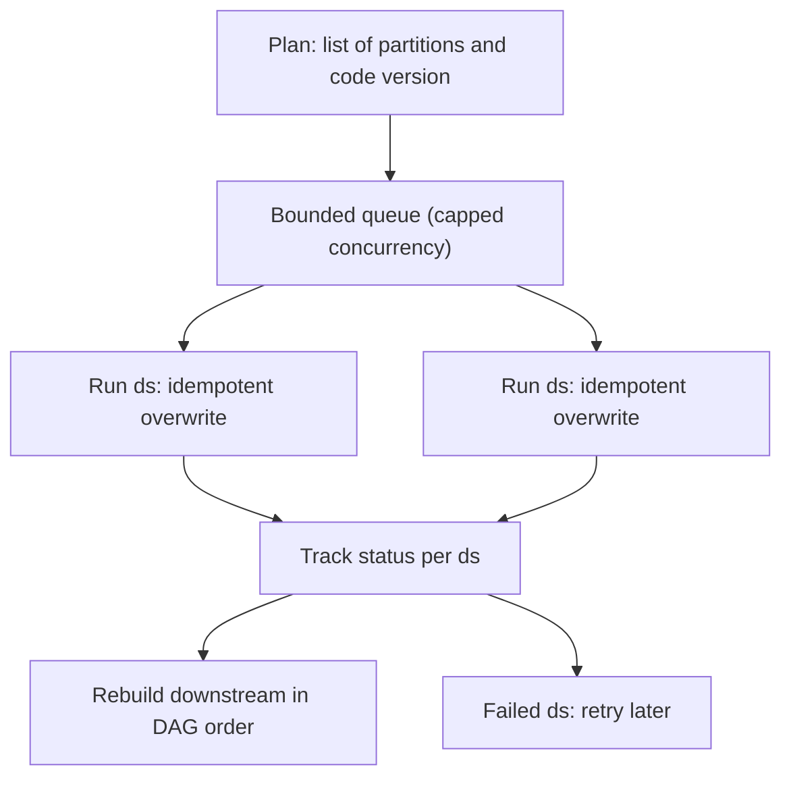

## 🎯 TL;DR

> A **backfill** runs a pipeline for past intervals, either to fill missing history or to recompute it after a bug fix. Treat it as many ordinary runs of an **idempotent** pipeline, with capped concurrency, isolation from the daily schedule, and a clear answer to "which code produced this partition?"

- A backfill is only safe if each partition run is idempotent (see [[pipeline-design-principles]]).
- Limit how many partitions run at once, so the daily SLA still holds.
- Decide the code version for each partition before you start, and record it.
- Check that the source still has the data: Kafka retention and source APIs expire, while the raw layer keeps it.
- Rebuild the **downstream** tables too, in dependency order.

## 🌱 Start simple (Junior)

> **💡 Analogy:** A shop finds a tax error in last month's invoices. It does not reissue all of them in one rush while customers are being served. It reissues them in batches, in date order, checking each batch, and keeps the daily invoices going in parallel.

Imagine a daily job that computes `revenue_daily` from `orders`. A bug made it skip refunds from 1 November to 31 January. After the fix, the team needs those 92 days recomputed.

The naive approach runs all 92 days at once:

```text
run 2025-11-01, 2025-11-02, ... 2026-01-31   (all at the same time)
```

That can overload the warehouse, slow down today's run, and leave half the days in an unknown state if something crashes. The safer approach runs the days in controlled batches and records what finished:

```text
for each day in order:
    run the pipeline for that day
    if it fails, note the day and move on; retry failed days later
```

Two words to remember:

- **Backfill:** running a pipeline for dates in the past.
- **Reprocessing:** running it again for dates that already have output, usually because the logic changed.

## 🔧 How it really works (Mid)

A backfill has four moving parts: the **list of partitions**, the **concurrency limit**, the **code version**, and the **order of downstream work**.

Partitions come from the schedule. In Airflow, each run covers a **data interval**, and its logical date is the start of that interval. A backfill asks the scheduler to create runs for a date range. Check the CLI reference for your Airflow version for the exact flags. The same idea works for any orchestrator, or for a plain script like this one, which runs a range with bounded parallelism and returns the failures to retry:

```python
from concurrent.futures import ThreadPoolExecutor
from datetime import date, timedelta


def day_range(start: date, end: date) -> list[str]:
    days = []
    d = start
    while d <= end:
        days.append(d.isoformat())
        d += timedelta(days=1)
    return days


def run_partition(ds: str) -> None:
    # Placeholder for the real pipeline entry point. It must be idempotent for ds.
    print(f"processing {ds}")


def backfill(start: date, end: date, workers: int = 4) -> list[str]:
    failed: list[str] = []
    partitions = day_range(start, end)
    with ThreadPoolExecutor(max_workers=workers) as pool:
        futures = {pool.submit(run_partition, ds): ds for ds in partitions}
        for future, ds in futures.items():
            try:
                future.result()
            except Exception:
                failed.append(ds)
    return failed


if __name__ == "__main__":
    failed = backfill(date(2025, 11, 1), date(2025, 11, 5), workers=2)
    print("failed:", failed)
```

In production, the orchestrator or a queue owns the concurrency, not a thread pool in a script. The logic is the same: a bounded number of workers, a list of partitions, and a list of failures to retry.

**Concurrency.** Partitions are usually independent, so they can run in parallel. But the daily run uses the same cluster. Use a dedicated pool, queue or resource limit for backfills, so they cannot take all the slots. Set `max_active_runs`-style limits on the DAG, or use a pool, and check the docs for your version.

**Ordering.** Some pipelines are sequential. A running total, a slowly changing dimension or a sessionization job needs yesterday's output before today's. For these, you cannot parallelize across dates; you run them in order, with `depends_on_past`-style rules or explicit dependencies. Parallel is fast only when the partitions are independent.

**Code version.** A backfill runs the code that is deployed today, unless you pin an older version. Decide this before you start. If the bug fix changed the logic, the old partitions should be recomputed with the new code. If the goal is to reproduce what was published then, pin the old version and say so in the run metadata. Record the git SHA or image tag per run.

**Downstream rebuild.** Fixing `fact_orders` makes `mart_revenue` and the dashboard wrong too. Rebuild the dependents, in DAG order, after the upstream partitions finish. Otherwise consumers see a mix of old and new numbers. Lineage ([[lineage]]) tells you what depends on what.

**Where the data comes from.** Replay is only possible when the data still exists:

- **Raw layer in object storage:** usually keeps everything you need, and it is the normal source for backfills (see [[medallion-architecture]]).
- **Kafka:** only has what is still inside the retention window. A topic with 7-day retention cannot replay a 30-day-old bug. Compacted topics keep only the latest value per key.
- **Source API or database:** may not offer history at all, or may have rate limits that make a large backfill take days.



## 🧠 Senior depth & trade-offs

- **Idempotency is the precondition.** Every run must be safe to repeat, or a crashed backfill leaves you guessing which days finished. Overwrite the partition, do not append. This is the core of [[dedup-idempotent-loads]].
- **Shadow outputs for risky changes.** For a large fix, write to a new table or a new version (for example `revenue_daily_v2`), compare totals with the old version and the source, then switch the view or the pointer. Rollback is then one change, not another backfill.
- **Protect the daily SLA.** Backfill traffic competes with the morning run. Use separate queues, lower priority, or a cap on executors and warehouse slots. A backfill that makes the daily dashboard late has failed, even if its own numbers are right.
- **Cost.** A 730-day backfill is 730 full runs, often more expensive than a month of normal runs. Estimate it with one sample day multiplied by the number of partitions, and check it against the budget before starting. Cost is a common reason to narrow the range.
- **Partial and late data.** If the backfill covers last week, and late events keep arriving for last week, the result is only as complete as the day you ran it. Decide the cutoff, then document it. See [[pattern-late-data]].
- **Source-side load.** Re-querying an operational database for 2 years can hurt production. Prefer the raw layer or a read replica, and throttle the extraction.
- **Observability.** Keep a progress table with one row per partition: `ds`, status, attempts, row count, duration, code version. It makes a backfill resumable, and it is the evidence that the work is complete. See [[pipeline-monitoring]].
- **When not to backfill.** If the logic has side effects, such as notifications or payments, running it again for history sends them again. In that case recompute into a table, and do not re-trigger the side effects. If the source data is gone and there is no raw copy, accept the gap, document it, and tell consumers.

## 🧪 Try it

1. You must backfill 180 daily partitions. Each takes 15 minutes, and the cluster can run 4 partitions at a time. How long does the backfill take? Show the arithmetic.
2. Your Kafka topic has 7-day retention. A bug affected data 30 days ago. What can you backfill from Kafka, and what would you use instead?
3. A bad fix changed `fact_orders`, which feeds `mart_revenue` and `mart_customers`. List the order in which you rebuild these tables and say why.

<details><summary>Show solutions</summary>

**1.** 180 partitions with 4 at a time take 180 / 4 = 45 waves. Each wave takes 15 minutes, so 45 × 15 = 675 minutes, which is about 11.25 hours. This assumes the partitions are independent and the cluster has no other load. If the pipeline is sequential, the time is much longer, because the waves cannot overlap.

**2.** Only the last 7 days are still in the topic, so you can replay only those. The 30-day-old data must come from the raw layer in object storage, which was written when the events arrived, or from the source system if it keeps history. Kafka is a retention buffer, not an archive.

**3.** Rebuild `fact_orders` first, because both marts read from it. Then rebuild `mart_revenue` and `mart_customers` in either order, since they are independent of each other. Do not publish the marts until the fact rebuild has finished and the totals have been checked.

</details>

## 💬 Interview corner

**Question: "How do you backfill six months of data safely?"**

Mid answer: "I'd run the job for each day from the start date to the end date, and I'd make sure the writes overwrite the partition so retries are safe."

Senior answer: "First I'd confirm that the source still has six months of data; if Kafka has only a week, I'd use the raw layer. I'd test one sample day, then run the partitions with a capped concurrency on a separate queue, so the daily run stays on time. I'd record the code version and a progress table, write into a shadow table and compare totals before switching, and rebuild the downstream marts in DAG order. I'd also estimate the cost before starting."

> **🎤 Say this in the interview:** "A backfill is a set of ordinary runs. It is safe because each run is idempotent, it is isolated from the daily schedule, and it is tracked per partition. Before I start, I check where the data comes from, which code version I'm using, and what depends on the output."

## ⚠️ Common mistakes

> **⚠️ Watch out:** running a backfill without a cap on concurrency. The daily run then misses its SLA, and a dashboard shows stale numbers in the morning.

- Using `datetime.now()` or `current_date` inside a task. The backfilled partitions get today's date logic, and every partition looks the same.
- Backfilling from Kafka when the bug is older than the retention window. The data is simply gone.
- Forgetting to rebuild downstream tables, so consumers see a mix of fixed and broken numbers.
- Appending during a backfill. A retry then duplicates rows, and you cannot tell which days finished.
- Writing directly to the production table with no comparison. A bad fix is then published without any check.
- Re-triggering side effects (emails, payments, external webhooks) for historical runs.
- Running a backfill with no progress record. A crash then means starting over, or guessing.

## ✅ Check yourself (quiz)

1. Why is a backfill normally safe to retry?
   - A) Because the scheduler stops duplicate runs
   - B) Because each partition run is idempotent: it overwrites the partition it owns
   - C) Because backfills always run on a single thread
   - D) Because the raw layer is deleted after each run

<details><summary>Answer</summary>

**B** — idempotent partition writes make a retry produce the same result. The other options are either not guaranteed or not true.

</details>

2. A bug was introduced 40 days ago. The Kafka topic keeps 14 days of data. What is the right source for the backfill?
   - A) The Kafka topic, with a larger `offset` value
   - B) The raw layer in object storage or the source system, if it keeps history
   - C) The mart table, because it already has the data
   - D) Nothing; the gap cannot be fixed

<details><summary>Answer</summary>

**B** — Kafka only holds the retention window, so the older events must come from the raw archive. Reading a mart does not recompute anything; it only copies the bug.

</details>

3. **(Senior)** Your backfill rewrites 2 years of a production fact table in place, and the new logic has a bug in 5% of rows. What should you have done?
   - A) Run it faster, so the bug is fixed sooner
   - B) Write to a shadow table or new version, compare totals with the old version and the source, then switch
   - C) Delete the old partitions first to save storage
   - D) Turn off the monitoring during the run

<details><summary>Answer</summary>

**B** — a shadow output makes the change reviewable and the rollback a pointer switch. An in-place rewrite of 2 years leaves no safe way back.

</details>

4. **(Senior)** Why can a daily pipeline with a running total not simply run its backfill partitions in parallel?
   - A) Because running totals cannot be stored
   - B) Because each day depends on the previous day's output, so the partitions must run in order
   - C) Because parallel jobs always produce duplicates
   - D) Because Spark does not support parallel tasks

<details><summary>Answer</summary>

**B** — the dependency is on the previous day's state, so parallelism would read stale state. The backfill must run in order, which makes it slower and needs its own planning.

</details>

5. Which action makes the most difference to protecting the daily SLA during a backfill?
   - A) Running the backfill at the same time as the daily job, to finish sooner
   - B) Capping backfill concurrency and isolating it on its own queue or resource pool
   - C) Removing the data quality checks
   - D) Increasing the retry count to 100

<details><summary>Answer</summary>

**B** — limiting and isolating backfill work keeps the daily run's resources available. Running them together, skipping checks or retrying endlessly all make the daily run worse.

</details>

## 🗂️ Flashcards

| Front | Back |
|---|---|
| Backfill | Running a pipeline for past intervals to fill or recompute history |
| Precondition for a safe backfill | Each partition run is idempotent (overwrite, do not append) |
| Where to get old data | The raw layer or the source; Kafka only holds its retention window |
| Why cap backfill concurrency | So the daily run keeps its resources and its SLA |
| Why use a shadow table | Compare totals first; rollback becomes a pointer switch |
| What to rebuild after a fix | The partitions, then every downstream table, in DAG order |
| What to record per partition | Status, attempts, row count, duration and code version |

## 🔗 Go further

- **pattern-backfill** covers the same problem from the pattern side, with more examples.
- **dedup-idempotent-loads** explains how idempotent loads remove duplicates, which is what makes a retry safe.
- **kafka-retention-compaction** explains what a topic keeps, and for how long, which decides whether replay is possible.
- **medallion-architecture** shows why a raw layer makes backfills cheap.
- **pattern-late-data** covers the cutoff question: how complete is a historical partition?
- Glossary: [[backfill]], [[idempotency]], [[incremental-processing]], [[partition]].
