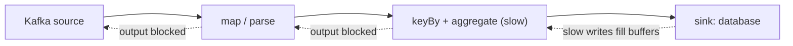

## 🎯 TL;DR

> **Backpressure** is what happens when a downstream stage cannot keep up with the rate of its upstream. The slowness must go somewhere: into a buffer, into a growing backlog, or into dropped data. Flow control is the set of mechanisms that decide which one happens, and when.

- If producers are faster than consumers **on average**, the gap accumulates. No system can process more than it has capacity for; it can only delay, buffer, or drop.
- Systems differ in **where** the pressure goes. A pipeline with a bounded buffer pushes it **upstream** (Flink). A durable log like Kafka stores it as **consumer lag** and never slows the producer.
- The remedies are: bounded buffers, more parallelism, rate limiting at the edge, batching, and load shedding with an explicit policy.
- The key metric is the **trend** of the backlog, not its absolute size. A growing lag is a problem even when it is small today.

## 🌱 Start simple (Junior)

> **💡 Analogy:** A kitchen with a fast waiter and a slow cook. At first the plates pile up on the pass. When the pass is full, the waiter stops taking orders from the dining room. That "stop" is backpressure: the slowness of the cook travels backwards to the front door.

Three things can happen when orders come faster than the cook can cook:

1. **Wait:** the plates stack up. Fine for a few minutes. Dangerous when it never ends.
2. **Stop the front:** the waiter takes fewer orders. The customers feel it as a longer wait at the door. This is backpressure.
3. **Throw orders away:** some orders are dropped. This is load shedding, and someone must decide which orders.

Data pipelines have exactly these three choices. The rest of this lesson is about choosing between them on purpose instead of letting the system choose by accident, usually by running out of memory.

## 🔧 How it really works (Mid)

### The core arithmetic

If a stage receives `λ` messages per second and processes `μ` per second, the backlog grows at `λ − μ` per second whenever `λ > μ`. Example with numbers:

- Producer: 50,000 events/s
- Consumer: 40,000 events/s
- Growth: 50,000 − 40,000 = **10,000 events/s**
- After one hour: 10,000 × 3,600 = **36,000,000 events** of backlog

If you then scale the consumer to 60,000 events/s, the backlog drains at 60,000 − 50,000 = 10,000 events/s, so it takes 36,000,000 / 10,000 = **3,600 s (one hour)** to clear. Scaling must have headroom above the arrival rate, or the backlog never shrinks.

Little's law gives the in-flight amount: `L = λ × W`. At 50,000 events/s with 2 seconds of end-to-end latency, about **100,000 events** are inside the system at any moment. Memory and buffers must be sized for that.

### Backpressure in Flink

Flink passes records between operators through network buffers. Each receiver gives the sender **credits** (buffer space). When a downstream operator is slow, its input buffers fill, its credits run out, and the upstream operator blocks on output. The block travels operator by operator back to the source, which then reads more slowly from Kafka or another source.



The Flink web UI shows the share of time each task spends **busy**, **backpressured** or **idle**. The task with high busy time and its upstream showing high backpressure is usually the bottleneck. Read the bottleneck, not the first red bar.

This is a feature: memory stays bounded, and the job slows down instead of crashing. The cost is that end-to-end latency grows, and a slow sink can make the whole job look slow.

### Backpressure with a durable log (Kafka)

Kafka does not slow the producer when a consumer is slow. The producer keeps writing to the log, and the consumer is free to fall behind. The difference from Flink is that the **backlog is stored**, so the pressure appears as **consumer lag**: the number of messages between the consumer group's committed [[offset]] and the log end.

```text
partition 0: log end offset = 9,400,000
             committed offset = 9,150,000
             lag = 250,000 messages
```

Lag is only a symptom. The real questions are whether the lag is **growing**, and whether it will be drained before the **retention** window deletes the oldest messages. If retention is 7 days and the backlog is 10 days behind, data is lost silently. See [[kafka-retention-compaction]] and [[consumer-lag]].

### Batch and micro-batch systems

Spark Structured Streaming works in micro-batches. The input rate is limited per trigger (for example by a maximum number of offsets per batch), so a slow batch makes the next one wait rather than overflowing memory. The stream does not "push back" in the same way as Flink; it simply processes less per trigger. Check the options of your version before you rely on a specific setting.

### Remedies

- **Bounded buffers:** cap queues so memory cannot grow forever. This turns unbounded growth into visible backpressure.
- **Horizontal scaling:** add parallelism. It only helps if the bottleneck is parallelizable, and it is limited by the number of Kafka partitions or the key distribution (see below).
- **Rate limiting at the edge:** the producer or API gateway slows intake on purpose. Tokens-per-second or per-tenant quotas protect the core.
- **Batching:** send 500 rows per write instead of one. Per-call overhead often dominates a slow sink.
- **Load shedding:** drop or sample data under overload, with a rule (for example, keep all purchases and sample page views) and a counter for what was dropped.
- **Degrade gracefully:** serve a stale answer or skip a non-critical enrichment instead of failing the whole pipeline.

## 🧠 Senior depth & trade-offs

- **Find the bottleneck first.** In Flink, the operator that is busy (not backpressured) and whose upstream is backpressured is the real limit. Scaling anything else does nothing. Keep an eye on state size and checkpoint duration too, because a slow checkpoint looks like backpressure.
- **Partition count is a ceiling.** In Kafka, one partition is read by at most one consumer in a group. If you have 12 partitions, 24 consumers do not help. Plan partitions for peak parallelism, but keep in mind that more partitions increase metadata and open-file overhead.
- **Skew defeats scaling.** If 60% of events have the same [[hot-key]], one parallel task receives most of the load and the rest sit idle. Adding tasks does nothing. Use salting or pre-aggregation for the hot key. See [[data-skew]].
- **Where to apply the limit.** Limit as close to the source as possible. Rejecting work at the edge is cheap; discarding it after it has traveled through the pipeline wastes compute and network.
- **Latency and freshness SLO.** Backpressure trades freshness for stability. Define the SLO (for example, "events visible within 60 s at p99") and alert on the projected time to drain, not on the lag alone.
- **Retry storms.** When a downstream service slows down, clients often retry. The retries add load and make the overload worse. Pair backoff with a [[retry]] policy that has jitter and a budget, and see [[fault-tolerance]].
- **Sinks dominate.** Most slow streaming jobs are slow at the sink: small commits, many small files, a row-by-row database write. Batch writes and check the sink metrics before tuning the stream.
- **Exactly-once interacts with backpressure.** Long checkpoints under backpressure can cause timeouts and restarts, which lengthen the backlog. Tune checkpoint interval and timeout together with the expected load.

## 🧪 Try it

Work on paper or in a spreadsheet. No cluster needed.

1. A topic receives 80,000 events/s at peak for 2 hours, then 20,000 events/s for the rest of the day. The consumer processes 50,000 events/s. How big is the backlog after the peak, and how long does it take to drain at 20,000 events/s of arrival?
2. The retention is 24 hours. Is the backlog from question 1 a risk? Explain.
3. A Flink job's `keyBy` operator shows 95% busy and its upstream shows high backpressure. Your colleague wants to double the source parallelism. Will it help? What would you do instead?

<details><summary>Show solutions</summary>

**1.** During the peak the growth is 80,000 − 50,000 = 30,000 events/s for 7,200 s, so the backlog is 30,000 × 7,200 = **216,000,000 events**. After the peak the consumer drains at 50,000 − 20,000 = 30,000 events/s, so the drain takes 216,000,000 / 30,000 = **7,200 s (2 hours)**.

**2.** Yes, it is a risk. The backlog is about 2 hours of peak growth plus the drain time, so the oldest messages sit in the log for more than 2 hours. Within 24 hours of retention this is fine, but if the backlog were larger than the retention window, messages would be deleted before they were consumed.

**3.** No. The `keyBy` operator is the bottleneck, and the source is not. More source parallelism only pushes more data into the same slow operator. Instead, increase the parallelism of the slow operator, check for key skew, or reduce its work (pre-aggregate, or move expensive lookups out of the hot path).

</details>

## 💬 Interview corner

**Question: "A streaming job's lag keeps growing. What do you do?"** Mid answer: "I'd check the consumer lag trend, then add more consumers or partitions, and check whether the sink is slow." Senior answer: "First I'd confirm the lag is growing, then compute the time to drain against the retention window. I'd find the bottleneck with the backpressure view and the busy-time metrics, check for key skew and sink latency, and decide between scaling, batching the sink, or shedding a low-value stream with an explicit policy. I'd also add an alert on the projected drain time."

**Question: "How does backpressure work in Flink but not in Kafka?"** Flink bounds its buffers, so slowness propagates upstream to the source. Kafka stores the data in a durable log, so the producer is decoupled and the pressure becomes lag, limited by retention.

> **🎤 Say this in the interview:** "Backpressure means the slowness has to go somewhere. I make it explicit: bounded buffers and backpressure in Flink, lag and retention in Kafka, and a deliberate rate limit or shedding policy at the edge. I look at the bottleneck operator and the growth trend, not only at the size of the backlog."

## ⚠️ Common mistakes

> **⚠️ Watch out:** Scaling the job before finding the bottleneck. If the slow part is the sink or one hot key, more parallelism changes nothing and may overload the sink further.

> **⚠️ Watch out:** Ignoring retention when lag grows. A backlog larger than the retention window silently loses data, and the consumer reports success when it reads the new end of the log.

- Treating a lag number without a trend. A constant lag of 1 million may be fine; a lag that grows by 10,000 per second is not.
- Setting unbounded in-memory queues "to be safe". They turn backpressure into an out-of-memory crash.
- Adding more partitions than consumers, or more consumers than partitions, and expecting a speed-up.
- Dropping data during overload without a counter. You cannot explain the missing numbers later.
- Retrying without backoff, which turns a slow dependency into a failed one.
- Forgetting that a slow checkpoint can look like a slow stream.

## ✅ Check yourself (quiz)

1. A consumer processes 30,000 events/s and the producer writes 35,000 events/s for 10 minutes. What is the backlog at the end?
   - A) 300,000 events
   - B) 3,000,000 events
   - C) 30,000 events
   - D) 0 events, because Kafka never builds a backlog

<details><summary>Answer</summary>

**B** — the growth rate is 5,000 events/s, and 5,000 × 600 s = 3,000,000 events. Kafka does build a backlog; it stores it as consumer lag.

</details>

2. In Flink, what is the first signal that an operator is the bottleneck?
   - A) Its upstream operator shows high backpressure while the operator itself is busy
   - B) The job has many checkpoints
   - C) The source reads too many partitions
   - D) The sink has no retries

<details><summary>Answer</summary>

**A** — the busy operator with backpressured upstreams marks the real limit. Scaling the source or changing checkpoints does not address it.

</details>

3. Which remedy is most likely to help when 60% of events share one key and one task is overloaded?
   - A) Doubling the number of partitions in the source topic
   - B) Salting or pre-aggregating the hot key, so its work is split across tasks
   - C) Turning off checkpoints
   - D) Increasing the producer batch size

<details><summary>Answer</summary>

**B** — skew sends most work to one task, and extra parallelism does not split a single key. Salting or pre-aggregation distributes the hot key's work.

</details>

4. **(Senior)** Your Kafka consumer lag is 40 million messages and growing by 2 million per hour. Retention is 48 hours. What do you do first?

   - A) Wait; lag always recovers by itself
   - B) Compute the drain time at current and planned consumer capacity, compare it with the retention window, and act now (scale, fix the bottleneck, or prioritise critical topics) before the oldest data is deleted
   - C) Reduce retention to free disk space
   - D) Increase the producer rate to flush the backlog

<details><summary>Answer</summary>

**B** — the key question is whether the backlog drains before the oldest messages expire. Reducing retention makes data loss happen sooner, and raising the producer rate makes the backlog worse.

</details>

5. **(Senior)** A team proposes an unbounded in-memory queue between an API and a slow database writer, "so nothing is ever lost". What do you say?

   - A) Good idea; memory is cheap
   - B) It hides the backpressure until the process runs out of memory and loses everything in the queue. Use a bounded queue, a rate limit at the API, and an explicit shedding or persistence policy, such as a durable buffer with a [[dead-letter-queue]] for records that cannot be written
   - C) Use a larger batch size instead of a queue
   - D) Remove the database writer

<details><summary>Answer</summary>

**B** — an unbounded queue turns a visible, controllable slowdown into a crash that loses the whole queue. Make the limit explicit and decide what happens at the limit.

</details>

## 🗂️ Flashcards

| Front | Back |
|---|---|
| Backpressure, in one line | Slowness of a downstream stage propagated upstream (or stored as backlog) when it cannot keep up |
| Backlog growth rate | Arrival rate minus processing rate, when arrival is higher |
| Flink's backpressure mechanism | Bounded network buffers and credits; upstream blocks when downstream is full |
| Kafka's version of backpressure | Producer is not slowed; pressure appears as consumer lag, limited by retention |
| Real bottleneck in Flink | The busy operator whose upstream shows backpressure |
| Why scaling can fail | Partition count, a single hot key, or a slow sink caps the gain |
| Drain time | Backlog divided by (consumer rate minus arrival rate) |

## 🔗 Go further

- **stream-concepts** introduces streams, event time and state, the vocabulary this lesson uses.
- **flink** and **spark-structured-streaming** show how each engine applies or limits input.
- **kafka-consumers** and **kafka-architecture** explain consumer groups, partitions and offsets that determine the lag.
- **fault-tolerance** covers retries, circuit breakers and dead letter queues, the other half of resilient streaming.
- **queues-vs-logs** compares the two storage models and why one turns pressure into lag and the other into queueing.
- Check the flow-control documentation of your engine version; buffer sizes and metric names change between releases.
