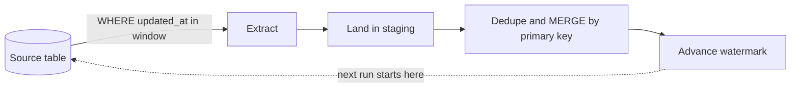

## 🎯 TL;DR

> **Batch ingestion** copies data from a source system into your platform on a schedule. The design questions are always the same: *which rows changed since the last run*, *how do we notice deleted rows*, and *what happens if a run is repeated*.

- **Full load** copies the whole table every time. It is simple and self-correcting, but its cost grows with the table.
- **Incremental load** copies only rows newer than a stored **high-water mark** (watermark). It is cheap, but it can miss late commits and it cannot see hard deletes.
- The fix for the blind spots is a **lookback window**, a periodic **reconciliation**, or moving to log-based [[cdc]] when freshness and delete history matter.
- Make every run **idempotent** (re-running it does not create duplicates), so retries and [[backfill]] runs are safe.

## 🌱 Start simple (Junior)

> **💡 Analogy:** Think of a library catalog that you copy to a branch library every night. Option 1: photocopy the whole catalog each night. Option 2: write down the date of your last copy, and each night copy only the cards that were added or edited since then. Option 2 is much faster, but if someone tore a card out, you will never notice unless you check.

Option 1 is a **full load**. Option 2 is an **incremental load**. Here is a small source table in an OLTP database (a transactional database that serves the application):

```sql
CREATE TABLE orders (
  id          bigint PRIMARY KEY,
  status      text        NOT NULL,
  amount      numeric(12,2) NOT NULL,
  updated_at  timestamptz NOT NULL DEFAULT now()
);
```

A full load reads everything:

```sql
SELECT id, status, amount, updated_at FROM orders;
```

An incremental load reads only what changed after the last run. We store the last point we reached in a small control table:

```sql
CREATE TABLE ingest_state (
  pipeline   text PRIMARY KEY,
  watermark  timestamptz NOT NULL
);

INSERT INTO ingest_state VALUES ('orders', '2026-10-13 09:00:00+00');
```

Each run follows three steps:

```sql
-- 1. read the high-water mark from the last successful run
SELECT watermark FROM ingest_state WHERE pipeline = 'orders';

-- 2. extract rows in a bounded window (lo = old mark, hi = the new mark we choose)
SELECT id, status, amount, updated_at
FROM orders
WHERE updated_at > '2026-10-13 09:00:00+00'
  AND updated_at <= '2026-10-13 10:00:00+00';

-- 3. after the target write has committed, move the mark forward
UPDATE ingest_state SET watermark = '2026-10-13 10:00:00+00' WHERE pipeline = 'orders';
```

Two details matter from day one. The window has an **upper bound**, so the run covers a fixed slice of time. And the mark moves **only after** the load has succeeded.

## 🔧 How it really works (Mid)

The usual shape of a batch pipeline is:



**Choosing the watermark column.**

- An **auto-increment id** works for inserts only. It cannot see updates to old rows.
- **`updated_at`** sees inserts and updates, but it depends on the application (or a trigger) setting it correctly, and on clocks.
- A **version or change counter** column is the most reliable when the source provides one.
- Always check that the watermark column is **indexed**. Without an index, every run is a full scan of the source table, which defeats the point of incremental loading.

**Extracting large tables.** Use keyset pagination instead of `OFFSET`, which gets slower on every page:

```sql
SELECT id, status, amount, updated_at
FROM orders
WHERE id > :last_id
ORDER BY id
LIMIT 10000;
```

**Loading into the target.** Staging rows are merged into the target by primary key, so a replayed batch overwrites the same rows instead of adding new ones. In PostgreSQL-style SQL:

```sql
-- staging may contain the same id twice (an order updated twice in one window):
-- keep only the newest version per id first
CREATE TEMP TABLE batch AS
SELECT DISTINCT ON (id) id, status, amount, updated_at
FROM staging.orders_batch
ORDER BY id, updated_at DESC;

INSERT INTO dwh.orders (id, status, amount, updated_at)
SELECT id, status, amount, updated_at FROM batch
ON CONFLICT (id) DO UPDATE
SET status     = EXCLUDED.status,
    amount     = EXCLUDED.amount,
    updated_at = EXCLUDED.updated_at;
```

The dedup step is not optional. `INSERT ... ON CONFLICT` fails if the same key appears twice in one statement, and MERGE statements in other engines have similar rules.

**The late-commit problem.** Suppose `updated_at` defaults to `now()`. In PostgreSQL, `now()` returns the **start** time of the transaction, not the commit time. Now take this timeline:

| Time | Event |
|---|---|
| 10:59:50 | Transaction T starts. It sets `updated_at = 10:59:50`. |
| 11:00:00 | Run R2 starts. Its window is `(10:00, 11:00]`. T is not committed, so R2 does not see the row. R2 moves the mark to 11:00:00. |
| 11:00:05 | T commits. The row now has `updated_at = 10:59:50`. |
| 11:15:00 | Run R3 reads `updated_at > 11:00:00`. The row is **never loaded**. |

A row can be lost forever. The fix is a **lookback window**: the next run starts at `watermark - N minutes` (for example 15 minutes). Some rows are read twice, and the idempotent merge makes that harmless.

**Deletes.** Query-based extraction cannot see a row that was hard-deleted from the source, because there is no row to select. Three common options:

1. **Soft delete** in the source (`deleted_at` column). Extract it like any update. Simple, but requires the application to cooperate.
2. **Periodic key reconciliation.** Extract only the primary keys (cheap) and find target rows that no longer exist in the source with an anti-join.
3. **Log-based CDC.** The delete appears in the log as an event. See [[cdc]].

**Full versus incremental, as a rule of thumb.** A full refresh is idempotent and easy to reason about, and it is often right for small dimension tables or tables under a few million rows. Incremental pays off when the table is large and the daily change rate is small. Many teams do both: incremental daily, plus a full reconciliation weekly.

## 🧠 Senior depth & trade-offs

- **Source load.** Extract from a read replica when possible. A big `SELECT` on the primary competes with the application. Schedule the extract away from peak traffic, and watch the replica lag: a lagging replica silently shifts what your watermark sees.
- **Clock and transaction semantics.** `updated_at` set by application servers depends on their clocks (skew of seconds is common). Set it in the database, or treat the watermark as "at least this old" and rely on the lookback.
- **Consistency across tables.** Extracting `orders` at 10:00 and `order_items` at 10:05 can give you items whose order is not yet in the warehouse. Use one snapshot for related tables (for example, a repeatable-read transaction on the replica), or accept eventual consistency and check it in a reconciliation job.
- **Schema drift.** `SELECT *` breaks silently when someone adds or renames a column. Prefer explicit column lists and a schema contract, and alert on new columns instead of loading them blindly.
- **Types and time zones.** Keep timestamps in UTC in storage and convert to local time (or a Jalali calendar) only in the reporting layer. Mixed time zones in the watermark are a classic source of skipped or duplicated windows.
- **Exactly-once is not required.** At-least-once extraction plus an idempotent merge gives the same result as exactly-once in the target. This is a much cheaper design than trying to make the extraction itself exact.
- **Monitoring.** Track rows per run, the lag between `now()` and the watermark, and the count of zero-row runs (a zero-row run after a busy day usually means a bug, not a quiet day). Reconcile daily counts and keys against the source, not only row totals.
- **When not to use it.** If you need sub-minute freshness, a full history of changes, or reliable deletes without cooperation from the application, move to [[cdc]].

## 🧪 Try it

Use the `orders` table from the beginning of this lesson.

1. The previous run's watermark is `2026-10-13 09:00:00+00`. Write the extract query for a run at `10:00:00+00` that uses a 10-minute lookback.
2. A job advances the watermark to `10:00`, then fails while loading. Explain what happens on the next run and how to reorder the steps.
3. The source hard-deletes rows. You have `dwh.orders` (the target) and a full key list `src_keys(id)` extracted from the source. Write a query that finds target rows that no longer exist in the source.

<details><summary>Show solutions</summary>

**1.**
```sql
SELECT id, status, amount, updated_at
FROM orders
WHERE updated_at > '2026-10-13 08:50:00+00'   -- 09:00 minus 10 minutes
  AND updated_at <= '2026-10-13 10:00:00+00';
```
The lookback reads some rows twice. The idempotent merge keeps the target correct.

**2.** The watermark already points to 10:00, so the next run starts after the failed window and those rows are **never loaded**. Advance the mark only after the target write commits, in the same transaction if the target and the state table share a database.

**3.**
```sql
SELECT t.id
FROM dwh.orders AS t
LEFT JOIN src_keys AS k ON k.id = t.id
WHERE k.id IS NULL;
```
Delete or flag those ids in the target, after checking that the key list is complete (a truncated key extract would look like mass deletion).

</details>

## 💬 Interview corner

**Question: "How would you ingest a daily-changing table from an OLTP database into the warehouse?"**

- **Mid answer:** "Incremental load using an `updated_at` watermark. Extract rows in the window, merge into the target by primary key, and advance the watermark after the commit."
- **Senior answer:** "Same core design, plus three guardrails. A lookback window for late commits, because `updated_at` can be older than the commit time. An idempotent merge, so retries and backfills are safe. A reconciliation job for deletes, which the watermark cannot see. I'd extract from a replica, use one snapshot for related tables, and alert on zero-row runs and count drift. If the business needs deletes or freshness under a few minutes, I'd switch to log-based CDC."

**Question: "What is the difference between a full load and an incremental load?"** A full load is simpler and self-correcting but costs grow with table size. An incremental load is cheap but depends on a correct watermark and does not see hard deletes.

> **🎤 Say this in the interview:** "I start with the watermark column and check it is indexed. I always assume late commits and hard deletes exist, so I design a lookback window and a reconciliation step from the start, and make the load idempotent so reruns are safe."

## ⚠️ Common mistakes

> **⚠️ Watch out:** Advancing the watermark before the load commits. A failure after that point silently skips the window.

> **⚠️ Watch out:** Trusting `updated_at` as the commit time. Long transactions set it early, so the row can appear behind your watermark.

- Believing an incremental load also captures deletes. It does not, unless you add a soft-delete flag or a key reconciliation.
- Using `OFFSET` pagination on a large table. Each page rescans the skipped rows.
- Running the first full load on the primary database during business hours.
- Using a non-unique or unindexed watermark column.
- Making the load append-only. A retry then creates duplicates, and a [[backfill]] doubles the data.
- Skipping the dedup step before `INSERT ... ON CONFLICT` or MERGE, which fails when one batch holds two versions of a key.

## ✅ Check yourself (quiz)

1. Which limitation is specific to query-based incremental extraction?
   - A) Merges are slow
   - B) Hard-deleted rows cannot be seen, because there is no row to select
   - C) It requires a message broker
   - D) It cannot read integer keys

<details><summary>Answer</summary>

**B** — the source no longer has the row, so a query for "rows changed since T" returns nothing for it. You need a soft-delete flag, a key reconciliation, or log-based [[cdc]].

</details>

2. A run advances the watermark to 10:00 and then fails during the load. What happens on the next run?
   - A) It reloads the window automatically
   - B) It starts after 10:00, so the failed window is never loaded
   - C) It creates duplicate rows
   - D) The watermark resets to the beginning of the table

<details><summary>Answer</summary>

**B** — the mark has already moved past the window. Move the watermark only after the target commit, and make the run restartable.

</details>

3. The daily job gets slower every month, even though the number of changed rows is about the same. What is the most likely cause?
   - A) The merge creates more indexes
   - B) The `WHERE updated_at > :mark` filter has no index, so each run scans the whole source table
   - C) Watermarks lose precision over time
   - D) The warehouse runs out of storage

<details><summary>Answer</summary>

**B** — the filter cost depends on the table size if the column is not indexed. Index it, or extract from a replica where the index exists.

</details>

4. **(Senior)** A transaction that set `updated_at` to 10:59:50 commits at 11:00:05. The run at 11:00 used the window ending at 11:00:00 and the next run starts at 11:00:00. Why is the row lost, and what is the fix?
   - A) The row is locked; wait for the next day
   - B) `updated_at` is earlier than the watermark, so incremental runs never see it; use a lookback window and an idempotent merge
   - C) The merge deleted it; disable deletes
   - D) Timestamps cannot be used as watermarks at all

<details><summary>Answer</summary>

**B** — a value committed later can carry an older timestamp than the mark. A lookback window re-reads recent rows, and the idempotent merge makes the extra reads harmless. You can also use a version column that increases at commit time, when the source provides one.

</details>

5. **(Senior)** You run the daily merge with `INSERT ... ON CONFLICT (id) DO UPDATE`, and it fails with "command cannot affect row a second time". What is the most likely reason, and how do you fix it?
   - A) The `id` column has no index
   - B) The batch contains two versions of the same `id`; keep one row per key (newest first) before the merge
   - C) `DO UPDATE` is not allowed on timestamps
   - D) The target table is too large

<details><summary>Answer</summary>

**B** — a single statement cannot update the same target row twice. Deduplicate the batch by key, keeping the latest version, as shown in the Mid section.

</details>

## 🗂️ Flashcards

| Front | Back |
|---|---|
| Full load vs incremental load | Full copies everything each run (simple, costs grow with size); incremental copies rows changed after a watermark (cheap, needs correctness) |
| High-water mark | The stored position (usually a timestamp or id) that marks how far the last successful run reached |
| Why use a lookback window? | Late commits can carry timestamps older than the mark; re-reading recent rows catches them |
| Can query-based extraction see deletes? | No. Use a soft-delete flag, key reconciliation, or log-based CDC |
| When should the watermark move? | Only after the target write commits |
| Why is keyset pagination better than OFFSET? | It seeks by the last key instead of rescanning skipped rows |
| What makes a batch load idempotent? | Merge by primary key, with deduplication inside the batch, so a rerun overwrites the same rows |
| Why index the watermark column? | Otherwise every run scans the full source table |

## 🔗 Go further

- **cdc** explains how log-based capture removes the delete and late-commit blind spots.
- **file-ingestion** covers the same problem when the source is a set of files rather than a table.
- **backfills** and **dedup-idempotent-loads** cover how to replay windows safely.
- **etl-vs-elt** explains where the transformation runs once the data lands.
- Read your source database's documentation on transaction timestamps (for example, what `now()` returns) before trusting any timestamp as a watermark.

