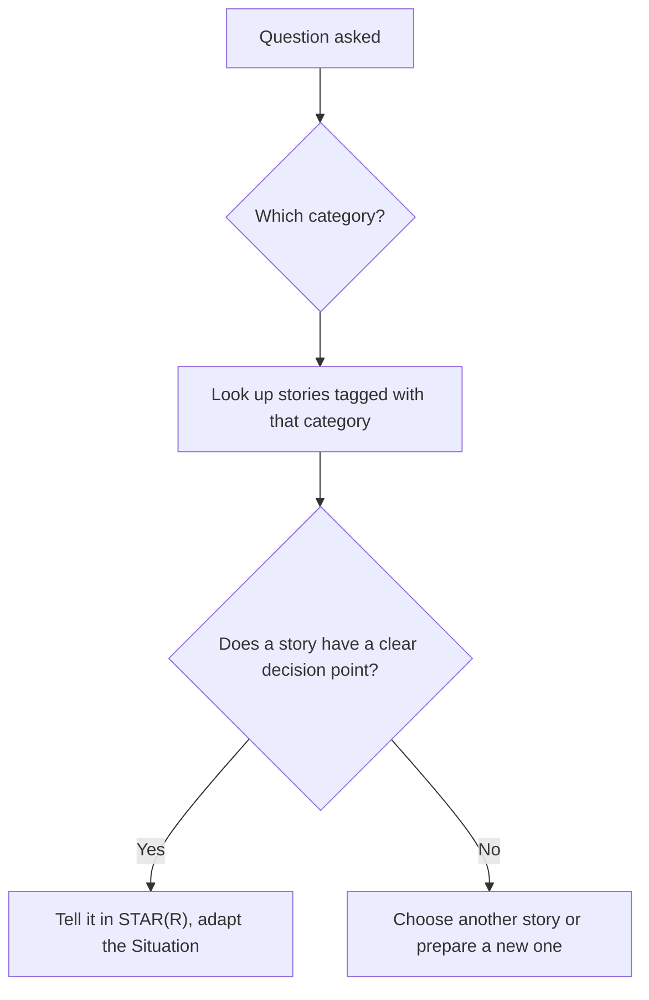

## 🎯 TL;DR

> Behavioral questions repeat. Most of them fall into about ten **categories**, and each category tests a small set of skills. Prepare **one strong story per category**, then adapt it to the exact wording.

- Ten categories cover most interviews: conflict, failure, a hard technical decision, disagree-and-commit, mentoring, influence without authority, deadline trade-offs, process improvement, unclear requirements, and saying no.
- Keep a **story bank**: one row per story, tagged with the categories it can answer.
- A single story can answer two or three categories if it has the right decision point. Do not use one story for all ten.
- Practise the answer aloud with the STAR(R) order, then check the Reflection and the trade-off.

## 🌱 Start simple (Junior)

> **💡 Analogy:** A story bank is like a toolbox. You do not need a new tool for every job, but you do need the right tool in the box. A toolbox with ten tools covers almost every repair. A toolbox with one hammer does not.

Interviewers ask "tell me about a time…" because they cannot watch you work. They want to see how you handle conflict, pressure, and mistakes, using a real example. The question is a request for evidence.

Here is the simplest way to prepare:

1. Read the ten categories below.
2. For each one, find a real situation from your work or study.
3. Write the story in the template at the end of this lesson.
4. Say it out loud in under two minutes.

You do not need a dramatic story. A small problem, handled well, is a good answer. A dramatic problem, handled badly, is a bad answer.

> **⚠️ Watch out:** Do not pick a story that makes a former colleague look like the villain. Describe the situation and your response. Interviewers care about how you behaved, not who was wrong.

## 🔧 How it really works (Mid)

Each category tests a different skill. The table shows what the interviewer is looking for and what a strong answer must show.

| Category | What is tested | Typical question | Strong answer must show |
|---|---|---|---|
| Conflict with a colleague or manager | Respect, communication, focus on outcome | "Tell me about a disagreement with a teammate." | Listening, facts, a shared goal, the result |
| A failure or production incident | Ownership, debugging, honesty | "Tell me about a time something broke in production." | Your action during the incident, the cause, the prevention |
| A hard technical decision | Trade-off thinking | "Describe a difficult technical choice you made." | Alternatives, criteria, the choice, the cost accepted |
| Disagreeing and committing | Judgement plus commitment | "When did you disagree with a decision, and what did you do?" | Your objection, the decision, and how you executed it fully |
| Mentoring someone | Multiplying others | "Tell me about helping someone grow." | A named person, a method, a visible outcome |
| Influencing without authority | Persuasion, data, relationships | "Tell me about getting a team to change its approach." | Evidence, stakeholders, the change that happened |
| Tight deadline trade-offs | Prioritisation, communication | "Tell me about a deadline you could not fully meet." | What you cut, who you told, what the risk was |
| Improving a process | Initiative, measurement | "Tell me about a process you changed." | The before problem, the change, the measured effect |
| Unclear requirements | Ambiguity handling | "How did you work with vague requirements?" | Questions asked, assumptions written down, a decision made |
| Saying no to a stakeholder | Judgement, negotiation | "Tell me about a time you declined a request." | The reason, the alternative offered, the relationship kept |

Use this flow to pick the right story from your bank:



**The story bank template.** Keep one row per story. Fill it as you go:

```text
STORY: [short name]
Situation (one line): [context, scale]
My decision point: [the choice I had to make]
Categories it answers: [pick 2 or 3 from the ten]
Alternatives I rejected: [what else I considered, and why not]
Result (number or before/after): [what changed, measured how]
Reflection: [what I would change next time]
People named (for follow-ups): [who was involved, and what they did]
```

**Worked example (illustrative, replace with your own).** The category is **saying no to a stakeholder**. The question: "Tell me about a time you declined a request from a senior stakeholder."

> **Weak answer:** "The VP wanted a new dashboard by Friday, but it was not possible, so I said no. It caused some tension, but the team understood in the end."

The weak answer has a decision but no reason, no alternative, no result, and no relationship repair. It sounds like a refusal, not a judgement.

> **Strong answer:** "**S:** A VP asked for a live revenue dashboard by Friday for a board review. Our streaming source would need two weeks of work to meet the freshness target. **T:** I owned the reporting pipeline; my goal was a useful answer for the board without breaking the data we already publish. **A:** I said no to the live version and gave two options with dates. Option one was a daily refresh by Friday, with a clear label on the timestamp. Option two was the live dashboard in two weeks. I shared a short note with the cost of each, and I asked the VP's analyst to check whether the daily version answered the board's question. It did. **R:** The board got a daily dashboard on Friday, and the live version shipped two weeks later with the same numbers. The VP later asked me to review the next request before he sent it. **Reflection:** I should have shared the freshness limit when the request first came up, not on the day it was due."

## 🧠 Senior depth & trade-offs (Senior)

Senior candidates are judged on **judgement** more than on the event. Prepare these moves for each category:

- **Name the trade-off, not only the action.** "I said no" is an action. "I said no because a live feed would have broken the reconciliation SLA for the other two reports" is judgement.
- **Show the second order effect.** What happened to the team, the stakeholder, or the system after your decision? Good answers include the follow-up work, such as a runbook or a new process.
- **Use calibrated language.** Say "about 30%" or "roughly two weeks" when you are not certain. Overclaiming is the fastest way to lose credibility on follow-ups.
- **Know the people.** For conflict and disagreement stories, be ready to say what the other person would say about the situation. Strong candidates describe the other side fairly.
- **Admit a real mistake.** A senior can describe their own error, its impact, and what they changed. A story with no fault is less believable at senior level.

**Balance the bank.** Interviewers often ask two questions from related categories in the same round. A bank with one story for "conflict" and one for "failure" is a good start, but also prepare a story from a different domain, such as a stakeholder or a mentoring story, so you are not repeating yourself.

**When not to use a story.** Hypothetical questions ("What would you do if your manager asked you to skip tests?") need a stated principle and a plan, not a memory. Say what you would do, what you would check first, and whom you would involve.

## 🧪 Try it

**Exercise 1: Map questions to categories.** For each question, name the category and one signal it tests.

- "Tell me about a time you had to push back on a design review comment."
- "Describe a release that went wrong, and what you did in the first hour."
- "How did you get the analytics team to adopt your data model?"

<details><summary>Solution</summary>

1. **Disagreeing and committing** (or conflict). Tests judgement and respect for the reviewer.
2. **A failure or production incident.** Tests ownership and the first-hour response (triage, communication, rollback).
3. **Influencing without authority.** Tests persuasion with evidence and stakeholder work.

Some questions fit two categories. Note both, because the same story may answer both.

</details>

**Exercise 2: Build a bank of five rows.** Pick five real situations from your work or study. For each, fill the story bank template, and tag each with the categories it can answer.

<details><summary>Solution</summary>

A complete row looks like this, for example:

- Story: "Late partner files". Decision point: add a sensor and an alert, or negotiate a contract. Categories: failure, influencing, process improvement. Result: late reports fell from weekly to nearly zero. Reflection: the contract should have come first.

A bank is complete when every row has a decision point, one number or before-after, and a reflection. A row with no decision point cannot answer a "hard decision" question, so tag it for a different category.

</details>

**Exercise 3: Rewrite a weak answer.** Rewrite this answer so it shows a decision, an alternative, and a result:

> "I worked with my manager on a difficult task and we got it done. It was stressful, but the team was happy."

<details><summary>Solution</summary>

A strong rewrite names the decision, your part, and the measured outcome. For example:

"My manager wanted to ship the new ingestion path in one week, which would have skipped the duplicate check. I proposed shipping the core path in a week, with the duplicate check behind a flag, and I wrote the test that proved the flag was safe. We shipped on time, and the duplicate check went live the following week, after a 10-day run with no duplicates in the sample."

The rewrite still has the uncertainty ("10-day run") and a clear role for the candidate. Keep the facts you can defend in a follow-up.

</details>

## 💬 Interview corner

> **🎤 Say this in the interview:** "Tell me about a time you disagreed with your manager." Pick the story with the clearest decision point, and make your own position and your commitment after the decision equally visible.

**Mid-level model answer (short):** "My manager wanted to move our batch job to a new scheduler in one sprint. I thought the testing was not enough, so I listed the three risks and asked for one more week of parallel runs. We agreed on the week, the parallel run found a timezone bug, and after the fix we moved on schedule. I then supported the migration fully, including the on-call handover."

**Senior-level model answer (short):** "I disagreed with a plan to drop the old warehouse tables on migration day, because two finance reports still read them and the inventory was incomplete. I put the dependency list and the cost of a wrong guess in a one-page note and proposed a 30-day read-only period. My manager accepted it with one change: a named owner for each report. We found three hidden consumers in that window. Once the decision was made I ran the migration with the same care I would have given my own plan, and the cutover finished on the agreed date."

## ⚠️ Common mistakes

- **Using one story for everything.** Interviewers notice the repetition, and the story does not fit every question.
- **Choosing stories with no decision.** A story about "a hard week" does not answer "a hard decision".
- **Blaming the other party.** Describe their position fairly and focus on your response.
- **Missing the result.** Without an outcome, the story stops mid-way.
- **Overclaiming.** "I single-handedly saved the company" fails at the first follow-up question.
- **Ignoring the question.** If you were asked about a conflict, do not tell a story about a failure, even if it is a better story.
- **Memorising word-for-word.** Know the facts and the decision, then speak naturally.

## ✅ Check yourself (quiz)

1. Which category does this question belong to? "Tell me about a time you could not finish everything before a launch."
   - A) Mentoring someone
   - B) Tight deadline trade-offs
   - C) Improving a process
   - D) Unclear requirements

<details><summary>Answer</summary>

**B** — the question is about choosing what to cut under a deadline and communicating the risk. The other categories do not test that trade-off.

</details>

2. A story has a clear decision and a result, but no Reflection. What is the best fix?

   - A) Remove the decision and keep the result
   - B) Add one sentence on what you would change next time, and what you learned
   - C) Make the Situation longer
   - D) Add a second story to the same answer

<details><summary>Answer</summary>

**B** — the Reflection shows growth and prepares you for the "what would you change?" follow-up. It is usually one or two sentences.

</details>

3. Which skill does a "disagreeing and committing" question test most directly?

   - A) Speed of typing
   - B) Judgement combined with commitment after the decision
   - C) Knowledge of a specific tool
   - D) Number of years of experience

<details><summary>Answer</summary>

**B** — the strong answer shows that you raised a real objection with evidence, and that you executed the decision fully afterwards, even if it was not your preference.

</details>

4. **(Senior)** An interviewer asks, "What would you do if your manager asked you to skip tests before a release?" Which response is strongest?

   - A) "I would do it, because managers know best."
   - B) "I would refuse and leave the team."
   - C) "I would state the risk in writing, propose the smallest test set that covers the critical path, and ask for an explicit decision with the owner's name on it."
   - D) "I would skip the tests and hope nothing breaks."

<details><summary>Answer</summary>

**C** — it names the risk, proposes a practical compromise, and makes the decision explicit. This is judgement under pressure, without drama or silent risk-taking.

</details>

## ✅ Self-assessment checklist

- [ ] I have at least one story for each of the ten categories
- [ ] Every story has a decision point and a result with a number or before-after
- [ ] Each story is tagged with two or three categories it can answer
- [ ] I can tell each story in under two minutes using STAR(R)
- [ ] I can name the trade-off and one rejected alternative for each story
- [ ] I can answer a follow-up on any detail I mention
- [ ] None of my stories makes a former colleague a villain

## 🗂️ Flashcards

| Front | Back |
|---|---|
| How many categories are there in this bank? | Ten, covering most behavioral interviews |
| What is a story bank? | A set of stories, one row each, tagged with the categories they answer |
| Why not use one story for all questions? | Interviewers notice, and one story does not fit every category |
| What makes a story usable for a "hard decision" question? | A clear decision point with a real alternative |
| What does "disagree and commit" test? | Judgement before the decision and full commitment after |
| What is the risk of overclaiming? | Follow-up questions expose it and damage credibility |
| How do you handle a "what would you do?" question? | State the principle, the first checks, and whom you would involve |

## 🔗 Go further

- [[star-framework]] explains the answer structure used in every category.
- [[senior-signals]] lists the signals that these answers should reveal at senior level.
- [[project-narratives]] shows how to prepare the deeper project stories that many behavioral answers draw from.
- [[interview-loop]] explains where behavioral rounds sit in a typical process.
- [[negotiation-iran]] covers how the saying-no and trade-off skills apply when negotiating an offer package.
