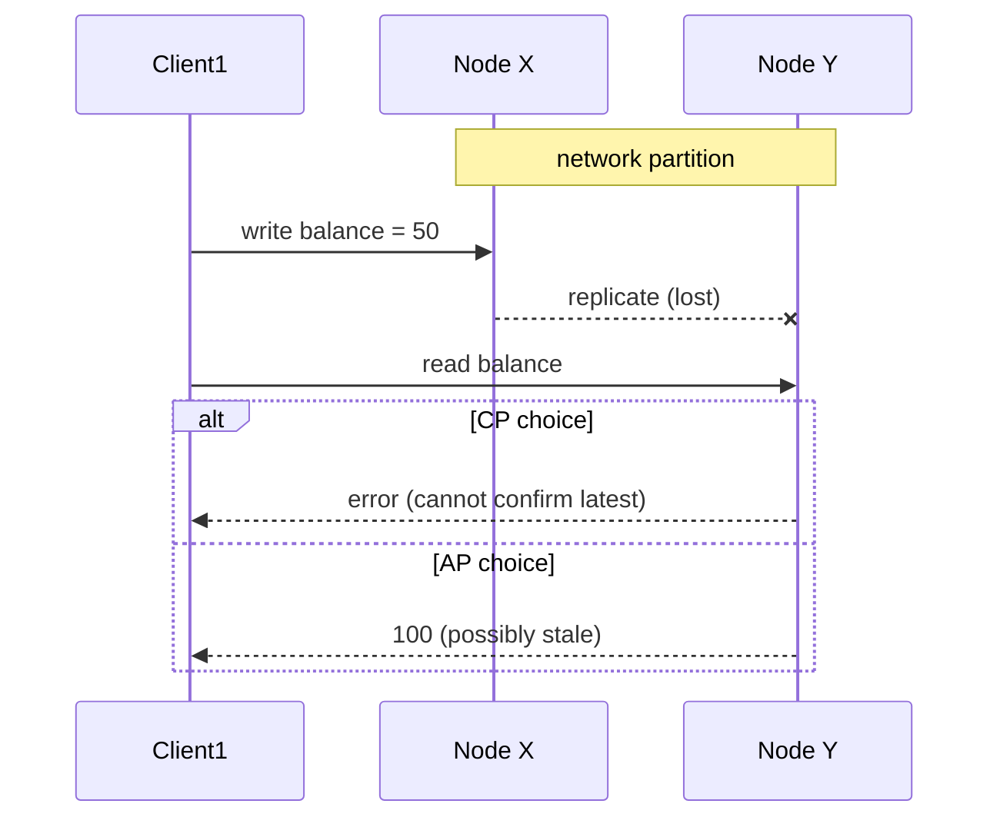

## 🎯 TL;DR

> **CAP** says that when the network splits a system in two, it must give up either **consistency** (answering with possibly stale data) or **availability** (refusing to answer). **PACELC** adds the normal case: when there is no partition, you still trade **latency** against **consistency**.

- CAP is about what happens **during a network partition**. Partitions are rare, but they are not optional, so "pick any two of three" is the wrong mental model.
- CP systems refuse some requests to stay correct. AP systems answer everything and reconcile later.
- The "C" in CAP is linearizability, not the "C" in ACID.
- Replication is where the latency cost comes from: waiting for copies costs time.

## 🌱 Start simple (Junior)

> **💡 Analogy:** Two branches of a bank lose their phone line. A customer withdraws money in each branch. Option 1: both branches keep serving, but they might both give out the same balance (the system stays available but can be wrong). Option 2: each branch refuses withdrawals until the line returns (the system stays correct but some customers are turned away).

That is the whole idea. A **partition** is the broken phone line: nodes are running, but they cannot talk to each other.

- **Consistency (C):** every read returns the most recent write, or an error. Everyone sees one up-to-date value.
- **Availability (A):** every request to a working node gets a response (not an error), though the data might be old.
- **Partition tolerance (P):** the system keeps going even when messages between nodes are lost.

During a partition you must choose between C and A. You cannot have both for the same data.

## 🔧 How it really works (Mid)

Two copies of a key `balance` live on nodes X and Y. The network between them breaks.

**CP** systems make the side that cannot reach a quorum stop serving the operation. **AP** systems keep both sides answering and repair differences later (for example with timestamps, vector clocks or read repair).

Real systems make this choice per component and sometimes per operation:

| System or setting | Behaviour during a partition | Notes |
|---|---|---|
| ZooKeeper, etcd (Raft-based) | CP: the minority side cannot process writes or linearizable reads | Used for coordination and metadata |
| Kafka, `acks=all` with `min.insync.replicas` set | Producer fails if too few replicas are in sync | Favours not losing acknowledged data over availability |
| Kafka, `unclean.leader.election.enabled=true` | An out-of-sync replica can become leader | Favours availability; acknowledged messages can be lost |
| Cassandra with tunable levels (`ONE`, `QUORUM`, `ALL`) | Chosen per query | Low levels lean AP; higher levels lean CP |

For a quorum system with `N` replicas, a write acknowledged by `W` replicas and a read from `R` replicas overlap when `R + W > N`. With `N = 3`, `W = 2`, `R = 2`, every read touches at least one replica that has the latest acknowledged write. That is not full linearizability under concurrent writes, so do not promise more than the docs say for your version.

**PACELC in practice.** Assume three replicas in different regions, and a 120 ms round trip between regions.

- **Synchronous replication:** a write waits for remote acknowledgement. Each write takes at least 120 ms. Ten sequential writes take at least 1.2 s. The reward is that a read from any replica is up to date.
- **Asynchronous replication:** a write returns after the local commit, in a few milliseconds. A read from a remote replica can miss the latest write.

That trade-off exists even when nothing has failed. That is the "ELC" part of PACELC.

## 🧠 Senior depth & trade-offs

- **CAP is about one operation on one data item.** A system can offer different guarantees per operation: strong reads for balances, eventual reads for a product catalogue. Ask "which operation, which key" before you say "CP" or "AP".
- **Partitions are more common than they sound.** They include dropped packets, a stalled NIC, a cross-AZ link problem, or a node frozen by GC that the rest of the cluster treats as gone. Design for them as a normal event.
- **Latency is a consistency price tag.** Quorum reads, synchronous replicas and cross-region commits all add round trips. Put a number on it before choosing: multiply the RTT by the number of sequential round trips per request.
- **Data platforms in practice.**
  - *Serving layer* (Cassandra, replicated Redis, read replicas of PostgreSQL): dashboards tolerate a few seconds of lag, but a balance check does not. Pick the read level per query.
  - *Lakehouse tables* (Iceberg, Delta): commits rely on an atomic swap of the table's metadata pointer through a catalog. A conflicting commit fails and is retried, so the table never splits. That is a consistency-first design.
  - *Coordinators* inside OLAP and streaming systems (metadata services, controllers) are normally consensus-based, which means CP.
- **What to monitor.** Replica lag, under-replicated partitions, failed produce or write rates, quorum failures, and stale-read rates where you measure them.
- **When not to pick AP.** Money, inventory and identity uniqueness usually need strong guarantees. When not to pick strong consistency: high-volume analytics where five-minute-old data is fine, because the latency bill is real.

## 🧪 Try it

1. A three-node cluster has `N = 3`. Pick `W` and `R` so that reads always overlap writes, and say which of the two you would make larger if writes must be fast.
2. An e-commerce site shows the number of items in stock on the product page, and it also charges the card at checkout. Assign CP or AP to each operation and justify it in two sentences.
3. Cross-region synchronous replication has a 150 ms round trip. A job makes 40 sequential writes. How long is the minimum time added by replication?

Show solutions

**1.** Any choice with `R + W > 3` works, for example `W = 2, R = 2`, or `W = 3, R = 1`. If writes must be fast, keep `W` small (for example `W = 1` or `2`) and make `R` larger. Note that `W = 1, R = 3` also satisfies `R + W > N`, but it makes every read wait for all three replicas.

**2.** The stock count can be AP: showing "about 3 left" slightly out of date is acceptable, and the page stays up. Charging the card should be CP: two buyers must not both get the last item, and a payment must not be double-processed. The checkout step should use a strongly consistent reservation, while the product page uses a cached count.

**3.** Each write waits one round trip: 40 × 150 ms = 6,000 ms, so at least 6 s of added time from replication alone.

## 💬 Interview corner

**Question: "CAP: which two do you pick?"** Mid answer: "CP or AP, depending on whether the system needs consistency or availability." Senior answer: "The real choice appears only during a partition. I'd ask which operation and which data, then choose CP for the balance check and AP for the catalogue. Outside partitions, PACELC says I still trade latency against consistency, so I'd measure the round trips before I decide."

**Question: "Is Cassandra CP or AP?"** Mid: "AP." Senior: "It depends on the consistency level per query. At `ONE` it behaves like an AP system. At `QUORUM` reads and writes it gives overlap for stronger reads, and I'd state that this is not full linearizability under concurrent writes."

> **🎤 Say this in the interview:** "CAP only forces a choice during a partition, and I make it per operation. Without a partition I still pay latency for consistency, so PACELC is the more useful model day to day."

## ⚠️ Common mistakes

> **⚠️ Watch out:** "CA" is not a real option for a distributed system. A single-node database has no partition to tolerate, so it is not what CAP is about.

- Saying "pick two of three" as a permanent rule rather than a choice during a partition.
- Reading "availability" as "99.9% uptime". In CAP it means every non-failed node answers every request.
- Confusing CAP consistency (linearizability) with ACID consistency (invariants inside a transaction).
- Calling a whole system CP or AP without naming the operation.
- Ignoring PACELC: the latency cost is paid on every request, not only during failures.

## ✅ Check yourself (quiz)

1. In CAP, what does "P" (partition tolerance) mean?
   - A) The system splits its data into partitions for scale
   - B) The system keeps working when messages between nodes are lost
   - C) The system can be partitioned by a SQL `PARTITION BY` clause
   - D) The system tolerates a crashed disk

Answer

**B** — a partition is a broken network link between nodes. Partition tolerance means the system keeps running through it. In a real distributed system, you cannot opt out of it.

2. A ZooKeeper ensemble of five nodes is split 3 and 2. What happens to the 2-node side?
   - A) It keeps accepting writes and merges later
   - B) It stops processing writes because it cannot reach a majority
   - C) It becomes the leader because it has fewer nodes
   - D) Nothing changes, because reads are always local

Answer

**B** — ZooKeeper is CP. Writes need a majority, so the minority side refuses them rather than risk diverging.

3. **(Senior)** Kafka topic data is produced with `acks=all` and `min.insync.replicas=2`, and only one replica is in sync. What is the expected behaviour?
   - A) The write succeeds on the one replica
   - B) The producer gets an error, so the system favours not losing acknowledged data over availability
   - C) The broker silently drops the message
   - D) The replica becomes the leader without any data check

Answer

**B** — with fewer in-sync replicas than the minimum, the broker rejects acknowledged writes. That is a consistency-first choice. Enabling unclean leader election would move the system toward availability.

4. **(Senior)** Your replicas are in two regions with a 100 ms round trip. Which statement about PACELC is correct?
   - A) PACELC only matters when a partition happens
   - B) Synchronous replication adds latency even when nothing has failed, which is the ELC trade-off
   - C) Asynchronous replication always gives the same reads as synchronous replication
   - D) Latency is never a consistency issue

Answer

**B** — PACELC covers the normal case too. Waiting for a remote acknowledgement costs round trips on every write, and that is the price of stronger reads.

5. **(Senior)** Why is "CA" a poor label for a distributed database?
   - A) Because CA databases are always slow
   - B) Because a distributed system cannot avoid partitions, so the real choice is between C and A during one
   - C) Because CA databases cannot store numbers
   - D) Because CAP was proven only for two nodes

Answer

**B** — a system that spans machines will see partitions eventually. A "CA" label hides the choice you actually make when that happens.

## 🗂️ Flashcards

| Front | Back |
|---|---|
| What does CAP's "C" mean? | Linearizability: every read sees the latest write, or the system errors |
| What does CAP's "A" mean? | Every non-failed node answers every request, possibly with stale data |
| When does the CAP choice apply? | Only during a network partition |
| What is PACELC's "ELC"? | Without a partition, choose latency or consistency |
| Example of a CP system | ZooKeeper or etcd: the minority side refuses writes |
| R and W quorum condition | `R + W > N` so reads overlap the latest acknowledged write |
| Why is "CA" misleading? | A distributed system cannot avoid partitions |

## 🔗 Go further

- **consistency-models** lists the spectrum from linearizable to eventual, which is what "C" really asks about.
- **consensus** explains why coordinators such as ZooKeeper and etcd choose CP.
- **replication** covers synchronous, asynchronous and quorum replication, where the latency cost comes from.
- **distributed-transactions** shows the cost of coordinating across services and why sagas trade consistency for availability.
- **kafka-producers** explains `acks` and `min.insync.replicas` in detail.
- The PACELC paper by Daniel Abadi (2012) is the short original source. Read it once.
