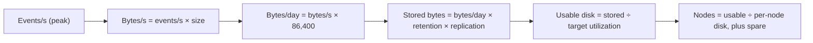

## 🎯 TL;DR

> **Capacity planning** turns a business volume into hardware: how much CPU, RAM, disk and network the system needs, with room for growth and for failures. The method is always the same chain: **events per second → bytes per second → bytes per day → × replication × retention → ÷ target utilization → nodes, plus spares.**

- Use **decimal units** and write them down (1 TB = 1000 GB). Mixing 1000 and 1024 is a classic source of 7–10% error.
- **Replication** multiplies storage and write traffic. **Retention** multiplies storage. **Target utilization** (for example 70% of disk) keeps room for spikes and recovery.
- Always size for **peak**, not average, and for **the year you will be at**, not today.
- Survive one failure: N+1 nodes, or a plan for how the cluster behaves when one node is lost.
- Measure your real throughput, compression ratio and per-core speed. The numbers in this lesson are assumptions to show the arithmetic.

## 🌱 Start simple (Junior)

> **💡 Analogy:** Planning a parking lot. You do not build for the average day. You count the cars per hour, how long each stays, the busy hours, and you leave spaces empty so that the lot does not jam when it is full. Data platforms are parking lots for bytes.

Here is the question every senior gets: *"We receive 50,000 events per second. How many servers do we need?"* Before answering, you need four facts:

| Fact | Example value | Why it matters |
|---|---|---|
| Events per second | 50,000 (peak 3× → 150,000) | Drives network and CPU |
| Size of one event | 1 KB | Turns events into bytes |
| How long to keep it | 7 days | Multiplies disk |
| Copies | 3 (replication) | Multiplies disk and write traffic |

Multiply them and you have a first answer. The rest of the lesson is about making that answer safe.

Quick unit check, because it trips people up:

```text
1 KB  = 1,000 bytes      (we use decimal units throughout)
1 MB  = 1,000 KB
1 GB  = 1,000 MB
1 TB  = 1,000 GB
```

If you use 1024 in one place and 1000 in another, your final number is off by a few percent, and that can change the number of servers you buy.

## 🔧 How it really works (Mid)

### The sizing chain



Each system has its own bottleneck, so you do this for each resource and take the largest result.

### Example 1: Kafka for the event stream

Assumptions (replace with your measurements):

- Average load: 50,000 events/s, 1 KB each → **50 MB/s** ingress.
- Per day: 50 MB/s × 86,400 s = 4,320,000 MB = **4.32 TB/day**.
- Replication factor 3 → **12.96 TB/day** on disk.
- Retention 7 days → 12.96 × 7 = **90.72 TB** stored in the cluster.
- Target utilization 70%, so usable disk must be 90.72 ÷ 0.70 = **129.6 TB**.
- Each broker offers 12 TB usable. 129.6 ÷ 12 = 10.8, so **11 brokers** for storage.

Now throughput. Every byte is written once by the leader and twice more by followers, so disk write traffic is 3 × 50 = **150 MB/s** cluster-wide. If a load test shows a broker sustains about 24 MB/s at comfortable utilization, then 150 ÷ 24 = 6.25, so **7 brokers** are enough for throughput. Storage is the binding constraint here.

Last, failure. With 11 brokers, losing one means the remaining 10 hold the same 90.72 TB, which is 90.72 ÷ (10 × 12) = 75.6% utilization during re-replication, above our 70% target. Adding one spare gives 12 brokers: normal utilization is 90.72 ÷ 144 = 63%, and after one loss it is 90.72 ÷ 132 = **68.7%**, which stays under the target. **Answer: 12 brokers.**

### Example 2: Spark nightly batch

A nightly job reads **2 TB** of compressed Parquet and must finish in **1 hour**.

- Required scan rate: 2,000,000 MB ÷ 3,600 s = **556 MB/s**.
- Assume (measured) 50 MB/s per core. 556 ÷ 50 = 11.1, so **12 cores** for the scan alone.
- Shuffle, skew and retries cost time. Double it for headroom: **24 cores**, which is six executors with four cores each.

The 2× factor is not a magic number. It is a stated margin, and in an interview you should say why you chose it.

### Example 3: ClickHouse for analytics

The same 4.32 TB/day of raw events goes into ClickHouse for 90 days of analytics.

- Assumed compression ratio 8:1 (measure it on your data): 4.32 ÷ 8 = **0.54 TB/day** (540 GB).
- 90 days: 0.54 × 90 = **48.6 TB**.
- Replication factor 2: 48.6 × 2 = **97.2 TB**.
- Target utilization 70%: 97.2 ÷ 0.70 = **138.9 TB** usable disk to buy.

Note that ClickHouse needs far less disk per day than Kafka here, because the stored form is compressed (8:1 assumed) while Kafka keeps raw bytes for replay. That difference is exactly why you size each system separately.

### Growth

If volume grows 50% per year, the year-3 volume is 1.5³ = 3.375× today. The Kafka storage above becomes 90.72 × 3.375 = **306 TB** stored by year 3. Decide whether you buy for year 1 and expand, or for year 3 up front. On-premises hardware usually has long lead times, so the answer is often "size for year 2 and plan the expansion path now".

## 🧠 Senior depth & trade-offs

- **Peak vs average.** Traffic is rarely flat. If the peak is 3× the average, size throughput and CPU for the peak, but storage for the average-plus-retention, because storage accumulates and peaks do not.
- **Headroom is a policy, not a guess.** The 70% disk target exists so that compaction, re-replication, and a node failure do not fill the disk. For Kafka and ClickHouse, merges and rebalancing need free space. Write the number down and justify it.
- **Replication is a cost decision.** RF=3 gives you tolerance for two lost replicas, but multiplies storage and write traffic by 3. For a derived copy that can be rebuilt from source, RF=2 or object storage may be the right trade.
- **Memory is about the hot set.** Kafka brokers serve recent data from the OS page cache, and ClickHouse and Spark do best when the working set fits in memory. Size RAM for the data consumers read repeatedly (the last hour, the hot partitions), not for the whole retention.
- **CPU depends on the work.** Compression, serialization and aggregation are CPU-heavy. Measure CPU per million events in a realistic test rather than trusting a generic rule of thumb.
- **Network is shared.** Replication, consumers, and the Spark shuffle all cross the same NICs. A 10 Gbps link fully used for replication has no room for consumers. Plan network per role and check the switch uplinks.
- **Object storage vs local disk.** Object storage (see [[data-lake-object-storage]]) separates capacity from compute, so you can size storage and compute independently. Local disks are faster for the hot path but tie capacity to nodes. Choose per system, and state the trade-off.
- **Cost is a formula.** Monthly cost ≈ (storage TB × price per TB-month) + (compute hours × price per hour) + (egress and support). On-premises: amortize hardware over its useful life (for example, 4 years) and add power, rack space and staff time. Bring the same formula to every design, so you can compare cloud and on-prem fairly.
- **On-prem realities.** In Iran, hardware lead times, disk pricing and import constraints (see [[onprem-iran]]) change the answer. A design that needs 40% more disk may be a months-long procurement, which is itself a capacity risk.
- **Validate with a load test.** Spreadsheets give the first answer; a load test gives the real one. Measure throughput per broker and per core, the real compression ratio, and recovery time after killing a node.
- **Sanity-check the answer.** If your design says 400 Kafka brokers for a 50 MB/s stream, something is wrong. Compare with the order of magnitude of the numbers you know: a few brokers handle tens to hundreds of MB/s, and a single disk is a few TB. Mistakes of 10× are common and cheap to catch early (see [[numbers-to-know]]).

## 🧪 Try it

Size the storage for a stream of **20,000 events/s**, average event **2 KB**, replication factor **3**, retention **14 days**, target utilization **60%**, each broker with **10 TB** usable disk. Use decimal units.

1. How many TB of data are written per day, before replication?
2. How many brokers are needed in steady state?
3. How many brokers do you need so that after losing one broker, utilization stays at or below 60%?

<details><summary>Your guess?</summary>

1. 20,000 × 2 KB = 40,000 KB/s = **40 MB/s**. Per day: 40 × 86,400 = 3,456,000 MB = **3.456 TB/day**.
2. With replication: 3.456 × 3 = 10.368 TB/day. Retention: 10.368 × 14 = **145.152 TB** stored. Usable needed at 60%: 145.152 ÷ 0.6 = **241.92 TB**. Brokers: 241.92 ÷ 10 = 24.19, so **25 brokers**. (Steady-state utilization with 25 brokers: 145.152 ÷ 250 = 58%.)
3. With 25 brokers, losing one leaves 24 × 10 = 240 TB, and 145.152 ÷ 240 = **60.5%**, just above the target. With **26 brokers**, the surviving 25 nodes give 145.152 ÷ 250 = 58.1%, which is under 60%. **Answer: 26 brokers.**

</details>

## 💬 Interview corner

**Typical question:** "How many servers do you need for this volume?"

- **Junior answer:** "Maybe 3 or 4 machines, because it is not that much data."
- **Mid answer:** "I convert events per second into bytes per second, multiply by retention and replication, and divide by the usable disk per node. I then check throughput separately."
- **Senior answer:** "I do the sizing chain per resource and take the largest. I size throughput for the peak and storage for retention, add a utilization target of around 70% for merges and recovery, and add one spare node so the cluster survives a failure. I state the assumptions, like compression and per-core throughput, and validate them with a load test before buying."

> **🎤 Say this in the interview:** "I start from the volume: events per second times size gives bytes per second. Storage is that times retention times replication, divided by a 70% utilization target, so there is room for merges and recovery. I size throughput separately, at peak, and take the largest of the results plus one spare node. The numbers are assumptions I would verify with a load test before buying, because they drive the cost."

## ⚠️ Common mistakes

> **⚠️ Watch out:** Forgetting replication. The most common error is sizing disk for the raw data and forgetting that RF=3 triples it.

- **Sizing for the average.** A system that is fine at 40,000 events/s fails at the 150,000 peak. Always state which load you sized for.
- **Mixing 1000 and 1024.** It changes the answer by several percent. Pick decimal, write it down, and keep it.
- **Forgetting headroom.** A disk at 98% cannot merge, rebalance or recover. Plan utilization, not raw capacity.
- **Ignoring the failure case.** A cluster sized exactly for steady state will be overloaded the day one node dies.
- **Taking the compression ratio from a blog post.** Compression depends on your data. Measure it on a sample.
- **One number for all systems.** Kafka storage, Spark CPU and ClickHouse disk have different bottlenecks. Size each one.
- **No growth.** A design that fits today and needs a rebuild in 12 months is not a good design, especially for on-prem hardware.

## ✅ Check yourself (quiz)

1. A stream is 10 MB/s with replication factor 3. What is the cluster-wide write traffic to disks, counting each replica once?
   - A) 10 MB/s
   - B) 20 MB/s
   - C) 30 MB/s
   - D) 3 MB/s

2. Retention is 7 days, the stream writes 1 TB/day before replication, RF=3, and you target 70% utilization. How much usable disk do you need?
   - A) 21 TB
   - B) 10 TB
   - C) 21 ÷ 0.7 = 30 TB, rounded from 3 × 7 = 21 TB stored
   - D) 7 TB

3. Which resource is usually the binding constraint for a Kafka cluster with long retention?
   - A) CPU
   - B) Disk capacity
   - C) GPU memory
   - D) DNS lookups

4. **Scenario (senior):** A colleague sized a Spark job as "2 TB in one hour, so 2 TB ÷ 3,600 s, done." What is missing from this estimate, and how would you correct it?

5. **Why/trade-off (senior):** Your team wants RF=3 for a derived analytics table that can be rebuilt from the source in a day. What would you propose instead, and what do you give up?

<details><summary>Answer</summary>

1. **C** — Each byte is written once by the leader and twice by followers: 10 × 3 = 30 MB/s of disk writes across the cluster.
2. **C** — 1 TB/day × 7 days = 7 TB, times RF 3 = 21 TB stored, divided by 0.7 gives 30 TB usable. A skips the headroom, and B and D skip replication, headroom, or both.
3. **B** — Long retention means a lot of stored data. Disk capacity, often together with utilization headroom, usually sets the cluster size, while throughput or CPU may only matter at peak.
4. The estimate uses raw input and ignores per-core throughput, the measured speed of your cluster, shuffle and skew overhead, retries, and a safety margin. The correction: measure throughput per core, compute cores for one hour, then add margin for shuffle and skew (for example 2×) and state the assumption.
5. Propose RF=2, or keep the table in object storage (where durability is handled by the storage layer) and rebuild from source if needed. You give up some durability margin and the instant failover of an extra replica, so you accept a longer recovery for a table that is cheap to rebuild. For a table that is expensive or impossible to rebuild, RF=3 stays the right choice.

</details>

## 🗂️ Flashcards

| Front | Back |
|---|---|
| Sizing chain | events/s × size → bytes/s → bytes/day × retention × replication ÷ target utilization → nodes + spare |
| Why 70% utilization | Leaves room for merges, rebalancing and recovery after a node failure |
| Replication effect on disk | Multiplies stored bytes by RF and write traffic by RF |
| Peak vs average | Size throughput and CPU for peak; storage follows the accumulated average |
| N+1 sizing | Plan so that the cluster still meets targets after losing one node |
| Compression ratio | Must be measured on your own data; never assume it from a blog |
| Year-3 growth at 50%/year | 1.5³ = 3.375× today's volume |
| Cost formula | storage cost + compute cost + egress/support; amortize hardware for on-prem |

## 🔗 Go further

- [[data-estimation]] — the general method for back-of-envelope estimates in system design.
- [[numbers-to-know]] — the order-of-magnitude numbers that catch 10× mistakes.
- [[kafka-architecture]] and [[kafka-retention-compaction]] — how partitions, replicas and retention drive broker count and disk.
- [[spark-memory-tuning]] and [[spark-shuffle]] — where Spark's memory and network go, and why headroom matters.
- [[data-retention]] — tiering and deletion policies that reduce the storage you must buy.
- [[onprem-iran]] — hardware lead times, disk prices and the cost of being wrong on-premises.
