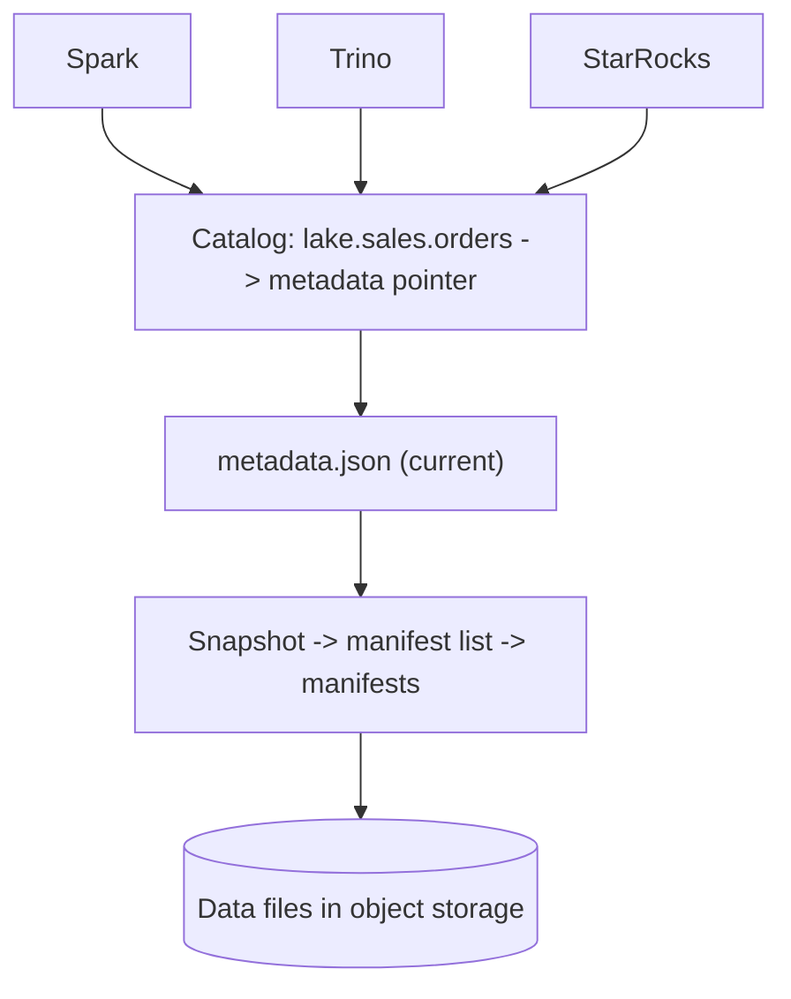

## 🎯 TL;DR

> A **catalog** (metastore) is the directory that maps a table name to **where its current metadata lives** and **who may change it**. In a lakehouse, it is the one place where several engines agree on what the current version of a table is.

- The table's data files and metadata files sit in object storage; the catalog only holds a **pointer** to the current metadata.
- A **commit** is an atomic swap of that pointer. This single compare-and-swap is what makes concurrent writers safe.
- Common options: **Hive Metastore (HMS)**, **AWS Glue**, **REST catalogs** (Iceberg REST spec, implemented by Polaris, Nessie, Unity Catalog and others), and **Nessie** (git-like branches and tags for data).
- Multi-engine access (Spark writes, Trino and StarRocks read) only works when all engines point at the same catalog.

## 🌱 Start simple (Junior)

> **💡 Analogy:** A library has books on shelves (data files) and an index card for each title (metadata). The card says "the current edition of *Data Engineering* is on shelf 4, box 12, edition 7". When a new edition is printed, the librarian changes the card in one step. Readers who check the card always get a consistent edition. The card catalogue is the **catalog**.

Without a catalog, each engine has to guess. Consider this path:

```text
s3://lake/warehouse/orders/metadata/00007-9f3c.metadata.json   <- current version?
s3://lake/warehouse/orders/metadata/00006-1a2b.metadata.json
s3://lake/warehouse/orders/data/part-0001.parquet
```

Which metadata file is current? If two Spark jobs write at the same time, both might write `00007` and one overwrites the other. The catalog exists to answer "which file is current?" and to refuse the second writer when it would overwrite the first.

A catalog gives you three things:

1. **Names.** `lake.sales.orders` is easier to share than a path.
2. **One current version.** Every engine asks the same place.
3. **Access rules.** Who can read or write the table.

## 🔧 How it really works (Mid)

### Catalog vs table format

The **table format** (Iceberg, Delta, Hudi) defines the metadata files, snapshots and manifests. The **catalog** stores the name and the pointer to the current metadata. They are separate layers:



Engines read the pointer, then follow the metadata tree to the data files. Writers create new files first, then ask the catalog to switch the pointer.

### How a commit works (optimistic concurrency)

1. The writer reads the current metadata pointer (say version 6).
2. It writes new data files and a new metadata file (version 7). Nothing is visible yet.
3. It asks the catalog: "switch the pointer from version 6 to version 7", as one **compare-and-swap**.
4. If the pointer is still version 6, the switch succeeds and readers see version 7.
5. If another writer already moved it to version 7, the swap fails. The writer reloads, checks for conflicts, and retries (or gives up).

This is why a catalog must offer **atomic** updates of the pointer. A plain file store without that guarantee can lose commits. This is the same idea as the time-travel snapshots described in [[time-travel]] and the isolation in [[acid]].

### Hive Metastore

HMS is the oldest and most widely deployed catalog. It is a service with a **Thrift** API, backed by a relational database (MySQL, PostgreSQL). It stores database and table definitions, column types, partition locations and table properties.

- Hive, Spark, Trino and Impala all understand it, which makes it the default shared catalog on Hadoop-era platforms.
- Limitations: it models **partitions**, not table versions. Listing many partitions is slow, and atomic changes across several tables are not part of its model. Lakehouse table formats store their own metadata, so HMS mainly holds the pointer and the name.
- Typical Spark setting:

```properties
spark.sql.catalogImplementation=hive
hive.metastore.uris=thrift://hms.internal:9083
```

### REST catalogs and the Iceberg REST spec

Iceberg defines a **REST catalog specification**: a standard HTTP API for namespaces, tables, and the atomic commit. Any engine that speaks the spec can use any server that implements it. This is the direction the ecosystem is moving: one protocol, several servers.

```properties
# Spark: an Iceberg catalog named "lake" backed by a REST server
spark.sql.catalog.lake = org.apache.iceberg.spark.SparkCatalog
spark.sql.catalog.lake.type = rest
spark.sql.catalog.lake.uri = https://catalog.internal/api/catalog
spark.sql.catalog.lake.warehouse = s3://lake-warehouse
spark.sql.extensions = org.apache.iceberg.spark.extensions.IcebergSparkSessionExtensions
```

```sql
-- After configuration, any Spark session sees the same table
CREATE NAMESPACE IF NOT EXISTS lake.sales;
CREATE TABLE lake.sales.orders (id BIGINT, amount DECIMAL(12,2), order_ts TIMESTAMP)
USING iceberg
PARTITIONED BY (days(order_ts));
```

Trino and StarRocks read the same table through their own Iceberg connectors, pointed at the same REST endpoint. Exact property names differ by engine and version, so check the connector docs for yours.

### Nessie: branches for data

Nessie adds **git-like** operations to the catalog: commits, branches and tags across **many tables at once**. A branch lets you run a risky ETL step, check the results with queries, then **merge** the branch so that all changed tables appear together. Readers on `main` never see half a run.

This is a multi-table atomic change, which the plain Iceberg per-table commit does not provide. It is useful for pipelines that must publish several tables as one unit, but it adds operational weight (merge conflicts and branch cleanup are real).

### Polaris, Unity Catalog and cloud catalogs

- **Apache Polaris** is an open catalog that implements the Iceberg REST API, with role-based access control for namespaces and tables.
- **Unity Catalog** (from Databricks, open-sourced) provides a three-level name (`catalog.schema.table`), governance for tables, files and models, and REST access for Iceberg and Delta.
- **AWS Glue Data Catalog** is a managed, HMS-compatible catalog on AWS and is the default for many AWS lake setups.

Check which API and which table formats each product supports for your version; support changes quickly.

### What a catalog is not

A **technical catalog** (this lesson) stores table pointers and schemas. A **data catalog** (search, ownership, descriptions, lineage) is a different product that often reads from the technical catalog. See [[data-catalogs]] and [[data-lineage]].

## 🧠 Senior depth & trade-offs

- **The catalog is a single point of coordination.** If it is down, writes stop and most reads fail. Run it highly available, with a managed database behind it, and monitor request latency, since every query and every commit hits it.
- **Commit contention.** Many writers to one table cause retries and wasted work. Batch small writes, use partitioning that keeps writers apart, and do not let a streaming job commit every second to a table that five batch jobs also update.
- **Metadata growth.** Each commit adds a snapshot. Expire old snapshots and delete orphan files on a schedule; without it, metadata and storage grow forever and planning slows down.
- **Security boundary.** Table ACLs in the catalog are only as strong as the storage credentials. If engines can read the bucket directly, a catalog-level denial can be bypassed. Use vended or scoped credentials where the catalog supports them.
- **Lock-in vs openness.** Choosing a proprietary catalog for governance can tie the table format to one vendor's engines. Prefer the REST spec and check that each engine you need is tested against it.
- **Multi-cloud and disaster recovery.** A catalog is a single set of pointers. Replicating the data is not enough; you also need a plan to restore the catalog, or to rebuild pointers from metadata files, and to test it.
- **When not to add a catalog.** A single engine, a single team, and files that are never shared do not need a shared catalog. The moment two engines or two teams need the same table, the catalog is worth its cost.

## 🧪 Try it

Set up a local lakehouse with Spark and a REST catalog (for example the Iceberg REST fixture or Nessie in Docker). Then answer these questions with commands:

1. Create a namespace and a table, insert three rows from Spark, and read them back from a second Spark session that uses the same catalog name.
2. Simulate a conflict: start two `INSERT` statements on the same table from two sessions at the same time. Observe whether one fails with a commit conflict or both succeed (and why).
3. Find the current metadata file for the table from the catalog's API or from `SELECT * FROM lake.sales.orders.snapshots` (Iceberg metadata table). Explain what a new commit changes in the pointer.

<details><summary>Show solutions</summary>

1. `CREATE TABLE` followed by `INSERT INTO lake.sales.orders VALUES (...)` is visible to any session configured with the same catalog URI. If the second session sees no rows, check that both use the same warehouse and catalog name.
2. Iceberg uses optimistic concurrency. The second commit to the same base version fails the compare-and-swap; Spark reports a commit or conflict error, or retries depending on the operation and settings. Appends to different partitions often succeed with a retry.
3. The snapshot metadata table lists snapshots, each pointing to a manifest list. A new commit adds one snapshot and moves the metadata pointer to the new metadata file. Old files remain until expired.

</details>

## 💬 Interview corner

**Question: "What is a catalog in a lakehouse and why does it matter?"**

- **Mid answer:** "It's a registry of tables, like Hive Metastore. It maps names to locations and schemas so that Spark, Trino and others can query the same tables."
- **Senior answer:** "It's the coordination point that stores the pointer to the current metadata of each table and performs atomic compare-and-swap commits. That is what gives multiple engines a consistent view and prevents lost updates. I'd choose an implementation of the Iceberg REST spec for openness, make it highly available, and plan for snapshot expiry, access control and disaster recovery."

**Question: "Two Spark jobs write to the same Iceberg table. What happens?"**

Each builds new files, then tries to swap the catalog pointer. One succeeds, the other detects a changed base version and retries or fails. The catalog, not the storage, prevents the lost update.

> **🎤 Say this in the interview:** "The catalog holds the one pointer that defines the current table. Commits are atomic swaps of that pointer, so every engine agrees on the version. The catalog is also where I enforce access and where I plan for availability and cleanup."

## ⚠️ Common mistakes

> **⚠️ Watch out:** Two engines configured with different catalog names or different warehouses pointing at the same bucket. They see different tables, or one writes files the other cannot find.

> **⚠️ Watch out:** Writing Iceberg files directly into a bucket and expecting readers to find them. Without a commit to the catalog, the new files are invisible (or, worse, a manual metadata edit corrupts the table).

- Believing a catalog is the same thing as a data catalog (search and lineage). They solve different problems.
- Ignoring snapshot expiry, so metadata and small files accumulate and planning slows down.
- Using HMS partition listings for tables with hundreds of thousands of partitions, then blaming the engine.
- Granting table-level access in the catalog while leaving bucket credentials open to every engine.
- Choosing a catalog without checking which engines and table formats it supports in the version you run.
- Forgetting that the catalog is a single point of failure for the whole lakehouse.

## ✅ Check yourself (quiz)

1. What does a catalog store for an Iceberg table?
   - A) All the data rows
   - B) The pointer to the current metadata file, plus the table name and access information
   - C) A copy of every Parquet file
   - D) Only query statistics

<details><summary>Answer</summary>

**B** — the data and metadata files live in object storage. The catalog stores the name and an atomically updated pointer to the current metadata.

</details>

2. Why does an Iceberg commit need an atomic compare-and-swap in the catalog?
   - A) To compress the data files
   - B) So that two writers based on the same version cannot both succeed and silently overwrite each other
   - C) To remove the need for partitions
   - D) To encrypt the metadata

<details><summary>Answer</summary>

**B** — the swap succeeds only if the pointer still has the expected version. This prevents lost updates between concurrent writers.

</details>

3. Which option is the most open and portable way to share an Iceberg catalog across engines?
   - A) A catalog that only one vendor's engine supports
   - B) An implementation of the Iceberg REST catalog specification
   - C) Copying the metadata files to each engine's local disk
   - D) Giving each team its own catalog with the same table names

<details><summary>Answer</summary>

**B** — the REST spec is a shared protocol that several servers implement, so engines are not tied to one vendor. Local copies and duplicate names create divergent views.

</details>

4. **(Senior)** A nightly job updates three related tables, and dashboards sometimes show new facts from one table with old values from another. Which catalog feature addresses this, and what is the trade-off?

   - A) Partition pruning
   - B) Branches with multi-table commits (for example Nessie): run the job on a branch, validate, and merge once; the trade-off is operational overhead and merge conflicts
   - C) Increasing the Spark executor count
   - D) Switching the table format to CSV

<details><summary>Answer</summary>

**B** — a branch isolates the whole run and a single merge publishes all three tables together. The cost is extra operations: branch management, conflict handling and cleanup.

</details>

5. **(Senior)** Your catalog is a managed service with an SLA, but the data bucket is readable with the same engine credentials. Why is that a governance gap?

   - A) Object storage cannot be secured
   - B) Engines could read data files directly and bypass table-level permissions set in the catalog; use scoped or vended credentials and restrict bucket access to the catalog's principals
   - C) Catalogs cannot store permissions
   - D) Managed services never support row-level security

<details><summary>Answer</summary>

**B** — catalog permissions only control access through the catalog. If the storage credentials are broad, the same files can be read without going through the catalog's checks.

</details>

## 🗂️ Flashcards

| Front | Back |
|---|---|
| What does a table catalog store? | Table names, schemas and a pointer to the current metadata (not the data) |
| Why is the commit an atomic swap? | So concurrent writers cannot both succeed from the same base version |
| Hive Metastore's backing store | A relational database (for example MySQL or PostgreSQL), exposed through a Thrift API |
| What does the Iceberg REST spec standardise? | An HTTP API for namespaces, tables and atomic commits |
| What does Nessie add? | Git-like branches, tags and multi-table commits for data |
| Technical catalog vs data catalog | Technical stores pointers and schemas; data catalog adds search, ownership and lineage |
| Why do old snapshots need expiry? | They keep metadata and files alive; without expiry, storage and planning grow |
| Catalog governance gap to avoid | Broad bucket credentials that bypass catalog permissions |

## 🔗 Go further

- **lakehouse-table-formats** explains the metadata tree that the catalog points to.
- **data-catalogs** covers the business-facing catalog, search and ownership.
- **data-lineage** shows how catalog metadata feeds lineage tools.
- **trino** and **starrocks-doris** are two engines that read the same catalog; compare their connector models.
- **data-lake-object-storage** explains the storage layer that holds the files the catalog points to.
