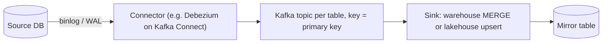
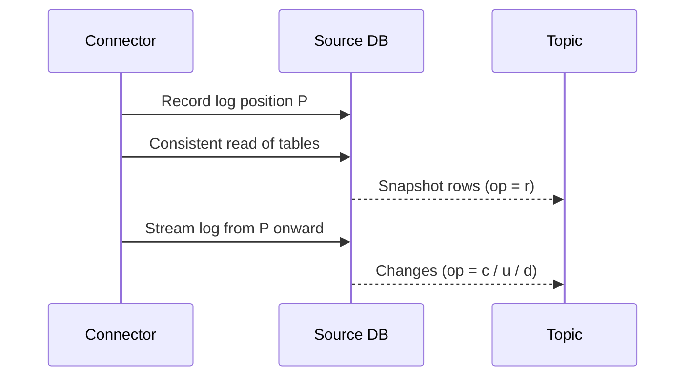

## 🎯 TL;DR

> **Change Data Capture (CDC)** turns every insert, update and delete in a source database into an event that downstream systems can consume, usually in near real time.

- **Log-based CDC** reads the database's own transaction log (MySQL binlog, PostgreSQL WAL). It sees every committed change, including deletes, in commit order.
- **Query-based CDC** polls tables with a watermark (see [[batch-ingestion]]). It is simpler, but it misses deletes and can miss late commits.
- A complete CDC design has four parts: an **initial snapshot**, a **streaming phase** that continues from the same log position, a **sink** that applies events idempotently, and a plan for **schema changes** and **replication-slot health**.
- The usual goal is a **mirror table** in the warehouse (or lakehouse) that matches the source, with deletes applied.

## 🌱 Start simple (Junior)

> **💡 Analogy:** A shop has a security camera that records every change to the shelves. You do not walk in every hour and compare the shelves with your notes (that is query-based). You watch the recording and copy each change as it happens (that is log-based). The recording also shows the item that was removed, so you never have to guess.

Take an `orders` table in a shop database. The application changes an order from `NEW` to `PAID`. With log-based CDC, a connector reads the change from the database log and publishes an event such as this (simplified, in the Debezium style):

```json
{
  "op": "u",
  "before": { "id": 42, "status": "NEW",  "amount": 250000 },
  "after":  { "id": 42, "status": "PAID", "amount": 250000 },
  "source": { "db": "shop", "table": "orders", "lsn": 918273645 },
  "ts_ms": 1760346000456
}
```

The important fields are:

- **`op`**: `c` (create), `u` (update), `d` (delete), `r` (a row read during the initial snapshot).
- **`before` / `after`**: the row before and after the change. A delete has `before` only; a create has `after` only.
- **`source`**: where the change came from, including a position in the log. The position is what lets you order events and resume after a restart.

A downstream system that applies these events, one by one, in order, ends up with the same table as the source.

## 🔧 How it really works (Mid)

A typical log-based pipeline looks like this:



**Why the log works.** Databases already write a log for replication and crash recovery. CDC reads that log as a replica would. It is cheap for the source (no extra queries), and it sees committed changes only.

- **MySQL**: the binary log must be on, in `ROW` format, so each event contains the row images.
- **PostgreSQL**: logical decoding reads the WAL through a **replication slot** and an output plugin. The slot tracks how far the consumer has read.

**The initial snapshot.** A connector cannot start from "now" and miss the existing rows, so it does two steps. It takes a consistent read of the tables (emitted as `op = r`), and it records the log position at the moment the snapshot starts. Then it streams the log from that position. Changes that happened during the snapshot are replayed, and the sink's idempotent apply makes the overlap harmless.



**Ordering.** Kafka keeps order only within one partition. If you key the topic by the primary key, all changes to one row land in one partition, in commit order. There is **no global order across tables**. If a sink needs cross-table consistency, use the source position, transaction metadata, or a single snapshot at read time.

**Deletes.** A hard delete produces an event with `op = d` and the `before` image, so the sink knows which key to remove. If the topic is log-compacted, a **tombstone** (a message with the key and a null value) follows, and compaction eventually removes older versions of that key.

**Building the mirror in the warehouse.** Do not apply events straight into the mirror table. Land every event in a raw, append-only table first. Then, in micro-batches, keep the latest event per key and merge it:

```sql
-- raw_cdc_orders: one row per change event (append-only landing table)
-- columns: id, op, status, amount, src_lsn

-- Latest event per key among events not yet applied.
-- last_applied_lsn is stored in a control table and moved only after the merge commits.
CREATE TEMP TABLE latest AS
SELECT DISTINCT ON (id) id, op, status, amount, src_lsn
FROM raw_cdc_orders
WHERE src_lsn > :last_applied_lsn
ORDER BY id, src_lsn DESC;

INSERT INTO mirror.orders (id, status, amount, src_lsn)
SELECT id, status, amount, src_lsn FROM latest WHERE op <> 'd'
ON CONFLICT (id) DO UPDATE
SET status  = EXCLUDED.status,
    amount  = EXCLUDED.amount,
    src_lsn = EXCLUDED.src_lsn;

DELETE FROM mirror.orders AS m
USING latest AS l
WHERE m.id = l.id AND l.op = 'd';
```

The `src_lsn` column is a monotonic position from the source (a log sequence number, or a value derived from the MySQL binlog file and position). Using it, rather than the event time, makes the "latest" choice correct even when events arrive out of order.

**Transactional outbox.** Sometimes you do not want to expose the internal tables of a service. The **outbox pattern** writes a business event in the same transaction as the state change, then CDC streams the outbox table:

```sql
CREATE TABLE outbox (
  id           uuid PRIMARY KEY,
  aggregate    text  NOT NULL,   -- e.g. 'order'
  aggregate_id text  NOT NULL,   -- use as the Kafka key
  event_type   text  NOT NULL,   -- e.g. 'OrderPaid'
  payload      jsonb NOT NULL,
  created_at   timestamptz NOT NULL DEFAULT now()
);

BEGIN;
UPDATE orders SET status = 'PAID' WHERE id = 42;
INSERT INTO outbox (id, aggregate, aggregate_id, event_type, payload)
VALUES (gen_random_uuid(), 'order', '42', 'OrderPaid', '{"amount": 250000}');
COMMIT;
```

Both writes commit together or not at all, which avoids the **dual-write** problem (writing to the database and to Kafka separately, where one can succeed and the other fail). Consumers then see a stable event contract instead of raw table structure.

**Schema changes.** When a column is added, the connector emits events with the new field. Use a schema registry with a compatibility rule (for example, backward compatibility for Avro) so that adding a nullable column does not break consumers. Renaming or dropping a column is a breaking change: plan it, announce it, and version the contract.

## 🧠 Senior depth & trade-offs

- **Replication slot risk (PostgreSQL).** A logical slot forces the server to keep WAL until the consumer confirms it. If the connector stops (or the slot is abandoned), WAL accumulates, and the disk can fill up and take the primary down. Monitor the retained WAL per slot and have an alert and a runbook. Recent PostgreSQL versions can keep logical slots on standbys for failover; check the docs for your version.

```sql
SELECT slot_name, active,
       pg_size_pretty(pg_wal_lsn_diff(pg_current_wal_lsn(), restart_lsn)) AS retained_wal
FROM pg_replication_slots;
```

- **Binlog retention (MySQL).** The connector must be able to resume from a binlog position. If the server purges old binlogs while the connector is down, you must re-snapshot. Set retention deliberately, and know how long your longest outage is. Check the setting name for your version.
- **One connector per database, not per table.** Many connectors on one server multiply load on the source and the number of log readers. For a fleet of 50 microservice databases, the usual design is one connector per database cluster, with topic naming that includes the service and table, and an owner per topic.
- **Delivery is at-least-once.** Connectors restart and replay from the last committed offset. The sink must be idempotent: apply by primary key, keep the newest `src_lsn`, and make replays of the same position harmless.
- **Long transactions and snapshots.** A large initial snapshot holds resources (and, depending on the database, locks or long read transactions). Schedule it, use incremental or chunked snapshot modes where the connector offers them, and watch the log growth it causes.
- **Flink CDC and direct readers.** Some teams read the source log directly into Flink (Flink CDC connectors) instead of going through Kafka. This removes a hop, but you lose the Kafka replay buffer that many other consumers rely on. Choose based on how many consumers need the same stream.
- **Oracle and enterprise sources.** In banks and telcos, the source is often Oracle. Log-based options exist (LogMiner-based connectors, or vendor replication tools), but licensing and operational support often decide the choice more than the technology does. Check the vendor's support matrix before designing around it.
- **Monitoring.** Track connector status and task restarts, consumer lag on the topics, end-to-end latency (`now()` minus `ts_ms`), replication-slot retained WAL, and the count of unapplied events in the raw table. Reconcile counts and a key checksum between source and mirror every day.
- **When not to use it.** If a nightly batch is enough, and the source has no delete requirement, CDC adds an operational cost (a log reader, a broker, schema management) that you do not need. Start with [[batch-ingestion]].

## 🧪 Try it

1. A consumer of the `orders` topic has been down for two days, and the source is PostgreSQL with a logical slot. What do you check first, and what is the risk?
2. Explain why the raw landing table plus `DISTINCT ON ... ORDER BY src_lsn DESC` is safer than applying each event straight to the mirror in arrival order.
3. Your team wants to add `discount_code` (nullable) to `orders`. Which schema change is safe for consumers, and which would break them?

<details><summary>Show solutions</summary>

**1.** Check the slot: `active` status and `retained_wal`. The slot keeps WAL until the consumer confirms it, so the WAL on disk grows every hour. The risk is disk exhaustion on the primary. Restart the connector if it is safe, or drop the slot only if you accept a full re-snapshot of the data.

**2.** Events can arrive out of order, or be replayed after a restart. Applying in arrival order can leave an older state on top of a newer one. Choosing the event with the highest source position per key makes the final state correct regardless of arrival order, and the merge is idempotent if replayed.

**3.** Adding a nullable column is backward-compatible: old consumers ignore the new field, and the new field is absent in old events. Renaming or dropping `amount` (or changing its type) breaks consumers, so it needs a versioned change, both schemas running side by side, and a deprecation window.

</details>

## 💬 Interview corner

**Question: "Design CDC from 50 microservice databases into the warehouse."**

- **Mid answer:** "Use Debezium on Kafka Connect. Each database gets a connector that reads its binlog or WAL, the events go to Kafka topics keyed by primary key, and a warehouse sink merges them into mirror tables."
- **Senior answer:** "Same backbone, with governance added. One connector per database cluster, topics named by service and table, and a schema registry with compatibility rules. Services that should not expose internal tables publish through an outbox. The sink lands raw events first, then merges by primary key with the highest source position winning, so replays are safe. Operationally I'd monitor replication-slot WAL on every PostgreSQL source, binlog retention on MySQL, connector lag, and daily reconciliation counts. I'd agree a snapshot schedule per database, because the initial load is the riskiest step."

**Question: "How do you handle deletes?"** Log-based CDC emits a delete event with the before image, and the sink applies it to the mirror (hard delete, or set a `deleted_at` flag if you need history). Query-based extraction cannot see deletes at all, which is why CDC exists for this case.

> **🎤 Say this in the interview:** "Log-based CDC reads the commit log, so it sees every insert, update and delete in commit order. I always plan the initial snapshot, make the sink idempotent because delivery is at-least-once, and watch the replication slot, because a stalled consumer can fill the source's disk."

## ⚠️ Common mistakes

> **⚠️ Watch out:** Forgetting that a replication slot (PostgreSQL) holds WAL until the consumer catches up. A forgotten slot can take down the primary.

> **⚠️ Watch out:** Applying events in arrival order instead of source position. Replays and retries will leave stale rows on top of newer ones.

- Assuming `ts_ms` (event time) is the right ordering key. Use the source position, since the clock can be wrong and transactions can share timestamps.
- Expecting a global order across tables. Only the order within a key (one partition) is guaranteed.
- Treating CDC as exactly-once end to end. It is at-least-once, and the sink must make replays harmless.
- Skipping the initial snapshot, or starting the connector "from now" and losing existing rows.
- Using a query-based incremental load and believing it captures deletes.
- Exposing internal table structure to all consumers, which couples every service to its schema.

## ✅ Check yourself (quiz)

1. In a Debezium-style event, what does `op = "d"` mean, and which image is filled?
   - A) Dedupe; `after` only
   - B) Delete; `before` only
   - C) Desync; both images empty
   - D) Snapshot; `before` only

<details><summary>Answer</summary>

**B** — `d` is a delete. The row is gone in the source, so there is no `after` image, and the `before` image tells the sink which row to remove. `r` is the snapshot read.

</details>

2. Why does a log-based connector record a log position before the initial snapshot starts?
   - A) To compress the snapshot
   - B) So it can stream every change that happens during and after the snapshot, with no gap
   - C) To lock the tables during the read
   - D) Because Kafka requires a position for each topic

<details><summary>Answer</summary>

**B** — the snapshot is a read at one moment, and changes can happen while it runs. Starting the stream from the recorded position means nothing is missed. Replayed changes are harmless because the sink applies events idempotently.

</details>

3. A PostgreSQL primary's disk usage climbs steadily, and a CDC connector has been stopped for a week. What is the most likely cause?
   - A) The mirror table is too large
   - B) The inactive logical replication slot keeps WAL until its consumer confirms it
   - C) Kafka is storing too many snapshots
   - D) The warehouse is writing to the primary

<details><summary>Answer</summary>

**B** — the slot holds WAL on the server for a consumer that is not reading. Check `pg_replication_slots`, restore the consumer or drop the slot (accepting a re-snapshot), and alert on retained WAL.

</details>

4. **(Senior)** A sink receives two events for order 42 after a connector restart: an update with `src_lsn = 500` and then the same update again with `src_lsn = 500`. Then an older update with `src_lsn = 480` arrives late. What should the final mirror state be, and why?
   - A) The `src_lsn = 480` state, because it arrived last
   - B) The state of `src_lsn = 500`, because the highest source position wins and replays are idempotent
   - C) Both rows, because duplicates must be kept
   - D) Neither, because the sink must reject out-of-order events

<details><summary>Answer</summary>

**B** — the sink keeps the event with the highest source position per key, so the late `480` does not overwrite `500`. The duplicate `500` produces the same row, so the replay is harmless. This is why the warehouse merge uses `src_lsn`, not arrival order.

</details>

5. **(Senior)** Consumers of an `orders` topic break after a producer renames `amount` to `total_amount`. What is the proper way to introduce that change?
   - A) Rename it on the source and let consumers adapt on their own schedule
   - B) Add `total_amount` alongside `amount`, let both publish for a deprecation window, migrate consumers, then remove `amount` as a versioned breaking change
   - C) Drop the schema registry, so consumers get raw JSON
   - D) Rename it in the warehouse only

<details><summary>Answer</summary>

**B** — additive change first, then a deprecation period with both fields, then removal under a new contract version. A schema registry with compatibility rules helps catch the breaking change before it ships.

</details>

## 🗂️ Flashcards

| Front | Back |
|---|---|
| Log-based vs query-based CDC | Log-based reads the commit log and sees deletes in commit order; query-based polls with a watermark and misses deletes |
| What does `op = r` mean? | A row read during the initial snapshot |
| Why record a log position before the snapshot? | So streaming can start from that point with no gap; overlapping changes are replayed idempotently |
| What is a tombstone? | A message with a key and a null value, used with compacted topics to delete that key |
| Ordering guarantee in Kafka CDC | Order is kept per key within one partition; there is no global order across tables |
| Why does an inactive PostgreSQL slot hurt? | It keeps WAL on the primary until the consumer confirms, so the disk can fill |
| Why use an outbox? | It writes the business event in the same transaction as the state change, avoiding dual writes |
| Delivery semantics of CDC | At-least-once; the sink must be idempotent |

## 🔗 Go further

- **batch-ingestion** shows the query-based alternative and its blind spots, which motivate CDC.
- **pattern-cdc-analytics** and **design-cdc-lake** apply these ideas to analytics and lakehouse designs.
- **kafka-connect-ops** covers running connectors in production: restarts, offsets and monitoring.
- **dedup-idempotent-loads** explains how to make the sink safe under replays.
- The glossary entries for [[outbox-pattern]], [[tombstone]] and [[wal]] are short companions to this lesson.

