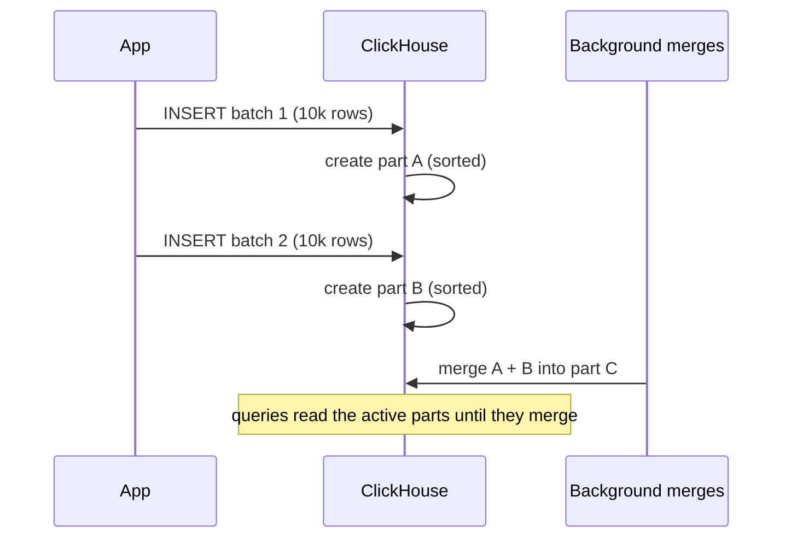

## 🎯 TL;DR

> **ClickHouse** is a column-oriented analytical database. Its core is the **MergeTree** family: each `INSERT` writes an immutable **part** sorted by `ORDER BY`, background **merges** combine parts, and a **sparse primary index** lets queries skip most of the data.

- Fast reads come from sorting, columnar storage and skipping, not from indexes on every column.
- Writes must be **batched**. Each insert creates a part; too many small parts slow everything down and can cause "Too many parts" errors.
- Deduplication and aggregation in the `*MergeTree` variants happen **during merges**, which is eventual. Use `FINAL` or aggregate-aware queries when you need exact answers at read time.

## 🌱 Start simple (Junior)

> **💡 Analogy:** A library that receives boxes of new books all day. Each delivery is a **part**: a sealed box, already sorted by author. Once in a while, a librarian merges several boxes into one bigger sorted box. When you look for an author, you check a short table of contents (the sparse index) and go straight to the right box.

Create a small table of page views:

```sql
CREATE TABLE page_views (
  user_id    UInt64,
  view_time  DateTime,
  url        String,
  duration_ms UInt32
)
ENGINE = MergeTree
PARTITION BY toYYYYMM(view_time)
ORDER BY (user_id, view_time);
```

- `ENGINE = MergeTree` is the default storage family. Everything else in this lesson is a variant of it.
- `ORDER BY (user_id, view_time)` decides how rows are sorted on disk. It is the most important design decision in ClickHouse.
- `PARTITION BY toYYYYMM(view_time)` groups data by month, so old months can be dropped as a unit.

A query that filters on `user_id` only needs a few granules, because the data is sorted by `user_id` first:

```sql
SELECT url, count() AS visits
FROM page_views
WHERE user_id = 42 AND view_time >= '2026-03-01'
GROUP BY url
ORDER BY visits DESC
LIMIT 10;
```

## 🔧 How it really works (Mid)

**Parts and merges.** An `INSERT` creates a new directory (a part) with one file per column. Parts are immutable. In the background, ClickHouse merges parts with the same partition into bigger ones, keeping the sort order. Merges are how the system stays fast after many inserts.



**Sparse primary index.** The primary key is not a B-tree over every row. ClickHouse stores one index mark per **granule** of rows: by default 8192 rows (`index_granularity`). For a query on the key prefix, the engine binary-searches the marks and reads only the matching granules. Because the index is small, it stays in memory, even for billions of rows. The trade-off is that the index does not find single rows; it finds ranges.

**Why the key order matters.** The index works on a prefix of `ORDER BY`. `ORDER BY (user_id, view_time)` makes `WHERE user_id = 42` fast and `WHERE view_time > ...` alone much slower, because rows with the same time are spread across all users. Put the most-filtered, lowest-cardinality-first columns at the front, and check with `EXPLAIN indexes = 1`.

**The "too many parts" problem.** Every insert adds parts. If inserts are small and frequent (for example one row per request), parts pile up faster than merges can combine them. ClickHouse then refuses new inserts with a "Too many parts" error, and every query has to read more files. The official guidance is to batch inserts: at least about 1,000 rows per insert, ideally 10,000 to 100,000 rows, or use `async_insert`, which buffers rows on the server. Check the current insert-strategy guide for your version.

```sql
-- Which tables have many active parts?
SELECT table, count() AS active_parts
FROM system.parts
WHERE active
GROUP BY table
ORDER BY active_parts DESC;
```

**Insert triggers with materialized views.** A `MATERIALIZED VIEW` in ClickHouse is an insert trigger. When a block of rows is inserted into the source table, the view's `SELECT` runs on that block and writes the result into a target table. It is not a refreshed snapshot of the source; it only sees new inserts.

```sql
CREATE TABLE views_daily (
  day Date, url String, visits UInt64
)
ENGINE = SummingMergeTree
ORDER BY (day, url);

CREATE MATERIALIZED VIEW views_daily_mv TO views_daily AS
SELECT toDate(view_time) AS day, url, count() AS visits
FROM page_views
GROUP BY day, url;
```

`SummingMergeTree` sums rows with the same key, but only **during merges**. Until then, `views_daily` can hold several rows for the same `(day, url)`. Query it with `SELECT day, url, sum(visits) ... GROUP BY day, url`.

## 🧠 Senior depth & trade-offs

- **The MergeTree family.** Choose the engine by what should happen to rows with the same key during merges:
  - `ReplacingMergeTree(version[, is_deleted])` keeps the row with the highest version (and optionally drops rows marked deleted). This is the usual pattern for upserts from CDC.
  - `SummingMergeTree` adds numeric columns of rows with the same key.
  - `AggregatingMergeTree` stores aggregate states (`AggregateFunction`) and is used with `-State` and `-Merge` combinators, for things like unique counts.
  - `CollapsingMergeTree` uses a `sign` column (+1 and -1) to cancel old state; it is fragile when events arrive out of order, so prefer `ReplacingMergeTree` when you can.
- **Deduplication is eventual.** `ReplacingMergeTree` removes duplicates only when a merge touches the parts that contain them. A plain `SELECT` can return both versions. `SELECT ... FROM t FINAL` merges on the fly at read time, which costs CPU and memory; the overhead grows with the number of unmerged parts and columns read. For dashboards, a common approach is to aggregate with `argMax(value, version)` grouped by key, or to avoid duplicates upstream with [[idempotency]].
- **FINAL cost.** Measure it. On large tables, the overhead of `FINAL` varies widely with the data (the official docs quote anything from tens of percent to several times the cost of a plain query). Reduce it by filtering on the sort key (so fewer granules are read), by keeping parts merged, or by changing the query to be aggregate-aware.
- **Projections and skipping indexes.** A projection stores a second copy of the data sorted (or aggregated) differently, so a query on another column can use it; ClickHouse chooses it automatically. Data-skipping indexes (minmax, set, bloom filter) store per-granule summaries for columns not in the primary key. They skip granules that cannot match, but they cost write time and disk. Test them with `EXPLAIN indexes = 1` and real data.
- **TTL and partitions.** `TTL` can delete or move rows older than a threshold, and partitions can be dropped in one command. Partitioning by month is good for retention; it is a poor tool for speeding up queries on a high-cardinality column. Too many partitions multiply the parts problem.
- **Dictionaries.** External or in-memory key-value lookups (`dictGet`) are the usual way to enrich a fact table with small dimensions, instead of a large `JOIN` at query time.
- **JOIN limitations.** ClickHouse supports joins, but the design favours wide, denormalized tables. A large join on the right side needs memory for the hash table, and join algorithms and their settings have changed across versions. Model the data for the query, use dictionaries for small lookups, and check the current JOIN documentation before promising a join pattern for big tables.
- **Replication and distribution.** `ReplicatedMergeTree` keeps replicas in sync through a coordination service: ZooKeeper, or ClickHouse Keeper in newer deployments. A `Distributed` table is a logical table that fans queries out to shards and merges results. Replication gives availability; sharding gives capacity. Both need care with the insert path, because a duplicate insert after a retry can create duplicate rows, which again points to [[idempotency]].
- **Kafka ingestion.** The Kafka table engine consumes a topic, and a materialized view moves the rows into a MergeTree table. Monitor consumer lag and the batch sizes produced, because tiny blocks create tiny parts.
- **Monitor.** Watch active parts per table, merge backlog, insert errors (`Too many parts`), and `system.query_log` for slow queries and their bytes read. These four signals tell you most of what you need.
- **When not to use it.** ClickHouse is excellent for append-heavy, read-heavy analytics. It is a poor fit for many small row-level updates and deletes, complex multi-table transactions, or workloads that need strict per-row consistency on every read.

## 🧪 Try it

You receive user profile changes from a CDC stream. Each event has `user_id`, `email`, `updated_at` (a `DateTime`) and `is_deleted` (0 or 1). Events can arrive out of order.

1. Write a `CREATE TABLE` for the target. Choose the engine, the `ORDER BY` and the version column, and explain each choice.
2. Write a query that returns the current, non-deleted profile for `user_id = 7`, and say why a plain `SELECT` is not enough.
3. The team inserts one row per event from a Python worker, and a dashboard shows "Too many parts". Give two changes that fix it without changing the schema.

<details><summary>Show solutions</summary>

**1.**
```sql
CREATE TABLE user_profiles (
  user_id    UInt64,
  email      String,
  updated_at DateTime,
  is_deleted UInt8
)
ENGINE = ReplacingMergeTree(updated_at, is_deleted)
ORDER BY user_id;
```
`ORDER BY user_id` is the key that identifies a row, so the engine can detect duplicates. The version column `updated_at` decides which version survives: the newest. `is_deleted` lets a deletion event win and be removed at merge time. Out-of-order events are safe, because the version decides, not the arrival order.

**2.**
```sql
SELECT user_id, email, updated_at
FROM user_profiles FINAL
WHERE user_id = 7 AND is_deleted = 0;
```
A plain `SELECT` may return several versions of user 7 before a merge runs. `FINAL` deduplicates at read time, and filtering on `user_id` keeps the cost low.

Note: the docs state that deleted rows are not removed at merge time, so keep the `is_deleted = 0` filter in every read of the table.

**3.** Batch the inserts: buffer events in the worker (for example, 10,000 rows or a 30-second window, whichever comes first) and insert them in one statement. Or enable `async_insert` so the server batches small inserts. Both reduce the number of parts created per second, which lets merges keep up.

</details>

## 💬 Interview corner

**Question: "Why should you not insert row by row?"** Mid answer: "Each insert creates a part. Too many small parts slow queries and can trigger the 'too many parts' error, so I batch inserts."

Senior answer: "Each insert creates an immutable part, and the background merge process must keep up with the rate of new parts. One row per insert means thousands of parts per second, which merges cannot combine in time. Queries then read more files, the index is checked for each part, and the server starts rejecting inserts. The fix is client-side batching of about 10,000 rows or a time window, `async_insert` for clients that cannot batch, and a buffer or Kafka layer in front of the table."

**Question: "How does ReplacingMergeTree dedup, and why isn't it immediate?"** Mid: "It keeps the row with the highest version for each sorting key, during merges."

Senior: "Deduplication is a side effect of background merges, and merges run asynchronously over parts, so until the duplicates land in the same merge, both versions are visible. That is why it gives eventual correctness. For exact reads I'd use `FINAL` or an `argMax` aggregation, and I'd note the cost. I'd not rely on it for uniqueness constraints, which need an upstream idempotency key."

> **🎤 Say this in the interview:** "ClickHouse writes immutable sorted parts and merges them in the background. So I batch inserts to keep the part count low, I choose the ORDER BY for the most common filter, and I treat ReplacingMergeTree as eventual deduplication, reading with FINAL or aggregates when I need exact answers."

## ⚠️ Common mistakes

> **⚠️ Watch out:** Inserting one row per request, or one insert per Kafka message. The table fills with tiny parts and the merge queue never catches up.

> **⚠️ Watch out:** Assuming `ReplacingMergeTree` has no duplicates. A plain `SELECT` can return them until a merge runs.

- Choosing the `ORDER BY` by the primary key habit of other databases, instead of the most common filter pattern.
- Partitioning by a fine-grained column (day plus customer) and creating thousands of partitions with tiny parts.
- Using `ALTER TABLE ... UPDATE` or `DELETE` for frequent row-level changes. Mutations rewrite whole parts; use a `ReplacingMergeTree` with versions for that pattern.
- Expecting a materialized view to backfill old rows. It only fires on inserts after it is created.
- Treating `SummingMergeTree` totals as exact on read without re-aggregating.
- Using `FINAL` everywhere without measuring its cost.

## ✅ Check yourself (quiz)

1. What is a **part** in ClickHouse?
   - A) A row in the primary index
   - B) An immutable, sorted set of files created by an insert, merged later in the background
   - C) A shard of a distributed table
   - D) A replica of a table on another node

<details><summary>Answer</summary>

**B** — each `INSERT` creates a part, and background merges combine parts. The sparse index is per granule, a shard is a node-level split, and a replica is a copy of data on another node.

</details>

2. Which engine should you use to keep only the latest version of each user profile from a CDC stream?
   - A) `MergeTree`
   - B) `SummingMergeTree`
   - C) `ReplacingMergeTree` with a version column
   - D) `Memory`

<details><summary>Answer</summary>

**C** — `ReplacingMergeTree` keeps one row per sorting key, chosen by the version column during merges. `SummingMergeTree` would add values instead, and plain `MergeTree` keeps every row.

</details>

3. A query on `page_views` with `WHERE view_time > '2026-03-01'` is slow, while `WHERE user_id = 42` is fast. The table is `ORDER BY (user_id, view_time)`. What is the reason, and what is the best response?

   - A) The index is corrupted; rebuild it
   - B) The sparse index works on the key prefix, so a filter on `view_time` alone cannot skip granules; add a projection sorted by `view_time`, or design the table order for the most common filter
   - C) `DateTime` cannot be indexed; cast it to text
   - D) ClickHouse does not support `WHERE` on non-key columns

<details><summary>Answer</summary>

**B** — rows with a given `view_time` are spread across all `user_id` values, so the granule marks cannot exclude ranges. Options: a projection with a different sort order, a second table, or an `ORDER BY` that matches the dominant query. Choose based on the real query mix.

</details>

4. **(Senior)** A pipeline inserts one row per Kafka message, and the table reports "Too many parts" every afternoon. Which change addresses the cause most directly?
   - A) Increase the number of partitions to 1,000 per day
   - B) Batch the inserts (the Kafka engine or a buffer in front of the table, or `async_insert`) so each insert writes many rows and creates fewer parts
   - C) Replace `ORDER BY` with a random key
   - D) Turn off merges to save CPU

<details><summary>Answer</summary>

**B** — the cause is the number of parts created per second, and merges cannot keep up. Batching reduces parts at the source. More partitions multiply the problem, and turning off merges makes it certain.

</details>

5. **(Senior)** A dashboard reads `user_profiles` (a `ReplacingMergeTree`) with a plain `SELECT` and occasionally shows a user twice. What is the correct explanation and the right fix?

   - A) The engine is broken; switch to `Memory` engine
   - B) Deduplication happens only during background merges, so unmerged duplicates are visible; use `FINAL` (or an `argMax` aggregation) in the query, and keep the cost in mind
   - C) `ReplacingMergeTree` never deduplicates; use `SummingMergeTree`
   - D) The dashboard must add `DISTINCT` on every column

<details><summary>Answer</summary>

**B** — deduplication is eventual, so reads must account for unmerged parts. `FINAL` or an aggregate query returns the deduplicated view. Measure the cost of `FINAL` on the real table, and filter on the sort key to limit it.

</details>

## 🗂️ Flashcards

| Front | Back |
|---|---|
| What is a part? | An immutable, sorted set of column files written by one insert; merged in the background |
| Sparse primary index | One mark per granule (default 8192 rows); finds ranges, not single rows |
| Why batch inserts? | Each insert creates parts; too many parts slow queries and trigger "Too many parts" |
| ReplacingMergeTree dedup | Keeps the highest version per sorting key during merges; eventual |
| How to read exact deduplicated rows | `FINAL`, or an aggregate such as `argMax` grouped by key |
| SummingMergeTree | Sums numeric columns per key during merges; re-aggregate on read |
| Materialized view in ClickHouse | Insert trigger: transforms each inserted block into a target table |
| Why ORDER BY matters | It defines the sort order and the prefix the sparse index can use |

## 🔗 Go further

- **[[realtime-olap]]** places ClickHouse among real-time OLAP systems and their trade-offs.
- **[[mpp-architecture]]** explains the shared-nothing and distributed query ideas behind ClickHouse shards.
- **[[starrocks-doris]]** compares a second analytics engine with a different design for updates and joins.
- **[[file-layout]]** covers the same sorting and partitioning ideas on Parquet and object storage.
- **[[dedup-idempotent-loads]]** is the general pattern behind using ReplacingMergeTree for CDC upserts.
