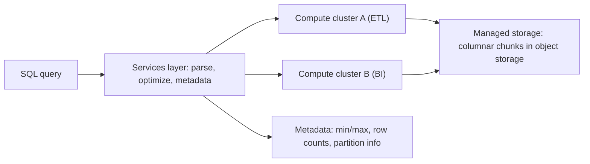

## 🎯 TL;DR

> A **cloud data warehouse** (Snowflake, BigQuery, Redshift and similar) is a managed analytical database whose core ideas are: **storage and compute are separate**, data is stored in **compressed columnar files managed by the vendor**, and you pay for **storage** and **compute** through different meters.

- **Separation of storage and compute** lets you scale query capacity up or down without moving data.
- Data is split into **immutable column-oriented chunks** (Snowflake calls them micro-partitions) with metadata such as min/max values, so queries skip most of them.
- **Pricing models** differ: pay per compute time (warehouses or slots), or pay per data scanned (on-demand). Your cost depends on how you query as much as on how much you store.
- These concepts appear in interviews even when you have no cloud account. Learn the mechanisms, not the marketing names.

## 🌱 Start simple (Junior)

> **💡 Analogy:** A **library with a separate reading room**. The books (storage) live in a building that never changes size. Reading desks (compute) can be added for a busy week and removed afterwards. Many readers can use different desks at the same time, and all of them see the same books.

In the old model, a database server held both the data and the CPUs. To handle a busy month-end, you bought a bigger machine, and the data had to move or the machine stayed large all year. In a cloud warehouse:

- **Storage** holds every table, in the vendor's object storage, billed per terabyte per month.
- **Compute** runs queries. You start a cluster or a "warehouse" when you need it, and stop it when you do not.

A simple query:

```sql
SELECT region, SUM(amount) AS revenue
FROM sales.orders
WHERE order_date >= DATE '2026-01-01'
GROUP BY region;
```

The engine reads only the columns it needs (`region`, `amount`, `order_date`) and skips the chunks whose date range cannot match. You never write files, indexes or partitions by hand in the simplest case, but you can still influence layout with partitioning and clustering when tables grow.

## 🔧 How it really works (Mid)



**Columnar chunks with metadata.** Rows are written into compressed column files. Each chunk stores statistics (min and max per column, sometimes distinct counts or bloom-like structures). A filter such as `order_date >= '2026-01-01'` is compared to these stats first, so whole chunks are pruned without being read. Snowflake documents this as micro-partition pruning; BigQuery and Redshift use similar ideas with their own terms.

**Clustering.** When data arrives in a random order, every chunk covers the whole range of values, and pruning does not help. Clustering (Snowflake clustering keys, BigQuery clustering, Redshift sort keys) keeps similar values together. Partitioning (BigQuery partitioned tables, date partitions) splits a table into logical pieces, usually by date, so queries that filter on the partition column scan fewer bytes.

**Compute units.**
- **Snowflake:** a *virtual warehouse* is a compute cluster you size (X-Small to larger). Several warehouses can read the same storage at once, which isolates ETL from BI.
- **BigQuery:** compute is measured in *slots* (units of query processing). You can run on-demand, where you pay for bytes scanned, or buy reserved capacity (slots) that you share among queries.
- **Redshift:** a provisioned cluster has a leader node and compute nodes. Newer node families separate managed storage from compute; Redshift Serverless provisions capacity automatically. Check the current docs for the family and the pricing you are asked about.

**Pricing in one sentence per model.**
- Storage: per TB per month (compressed).
- Compute, time-based: per second or hour of a cluster or warehouse while it runs.
- Compute, scan-based: per TB scanned by the query (BigQuery on-demand). A `SELECT *` on a wide table costs more than a narrow column list.

A hypothetical on-demand example, with a made-up price of 5 USD per TB scanned: a dashboard query that scans 2 TB every 10 minutes for 24 hours costs 2 × 5 × 144 = 1,440 USD per day. The same query reading 20 GB costs 1,440 × 0.01 = 14.4 USD. Pruning is worth real money.

## 🧠 Senior depth & trade-offs

- **Separation is not free isolation.** Warehouses share storage, but they still compete for metadata services, concurrency slots and account-level limits. A runaway ETL job can slow BI if they share one warehouse, so give workloads their own compute.
- **Cost is a query-design problem.** Scan-based pricing rewards narrow projections, partition filters and clustering. Time-based pricing rewards keeping clusters busy and suspending them when idle. Measure both: bytes scanned per query, and warehouse-hours per day.
- **Micro-partitions and small writes.** Many tiny inserts create many small chunks. Pruning gets worse and background maintenance has more work. Batch your loads, and check whether the vendor merges or reclusters automatically.
- **Clustering is maintenance.** As new data arrives out of order, clustering degrades. Automatic clustering or reclustering costs compute. Cluster only on columns that appear in common filters, with a bounded number of keys.
- **Concurrency.** A single compute cluster has finite parallelism. For many simultaneous dashboard users, you scale out (more clusters or multi-cluster warehouses) rather than up. Watch queue time, not only run time.
- **Lock-in and portability.** SQL dialects, data sharing features, time travel and stored procedures differ. Keep the business logic in portable SQL and keep raw data in open formats (Parquet, Iceberg) where you can. See [[lakehouse-table-formats]].
- **Interview framing.** When asked to "design a warehouse", name the separation of storage and compute, the chunk pruning, the workload isolation, and the cost model, then ask about data volume and concurrency. That order shows you think in mechanisms.
- **When not to use one.** Very low-latency serving to end users (use a serving store or real-time OLAP, see [[realtime-olap]]), or when data must stay on-premises and a managed cloud service is not allowed.

## 🧪 Try it

You have a fact table `sales.orders` with 2 billion rows, about 50 columns, partitioned by `order_date` (one partition per day). A dashboard runs this every minute:

```sql
SELECT region, SUM(amount)
FROM sales.orders
WHERE order_date >= CURRENT_DATE - 7
GROUP BY region;
```

1. Assuming scan-based pricing, what does the query read, and what design choice reduces it most?
2. Assuming time-based pricing with a warehouse that runs continuously, what would you change to save money if the dashboard only needs fresh data during office hours?
3. The table is loaded by 500 small hourly files. Which problem does that create for pruning and cost?

<details><summary>Show solution</summary>

**1.** It reads the `region`, `amount` and `order_date` columns for seven daily partitions. The daily partition filter prunes the other days. The biggest reduction comes from the partition filter and the narrow column list. Make sure `CURRENT_DATE - 7` is evaluated as a constant so the engine can prune at planning time (engine-specific; check your dialect).

**2.** Suspend the warehouse outside office hours (auto-suspend and auto-resume), or pre-compute the seven-day regional totals once per hour into a small table that the dashboard reads. The second option also cuts scan cost, because the dashboard reads hundreds of rows instead of billions.

**3.** Small files mean many chunks with narrow, overlapping min/max ranges, so pruning is weaker, metadata grows, and each query opens more files. Consolidate loads into fewer, larger files or let the platform compact them, and batch the hourly loads where latency allows.

</details>

## 💬 Interview corner

**Question: "Explain how Snowflake (or BigQuery) stores and scans data."**
Mid answer: "Data is stored in columnar compressed files in object storage. Queries read only the needed columns and skip files by metadata."
Senior answer: "Storage and compute are separate. Data is organized in immutable, compressed chunks with per-column statistics, so filters prune chunks before reading. Clustering or partitioning on the common filter columns keeps pruning effective as data grows, and workloads get their own compute to avoid interference. Cost follows scan or compute time, so I design for narrow scans and short-lived compute."

**Question: "How would you cut the cost of a warehouse that is growing fast?"**
Mid: "Drop unused tables and add partitions."
Senior: "First I find the top spenders: bytes scanned per query and compute hours per warehouse. Then I fix query shape (projections, partition filters), reduce small-file churn, suspend idle compute, and pre-aggregate hot dashboard queries. I'd put a budget alert on the expensive workloads."

> **🎤 Say this in the interview:** "Cloud warehouses separate storage from compute and prune immutable columnar chunks using metadata. The cost model is either scan-based or compute-time based, so my design goal is to read less and keep compute short-lived for each workload."

## ⚠️ Common mistakes

> **⚠️ Watch out:** Treating the warehouse as a bottomless free scan. Under scan-based pricing, `SELECT *` on a wide table can cost more in one day than a year of careful modeling.

> **⚠️ Watch out:** Assuming clustering keeps itself perfect forever. New out-of-order data degrades it, and maintenance has a compute cost.

- Putting ETL and BI on the same compute and then blaming "the database" for slowdowns.
- Leaving compute running all night for a dashboard that is used only in the morning.
- Partitioning on a high-cardinality column (such as `user_id`), which creates a mass of tiny partitions.
- Confusing "the warehouse" (compute) with the storage: suspending compute does not delete data.
- Quoting a price or a default from memory. Pricing and limits change; check the current vendor page.

## ✅ Check yourself (quiz)

1. What is the main benefit of separating storage from compute in a cloud warehouse?
   - A) Data is stored twice for safety
   - B) Compute can be scaled or suspended without moving or reloading the data
   - C) Queries no longer need statistics
   - D) Indexes are created automatically on every column

<details><summary>Answer</summary>

**B** — storage keeps the data in place, and compute clusters can be added, resized or stopped independently. Several workloads can read the same tables.

</details>

2. Why does a filter on `order_date` make a query faster on a columnar warehouse with chunk statistics?
   - A) The filter is ignored and the whole table is read
   - B) Chunks whose min/max range cannot match the filter are skipped without being read
   - C) The filter converts columns into rows
   - D) Dates are stored as text, which is faster

<details><summary>Answer</summary>

**B** — the metadata for each chunk says which date range it covers. Chunks outside the filter are pruned, which reduces both time and bytes scanned.

</details>

3. Under scan-based (on-demand) pricing, which change most reduces the cost of a dashboard query?

   - A) Adding more columns to the `SELECT` list
   - B) Selecting only the needed columns and filtering on the partition column
   - C) Running the same query more often
   - D) Removing the `WHERE` clause

<details><summary>Answer</summary>

**B** — narrow projections and partition filters reduce the bytes scanned, which is what this meter charges for.

</details>

4. **(Senior)** A single compute cluster serves both nightly ETL and daytime BI, and BI users complain about slowness during the load. What is the best structural fix?

   - A) Increase the retention period
   - B) Give ETL and BI separate compute on the same storage, so each has its own parallelism and queue
   - C) Disable clustering
   - D) Store the data in one large file

<details><summary>Answer</summary>

**B** — separation of storage and compute makes workload isolation possible. Each workload gets compute sized to its needs, and the storage is shared.

</details>

5. **(Senior)** A table with a clustering key degrades over months as new data arrives. Why, and what is the trade-off of fixing it?

   - A) Clustering is only applied at table creation and never again
   - B) New data is appended out of order, so chunks overlap again; reclustering restores pruning but consumes compute
   - C) Storage costs fall as clustering degrades
   - D) The vendor deletes the clustering key after 30 days

<details><summary>Answer</summary>

**B** — appended data does not respect the clustering order, so chunk ranges overlap and pruning weakens. Reclustering fixes it, but it is compute you pay for, so cluster only where the filter savings justify it.

</details>

## 🗂️ Flashcards

| Front | Back |
|---|---|
| Separation of storage and compute | Data stays in managed storage; compute clusters scale and stop independently |
| Micro-partition (Snowflake) | Immutable compressed chunk of columns with min/max metadata, used for pruning |
| Pruning | Skipping chunks or partitions whose metadata cannot match the filter |
| Clustering | Keeping similar values together so that pruning stays effective |
| Scan-based pricing | You pay per bytes scanned (for example BigQuery on-demand) |
| Time-based pricing | You pay for the time a compute cluster or warehouse runs |
| Workload isolation | Separate compute per workload on shared storage |
| Slot (BigQuery) | Unit of query processing capacity used for compute billing and scheduling |

## 🔗 Go further

- [[trino]] — querying the same kind of data in open formats without a managed warehouse.
- [[lakehouse-table-formats]] — the open-format alternative with portable table metadata.
- [[dimensional-modeling]] — how to model the tables that a warehouse serves well.
- Vendor documentation for the pricing and storage details of the platform you use, checked before any interview quote.
