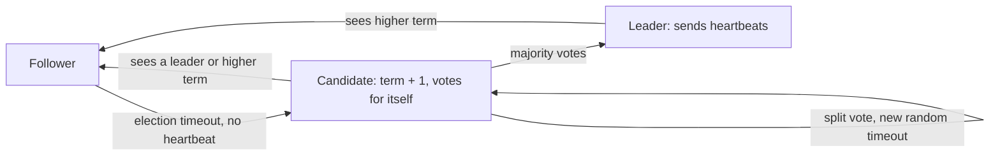

## 🎯 TL;DR

> **Consensus** means a group of nodes agrees on one value (or one ordered sequence of values), even when some nodes crash and messages are delayed or lost. Protocols such as **Raft**, **Paxos** and **ZAB** do this with a **majority quorum** and a **leader** that orders decisions.

- A decision is final once a **majority** of nodes has stored it. With 5 nodes, 3 must agree; 2 can fail.
- Raft uses **terms** (numbered epochs) to reject stale leaders. Only one leader per term.
- Consensus gives you a **replicated, linearizable log**. Locks, leader election, configuration and metadata are built on top of it.
- It is expensive: every decision waits for a majority round trip. Use it for small, critical state, not for every row you write.

## 🌱 Start simple (Junior)

> **💡 Analogy:** A group of five friends must pick one restaurant. They shout suggestions, and a restaurant is chosen only when three of them agree. If two friends leave the room, the other three can still decide. Two groups that do not overlap cannot both decide, because each needs three people and there are only five.

That "more than half" rule is a **quorum**. Two quorums out of the same group always share at least one member, and that shared member prevents two different answers.

```text
Cluster: 5 nodes  ->  quorum = floor(5/2) + 1 = 3
  node1 stores "job-42 owner = worker-A"   (1 copy)
  node2 stores it                          (2 copies)
  node3 stores it                          (3 copies) -> decision is final
  node4, node5 are down: no problem, 3 of 5 still agree
```

Why do you need this? Imagine two workers both think they are the leader that processes a file. Without consensus, both may write results and corrupt the output. Consensus lets the group pick exactly one leader, and lets everyone agree on which one.

## 🔧 How it really works (Mid)

### Raft in one page

Each node is a **follower**, **candidate** or **leader**. Time is split into **terms**, numbered 1, 2, 3, and so on. Each term has at most one leader.



1. **Election.** A follower that hears no heartbeat for a randomized timeout becomes a candidate, increments its term, and asks for votes. Each node votes at most once per term. The random timeouts make split votes rare, and a new round starts if one happens.
2. **Log replication.** The leader appends the client command to its log and sends `AppendEntries` to followers. Each entry carries the term and index.
3. **Commit.** An entry is **committed** when the leader has stored it on a majority. Only then does the leader apply it to the state machine and reply to the client.
4. **Safety.** A candidate can win only if its log is at least as up to date as a majority's. So a committed entry is never lost after a leader change.

A detail that matters for correctness: a new leader does not count replicas of entries from *previous* terms to decide commit. It commits an entry from its own term, and older entries commit with it. Implementations must follow this rule exactly.

### Worked example: fault tolerance

| Cluster size N | Quorum | Failures tolerated |
|---|---|---|
| 1 | 1 | 0 |
| 3 | 2 | 1 |
| 5 | 3 | 2 |
| 7 | 4 | 3 |

Even sizes add cost without adding tolerance: 4 nodes tolerate 1 failure, the same as 3. That is why clusters use 3, 5 or 7 voters.

### Leases, locks and fencing tokens

A distributed lock built with a lease ("I hold the lock for 10 seconds") is unsafe alone. Here is the classic failure:

1. Client A gets the lock with a 10 s lease.
2. A hits a long garbage-collection pause of 15 s. The lease expires.
3. Client B gets the lock and writes.
4. A wakes up, still believes it holds the lock, and writes too.

The fix is a **fencing token**: the lock service returns a number that increases on every grant, and the storage system rejects writes with an older token. Consensus-backed stores (etcd, ZooKeeper) are the right place to issue these numbers, because the numbers must be monotonic across failures.

### The systems you will be asked about

- **ZooKeeper** uses ZAB (an atomic broadcast protocol with a similar leader and quorum design). Clients use **sessions**, **ephemeral znodes** (deleted when the session ends) and **watches** (notifications). Kafka used ZooKeeper for cluster metadata for years.
- **KRaft** is Kafka's Raft-based controller quorum. Cluster metadata lives in an internal log (`__cluster_metadata`) that controllers replicate with Raft. Recent Kafka releases removed ZooKeeper mode completely; check your version's upgrade notes.
- **etcd** is a Raft-based key-value store. Kubernetes stores its state there. It offers **leases**, **revisions** (monotonic version numbers) and **watches**.
- **ClickHouse Keeper** is a Raft-based coordination service with a ZooKeeper-compatible protocol. Replicated MergeTree tables use it to coordinate parts and replicas.

## 🧠 Senior depth & trade-offs

- **Latency.** A write costs one round trip to a majority plus a disk flush (`fsync`) on each voter. Across regions, that is tens to hundreds of milliseconds. Keep voters in one region or spread them across three zones with low latency. Do not put a five-node quorum across continents for hot data.
- **Quorum loss = unavailability by design.** When a majority is unreachable, the cluster refuses writes rather than risk two answers. That is the CP choice from [[cap-theorem]]. Plan for it: operators need runbooks for minority-side outages.
- **Membership changes.** Adding or removing voters must be done through the protocol (joint consensus or single-server changes in Raft). Changing the list of peers by hand can create two majorities in one term.
- **Reads.** A linearizable read needs either a log entry or a leadership check (read index, lease reads). A follower serving reads without these checks can return stale data. See [[consistency-models]].
- **Consensus is not a database.** It orders a small amount of state. Storing large payloads in the log slows every decision. Keep bulk data in object storage or partitioned logs and store only pointers and metadata in the consensus group.
- **What to monitor.** Leader changes per hour (flapping means network or disk trouble), commit latency, follower lag, number of voters alive versus the quorum, and disk `fsync` latency.
- **When not to use it.** If a database with a single-writer lease, a conditional update (compare-and-set), or a unique constraint solves the problem, use that. A distributed lock is rarely the simplest correct answer.

## 🧪 Try it

1. For a 7-node cluster, how many failures can it tolerate, and how many nodes must acknowledge a commit? Then explain why 6 nodes are not better than 5.
2. A worker holds a lease for `job-42` with token `37`. The storage layer already accepted a write with token `38`. What should happen when the first worker writes with token `37`, and why?
3. Your Kafka cluster in KRaft mode has 3 controllers. Two are down. Can it elect a new metadata leader? What changes if one more node joins the controller quorum as the fourth voter?

<details><summary>Show solutions</summary>

**1.** Quorum = floor(7/2) + 1 = 4, so it tolerates 3 failures (7 - 4). A commit needs 4 acknowledgements. Six nodes need quorum 4 as well (floor(6/2)+1 = 4), so they tolerate only 2 failures. The extra node adds cost without adding tolerance; odd sizes are the norm.

**2.** The write must be rejected. Token `38` is newer than `37`, so the storage layer knows another worker has been granted the lock later. Accepting `37` would overwrite the newer owner's work. This is why fencing tokens must be checked by the resource, not only by the lock service.

**3.** No. With 3 voters, the quorum is 2, and only 1 is alive, so no majority exists and no leader can be elected. Adding a fourth voter makes the quorum floor(4/2)+1 = 3; with 2 down and 2 alive, it still cannot elect. Adding a voter does not help until a majority is reachable. Restoring one of the two failed nodes is the fix.

</details>

## 💬 Interview corner

**Question: "How does ZooKeeper, etcd or Raft give you a lock?"**

- Mid: "A client creates an ephemeral node or a lease key. If it dies, the session ends and the key goes away, so another client can take the lock."
- Senior: "The lease alone is not safe, because a paused client can keep acting after it expires. I'd issue a monotonic fencing token from the consensus store and make the protected resource reject older tokens. I'd also keep the lock lease short and renew it."

**Question: "Why do clusters use an odd number of voters?"** Because 4 voters tolerate 1 failure, the same as 3. Odd sizes give the most tolerance per voter.

> **🎤 Say this in the interview:** "Consensus gives me one agreed, ordered log across a majority. I use it for metadata and leadership, not for bulk data, and I accept that it stops writing when a majority is lost. Anything that needs mutual exclusion also needs fencing tokens."

## ⚠️ Common mistakes

> **⚠️ Watch out:** "Two nodes are enough for high availability." With N=2 the quorum is 2, so one failure stops the cluster. Use 3 voters minimum.

> **⚠️ Watch out:** "A lock with a TTL guarantees mutual exclusion." Only with fencing. A paused process can outlive its lease.

- Running an even number of voters and expecting extra tolerance.
- Putting bulk data in the consensus log, which slows every decision.
- Confusing the **leader** of an application (for example a job scheduler) with the Raft **leader** of the metadata store. They are separate layers.
- Ignoring that a quorum can be lost, and designing for "the cluster is always up".
- Reading from a follower without a read-index check and calling the result linearizable.

## ✅ Check yourself (quiz)

1. A 5-node Raft cluster has 2 nodes down. What happens?
   - A) Writes are rejected, because 2 nodes cannot form a quorum
   - B) Writes continue, because 3 of 5 nodes form a majority
   - C) The cluster splits into two independent clusters
   - D) Only reads continue, writes need all 5 nodes

<details><summary>Answer</summary>

**B** — a quorum for 5 nodes is 3. With 2 down, 3 remain and can still elect a leader and commit entries. Writes stop only when fewer than 3 are reachable.

</details>

2. What is the purpose of the `term` number in Raft?
   - A) It sets the replication factor
   - B) It is a logical epoch that lets nodes reject messages from stale leaders
   - C) It records the wall-clock time of each write
   - D) It is the number of partitions in the log

<details><summary>Answer</summary>

**B** — terms order leadership in time. A node that receives a message with an older term ignores it, so an old leader that was partitioned away cannot commit after a new leader exists.

</details>

3. A distributed lock has a 10-second lease. A client pauses for 15 seconds, and another client acquires the lock and writes. The first client resumes and writes. What is the missing mechanism?
   - A) A larger lease
   - B) Heartbeats from the client to the lock service
   - C) A fencing token that the storage layer checks
   - D) Replacing the lock with a sleep before writing

<details><summary>Answer</summary>

**C** — the lease alone cannot stop a process that does not know it has lost the lock. A monotonic fencing token lets the storage layer reject the old client's write.

</details>

4. **(Senior)** You are asked to store a 2 GB dataset of file manifests inside an etcd cluster so that all workers can read it quickly. What is the problem and what would you do instead?
   - A) etcd cannot store keys
   - B) Large values slow every consensus write and strain memory and snapshots; store the manifest in object storage (or a database) and keep only a pointer, version and small metadata in etcd
   - C) etcd is always faster for large values
   - D) The fix is to use a 4-node cluster

<details><summary>Answer</summary>

**B** — consensus logs replicate every value to a majority, so big payloads multiply I/O and make snapshots and recovery slow. Keep the coordination state small and the data in a system built for bulk storage.

</details>

5. **(Senior)** A team sets up a 2-node database cluster for "high availability" and calls it done. What do you tell them?
   - A) Two nodes are the minimum for consensus
   - B) With 2 voters the quorum is 2, so one node failure stops writes; use 3 voters (or 3 zones) to survive a single failure
   - C) Two nodes are fine because Raft does not need a majority
   - D) Only 2 voters are needed if they run on fast SSDs

<details><summary>Answer</summary>

**B** — the quorum for 2 is floor(2/2)+1 = 2, so the cluster has zero failure tolerance. Three voters is the smallest useful size, and it tolerates one failure.

</details>

## 🗂️ Flashcards

| Front | Back |
|---|---|
| Quorum for N nodes | floor(N/2) + 1 |
| Failures tolerated by N nodes | floor((N-1)/2) |
| What is a Raft term? | A logical epoch with at most one leader; stale terms are rejected |
| When is a log entry committed? | When the leader has stored it on a majority |
| Why fencing tokens? | A paused client can keep acting after its lease expires; storage rejects older tokens |
| What do ZooKeeper, etcd, KRaft and ClickHouse Keeper have in common? | Replicated, ordered metadata stores that use a majority quorum |
| Why odd voter counts? | An even count adds cost without adding failure tolerance |
| Consensus vs database | Consensus orders small state; bulk data belongs in storage built for it |

## 🔗 Go further

- **[[consistency-models]]** explains linearizable reads and why follower reads need care.
- **[[cap-theorem]]** and **[[cap-pacelc]]** explain why a quorum stops writes during partitions.
- **[[distributed-transactions]]** shows how commit protocols depend on a reliable coordinator.
- **[[fault-tolerance]]** covers replication and recovery in data platforms.
- **[[kafka-architecture]]** places the KRaft controller quorum in the wider Kafka design.
