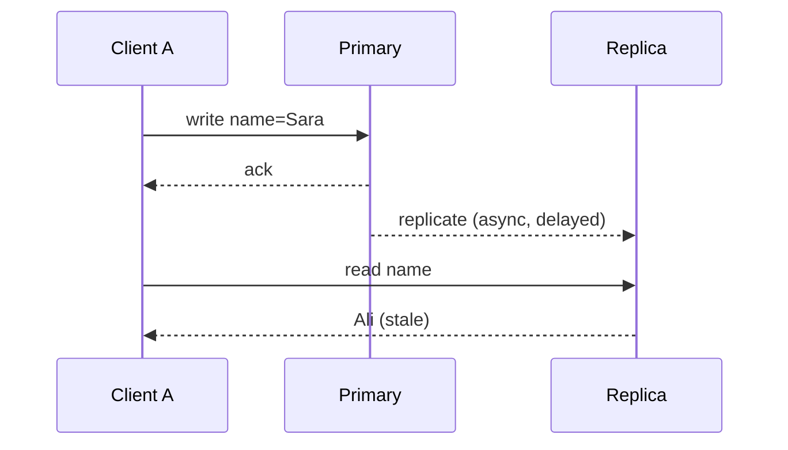

## 🎯 TL;DR

> A **consistency model** is a contract about **what a read is allowed to return** when data is replicated or accessed concurrently. Stronger models hide more of the distributed system from you, and cost more latency and availability.

- **Linearizability** (one object): every operation appears to take effect at one instant between its start and its end, and those instants respect real time. Once a write is acknowledged, every later read sees it.
- **Serializability** (transactions over many objects): concurrent transactions behave as if they ran one after another in *some* order. It says nothing about real time.
- **Strict serializability** = serializability + linearizability.
- **Causal** and **session** guarantees (read-your-writes, monotonic reads) are weaker, cheaper, and often enough.
- **Eventual** consistency only promises that replicas converge once writes stop.
- The **C** in CAP means linearizability. The **C** in ACID means the database keeps your integrity rules (constraints, invariants) true. They are different things.

## 🌱 Start simple (Junior)

> **💡 Analogy:** A shared family whiteboard that you photograph and pin on the fridge. You write "milk", then look at the photo, and it still shows the old list. Consistency models decide how stale that photo is allowed to be, and which people must see your change before you do.

Scenario: a user changes their display name. The write goes to the primary database. A read hits a replica that has not received the change yet.

```text
t=0  client A: UPDATE users SET name='Sara' WHERE id=7   (primary, OK)
t=1  client A: SELECT name FROM users WHERE id=7          (replica, lag 2s)
     -> returns 'Ali'   (stale)
```

Is that a bug? It depends on the contract. If the product promises "you always see your own change", yes. If it promises "others see the new name within a few seconds", no.

Three questions help you place a system on the spectrum:

1. Does a read always see the latest acknowledged write?
2. Do different clients see the writes in the same order?
3. Do I see my own writes, and do my reads never go back in time?

Each "yes" pushes the system toward the strong end, and each "yes" costs something.

## 🔧 How it really works (Mid)

### The strong end

A **linearizable** register behaves like one copy of the data where every operation is atomic. Each operation has an invocation and a response. There must be a single point (the *linearization point*) between them where the operation takes effect, and these points must be ordered consistently with real time. The practical consequence: if write W completes before read R starts, R must return W's value or something newer.

Linearizability is a property of **one object** (a key or a register). It says nothing about two keys updated together.

**Serializability** is a property of **transactions** over many objects. The outcome must equal *some* serial execution of those transactions. That serial order may differ from real time: a transaction that finished earlier can be placed after one that started later. This is why serializable is not the same as linearizable. **Strict serializability** requires both: the serial order must respect real time.

Most SQL systems default to something weaker than serializable, such as read committed or snapshot isolation (see [[isolation-level]]). Check your engine's documentation to know which one you have.

### The middle

- **Sequential consistency**: all clients see the operations in one total order that respects each client's own program order, but not necessarily real time.
- **Causal consistency**: if write B depends on write A (B was written after reading A), everyone sees A before B. Concurrent writes may be seen in different orders.
- **Session guarantees** (per client):
  - *Read-your-writes*: after you write, your reads include that write.
  - *Monotonic reads*: a later read is never older than an earlier one.
  - *Monotonic writes*: your writes are applied in the order you issued them.

### The weak end

**Eventual consistency**: if writes stop, all replicas eventually converge to the same value. It says nothing about how long that takes or what you read in the meantime. See [[eventual-consistency]].

### A stale read in practice



With **synchronous** replication (the primary waits for the replica before acknowledging), this stale read cannot happen, but every write pays the replica round trip, and one slow replica slows all writes. With **asynchronous** replication, writes are fast, and replica reads can be stale. Session stickiness (send a user's reads to the primary for a few seconds after a write, or to the replica that acknowledged the write) gives read-your-writes without the full synchronous cost.

### Quick reference

| Model | Promise | Typical cost |
|---|---|---|
| Strict serializability | Transactions look serial, in real-time order | Highest latency, coordination on commit |
| Linearizable (per key) | Reads see the latest acknowledged write | Leader or quorum round trips |
| Serializable | Transactions equal some serial order | Locks, aborts, or validation |
| Snapshot isolation | Each transaction reads one consistent snapshot | Cheap reads, but write-skew anomalies |
| Causal | Causally related writes seen in order | Dependency tracking |
| Session (read-your-writes) | Own writes visible, reads never go back | Sticky routing or version checks |
| Eventual | Replicas converge once writes stop | Cheapest, most available |

## 🧠 Senior depth & trade-offs

- **CAP and the C.** The CAP theorem (see [[cap-theorem]]) says that during a network partition you cannot keep both linearizable consistency and availability for every request. The choice is per operation, not per system. PACELC adds that even without a partition you trade latency against consistency. See [[cap-pacelc]].
- **Quorums are not magic.** With N replicas, a write acknowledged by W replicas and a read from R replicas with R + W > N always overlap in at least one replica. That overlap is necessary but not sufficient for linearizability. Concurrent writes, sloppy quorums, hinted handoff and writes that failed after being applied can still return stale or conflicting values. Dynamo-style stores (for example Cassandra) are tunable and usually eventual; their lightweight transactions use a separate, slower consensus path. Check the docs for your version.
- **Replica reads in analytics.** A dashboard on a replica shows data that is seconds or minutes old. Put the lag in the SLA, show a "data as of" timestamp, and monitor replication lag as a metric. Never use a replica read to make an irreversible decision, such as charging a card.
- **Table formats.** Iceberg, Delta and Hudi give snapshot isolation on object storage through atomic metadata commits. Conflicting writers are detected at commit time. Readers see a consistent snapshot, but two engines reading "latest" can see different snapshots if one has not refreshed its catalog. That is a freshness issue, not a corruption issue.
- **Kafka.** Within one partition, the log gives one order that every consumer sees identically. Across partitions there is no order. Design for per-key ordering, not global ordering.
- **Cost model.** Each step up the ladder adds a round trip or a lock. A linearizable write across regions costs at least one cross-region round trip, often tens to hundreds of milliseconds. Choose the weakest model that keeps your invariants true, and enforce the rest in the application with idempotency keys and unique constraints.
- **What to monitor.** Replication lag per replica, stale-read rate in canaries (write, then read back), abort rates under serializable isolation, and consumer lag for event-driven copies.

## 🧪 Try it

Use two `psql` sessions against PostgreSQL 13 or later, or reason on paper.

1. Create `accounts(id int primary key, balance int)` with the row `(1, 100)`. In session A run `BEGIN; UPDATE accounts SET balance = balance - 30 WHERE id = 1;` and do not commit. In session B run `SELECT balance FROM accounts WHERE id = 1;`. What does B see, and what does it see after A commits?
2. Two doctors are on call and the rule is "at least 2 on call". Two transactions each run `SELECT count(*) ... WHERE on_call` (sees 2), then each sets its own row to off call, and both commit. What is the anomaly, and what two fixes would you consider?
3. A user writes to the primary, then their next read goes to a replica that is 3 seconds behind and shows the old value. Which session guarantee is violated, and which routing change restores it?

<details><summary>Show solutions</summary>

**1.** B sees `100`: under read committed, uncommitted changes are invisible to other sessions. After A commits, B's next statement sees `70`.

**2.** This is write skew. Both transactions read the same snapshot, then write different rows, so a snapshot-isolation check on row conflicts does not fire and the rule "at least 2" breaks. Fixes: run the transactions at SERIALIZABLE (PostgreSQL detects this with SSI and aborts one of them), or make both transactions update a shared row (for example a shift row) so they conflict on the same key.

**3.** Read-your-writes is violated: the user does not see their own write. Fix: send that user's reads to the primary for a short window after a write, or pass the write's log position along and make the replica wait until it has applied that position.

</details>

## 💬 Interview corner

**Question: "What is the difference between consistency in CAP and consistency in ACID?"**

- Mid: "CAP's consistency means linearizability, so every read sees the latest write. ACID's consistency means the database keeps the constraints valid. They are different."
- Senior: "CAP's C is a recency property on the system's data, and it is what you give up during a partition. ACID's C is an application invariant that the database enforces with constraints and transactions, and it depends on the isolation level. A system can be ACID and still not linearizable, for example a primary with snapshot isolation and asynchronous replicas."

**Question: "Is serializable the same as linearizable?"** No. Serializable is about transactions over several objects, with some serial order. Linearizable is about single objects and real-time order. Strict serializable has both.

> **🎤 Say this in the interview:** "First I'd ask which invariant must hold and which operation needs fresh data. Then I'd pick the weakest model that keeps that invariant, and enforce the rest with idempotency and constraints."

## ⚠️ Common mistakes

> **⚠️ Watch out:** "Replication means consistency." Replicas are copies. Unless the protocol guarantees otherwise, a read from a copy can be stale.

> **⚠️ Watch out:** "R + W > N gives strong consistency." It gives an overlap, not linearizability, once concurrent or failed writes are involved.

- Mixing up serializable (transactions) and linearizable (single objects).
- Assuming the default isolation level is serializable. Many databases default to read committed.
- Reading from a replica and then acting on the value as if it were the source of truth.
- Thinking eventual consistency means "wrong data". It means temporarily stale data with a convergence rule.
- Comparing wall-clock timestamps from different machines to decide order (see [[time-and-ordering]]).

## ✅ Check yourself (quiz)

1. Which property does "every read returns the most recently acknowledged write to that key" describe?
   - A) Serializability
   - B) Linearizability
   - C) Causal consistency
   - D) Eventual consistency

<details><summary>Answer</summary>

**B** — linearizability for a single object: once a write is acknowledged, every later read sees it (or something newer). Serializability is about transactions over several objects and does not require real-time order.

</details>

2. A user posts a comment, refreshes the page, and the comment is missing because the read went to a lagging replica. Which guarantee is violated?
   - A) Monotonic writes
   - B) Read-your-writes
   - C) Serializability
   - D) Durability

<details><summary>Answer</summary>

**B** — read-your-writes says a client's reads include its own earlier writes. Durability is about a write surviving a crash, which is not the issue here.

</details>

3. Two concurrent transactions each read overlapping data, decide based on it, and write different rows. Under snapshot isolation both commit and an invariant breaks. What is this anomaly called?
   - A) Dirty read
   - B) Lost update on the same row
   - C) Write skew
   - D) Phantom read in a read-only query

<details><summary>Answer</summary>

**C** — write skew. The transactions write disjoint rows, so the row-level conflict check of snapshot isolation does not fire. Serializable isolation or an explicit shared-row conflict fixes it.

</details>

4. **(Senior)** An analytics team reads from a replica to decide whether a customer has enough remaining credit to allow a card charge. Why is this design wrong, and what would you change?
   - A) Replicas do not support SELECT
   - B) The replica read may be stale, so the decision can use an outdated balance; run the check on the primary in the same transaction as the charge, or use a conditional update that enforces the limit
   - C) Replicas are always linearizable, so no change is needed
   - D) Card charges should use DISTINCT

<details><summary>Answer</summary>

**B** — a decision that must not be wrong (charging money) has to read authoritative state, inside a transaction that enforces the invariant. Replicas are fine for dashboards with a stated freshness.

</details>

5. **(Senior)** A cluster has N=5 replicas, writes wait for W=3 acknowledgements and reads query R=3 replicas. A colleague says this is linearizable because R + W > N. What do you answer?
   - A) Correct, the overlap guarantees linearizability
   - B) The overlap is necessary but not sufficient: concurrent writes and writes that failed after being applied can still return stale or conflicting values; linearizability needs a protocol that totally orders operations, such as a leader with a consensus log
   - C) Correct only if N is even
   - D) Irrelevant, quorums never overlap

<details><summary>Answer</summary>

**B** — R + W > N guarantees at least one replica in common, but without a total order of writes and a read protocol that handles in-flight writes, anomalies remain. Consensus-based systems (see [[consensus]]) order every operation through one log, which gives linearizable reads.

</details>

## 🗂️ Flashcards

| Front | Back |
|---|---|
| Linearizable | Each op takes effect at one instant between its start and end; respects real time; one object |
| Serializable | Concurrent transactions equal some serial order; no real-time requirement |
| Strict serializability | Serializable + linearizable |
| Read-your-writes | After my write, my reads include it |
| Monotonic reads | My later reads are never older than my earlier reads |
| Causal consistency | Causally related writes are seen in the same order by everyone |
| Write skew | Two transactions read overlapping data, write disjoint rows, and break an invariant |
| C in CAP vs C in ACID | Recency of data (linearizability) vs application integrity invariants |

## 🔗 Go further

- **[[distributed-fundamentals]]** describes the failure model these guarantees are built on.
- **[[cap-pacelc]]** turns the trade-off into a latency decision.
- **[[consensus]]** shows how a linearizable log is built.
- **[[isolation-level]]** and **[[mvcc]]** explain the single-node side of serializability.
- **[[kafka-exactly-once]]** and **[[dedup-idempotent-loads]]** show how to keep invariants when the store is weak.
