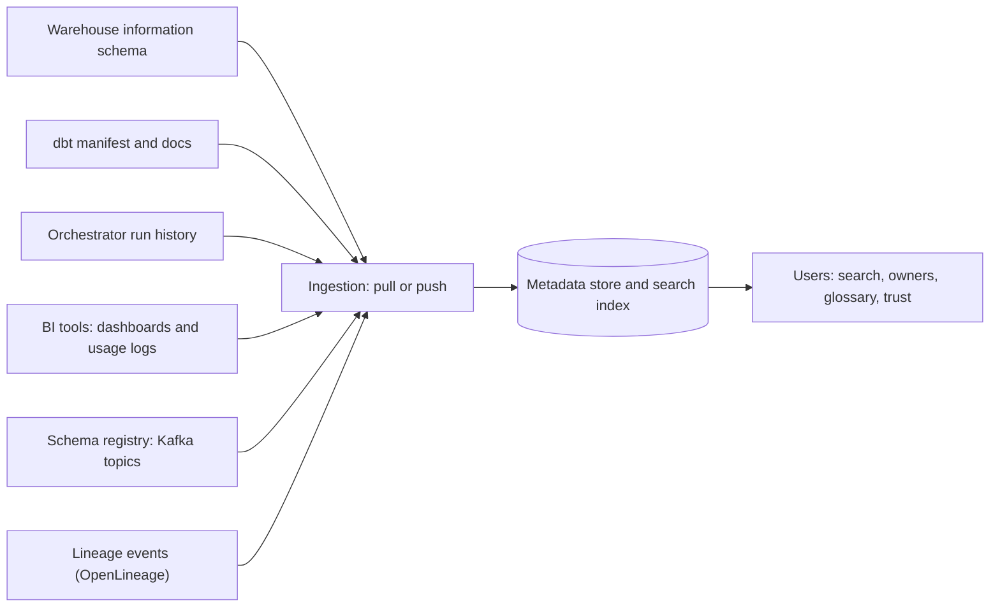

## 🎯 TL;DR

> A **data catalog** is the searchable index of your data estate: which tables and dashboards exist, what they mean, who owns them, how they are used, and how they connect (lineage). It holds **metadata**, not the data itself.

- The four kinds of metadata: **technical** (schema, types), **operational** (freshness, run history), **business** (definitions, glossary terms) and **usage** (who queries what, how often).
- A catalog serves three jobs: **discovery** ("where is the revenue table?"), **trust** ("is it certified, who owns it?") and **governance** ("which columns are personal data?").
- Tools such as **OpenMetadata**, **DataHub** and **Amundsen** differ in how metadata gets in (pull or push), how they model entities, and how much they focus on search, governance workflows or lineage. Check the current docs before choosing.

## 🌱 Start simple (Junior)

> **💡 Analogy:** A library catalog. The books are the data. The catalog card says the title, the author, the shelf, whether the copy is current, and who to ask about it. Nobody reads the catalog to learn the book's content, but nobody finds the book without it.

Imagine a company with 2,000 tables. A new analyst asks: "Where do I find active customers for last quarter?" Without a catalog, the answer comes from a colleague's memory, and the analyst may pick `stg.customers_v2_old`. With a catalog, they search "active customer", open the certified table, see the owner and the definition, and check when it was last refreshed.

Here is what one catalog entry might hold, in plain YAML:

```yaml
table: mart.customers
description: One row per customer, with activity flags updated daily.
owner: growth-analytics
certified: true
tags: [pii-contains-email]
columns:
  email:
    type: text
    tags: [pii]
  is_active:
    type: boolean
    business_term: Active customer
```

Each line is metadata. None of it is customer data.

## 🔧 How it really works (Mid)

**Where metadata comes from.** A catalog does not invent its information. It **ingests** it from sources:



- **Pull (crawlers):** a scheduled job reads metadata from a source, for example the warehouse's information schema. Simple, but it lags behind changes.
- **Push:** a source emits metadata events when something changes, for example a dbt run or a schema registry update. Fresher, but each source needs an integration that emits events.

**Four kinds of metadata**, and what they enable:

| Kind | Examples | What it enables |
|---|---|---|
| Technical | columns, types, partitions, row counts | Search by column name, schema diffs |
| Operational | last refresh, run status, SLA | Freshness badges, incident triage |
| Business | definitions, glossary terms, metrics | "What does 'active' mean here?" |
| Usage | query counts, top users, dashboards built on it | Popularity ranking, deprecating unused tables |

**Business glossary.** A glossary is a list of agreed business terms ("Active customer", "Net revenue") with one definition each. The useful part is the **link**: the term is attached to the columns and dashboards that implement it. Two teams then stop computing "active" differently, or at least they can see that they do.

**Ownership.** Every important asset needs an owner (a team) and often a steward (a person who maintains definitions). Ownership drives alert routing in [[data-observability]] and access requests in governance.

**Certification.** A simple label like "certified" tells users which tables meet a standard (documented, tested, owned, fresh). Automating the check is better than maintaining the label by hand.

A small check you could run against catalog exports, to find tables without owners:

```python
catalog = [
    {"name": "mart.revenue_daily", "owner": "finance", "columns": {"amount": "numeric"}},
    {"name": "stg.customers", "owner": None, "columns": {"email": "text"}},
]

def missing_owner(entries: list[dict]) -> list[str]:
    return [e["name"] for e in entries if not e.get("owner")]

print(missing_owner(catalog))  # ['stg.customers']
```

## 🧠 Senior depth & trade-offs

- **A catalog that nobody updates is worse than none.** Stale descriptions and owners teach people to distrust the tool. Measure coverage (share of certified tables with owners and descriptions) and freshness of the metadata itself.
- **Pull vs push is a freshness versus effort trade-off.** Crawlers are easy to deploy and work on any source. Push integrations are more accurate and cheaper at scale but need work per tool. Most real deployments mix both.
- **Metadata is a graph.** Lineage, ownership and glossary links together make the catalog useful for impact analysis. A flat list of tables with descriptions answers only "what is this?".
- **Governance workflows.** Access requests, PII classification and approval steps are where tools differ most. If compliance requires an audit trail, check that the tool records who approved what and when, instead of trusting a free-text tag.
- **Search quality is the adoption driver.** Users judge the catalog by its first search. Ranking by usage and certification, synonyms for business terms, and clear table names matter more than the number of connectors.
- **Scale and the metadata store.** A few thousand tables with columns is a modest index. The cost is in ingestion frequency, column-level profiling and the volume of usage logs, not in the search itself.
- **Catalog vs table catalog.** Do not confuse this with the table-format catalog used by Iceberg or the Hive metastore, which tracks where a table's files and metadata are and which engines can read it. Those are part of the storage layer; a data catalog is for people and governance. See [[catalogs]] for that side.
- **When not to adopt a full platform.** For a small team with a handful of tables, a documented wiki page, a naming convention and dbt docs cover most needs. Adopt a catalog when people repeatedly ask the same "where is" and "who owns" questions.

## 🧪 Try it

1. Extend the `missing_owner` function so it also returns tables where `columns` contains a name ending in `email` but the table has no `tags` containing `pii`. **Predict:** which entries does the new check flag in the example above?
2. Write a YAML entry for a business term "Net revenue" that links to two columns in two different tables. Explain what the link adds that a plain description does not.
3. Design a certification rule with three conditions that could be checked automatically. Name what each condition reads from (which kind of metadata).

<details><summary>Show solutions</summary>

**1.** With the example data, `stg.customers` has an `email` column and no `tags` at all, so it is flagged. `mart.revenue_daily` has no `email` column, so it is not. The point of the exercise is to notice that missing `tags` should be treated as "no tags", not crash the check: use `e.get("tags", [])`.

**2.** The YAML is a glossary entry with `term`, `definition`, `owner` and `linked_columns` listing the two columns. The link lets the catalog show every place the term is implemented and lets a reviewer see when two teams compute it differently. A plain description cannot be checked against the data.

**3.** Examples: (a) has an owner (ownership metadata); (b) has a description and a glossary link on key columns (business metadata); (c) was refreshed within its SLA (operational metadata). Each condition reads from a different metadata kind, which is why catalogs need several ingestion sources.

</details>

## 💬 Interview corner

**Question: "How would you help analysts find trustworthy data?"** Mid answer: "I would set up a catalog that ingests the warehouse schema and dbt docs, so people can search tables and see descriptions and owners." Senior answer: "I would start with the tables that the most dashboards and models use, and make them certified: owned, documented, tested and fresh. I would ingest technical, operational and usage metadata automatically, add a business glossary for the terms people argue about, and measure search success and coverage rather than the number of tables."

**Question: "Data catalog or data lineage: which first?"** Start with the catalog's core (ownership, descriptions, search) because it solves the most common daily question. Lineage adds depth for impact analysis and usually comes once the metadata pipelines are reliable.

> **🎤 Say this in the interview:** "A catalog is the index of the data estate. I want technical, operational, business and usage metadata in it, with owners on every important asset and a glossary for shared terms. I judge it by whether people find and trust the right table quickly."

## ⚠️ Common mistakes

> **⚠️ Watch out:** Treating the catalog as a documentation project that runs once. Metadata decays unless ingestion and ownership are automated.

- Ingesting everything and curating nothing, so search returns 40 near-identical tables.
- Writing business definitions in a wiki and never linking them to columns.
- Assigning owners who have left the company, or owners by default (for example, "data team") that nobody answers for.
- Confusing a data catalog with the table-format catalog that tracks Iceberg or Hive table metadata.
- Using a "certified" tag that people set by hand and never revisit.
- Expecting the catalog to enforce access control. It records and displays; enforcement lives in the data platform.

## ✅ Check yourself (quiz)

1. Which kind of metadata is "last refresh time" and "last run status"?
   - A) Technical
   - B) Operational
   - C) Business
   - D) Usage

<details><summary>Answer</summary>

**B** — operational metadata describes how and when data was produced and whether it is current.

</details>

2. What is the main benefit of a business glossary linked to columns?

   - A) It makes queries run faster
   - B) It attaches agreed definitions to the places where those definitions are implemented
   - C) It replaces the warehouse schema
   - D) It encrypts personal data

<details><summary>Answer</summary>

**B** — a definition alone can drift from the code. Linking it to columns makes the implementation visible and reviewable.

</details>

3. A team's catalog has 90% of tables ingested, but analysts still ask the same "who owns this?" questions. What is the likely gap?

   - A) Ingestion is too fast
   - B) Ownership metadata is missing or stale, even though technical metadata is complete
   - C) The team needs more usage logs
   - D) The catalog needs a second search engine

<details><summary>Answer</summary>

**B** — technical coverage does not imply ownership coverage. Ownership is a separate piece of metadata that must be entered and maintained, often through a process rather than a crawler.

</details>

4. **(Senior)** Why might a team prefer push-based ingestion for dbt models, but a pull-based crawler for a legacy database?

<details><summary>Answer</summary>

dbt runs emit fresh, structured metadata at the moment of change, so push keeps the catalog accurate and cheap. A legacy database often has no event hooks, so a scheduled crawler of its information schema is the practical option. Most deployments mix both.

</details>

5. **(Senior)** How would you measure whether the catalog is succeeding?

   - A) Number of tables ingested
   - B) Search success (users find and open the table they need), certified coverage of critical tables, and share of critical tables with owners and descriptions
   - C) Number of logins per day only
   - D) Number of connectors installed

<details><summary>Answer</summary>

**B** — ingestion volume is an input, not an outcome. Measure whether people find trusted data and whether the important assets are documented and owned.

</details>

## 🗂️ Flashcards

| Front | Back |
|---|---|
| What does a data catalog store? | Metadata about data (schema, owners, definitions, usage, lineage), not the data itself |
| The four kinds of metadata | Technical, operational, business, usage |
| Pull vs push ingestion | Pull: a crawler reads a source on a schedule; push: the source emits metadata events on change |
| What makes a glossary useful? | Links from each agreed term to the columns and dashboards that implement it |
| Why do owners matter in a catalog? | They route questions, alerts and access requests to someone accountable |
| Data catalog vs table-format catalog | Data catalog serves people and governance; table-format catalog (Iceberg, Hive metastore) tells engines where a table's files are |
| The best adoption metric | Search success and coverage of critical assets, not the number of tables ingested |

## 🔗 Go further

- [[data-lineage]] adds the dependency graph that makes the catalog useful for impact analysis.
- [[data-observability]] uses owners and lineage from the catalog to route alerts.
- [[governance-contracts-mesh]] covers ownership, policies and contracts, the governance context around catalogs.
- [[catalogs]] explains the table-format catalog side (Iceberg and Hive metastore), which is a different concept with the same name.
- [[dbt]] is a common source of descriptions and tests that the catalog ingests.
- Read each tool's current documentation for its ingestion model and supported sources; these change between releases.
