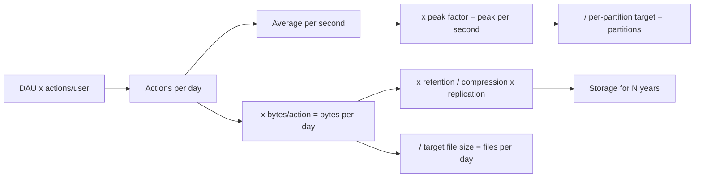

## 🎯 TL;DR

> **Back-of-envelope estimation** turns one product number (for example "10M daily active users") into the handful of numbers a design depends on: events per second, bytes per day, file or partition counts, and storage for N years.

- Write down every assumption before you calculate. The interviewer cares about the reasoning more than the exact result.
- Round aggressively. Use powers of ten: one day is about 10^5 seconds (86,400), one million per day is about 12 per second.
- Peak is not average. Multiply the average by a peak factor (2 to 5 is a common planning range) before you size anything.
- Check the result against a sanity rule: "does this fit on one machine?", "is this file count sane?", "is a cluster needed at all?"

## 🌱 Start simple (Junior)

> **💡 Analogy:** You are ordering pizza for a stadium. You do not know the exact crowd, so you say "about 50,000 people, half will eat, each eats 2 slices, so 50,000 slices, around 1,000 pizzas". The number is rough, but it tells you whether you need one oven or ten. Data estimation works the same way.

The method has five steps. Learn them once and you can use them for every system design question.

1. **Users to actions.** `users × actions per user per day = actions per day`.
2. **Per day to per second.** Divide by 86,400 (round to 10^5 when you only need the order of magnitude). Then multiply by a peak factor.
3. **Actions to bytes.** `actions per day × bytes per action = bytes per day`.
4. **Bytes to storage.** Multiply by retention days. Then divide by compression ratio, and multiply by replication factor if the storage is replicated.
5. **Storage and throughput to structure.** Divide by a target file size to get file counts, and by a per-partition throughput target to get partition counts.

Three conversion facts save most of the time:

| Quantity | Value | Use it for |
|---|---|---|
| Seconds per day | 86,400 ≈ 10^5 | per-day → per-second |
| 1 million per day | ≈ 11.6 per second | rough request rate |
| 1 GB per day | ≈ 12 KB per second | rough ingest bandwidth |

## 🔧 How it really works (Mid)

The estimation flow is a funnel: you start with users and end with hardware-level numbers.

### Worked example 1: event pipeline

**Given:** 10M daily active users (DAU), 20 events per user per day, 1 KB per event, peak factor 3, one year of raw retention, Parquet compression ratio 5 (5 GB of raw data becomes 1 GB on disk), storage replication factor 3.

**Throughput**

- Events per day = 10,000,000 × 20 = 200,000,000 = 2 × 10^8
- Average per second = 2 × 10^8 / 86,400 ≈ 2,315 → call it **2.3k/s**
- Peak per second = 3 × 2,315 ≈ 6,944 → call it **7k/s**
- Ingest bandwidth at peak = 6,944 events × 1 KB ≈ 6.9 MB/s

**Daily volume**

- Raw bytes per day = 2 × 10^8 × 1 KB = 2 × 10^11 B = **200 GB/day**
- Compressed per day = 200 GB / 5 = **40 GB/day**

**Yearly storage**

- Raw, one year: 200 GB × 365 = 73,000 GB ≈ **73 TB**
- Compressed, one year: 40 GB × 365 = 14,600 GB ≈ **14.6 TB**
- With replication 3: 14.6 TB × 3 ≈ **44 TB** (object storage with erasure coding has a different overhead; state your assumption)

**Files and partitions**

- If a good target file size is 256 MB, the compressed daily volume gives 40,000 MB / 256 MB ≈ 156, so about **160 files per day** and about 58,000 per year. That is a file count you can manage, but if your writers create one file per micro-batch every minute you would create 1,440 small files per day. That is the [[small-files-problem]].
- Kafka partitions: the peak is 6.9 MB/s. Pick a per-partition throughput target from your own benchmark (say 5 MB/s, a planning assumption, not a fixed limit). 6.9 / 5 ≈ 1.4, so at least 2 partitions. Choose **12** to leave headroom and to allow up to 12 parallel consumers.

### Worked example 2: a warehouse fact table

**Given:** 50,000 orders per day, 200 bytes per row, 5 years of history.

- Rows = 50,000 × 365 × 5 = 91,250,000 ≈ 9.1 × 10^7
- Raw size = 9.1 × 10^7 × 200 B = 1.825 × 10^10 B ≈ **18 GB**
- With a 3× allowance for indexes, metadata and overhead: about **55 GB**

This fits on one well-sized node. Many interview designs are much smaller than they sound, and saying so is a good signal. Do not add a distributed cluster for 55 GB without a reason.

### Worked example 3: query load on serving

**Given:** 1,000 analysts. Each opens 20 dashboards per day, and each dashboard runs 5 queries. 80% of the activity happens in a 2-hour business window.

- Queries per day = 1,000 × 20 × 5 = 100,000
- Average = 100,000 / 86,400 ≈ 1.2 queries per second
- Peak window = 80,000 queries in 7,200 seconds ≈ **11 queries per second**

Requests per second are small. The real cost is the bytes each query scans. If each query scans 2 GB, the peak scan rate is 11 × 2 GB ≈ **22 GB/s**. That number decides whether you need pre-aggregation, a serving table or a faster engine. This is why [[olap]] designs care about bytes scanned more than request counts.

## 🧠 Senior depth & trade-offs

- **Sensitivity beats precision.** Before you refine a number, ask which input moves the result most. Here, bytes per event and retention dominate; the peak factor matters for sizing compute, not storage. Spend your time on the big levers.
- **Average and peak are different designs.** Storage is sized on the sum over time. Compute and network are sized on the peak. Kafka retention, consumer lag budgets and cluster size all depend on the peak, not the mean.
- **Skew breaks the uniform model.** Divide by partitions and assume even load, then check the hot key. One celebrity user or one region can put 30% of events in a single partition. Estimate the top key separately (see [[hot-key]]).
- **Replication and compression multiply.** A 5× compression ratio on Parquet is a plan, not a fact. Measure it on a real sample. Columnar formats and dictionary encoding can give very different ratios depending on the data.
- **Retention is a business decision.** Ask how long data must be kept for audits, reprocessing and ML training. Keeping raw events for 365 days and aggregates for 5 years is a common split, and it changes the storage answer by an order of magnitude.
- **Know when not to use a big system.** If the estimate says "a few TB per year, a few thousand events per second", a managed warehouse or a single Postgres node may be enough. Streaming platforms add operational cost, and the estimate should justify them.
- **Monitor the assumptions.** In production, track actual bytes per event, real compression, real peak factor and file sizes. A design review is only as good as the numbers it was built on; see [[capacity-planning]].

## 🧪 Try it

Solve these on paper first, in under 3 minutes each. Then check the solutions.

1. **Clickstream.** 5M DAU, 50 page views per user per day, 500 bytes per event, peak factor 4, 90 days of raw retention, compression 4×. Find the events per second (average and peak), the raw and compressed daily volume, and the compressed 90-day storage.
2. **Payments.** 2,000,000 transactions per day, 300 bytes per row, 7 years retention, 3× overhead allowance. Find the total size, and say whether it fits on one node.
3. **Kafka sizing.** The peak from exercise 1 is written to Kafka with a planning target of 8 MB/s per partition. How many partitions do you need, and what would you choose with a parallel consumer group of 16?

Show solutions

**1.**
- Events per day = 5,000,000 × 50 = 2.5 × 10^8
- Average per second = 2.5 × 10^8 / 86,400 ≈ 2,894 → about **2.9k/s**
- Peak = 4 × 2,894 ≈ 11,574 → about **11.6k/s**
- Raw daily = 2.5 × 10^8 × 500 B = 1.25 × 10^11 B = **125 GB/day**
- Compressed daily = 125 / 4 = **31.25 GB/day**
- 90 days compressed = 31.25 × 90 ≈ 2,812 GB ≈ **2.8 TB**

**2.**
- Rows over 7 years = 2,000,000 × 365 × 7 = 5.11 × 10^9 rows
- Raw size = 5.11 × 10^9 × 300 B = 1.533 × 10^12 B ≈ **1.5 TB**
- With 3× overhead ≈ **4.6 TB**
- One node with a few TB of disk can hold this, but it is close to the limit. Whether it "fits" depends on the disk and the query load. A good answer says "one large node or a small cluster, decided by query load, not by size alone".

**3.**
- Peak from exercise 1 = 11,574 events/s × 500 B ≈ 5.8 MB/s.
- 5.8 MB/s / 8 MB/s ≈ 0.7, so one partition would be enough for throughput alone. Round up for headroom and for consumer parallelism: **16 partitions** matches the consumer group of 16, so each consumer owns exactly one partition.

## 💬 Interview corner

**Question: "Estimate the storage for a log platform for a 10M user product."** Mid answer: "10M users times 20 events a day times 1 KB is 200 GB a day, which is about 73 TB a year before compression." Senior answer: "I'd use the same numbers, then split by retention tier. Raw logs for 30 days on hot storage, compressed Parquet for a year on object storage, and aggregates for longer. I'd state the compression ratio as an assumption and check it against a sample, because it moves the answer by 5×."

**Question: "How many partitions for this topic?"** Mid: "Peak throughput divided by the per-partition target, then round up." Senior: "Same, plus consumer parallelism and headroom for growth. I'd check that the hottest key does not overload one partition, because a uniform split is not what the data gives you."

> **🎤 Say this in the interview:** "Let me state my assumptions first: users, actions per user, bytes per event, and a peak factor. Then I'll compute per-day, per-second, and yearly numbers, and check whether the result needs a distributed system at all."

## ⚠️ Common mistakes

> **⚠️ Watch out:** Dividing the daily total by 24 instead of 86,400 seconds. 24 is hours, not seconds. Use 86,400 or the rounded 10^5.

> **⚠️ Watch out:** Sizing compute on the average. Peak traffic decides whether the system falls over, not the mean.

- Forgetting units. Keep bits and bytes apart (network links are often in bits per second, storage in bytes).
- Ignoring replication or overhead for storage, or applying it twice.
- Treating compression as free or exact. Measure it on real data.
- Calculating to six significant digits. Two is usually enough, and false precision looks junior.
- Designing for one million users when the question says "10M DAU" and then giving a number for a different product.
- Skipping the sanity check. An answer of "2 PB per day" for a small product means an input is wrong.

## ✅ Check yourself (quiz)

1. A product has 2 million daily active users, each generating 10 events per day. What is the average event rate per second, rounded?
   - A) About 23 per second
   - B) About 231 per second
   - C) About 2,315 per second
   - D) About 23,150 per second

Answer

**B** — 2,000,000 × 10 = 2 × 10^7 events per day. Divide by 86,400 to get about 231.5 per second. Option C is the answer for 10 million events per day, which is a common slip.

2. Which step do many candidates skip, and why does it matter most for compute sizing?
   - A) Converting bytes to bits
   - B) Applying a peak factor to the average rate
   - C) Naming the database
   - D) Choosing a file format

Answer

**B** — the average hides bursts. Brokers, consumers and query engines must handle the peak, so sizing on the average means they will fall behind at the busiest hour.

3. A candidate's storage estimate is 5× higher than a reviewer's. The inputs match. What is the most likely source of the difference, and how should you check it?

   - A) Different database vendors
   - B) A different compression ratio or replication factor assumption; check both against measured data and state them explicitly
   - C) The reviewer forgot about peak traffic
   - D) Partitioning changes the total number of bytes

Answer

**B** — compression and replication are multipliers, so small differences in assumptions become large differences in totals. Make them explicit in the answer and validate with a sample of real data.

4. **(Senior)** Your estimate says 400 GB per day of raw events, and a Kafka partition's safe target is 5 MB/s. Your peak rate is 30 MB/s. What do you do with the partition count and the hot key?

   - A) Add partitions until the peak divided by partition count is below 5, and check that the top key does not concentrate load on one partition
   - B) Set partitions to 1 for ordering and accept the lag
   - C) Increase the peak factor to 10 so the answer looks safe
   - D) Remove the key so that load is always uniform

Answer

**A** — the partition count must cover the peak with headroom (30 / 5 = 6 minimum, so 6 or more, perhaps 12 with headroom). Adding partitions does not help if a single key sends most of the events to one partition, so check skew separately. Option D removes ordering guarantees that the design may need.

5. **(Senior)** Your 5-year estimate is 40 TB, which the team wants to store on a single NVMe node. Why is "it fits on disk" not enough to decide, and what else would you estimate?

   - A) Disks cannot hold more than 10 TB
   - B) Also estimate query load (bytes scanned per second), recovery time after failure, and the cost of rebuilding indexes or replicas; capacity is one of several constraints
   - C) NVMe does not support Parquet
   - D) Nothing else matters once storage fits

Answer

**B** — a node that can hold the data may still be too slow to scan it, and a single node is a single failure domain. Recovery time (copying 40 TB back) and query throughput can rule it out even when disk capacity is fine.

## 🗂️ Flashcards

| Front | Back |
|---|---|
| Seconds in a day (rounded) | 86,400 ≈ 10^5 |
| 1 million events per day is about how many per second | ≈ 11.6 per second |
| First step of any estimate | Write down assumptions: users, actions per user, bytes per event, peak factor |
| Why use peak, not average, for compute | The busiest period decides whether the system keeps up |
| Storage formula with compression and replication | Raw per day × retention days ÷ compression × replication factor |
| Partitions from throughput | Peak throughput ÷ per-partition target, rounded up, plus headroom |
| Why a small estimate can change the design | If data fits on one node and load is low, a distributed cluster is not justified |

## 🔗 Go further

- **[[capacity-planning]]** covers the broader process: growth, headroom and the cost of being wrong.
- **[[partitioning-sharding]]** explains how the partition count you calculated maps to keys and nodes.
- **[[data-formats]]** and **[[columnar-storage]]** explain why compression ratios on Parquet differ from raw text.
- **[[kafka-architecture]]** shows how topic partitions and consumer groups relate to your numbers.
- Practise with a timer. Pick any product you use, make the five-step estimate in three minutes, then compare it with the real metrics the product publishes when they are available.
