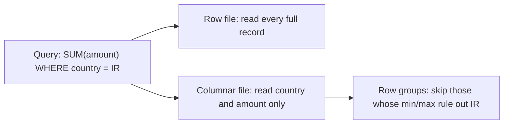

## 🎯 TL;DR

> A **file format** decides how bytes are laid out on disk or on the wire. The main split is **row-oriented** (all fields of one record together: CSV, JSON, Avro, Protobuf) versus **column-oriented** (all values of one column together: Parquet, ORC).

- Analytics usually reads **few columns of many rows**, so columnar formats win for stored tables.
- Message systems usually move **one record at a time**, so compact row formats (Avro, Protobuf) win on the wire.
- Parquet and ORC store **statistics** that let engines skip data they do not need.
- Some formats are not **splittable**: a distributed engine cannot cut them into parallel tasks, and one slow file becomes one slow task.

## 🌱 Start simple (Junior)

> **💡 Analogy:** Think of customer records as index cards. A **row** format keeps one card per customer, with all their information on it. A **column** format keeps one drawer per field: all names in one drawer, all ages in another. To answer "how many customers are over 40?", you open only the age drawer.

Here are three payment records in three formats. The data is the same:

```text
user_id,country,amount
42,IR,12.5
43,DE,7.0
44,IR,3.25
```

```json
{"user_id": 42, "country": "IR", "amount": 12.5}
{"user_id": 43, "country": "DE", "amount": 7.0}
{"user_id": 44, "country": "IR", "amount": 3.25}
```

CSV is plain text with no types: is `007` a number or a string? Nobody knows from the file alone. JSON adds structure and nesting, but it repeats every field name in every record, so a million records repeat `"country"` a million times. Binary formats store types once and skip the names.

The format is a **contract**. The reader must know the field names, their types and their order. Changing that contract later is the hard part, and it is where most production incidents come from.

## 🔧 How it really works (Mid)

A column store reads only what the query asks for. The diagram shows the difference for one query:



**Parquet layout.** A Parquet file is built from the inside out like this:

- **Row group**: a horizontal slice of rows (a writer setting; commonly around 128 MB in common writers).
- **Column chunk**: one column's values inside one row group. Each column can be read on its own.
- **Page**: a unit of encoded values inside a column chunk (commonly about 1 MB). Pages are where compression is applied.
- **Footer**: the schema, plus statistics (min, max, null count) for every column chunk. The reader reads the footer first, then decides what to fetch.

**Encodings** shrink the values before the codec (Snappy, Zstd, gzip) runs:

- **Dictionary encoding**: store each distinct value once, then small integer codes. Ideal for `country` (about 250 values).
- **Run-length encoding (RLE)**: `IR, IR, IR, IR` becomes `(IR × 4)`. Ideal for sorted or repetitive columns.
- **Delta encoding**: store differences between sorted integers or timestamps. `1000, 1001, 1002` becomes `1000, +1, +1`.

**Predicate pushdown** uses the footer. For `WHERE country = 'IR'`, the engine skips any row group whose min/max range for `country` cannot contain `'IR'`. This only works if the data is **clustered** by that column. If every row group spans `'AE'` to `'ZA'`, nothing is skipped (see [[predicate-pushdown]]).

Here is a small runnable example with `pyarrow`:

```python
import pyarrow as pa
import pyarrow.parquet as pq

table = pa.table({
    "user_id": [42, 43, 44],
    "country": ["IR", "DE", "IR"],
    "amount": [12.5, 7.0, 3.25],
})
pq.write_table(table, "payments.parquet", compression="zstd")

# Column projection: only two columns are read from storage
subset = pq.read_table("payments.parquet", columns=["country", "amount"],
                       filters=[("country", "=", "IR")])
print(subset.to_pydict())   # {'country': ['IR', 'IR'], 'amount': [12.5, 3.25]}

# The statistics live in the footer, no data pages are read
stats = pq.ParquetFile("payments.parquet").metadata.row_group(0).column(2).statistics
print(stats.min, stats.max)  # 3.25 12.5
```

**Avro** is row-based binary. Its schema is written in JSON, and it is stored once in the file header (an Avro container file) or referenced by an ID in each Kafka message. Evolution works through **reader and writer schemas**: the reader resolves the writer's schema into its own. A new field needs a **default** so old records can still be read:

```json
{
  "type": "record",
  "name": "Payment",
  "namespace": "com.example.payments",
  "fields": [
    {"name": "user_id", "type": "long"},
    {"name": "country", "type": "string"},
    {"name": "amount", "type": "double"},
    {"name": "channel", "type": ["null", "string"], "default": null}
  ]
}
```

The `channel` field was added later. Records written before it existed are read with `channel = null`. The default must match the first branch of the union, which is why `null` comes first.

**Protobuf** puts **field numbers**, not names, on the wire. You may add a new field with a new number. You must never reuse a number or change its type, because old data would be decoded into the wrong field. Protobuf messages are not self-describing: the reader needs the `.proto` file.

**Splittability.** A distributed engine (Spark, Trino) turns a file into tasks by cutting it into byte ranges. A file is splittable if a reader can start in the middle and find the next record boundary:

- Plain CSV and JSON Lines: yes, at newlines (if not compressed).
- **gzip-compressed CSV**: no. gzip must be decompressed from the start, so one task reads the whole file.
- Avro: yes, because sync markers appear between blocks, whatever the block codec.
- Parquet and ORC: yes, at row group and stripe boundaries. Snappy-compressed Parquet is splittable because compression is per page.

**ORC** is the Hive-era columnar format with stripes, similar statistics and optional Bloom filters. **Arrow** is a columnar format for **memory**, used to exchange data between processes (Python, Spark, DuckDB) without a copy. It is rarely the long-term storage format.

| Format | Layout | Schema location | Size | Splittable | Evolution | Typical use |
|---|---|---|---|---|---|---|
| CSV | row, text | header only | large | yes if uncompressed | weak | exports, small files |
| JSON Lines | row, text | implicit | largest | yes if uncompressed | flexible, not enforced | raw logs, landing |
| Avro | row, binary | file header or registry | compact | yes (sync markers) | strong (defaults, aliases) | Kafka messages, landing |
| Protobuf | row, binary | `.proto` file | compact | per message | strong with number rules | RPC, service messages |
| Parquet | column, binary | footer | smallest for analytics | yes (row groups) | good; table formats track columns by ID | lakehouse tables |
| ORC | column, binary | footer | small | yes (stripes) | good | Hive-era lakes |
| Arrow | column, memory | schema object | n/a | n/a | n/a | in-memory exchange |

## 🧠 Senior depth & trade-offs

- **Small files defeat columnar layout.** A Parquet file of 1 MB per partition costs a metadata read and a task launch for almost no data. Compact to file sizes in the hundreds of MB, see [[small-files]].
- **Clustering decides pruning.** Min/max statistics only skip data when values are grouped. Sort or cluster by the most common filter column (Z-order or a sort key in Iceberg, Delta or Spark writes), or partition by it. Random order makes the statistics useless.
- **Dictionary encoding has limits.** Writers fall back to plain encoding when a dictionary grows too large. Random UUIDs and high-precision floats compress poorly. Do not expect a 5× ratio on them.
- **Nested data.** Parquet stores nested structs and lists as separate leaf columns, with repetition and definition levels. A query that reads `user.address.city` reads only that leaf column. Flattening everything into a wide table costs storage and loses this.
- **Schema evolution rules.** Avro and Protobuf: add with defaults or new numbers, never change types in place. Parquet: adding columns is common, but readers that match by name break on renames; table formats (Iceberg, Delta) track columns by ID or mapping to make renames safe.
- **Kafka with Schema Registry.** Producers embed a schema ID in each message. The registry's compatibility mode (for example BACKWARD or FULL) decides which changes are allowed. Check your registry's documentation for the modes it offers.
- **Telco and ASN.1.** Call records often arrive as **ASN.1**-encoded binary (for example BER or PER encodings of a telecom record schema). Decode them at the edge with a generated decoder, then land them as Avro or Parquet with the schema version recorded. Keep the raw bytes until the decode is verified.
- **Conversion is a batch job.** The common pattern is Avro (or JSON) in a landing zone, then a batch job writes Parquet partitioned by date. Streams are row-oriented and append-friendly; analytics is column-oriented and scan-friendly.
- **When NOT to use columnar.** Reference tables of a few thousand rows, or data you open in an editor, are fine as CSV. A columnar format pays off on large, scanned tables.

## 🧪 Try it

1. A nightly Spark job reads 400 gzip-compressed CSV files of 1 GB each. The job uses 400 tasks and runs for hours. Why, and what two changes would you make?
2. A Parquet table partitioned by `event_date` has 2,000 files. Query `WHERE user_country = 'IR'` reads everything. Explain why, and propose a fix.
3. Add a field `discount` (double) to an Avro schema that is in production. Write the schema change so old data stays readable, and say what happens if you instead add it as a required field.

<details><summary>Show solutions</summary>

**1.** gzip is not splittable, so each 1 GB file becomes one task that reads the whole file. Parallelism is capped at 400 tasks, and each task is slow. Fixes: write the data as Parquet or Avro (splittable), or use a splittable codec (Snappy or Zstd in Parquet). Then Spark creates many tasks per file.

**2.** The table is partitioned by date, not country, and nothing is clustered by `user_country`. Within each date, the country values are spread across many files, so every file's min/max range covers `'IR'` and nothing is pruned. Fixes: sort or cluster the writes by `user_country` (for example, a sort key on the write job or Z-order in a table format), or add the column to the partition layout if its cardinality is low enough.

**3.** Add `{"name": "discount", "type": "double", "default": 0.0}` to the fields. Readers using the new schema fill `discount = 0.0` for old records, so both old and new data stay readable. If the field is required (no default), a reader with the new schema cannot decode old records that lack it, which breaks consumers during the rollout.

</details>

## 💬 Interview corner

**Question: "Why Parquet over CSV?"**

- **Mid answer:** "Parquet is columnar and compressed, so a query reads only the needed columns and far fewer bytes. It also keeps types and statistics, so CSV's text ambiguity disappears."
- **Senior answer:** "It is columnar, so column projection and predicate pushdown skip data, and the footer statistics let engines prune row groups. Encodings and codecs shrink storage several times over. The trade-off is that it is not human-readable, not appendable in place, and only pays off if files are sized and clustered correctly."

**Question: "Avro vs Protobuf for Kafka?"**

- **Mid answer:** "Both are compact binary formats with schemas. Avro is common with Kafka and the Schema Registry, and it has a container format for files. Protobuf is common in service-to-service APIs."
- **Senior answer:** "I'd choose by the ecosystem and evolution rules. Avro resolves writer and reader schemas and works well in Kafka and data lakes. Protobuf is excellent for RPC and strict field-number rules. Either way I'd enforce a compatibility mode in the registry, so a breaking change fails in CI, not in a consumer at 3 a.m."

**Question: "What makes a file splittable?"** A file is splittable if a reader can start at an arbitrary byte offset and find a valid record boundary. Uncompressed text at newlines, Avro via sync markers, and Parquet at row groups are splittable. gzip over the whole file is not.

> **🎤 Say this in the interview:** "I store the raw data as Avro for evolution and append-friendly writes, then batch-convert to Parquet partitioned and clustered by the main filter column. I check the file sizes, because small files and non-splittable codecs cost more than the format choice saves."

## ⚠️ Common mistakes

> **⚠️ Watch out:** A gzipped CSV or a gzipped JSON file is a single task. Compression choice is a parallelism choice, not only a size choice.

- Storing timestamps and numbers as strings in CSV or JSON. The type is lost, and every query casts.
- Adding a required field to Avro or Protobuf without a default. Old data becomes unreadable for new consumers.
- Reusing a Protobuf field number after deleting a field. Old data is decoded into the wrong field.
- Expecting predicate pushdown on a column the data is not clustered by.
- Believing "Parquet is always small". High-cardinality IDs and random floats compress poorly.
- Writing many tiny Parquet files, one per partition per batch. Metadata and task overhead dominate.
- Using Arrow as the long-term table format. It is an in-memory interchange format.

## ✅ Check yourself (quiz)

1. Which format stores all values of one column together?
   - A) Avro
   - B) Parquet
   - C) Protobuf
   - D) JSON Lines

<details><summary>Answer</summary>

**B** — Parquet is columnar. Avro, Protobuf and JSON Lines are row-oriented: each record's fields are stored together.

</details>

2. Why is a single gzip-compressed CSV file hard to parallelize?
   - A) gzip cannot compress text
   - B) gzip is not splittable, so a reader must start at the beginning and one task reads the whole file
   - C) CSV has no delimiter
   - D) Spark does not support gzip

<details><summary>Answer</summary>

**B** — gzip decompression must start at the beginning of the stream. The file can be read in parallel only as one unit, so the job is limited by one task.

</details>

3. Which Avro schema change keeps old data readable for new readers?
   - A) Add a new field with no default
   - B) Rename an existing field
   - C) Add a field `["null", "string"]` with default `null`
   - D) Change a field's type from `long` to `string`

<details><summary>Answer</summary>

**C** — a new field with a default lets readers fill old records. Renaming and changing types break the resolution between writer and reader schemas.

</details>

4. A Parquet table has 2,000 files and a query `WHERE event_date = '2026-03-01'` reads all of them. The most likely cause is:
   - A) Parquet does not support date filters
   - B) The data is not clustered or partitioned by `event_date`, so every file's min/max range covers the value
   - C) The files should be CSV
   - D) The query needs a `DISTINCT`

<details><summary>Answer</summary>

**B** — pruning needs clustering. If each file contains dates scattered across the whole range, the statistics cannot rule out any file. Sort or partition the write by `event_date`.

</details>

5. **(Senior)** Why keep raw events as Avro in a landing zone and batch-convert them to Parquet, rather than storing Parquet directly from the stream?

   - A) Parquet cannot be written by any streaming engine
   - B) Avro writes one record at a time with the schema attached and evolves well; Parquet is columnar and best for analytic scans, so a batch conversion gives you both benefits
   - C) Avro is smaller than Parquet for analytics
   - D) Parquet files cannot have more than one row group

<details><summary>Answer</summary>

**B** — streams produce small, row-wise records; a batch job can buffer them into large, sorted Parquet files. The trade-off is one more pipeline stage and a recorded schema version for each conversion.

</details>

## 🗂️ Flashcards

| Front | Back |
|---|---|
| Row vs columnar format | Row keeps each record together (Avro, CSV); columnar keeps each column together (Parquet, ORC) |
| Why Parquet is fast for analytics | Column projection and predicate pushdown read fewer bytes |
| What a row group is | A horizontal slice of rows, with one column chunk per column |
| Where Parquet statistics live | In the footer: min, max and null count per column chunk |
| Why gzip CSV is slow in Spark | gzip is not splittable, so one file means one task |
| Safe Avro field addition | A new field with a default value |
| Protobuf evolution rule | Never reuse or retype a field number |
| Dictionary encoding works best for | Low-cardinality columns such as country or status |

## 🔗 Go further

- **numbers-to-know** gives the size and throughput arithmetic that decides when format choices matter.
- **columnar-storage** and **compression** explain why column layout and codecs change scan cost.
- **file-layout** and **small-files** cover how many files to write and how big they should be.
- **schema-registry** shows how Avro and Protobuf schemas are versioned in Kafka.
- **lakehouse-table-formats** explains how Iceberg and Delta track columns and files on top of Parquet.
- **spark-writes** covers partitioning and clustering on write, which decide whether pruning works.
