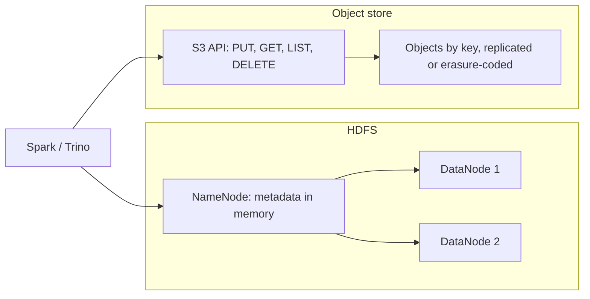

## 🎯 TL;DR

> A **data lake** is a large pool of files (usually Parquet, JSON, CSV or ORC) kept on cheap storage, with **no fixed schema on write**. Today the storage is usually an **object store** (S3 or an S3-compatible system such as MinIO or Ceph RGW), or older **HDFS** clusters.

- **Object storage** keeps immutable objects in flat buckets, addressed by key. It is cheap, durable and scales far beyond one cluster.
- **HDFS** is a real file system with directories and an atomic directory rename. Its compute is usually co-located with its storage.
- The object store is not a file system. **Directories do not exist, rename is a copy plus delete, and listing is paginated.** Most lake bugs come from forgetting this.
- **Storage and compute are separate**: many engines (Spark, Trino, Flink, Hive) read the same files, and each one scales on its own.
- A lake without ownership, a catalog and file hygiene turns into a **data swamp**.

## 🌱 Start simple (Junior)

> **💡 Analogy:** A library's back room. Books (files) are stacked in boxes with labels on the outside. Anyone can drop a box in, and nobody checks the content when it arrives. That is cheap and fast to add to. Finding the right book later needs a good label system and a catalog card. Without those, the back room becomes a pile nobody can use. That pile is the **data swamp**.

In a lake, a "table" is often just a folder of files:

```text
s3://company-lake/raw/orders/dt=2026-03-01/part-0001.parquet
s3://company-lake/raw/orders/dt=2026-03-01/part-0002.parquet
s3://company-lake/raw/orders/dt=2026-03-02/part-0001.parquet
```

Each file is a **Parquet** file (see [[parquet]]). The `dt=2026-03-01` part is a naming convention (Hive-style partitioning) that engines use to skip folders they do not need. A query for one day reads one folder, not the whole bucket.

Three ideas to hold onto:

- **Object:** a blob with a key (its path) and metadata. You write it whole, and you do not edit it in place.
- **Bucket / prefix:** a flat namespace. `raw/orders/` is just a string prefix, not a folder.
- **Schema on read:** the lake accepts any file. The reader decides how to interpret it, which is flexible and risky.

## 🔧 How it really works (Mid)

The two storage families behave differently. This table is the core of the interview answer.

| Property | HDFS | Object store (S3 API) |
|---|---|---|
| Namespace | Real directories, stored in NameNode memory | Flat keys; "directories" are key prefixes |
| Rename a directory | One metadata operation (fast, effectively atomic) | Copy every object to the new key, then delete the old ones (not atomic, cost ∝ data size) |
| Append to a file | Supported (within limits) | Not supported; you write a new object |
| Listing | Directory listing from metadata | Paginated LIST by prefix (pages of up to 1,000 keys) |
| Compute | Usually co-located with data (data locality) | Separate; data is read over the network |
| Scaling | Add DataNodes; NameNode memory is a limit | Practically unbounded object count per bucket |



**Why rename matters.** A Spark job writes to a temporary location and then renames the output to its final place, so readers never see half a job. On HDFS this rename is cheap and atomic-enough. On S3 the same rename is a copy of every file, so a failure in the middle leaves a mixed state. This is why object-store writes need an **output committer** designed for object stores (see the Spark write lessons, for example [[spark-writes]]), and why table formats exist (see [[lakehouse-table-formats]]).

```bash
# On S3, "moving a folder" is copy + delete, one object at a time
aws s3 mv s3://company-lake/raw/orders/dt=2026-03-01/ \
          s3://company-lake/clean/orders/dt=2026-03-01/ --recursive
# If this stops at object 500 of 2000, the bucket now has both halves.
```

**Consistency.** Modern S3 gives strong read-after-write consistency for objects and for listings, so a file you just wrote shows up in a LIST. Older systems and some S3-compatible products had weaker guarantees. Check the documentation of the system you run, and do not assume every compatible store behaves identically.

**Replication vs erasure coding.** Both protect data against disk and node failures:

- **Replication (3 copies):** raw capacity = 3 × usable. Simple, fast reads and repairs.
- **Erasure coding (for example, Reed-Solomon 6+3):** split data into 6 data shards and compute 3 parity shards. Raw capacity = 9/6 = 1.5 × usable, and any 3 lost shards are recoverable. Costs more CPU and slower repair, and small objects often suffer.

Worked numbers: 1 PB of usable data costs 3 PB raw with 3-way replication, and 1.5 PB raw with 6+3 erasure coding. The saving is large, which is why cold lake data on-prem is often erasure coded.

## 🧠 Senior depth & trade-offs

- **Small files.** Object stores charge per request and per object, and every engine pays a task or metadata cost per file. A day of streaming data written every 10 seconds can create tens of thousands of tiny files. See [[small-files-problem]] and [[compaction]].
- **Commit protocol.** Writing to S3 from Spark or Hive without a proper committer can lose or duplicate output on retries. Prefer a table format with atomic commits over raw directory writes for anything that matters.
- **Listing cost at scale.** Listing 10 million objects is slow even with pagination. Partition layout and manifests (see [[lakehouse-table-formats]]) exist so engines do not list the whole bucket.
- **Storage/compute separation.** It lets you scale compute to zero and share one copy of data among engines. The cost is network I/O and per-request charges, so caching, columnar formats and predicate pushdown matter (see [[predicate-pushdown]]).
- **Deletion and retention.** Deleting a person's data from immutable files means rewriting the affected files or using a table format with row-level deletes. Plan retention and deletion from day one (see [[data-retention]] and [[pattern-data-deletion]]).
- **Data swamp prevention.** Use zones (raw, clean, curated), a catalog with owners, schema contracts for critical datasets, quality checks at each promotion, and a retention policy. A swamp is a missing process, not a missing technology.
- **HDFS to object store migration.** The hard part is not the copy. It is the commit semantics, the listing assumptions in jobs, the permissions model and the catalog. See [[design-hadoop-migration]].
- **On-prem object storage.** MinIO and Ceph RGW expose the S3 API, so code can often move between cloud and on-prem with a changed endpoint. Verify each feature you depend on (versioning, conditional writes, lifecycle rules, event notifications) in the product docs, because compatibility is partial. Many on-prem deployments exist for data residency, where the same design rules apply.
- **Monitoring.** Track object count and average object size per prefix, request rates and errors, storage per zone, and the age of the newest object per dataset (freshness).

## 🧪 Try it

1. **Capacity math.** You need 800 TB of usable space. Compare the raw capacity required with 3-way replication and with a 10+4 erasure code. Show the arithmetic.
2. **Small-file estimate.** A streaming job writes one file per 10 seconds per partition across 50 partitions. How many files per day? If you compact to 512 MB files and the daily volume is 40 GB, how many output files do you get?
3. **Rename risk.** A nightly job renames `clean/tmp_orders/` to `clean/orders/` on S3 after writing 2,000 objects. The job crashes after 1,200 copies. Describe the state readers see, and propose a fix that gives readers all-or-nothing visibility.

<details><summary>Show solutions</summary>

**1.** Replication: 800 × 3 = 2,400 TB raw. Erasure coding 10+4: raw = usable × (14/10) = 800 × 1.4 = 1,120 TB raw. Erasure coding uses less than half the raw space, at the cost of CPU and repair time.

**2.** 50 partitions × (86,400 s / 10 s) = 50 × 8,640 = 432,000 files per day. Daily volume 40 GB = 40,960 MB; 40,960 / 512 = 80 output files. Compaction reduces 432,000 tiny files to about 80.

**3.** Readers see a mixed state. `clean/orders/` contains 1,200 objects, and `clean/tmp_orders/` still holds the rest, so a query can return partial data and no error. A fix is to write the whole result into a new versioned location, and switch a single pointer atomically. A table format with atomic snapshot commits does this natively: readers see either the old snapshot or the new one.

</details>

## 💬 Interview corner

**Question: "HDFS or S3 for a data lake? What changes in the design?"**

- **Junior answer:** "S3 is cheaper and scales better, so I would use S3."
- **Mid answer:** "S3 separates storage and compute and is cheap. But rename is not atomic, listing is paginated, and writes are whole objects. So I need a committer and a table format for atomic commits, and I must manage small files."
- **Senior answer:** "I would decide by workload and operations. For multi-engine analytics with cloud-scale storage, object storage with an open table format. For on-prem, I check which S3-compatible features my product supports, pick erasure coding for cold data, and design zones, a catalog, commit semantics and compaction before migrating. I measure request costs and small-file counts as first-class metrics."

> **🎤 Say this in the interview:** "On object storage, rename is a copy plus delete, so atomicity and listing behave differently from HDFS. I design around that: atomic commits through a table format, compaction for small files, storage and compute separated, and zones with a catalog so the lake does not become a swamp."

## ⚠️ Common mistakes

> **⚠️ Watch out:** Treating S3 as a file system. `mv` of a "folder" is not atomic and a half-finished move is visible to readers.

- Writing directly into the final prefix, so readers see partial output during a job.
- Assuming `_SUCCESS` markers or directory names give transactional guarantees.
- Keeping everything in one bucket prefix with no zones, owners or retention.
- Ignoring small files until queries time out.
- Using erasure coding for hot data with small objects, then blaming the cluster for slow reads.
- Storing CSV or JSON as the long-term format, when Parquet costs far less to scan.

## ✅ Check yourself (quiz)

1. What is the biggest difference between HDFS and an object store for renaming a directory?
   - A) HDFS cannot rename; object stores can
   - B) HDFS rename is a metadata operation; object store rename copies and deletes every object
   - C) Object stores rename faster because of replication
   - D) There is no difference for directories

<details><summary>Answer</summary>

**B** — on HDFS the rename changes metadata. On an object store the "directory" is a prefix, so each object must be copied and the old one deleted, and the process is not atomic.

</details>

2. Replication factor 3 is compared with erasure coding 6+3 for the same usable data. What is the raw overhead of each?
   - A) 3× and 2×
   - B) 3× and 1.5×
   - C) 1× and 1.5×
   - D) 3× and 9×

<details><summary>Answer</summary>

**B** — 3 copies give 3×. For 6+3, raw = (6+3)/6 = 1.5× usable.

</details>

3. Why does a lake with no catalog or owners turn into a swamp?
   - A) Object stores cannot hold metadata
   - B) Nobody can find, trust or safely change datasets, so people copy and create new ones
   - C) Parquet files are not allowed in a swamp
   - D) Swamps always use HDFS

<details><summary>Answer</summary>

**B** — the cost is discoverability and trust. Without them, duplicates and conflicting numbers multiply.

</details>

4. **(Senior)** A Spark job writing to S3 without a proper committer fails halfway and is retried. What is the most likely result?
   - A) The job is always rolled back automatically
   - B) Partial or duplicated output can be visible to readers
   - C) S3 blocks the retry
   - D) The data is stored in a hidden transaction log

<details><summary>Answer</summary>

**B** — without an atomic commit protocol, a retry can leave mixed or duplicated objects. The fix is an object-store committer or an atomic table format.

</details>

5. **(Senior)** When would you choose erasure coding over replication for an on-prem lake?
   - A) For hot, small, frequently rewritten objects
   - B) For large, cold, mostly-read data where storage cost dominates and slower repair is acceptable
   - C) Always, because it is faster
   - D) Never, because it needs a NameNode

<details><summary>Answer</summary>

**B** — erasure coding saves raw capacity but costs CPU and repair time, which suits cold, large data. Hot, small objects prefer replication.

</details>

## 🗂️ Flashcards

| Front | Back |
|---|---|
| Object store | Flat key-value store of immutable objects (S3 API) with no real directories |
| HDFS | Distributed file system with a NameNode holding real directory metadata |
| Rename on S3 | Copy every object to the new key, then delete the old one; not atomic |
| Erasure coding 6+3 | 9 shards for 6 data shards; raw = 1.5× usable; tolerates 3 losses |
| Data swamp | A lake with no ownership, catalog, quality checks or retention, so nobody can use it |
| Hive-style partition path | `dt=2026-03-01/` in the key lets engines skip folders |
| Storage/compute separation | Several engines read the same files; each scales independently |
| Small files problem | Many tiny objects add request and task overhead; fix with compaction |

## 🔗 Go further

- [[data-lake]] and [[object-storage]] give the short definitions.
- [[small-files-problem]] and [[compaction]] explain the most common performance issue.
- [[lakehouse-table-formats]] shows how table formats add atomic commits and snapshots on top of this storage.
- [[dwh-fundamentals]] compares the lake with the warehouse.
- [[file-layout]] and [[data-formats]] cover file sizes and formats.
- [[medallion-architecture]] describes zones (raw, clean, curated) in a modern lake.
