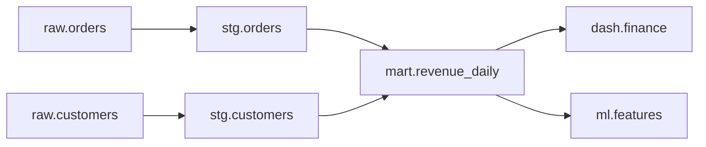

## 🎯 TL;DR

> **Data lineage** records where data came from and where it goes: which inputs produced which outputs, by which job, at what time. At **table** level it answers "what feeds this table?". At **column** level it answers "where does this number come from?".

- Lineage powers two things: **provenance** (trust and audit) and **impact analysis** (what breaks if I change this?).
- Lineage can be collected from SQL parsing, from the orchestrator, from the transformation tool (for example, dbt), or from runtime events such as **OpenLineage**.
- Table-level lineage is the common baseline. Column-level lineage is harder, and it is where most of the interview depth is.

## 🌱 Start simple (Junior)

> **💡 Analogy:** A family tree for data. Your report is the grandchild. Its parents are the tables it was built from, its grandparents are the tables those were built from, and so on. When a grandparent changes, you want to know which descendants are affected.

A small chain makes this concrete:

```text
raw.orders ──► stg.orders ──► mart.revenue_daily ──► dash.finance
raw.customers ──► stg.customers ──┘
```

Two questions a lineage graph answers in seconds:

- **Upstream (provenance):** "Where does `mart.revenue_daily` come from?" Answer: `stg.orders` and `stg.customers`, back to the raw tables.
- **Downstream (impact):** "If I change `raw.orders`, what breaks?" Answer: `stg.orders`, `mart.revenue_daily` and `dash.finance`.

Without lineage, the impact question is answered by asking people in chat, and the answer is wrong about half the time.

## 🔧 How it really works (Mid)

**Table-level vs column-level.** Consider this transformation:

```sql
CREATE TABLE mart.revenue_daily AS
SELECT o.order_date,
       c.region,
       SUM(o.amount) AS total_revenue
FROM stg.orders o
JOIN stg.customers c ON c.customer_id = o.customer_id
GROUP BY o.order_date, c.region;
```

- **Table-level:** `mart.revenue_daily` depends on `stg.orders` and `stg.customers`.
- **Column-level:** `total_revenue` depends on `stg.orders.amount`. `region` depends on `stg.customers.region`. `order_date` depends on `stg.orders.order_date`. The join key `customer_id` affects which rows are included, which many tools record as a separate "filter" or "join" dependency.

The column view is what you need to answer "why did revenue change?" and "which columns can I drop safely?".

**Where lineage comes from.**

| Source | How | Strength | Weakness |
|---|---|---|---|
| SQL parsing | Parse the query text | Works without instrumentation | Dynamic SQL and macros are hard |
| Transformation tool | dbt reads its own model graph | Accurate for dbt models | Covers only what the tool runs |
| Orchestrator | Records task inputs and outputs | Knows the runs and timings | Often table-level only |
| Runtime events (OpenLineage) | Jobs emit start, complete and fail events | Includes runs, schemas and facets | Each integration must emit |

**OpenLineage** is an open standard for emitting lineage events. Its model has three entities: a **job** (a named piece of work), a **run** (one execution of a job, with a `runId`) and a **dataset** (a table or file, identified by namespace and name). A run emits events such as `START`, `COMPLETE` or `FAIL`, and each event lists its inputs and outputs. Extra information is attached as **facets** (schema, SQL text, row counts, parent run). The Marquez project is an open-source metadata service that stores and visualizes these events.

```json
{
  "eventType": "START",
  "eventTime": "2026-01-02T03:00:00.000Z",
  "run": { "runId": "3b452093-782c-4ef2-9c0c-aafe2aa6f34d" },
  "job": { "namespace": "airflow", "name": "revenue_daily.build" },
  "inputs": [ { "namespace": "warehouse", "name": "stg.orders" } ],
  "outputs": [ { "namespace": "warehouse", "name": "mart.revenue_daily" } ],
  "producer": "https://example.com/my-integration"
}
```

This is trimmed for readability. The full specification also requires a `schemaURL` field and recommends facets for schema and SQL. Check the spec for the version you target.

**Impact analysis is a graph traversal.** Store lineage as adjacency lists (upstream to downstream) and walk them with breadth-first search:

```python
from collections import deque

edges = {  # upstream -> downstream
    "raw.orders": ["stg.orders"],
    "stg.orders": ["mart.revenue_daily"],
    "mart.revenue_daily": ["dash.finance", "ml.features"],
    "raw.customers": ["stg.customers"],
    "stg.customers": ["mart.revenue_daily"],
}

def impacted(start: str) -> list[str]:
    seen, order, q = {start}, [], deque([start])
    while q:
        node = q.popleft()
        for child in edges.get(node, []):
            if child not in seen:
                seen.add(child)
                order.append(child)
                q.append(child)
    return order

print(impacted("raw.orders"))
# ['stg.orders', 'mart.revenue_daily', 'dash.finance', 'ml.features']
```

The `seen` set is what keeps the walk finite and avoids reporting a node twice when two paths reach it.



## 🧠 Senior depth & trade-offs

- **Column-level lineage is expensive to get right.** `SELECT *`, unqualified column names, macros, `UNION` by position and dynamic SQL all make parsing ambiguous. A lineage tool that is "mostly right" can give false confidence. Measure its coverage before relying on it for a compliance answer.
- **Granularity vs cost.** Column-level lineage on thousands of tables produces a very large graph. Keep the detailed view for critical marts and the table view everywhere else.
- **Runtime vs static.** Static parsing shows what the code *says*. Runtime events show what actually *ran*: a backfill, a manual rerun or a failed half-written job. Mature setups combine both.
- **Lineage is not a permission system.** Knowing that a field feeds a report does not stop anyone from reading it. Access control belongs to the [[data-security]] and governance layer.
- **Impact analysis needs versioning.** Changing a column is safe only if you know which consumers depend on it. Pair lineage with schema contracts ([[governance-contracts-mesh]]) so a breaking change is detected before the merge.
- **Lineage in streaming.** For Kafka-to-lake pipelines, the dataset identity is the topic plus the sink table, and the job is a long-running run rather than a daily one. Event-based lineage (OpenLineage with long runs) is the usual approach. Check the integration you use for streaming engines such as Flink or Spark Structured Streaming.
- **Trade-off with governance.** More lineage means more metadata to store, index and keep fresh. Stale lineage is worse than none, because people trust it.

## 🧪 Try it

1. Add `dash.exec_summary` as a child of `mart.revenue_daily` and `ml.features` as a child of `stg.customers` to the Python `edges` dictionary. **Predict:** what does `impacted("raw.customers")` return, and in which order?
2. Write column lineage by hand for this query: `SELECT customer_id, UPPER(name) AS name_upper, amount * 1.09 AS amount_with_tax FROM raw.sales;`. List every upstream column for each output column.
3. Explain why the `seen` set matters in the BFS when two paths reach the same node.

<details><summary>Show solutions</summary>

**1.** If you append `"ml.features"` to the list under `"stg.customers"` and `"dash.exec_summary"` to the list under `"mart.revenue_daily"`, the result is `['stg.customers', 'mart.revenue_daily', 'ml.features', 'dash.finance', 'dash.exec_summary']`. `ml.features` appears once even though it is reachable from two parents, because of the `seen` set. The dashboards come after the mart that feeds them.

**2.** `customer_id` depends on `raw.sales.customer_id`. `name_upper` depends on `raw.sales.name`. `amount_with_tax` depends on `raw.sales.amount`. The constant `1.09` is not a dependency.

**3.** `mart.revenue_daily` is reached through both `stg.orders` and `stg.customers` in the earlier example. Without `seen`, a node reached twice would be queued and reported twice, and in a graph with cycles the walk would never end. The set makes each node appear once.

</details>

## 💬 Interview corner

**Question: "How would you implement data lineage for a warehouse?"** Mid answer: "I would parse the SQL or use dbt's graph for table-level lineage and store it in a metadata service, so people can see upstream and downstream tables." Senior answer: "I would start with table-level lineage from the transformation tool and the orchestrator, then add runtime events for runs that do not go through dbt. Column-level lineage comes next, only for critical marts, because parsing is the hard part. I would expose lineage in the catalog, tie it to owners, and use it for impact analysis in pull requests."

**Question: "What is the difference between data lineage and data observability?"** Lineage describes the structure of dependencies. Observability measures the health of the data flowing through them. Lineage tells you what to check and who to tell; observability tells you that something is wrong.

> **🎤 Say this in the interview:** "Lineage answers where data came from and what depends on it. I use it for impact analysis before a change and for root-cause analysis after an incident. I collect it from the transformation layer and runtime events, and I am honest about column-level coverage."

## ⚠️ Common mistakes

> **⚠️ Watch out:** Treating lineage as complete because a tool draws a graph. A graph built from partial parsing hides the dependencies it missed.

- Assuming `SELECT *` lineage is precise. The columns depend on the table schema at the time of parsing.
- Confusing a join key with a value dependency. A join key changes which rows appear, so it still matters for impact analysis.
- Collecting lineage only for daily batch jobs and forgetting ad hoc notebooks, manual fixes and backfills.
- Using lineage as an access-control system.
- Letting lineage go stale. A diagram from six months ago is confidently wrong.
- Drawing column lineage for every column of every table, which produces a graph nobody reads.

## ✅ Check yourself (quiz)

1. What does **impact analysis** use lineage for?
   - A) Compressing tables
   - B) Finding the downstream assets affected by a change
   - C) Encrypting columns
   - D) Scheduling jobs

<details><summary>Answer</summary>

**B** — impact analysis walks the graph downstream from a changed asset to find dependent tables, dashboards and models.

</details>

2. In OpenLineage, what identifies **one execution** of a job?
   - A) The dataset namespace
   - B) The `runId` on the run
   - C) The `producer` URL
   - D) The facet list

<details><summary>Answer</summary>

**B** — a job is the named piece of work, and each execution is a run with its own `runId`. START, COMPLETE and FAIL events for the same run share that id.

</details>

3. A query uses `SELECT *` on a source table, and the source later adds a column. What can go wrong for lineage?

   - A) Nothing; `SELECT *` always has complete lineage
   - B) Column-level lineage recorded earlier may be out of date until the query is parsed again
   - C) The job will be marked as a streaming job
   - D) The dataset namespace changes

<details><summary>Answer</summary>

**B** — the output columns depend on the source schema at parse time. A new source column changes the lineage, so the record must be refreshed. This is why `SELECT *` is a common lineage problem.

</details>

4. **(Senior)** A team wants column-level lineage for all 3,000 tables before a compliance audit, in three weeks. What would you propose?

   - A) Draw it by hand for every table
   - B) Scope to the tables that hold regulated data, use table-level lineage elsewhere, measure parser coverage, and report coverage honestly
   - C) Turn off lineage until after the audit
   - D) Use lineage to replace access control

<details><summary>Answer</summary>

**B** — the audit needs confidence on the sensitive data, not every table. Scoping, combining methods, and stating coverage gaps is more credible than an overstated complete graph.

</details>

5. Why are runtime lineage events useful in addition to parsing the SQL?

<details><summary>Answer</summary>

Parsing shows what the code says, but runtime events show what actually ran: manual reruns, backfills, failed partial writes, and jobs that build SQL dynamically. Combining both gives a more accurate picture.

</details>

## 🗂️ Flashcards

| Front | Back |
|---|---|
| Table-level vs column-level lineage | Table-level: which tables feed a table; column-level: which source columns feed each output column |
| Provenance vs impact analysis | Provenance walks upstream (where from?); impact walks downstream (what breaks?) |
| OpenLineage's three core entities | Job, run and dataset |
| What does a `FAIL` event tell you? | The run with that `runId` ended with an error; it does not end the job itself |
| Why are facets used? | To attach extra metadata (schema, SQL, row counts) to jobs, runs and datasets |
| Why does `SELECT *` complicate lineage? | Its output depends on the source schema at parse time, so the lineage changes when the schema does |
| Why track a `seen` set in an impact walk? | To avoid repeating nodes and to stop the walk from looping |

## 🔗 Go further

- [[data-observability]] uses lineage to turn an alert into an impact list.
- [[data-catalogs]] is where lineage is usually displayed next to owners and descriptions.
- [[dbt]] is a common source of accurate table-level lineage.
- [[etl-vs-elt]] explains why transformations inside the warehouse make lineage easier to capture.
- [[governance-contracts-mesh]] connects lineage to contracts and ownership.
- [[dwh-fundamentals]] gives the layering (raw, staging, marts) that lineage graphs usually follow.
