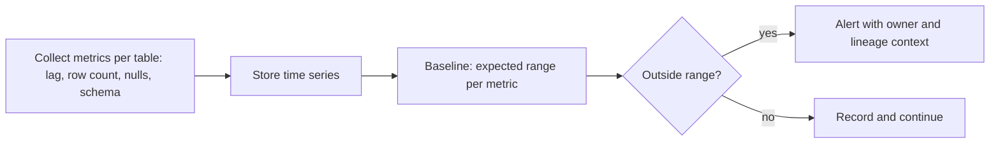

## 🎯 TL;DR

> **Data observability** means continuously knowing whether your data is **arriving on time, complete, well-shaped and trustworthy**, and being told when it is not. It watches the data itself, not just whether the job ran.

- A green Airflow task only says the code finished. It does not say the table has yesterday's rows.
- A common framing has five pillars: **freshness**, **volume**, **schema**, **distribution** and **lineage**.
- Good monitoring learns a **baseline** and alerts on deviations, instead of hard-coding one threshold per table.
- The hard part is **alert quality**: few alerts, each with an owner and a clear next step.

## 🌱 Start simple (Junior)

> **💡 Analogy:** A hospital monitor for a patient. The machine does not wait for the patient to say "I feel bad." It watches heart rate, oxygen and temperature all the time, and it rings when a number leaves its normal range. Data observability is that monitor for tables.

Consider an `orders` table that a dashboard reads every morning. Four things can go wrong, and the job can still succeed each time:

- **Late:** yesterday's rows never arrived.
- **Short:** only 200 rows arrived, usually 10,000.
- **Changed:** a column was renamed upstream.
- **Odd:** `customer_id` is suddenly 40% NULL.

Here are two simple checks in SQL (PostgreSQL syntax):

```sql
-- Freshness: how old is the newest row?
SELECT now() - max(loaded_at) AS lag
FROM warehouse.orders;

-- Distribution: what share of yesterday's rows have no customer?
SELECT count(*) FILTER (WHERE customer_id IS NULL) * 1.0 / count(*) AS null_rate
FROM warehouse.orders
WHERE order_date = CURRENT_DATE - 1;
```

The `* 1.0` matters: without it, integer division gives `0` instead of `0.4`.

## 🔧 How it really works (Mid)

Observability tools follow a loop: **collect metrics**, **build a baseline**, **detect anomalies**, **route alerts**.



**The five pillars**, with the question each one answers:

| Pillar | Question | Typical metric |
|---|---|---|
| Freshness | Did data arrive when expected? | Lag between now and `max(loaded_at)` |
| Volume | Is the row count plausible? | Rows per partition, per day |
| Schema | Did the structure change? | Added, dropped or retyped columns |
| Distribution | Do values look normal? | Null rate, distinct count, min/max, mean |
| Lineage | What is affected, and who owns it? | Upstream and downstream dependencies |

**Static rules vs learned baselines.** A static rule ("row count > 5000") is easy to explain but breaks on seasonality: Monday is busy, Sunday is quiet, and a holiday is a legitimate drop. A learned baseline uses recent history, sometimes per weekday. A simple version is a z-score:

```python
import statistics

def is_volume_anomaly(history: list[int], today: int, z_max: float = 3.0) -> bool:
    if len(history) < 7:
        return False                      # not enough history to learn a baseline
    mean = statistics.fmean(history)
    stdev = statistics.stdev(history)
    if stdev == 0:
        return today != mean
    return abs(today - mean) / stdev > z_max

last_week = [1000, 1020, 980, 1010, 990, 1005, 995]
print(is_volume_anomaly(last_week, 400))   # True: far outside the normal range
print(is_volume_anomaly(last_week, 1015))  # False: normal variation
```

Production tools use more robust models (seasonality, trend, robust statistics), but the idea is the same.

**Where checks run.** Metadata checks (freshness from a load timestamp, row counts from table statistics) are cheap and can run often. Distribution checks scan data and cost real compute, so run them on the new partition only, not the full table. Schema checks compare the current schema with the last known one, often triggered from the [[data-catalog]] or the warehouse information schema.

**Alerting.** Every alert needs a table owner, a severity, and a link to the failing run and the affected downstream dashboards. Deduplicate alerts so one upstream incident does not produce 40 pages.

## 🧠 Senior depth & trade-offs

- **Alert fatigue is the main failure mode.** An observability tool that alerts 50 times a week trains people to ignore it. Start with a small set of critical tables (those with [[sla-slo|SLAs]]) and grow from there.
- **Anomaly detection has false positives and negatives.** A learned baseline can silence a real slow decline, because the baseline drifts with it. Combine a learned check with a hard floor ("never fewer than X rows") for business-critical tables.
- **Scale and cost.** Scanning every column of every table each day is expensive. Prioritize by consumer impact (dashboards, models, finance reports) and by column type. Sample large tables where exact counts are not needed for the check.
- **Lineage makes alerts actionable.** A null spike in `stg_orders` is only useful if you can see that it feeds `revenue_daily` and the finance dashboard. See [[data-lineage]].
- **Ownership is a data problem.** Observability without owners only produces dashboards nobody reads. Tie each table to a team in the [[data-catalog]].
- **Observability vs testing.** Tests run on a code change or a known input and fail the build. Observability watches production data continuously and catches what tests did not anticipate. You need both; neither replaces the other.
- **Diagnosing incidents.** When a freshness alert fires, the question is "which upstream job stopped, and is the data wrong or just late?" That is where lineage and run history matter. Feed the outcome into [[incidents-postmortems]].
- **When not to build it yourself.** For a few tables, SQL checks in the orchestrator are enough. A platform makes sense when dozens of teams and hundreds of tables need the same checks and routing.

## 🧪 Try it

1. Using the z-score function above, predict the result for `today = 1200` with the same `last_week` history. Then say why a weekday-aware baseline could still be better for a Monday.
2. Write a freshness query for `warehouse.payments` that returns `TRUE` when the newest `loaded_at` is more than 2 hours old.
3. A null-rate check fires every Sunday for `customer_id`. Give two possible causes and one fix that does not just raise the threshold.

<details><summary>Show solutions</summary>

**1.** `1200` is about 180 above the mean of roughly 1000, and the standard deviation of that history is about 13, so the z-score is above 3 and the function returns `True`. A Monday-specific baseline matters because Monday volumes may differ systematically from the rest of the week, and a single baseline would flag normal Monday peaks.

**2.** `SELECT now() - max(loaded_at) > interval '2 hours' AS is_stale FROM warehouse.payments;`

**3.** Causes: a guest-checkout flow that legitimately has no customer on weekends, or an upstream change that stopped populating the field on one day. Fix: segment the check by the known condition (for example, exclude guest checkouts, or split the metric by channel), so the alert reflects a real anomaly. Raising the threshold would hide a real regression later.

</details>

## 💬 Interview corner

**Question: "How would you monitor data quality in a pipeline?"** Mid answer: "I would add checks for freshness, row counts and null rates on the key tables, and alert when they fail." Senior answer: "I would use the five pillars as a checklist per critical table. Freshness and volume are cheap and run often; distribution checks run on new partitions only. Thresholds come from learned baselines plus hard business floors. Every alert has an owner and lineage context, and I measure alert precision so the signal stays trustworthy."

**Question: "What is the difference between data quality tests and data observability?"** Tests check known expectations at build or load time. Observability watches production continuously and detects unexpected changes. Tests prevent known bugs; observability catches unknown ones.

> **🎤 Say this in the interview:** "A job that succeeds does not mean the data is right. I monitor freshness, volume, schema, distribution and lineage on the tables that matter, use learned baselines to reduce noise, and route alerts to owners with lineage context so people can act on them."

## ⚠️ Common mistakes

> **⚠️ Watch out:** Monitoring the job status instead of the data. Green runs can still produce empty or wrong tables.

- Setting one fixed threshold for every table and every weekday, then tuning it endlessly.
- Alerting on every anomaly without severity or deduplication, which trains people to ignore alerts.
- Running full-table distribution scans every hour on huge tables.
- Treating a learned baseline as truth after a real change in the business (a new product line changes the normal volume).
- Forgetting that a schema change can be "valid" but still break a downstream metric.
- Building observability before the critical tables have owners.

## ✅ Check yourself (quiz)

1. Which pillar answers "did yesterday's data arrive?"
   - A) Volume
   - B) Freshness
   - C) Schema
   - D) Lineage

<details><summary>Answer</summary>

**B** — freshness measures how old the newest data is. Volume checks how much data arrived, which is a different question.

</details>

2. A job succeeded and the table has the right number of rows, but the `amount` column is now stored as text. Which pillar caught it?

   - A) Freshness
   - B) Volume
   - C) Schema
   - D) Distribution

<details><summary>Answer</summary>

**C** — the column type changed, which is a schema change. Volume and distribution checks might not catch it at all, which is why schema checks exist separately.

</details>

3. **(Senior)** A team wants to alert when `row_count` is below 80% of the 30-day average. Give one reason this is risky and one improvement.

<details><summary>Answer</summary>

Risk: a fixed average ignores weekly seasonality and legitimate drops (holidays), so it will fire often. It also drifts: a slow decline can become the new average and never alert. Improvement: compare with the same weekday over recent weeks, and add a hard business floor for critical tables.

</details>

4. **(Senior)** Why is lineage important when a null-rate alert fires?

   - A) It makes the query faster
   - B) It shows which downstream tables and dashboards are affected, and who owns them
   - C) It replaces the need for owners
   - D) It fixes the null values automatically

<details><summary>Answer</summary>

**B** — lineage turns an alert into a prioritized impact list. Observability without lineage tells you that something is wrong, not who should care.

</details>

5. Why are distribution checks usually run on new partitions instead of the full table?

<details><summary>Answer</summary>

Full scans are expensive and repeated daily. Most anomalies appear in new data, so checking the newest partition catches them at a fraction of the cost. Occasional full-history audits can still run less often.

</details>

## 🗂️ Flashcards

| Front | Back |
|---|---|
| What does data observability watch? | The data itself (arrival, volume, shape, values, dependencies), not only whether a job succeeded |
| The five pillars | Freshness, volume, schema, distribution, lineage |
| Freshness vs volume | Freshness: how recent the data is; volume: how much arrived |
| Why learned baselines? | They handle seasonality and avoid one hard-coded threshold per table |
| Main failure mode of observability | Alert fatigue from too many unprioritized alerts |
| Why multiply by `1.0` in a null-rate query? | To avoid integer division, which would return 0 |
| Tests vs observability | Tests check known expectations before change; observability detects unknown changes in production |

## 🔗 Go further

- [[data-quality]] covers the rules and tests that complement observability.
- [[pipeline-monitoring]] covers job-level metrics such as lag, failures and run duration.
- [[data-lineage]] explains how to turn an alert into an impact list.
- [[data-catalogs]] is where owners and table metadata usually live.
- [[incidents-postmortems]] shows what to do after the alert fires.
- [[design-dq-platform]] walks through designing a data-quality platform end to end.
