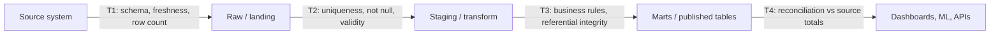

## 🎯 TL;DR

> **Data quality** means the data is *fit for its use*. You check it with explicit, automated tests, and you decide in advance what happens when a test fails: warn, quarantine the bad rows, or **stop the pipeline** before the bad data reaches a dashboard or a model.

- Quality is measured along **dimensions**: completeness, uniqueness, validity, consistency, timeliness and accuracy.
- Put tests where data **changes hands**: at the source boundary, after each transformation, and right before publishing.
- Three patterns do most of the work: **write-audit-publish** (test before the data is visible), **circuit breakers** (halt when a threshold is crossed), and **reconciliation** (source and target must agree on counts and totals).
- A passing test is not proof of correctness. Tests check what you thought to check.

## 🌱 Start simple (Junior)

> **💡 Analogy:** A restaurant kitchen. Before a dish leaves, someone checks that it is hot, that the right ingredients are in it, and that nothing is missing. If the soup is cold, the cook does not send it out, and the kitchen stops that station until someone fixes it. Data pipelines need the same habit.

Imagine an `orders` table that feeds a revenue dashboard. Five things can go wrong with it:

| Dimension | Question it answers | Bad example in `orders` |
|---|---|---|
| **Completeness** | Is the data there? | 12% of rows have `customer_id = NULL` |
| **Uniqueness** | Does each thing appear once? | `order_id = 881` appears 3 times after a retry |
| **Validity** | Does the value follow the rules? | `status = 'shipd'` (not in the allowed list) |
| **Consistency** | Do two places agree? | `orders` says 10,400 rows, the source system says 10,250 |
| **Timeliness** | Is it fresh enough? | Yesterday's partition arrived at 14:00 today |
| **Accuracy** | Is the value true in the real world? | `amount = -5000` for a normal purchase |

Notice that the last one is the hardest. A database cannot know the real price of a product. Accuracy is usually checked indirectly, by comparing with another trusted source or by checking that values are plausible.

The simplest useful test is a question that must return **zero rows**:

```sql
-- Test: every order has a customer. Passes if this returns 0 rows.
SELECT order_id
FROM orders
WHERE customer_id IS NULL;
```

Almost every data quality tool is a way to write, run, schedule and report questions like this one.

## 🔧 How it really works (Mid)

### Where to place tests

Data passes through several **boundaries**. A test is cheap at the boundary and expensive later, because by then the bad data has already been joined, aggregated and copied.



- **T1 (source boundary)** catches upstream changes early: a column was renamed, or the export is empty.
- **T2 (after load)** checks structure and basic validity before any join multiplies the damage.
- **T3 (after transform)** checks business logic and keys between tables.
- **T4 (before publish)** compares totals with the source. This is the test that catches "everything loaded, but the join dropped 20% of rows".

### Tools, described by what they do

- **dbt tests** are declared in YAML next to the model. Generic tests cover `not_null`, `unique`, `accepted_values` and `relationships` (foreign keys). Custom tests are SQL queries that must return zero rows, which is the same idea as the example above.
- **Great Expectations** and **Soda** let you declare expectations or checks on tables and run them from an orchestrator. They also produce reports and history. Their exact syntax changes between versions, so check the docs for your version before you copy code.

```yaml
# dbt schema.yml: declared next to the model, run with `dbt test`
version: 2
models:
  - name: orders
    columns:
      - name: order_id
        tests: [unique, not_null]
      - name: customer_id
        tests:
          - not_null
          - relationships:
              to: ref('customers')
              field: customer_id
      - name: status
        tests:
          - accepted_values:
              values: ['placed', 'shipped', 'cancelled']
```

### Write-audit-publish (WAP)

The problem with "load, then test" is that consumers can read the table while the tests are still running, or after they fail. **WAP** fixes this:

1. **Write** the new data to a hidden location: a staging table, a new partition, or a branch in a table format that supports branches.
2. **Audit** it: run all the checks against the staged data.
3. **Publish** it atomically (swap the partition, promote the branch, rename the table). If the audit failed, the publish never happens and readers keep yesterday's good data.

```sql
-- Audit step on the staged partition (must return 0 for each check)
SELECT
  (SELECT COUNT(*) FROM staging.orders WHERE order_id IS NULL)                    AS null_keys,
  (SELECT COUNT(*) - COUNT(DISTINCT order_id) FROM staging.orders)                AS duplicate_keys,
  (SELECT COUNT(*) FROM staging.orders WHERE amount < 0)                          AS negative_amounts;
```

### Circuit breakers

A **circuit breaker** is a rule that stops the pipeline when a metric crosses a threshold, the same way an electrical breaker cuts power when current is too high. Typical breakers:

- Row count dropped more than 50% versus the 7-day average (the upstream export is probably truncated).
- Null rate of a key column above 0.1%.
- A schema change that removes a column used downstream.

The breaker should **halt the publish step**, alert a human, and keep the last good output. Halting an orchestrator task is cheap. Publishing wrong numbers that someone already used for a decision is not.

### Reconciliation

Reconciliation compares **control totals** between the source and the target for the same window: row counts, sums of money columns, and distinct keys, grouped by day or partition.

```sql
-- Run per day on both sides, then compare
SELECT order_date,
       COUNT(*)       AS row_count,
       SUM(amount)    AS total_amount,
       COUNT(DISTINCT order_id) AS distinct_orders
FROM orders
WHERE order_date = DATE '2026-03-01'
GROUP BY order_date;
```

A mismatch in any of the three numbers is a signal. Matching counts do not prove the values are right, so sums and distinct keys matter too.

## 🧠 Senior depth & trade-offs

- **Hard vs soft failures.** A duplicate primary key in a fact table is a hard failure: stop. A slight rise in the share of `status = 'unknown'` is a soft failure: warn and track the trend. Mixing these up causes either constant false alarms or silent corruption.
- **Thresholds need history.** A fixed "row count must be above 1 million" breaks on weekends. Compare with a rolling baseline (same weekday, last N weeks), and accept that the first weeks after a new source will be noisy.
- **Cost of testing.** A `COUNT(DISTINCT)` on a 20 TB table is not free. Test incrementally (only the new partition), sample for expensive checks, and run heavy reconciliations on a schedule, not on every retry.
- **Quarantine instead of halting, when the loss is acceptable.** For clickstream, you may route bad records to a dead-letter location (see [[dlq-bad-records]]) and publish the rest. For financial data you usually halt. Decide per dataset and write it down as a contract.
- **Tests drift.** A test that always passes after a schema change is worse than no test, because it creates false confidence. Review failing and skipped tests regularly, and retire tests whose assumptions no longer hold.
- **Ownership.** Each dataset needs an owner who gets the alert. A test that alerts nobody is documentation, not quality control. See [[governance-contracts-mesh]] for contracts between producer and consumer teams.
- **Quality and observability are different.** Tests answer "did this specific rule hold today?" Observability (see [[data-observability]]) answers "did something unexpected change?" for rules you did not write. You need both.
- **Backfills break tests.** A reprocessing run can legitimately change historical counts. Tests should know whether a run is a backfill (see [[pattern-backfill]]) so they do not halt on expected changes, but they should still check the result.

## 🧪 Try it

You own a daily pipeline that loads `payments` (`payment_id`, `order_id`, `amount_cents`, `currency`, `paid_at`) and joins it to `orders` (`order_id`, `customer_id`). Write SQL checks that each return **the failing rows**. The run passes only if every check returns zero rows.

1. `payment_id` must be unique.
2. `amount_cents` must not be negative.
3. Every `payments.order_id` must exist in `orders`.
4. Today's total of `amount_cents` must match the source control total, which you pass in as a parameter `:source_total`.

<details><summary>Your guess?</summary>

```sql
-- 1. uniqueness: keys that appear more than once
SELECT payment_id, COUNT(*) AS n
FROM payments
GROUP BY payment_id
HAVING COUNT(*) > 1;

-- 2. validity: negative amounts
SELECT payment_id, amount_cents
FROM payments
WHERE amount_cents < 0;

-- 3. referential integrity: orphan payments (anti-join, not NOT IN with NULLs)
SELECT p.payment_id, p.order_id
FROM payments p
LEFT JOIN orders o ON o.order_id = p.order_id
WHERE o.order_id IS NULL;

-- 4. reconciliation: one row only if the total does not match
SELECT SUM(amount_cents) AS loaded_total, :source_total AS source_total
FROM payments
WHERE DATE(paid_at) = CURRENT_DATE
HAVING SUM(amount_cents) <> :source_total;
```

Check 3 uses a `LEFT JOIN ... IS NULL` anti-join. `NOT IN (SELECT order_id FROM orders)` gives surprising results if `orders.order_id` contains a `NULL`, so avoid it for integrity checks. Check 4 returns a row only on mismatch, which fits the "zero rows means pass" rule. (In some engines `CURRENT_DATE` and `DATE(...)` need a dialect adjustment.)

</details>

## 💬 Interview corner

**Typical question:** "How do you make sure the data in your pipeline is correct?"

- **Junior answer:** "I write tests on the columns, like not null and unique, and check the results."
- **Mid answer:** "I test at each boundary: source, after load, after transforms, and before publish. I use dbt tests for keys and relationships, and write-audit-publish so bad data never becomes visible to consumers."
- **Senior answer:** "I classify checks as hard or soft, with a severity and an owner. Publishing is gated by circuit breakers and reconciliation against source totals. For accuracy I rely on independent controls, because tests only check the rules I thought of, so I also run anomaly monitoring on volume, freshness and distribution."

> **🎤 Say this in the interview:** "Quality is a set of tests at each boundary with a declared action on failure. I publish through write-audit-publish so consumers never see unaudited data, I reconcile counts and totals against the source, and I alert on anomalies that no rule covers. Every dataset has an owner who receives the alert."

## ⚠️ Common mistakes

> **⚠️ Watch out:** Testing only after publish. Consumers have already read the bad numbers by the time the test fails.

- **Only testing for nulls and uniqueness.** Those are the easy checks. Most real incidents are about volume drops, late data and business rules.
- **Using `NOT IN` for referential checks.** A single `NULL` in the subquery makes the result empty, so the check silently passes. Use an anti-join.
- **Treating a green run as proof.** A test with a wrong `WHERE` clause is always green. Test the tests occasionally by injecting a bad row.
- **Setting thresholds once and forgetting them.** Data volume grows, and a threshold that was right last year now fires every day or never.
- **Halting for everything.** If every warning stops production, people disable the breaker. Reserve halts for failures that would cause a wrong decision.
- **Forgetting backfills.** A reprocessing job that changes last year's counts should not page the on-call engineer, but it should still be checked.

## ✅ Check yourself (quiz)

1. A table `orders` has 1,000,000 rows and the source system reports 1,000,000. Which dimension is still unverified?
   - A) Completeness
   - B) Accuracy
   - C) Uniqueness
   - D) Timeliness

2. Which pattern guarantees that readers never see data that failed its checks?
   - A) Retry with backoff
   - B) Write-audit-publish
   - C) Partitioning by date
   - D) Caching the dashboard

3. A key column suddenly has a 3% null rate after a source change. What is the most appropriate first action?
   - A) Ignore it because the rest of the data is fine
   - B) Let the dashboard show it and fix it next week
   - C) Trigger a circuit breaker that halts publishing and alerts the owner
   - D) Drop the whole table and reload

4. **Scenario (senior):** A fact table is loaded daily. The team wants a check that catches a join that silently drops 20% of rows. Why is a row-count test on the final table alone not enough, and what would you add?

5. **Why/trade-off (senior):** Your team wants every test to halt the pipeline. What is the main risk, and how would you change the design?

<details><summary>Answer</summary>

1. **B** — Matching row counts are a consistency check (completeness at row level), but they say nothing about whether the values are true. Accuracy needs an independent source or plausibility rules.
2. **B** — Write-audit-publish writes to a hidden location, audits it, and only then publishes atomically. Retries, partitioning and caching do not gate visibility.
3. **C** — A breaker that halts publishing and alerts the owner keeps the last good data visible and forces a decision. Ignoring it or dropping the table are both worse.
4. A row-count check on the final table compares it with nothing, so a drop from a bad join is invisible unless you know the expected count. Add reconciliation: compare the row count of the fact input before the join with the row count after it (a left join from the fact side must not change the count), and compare totals with the source system's control totals. A check that the fact key is still unique after the join also catches fan-out from a duplicated dimension key.
5. **Halting on every failure** causes alert fatigue, and people disable breakers, so real failures get ignored. Use severity levels: hard failures halt, soft failures warn and track trends. The design goal is that every halt is one a human would agree is worth stopping production for.

</details>

## 🗂️ Flashcards

| Front | Back |
|---|---|
| Six data quality dimensions | Completeness, uniqueness, validity, consistency, timeliness, accuracy |
| Test that must return zero rows | A failing-rows query: the pipeline passes if the result is empty |
| Write-audit-publish (WAP) | Write to a hidden place, audit, then publish atomically so bad data is never visible |
| Circuit breaker (data) | A threshold rule that halts publishing and alerts an owner |
| Reconciliation | Comparing control totals (counts, sums, distinct keys) between source and target |
| Why use an anti-join for integrity checks | `NOT IN` returns nothing if the subquery contains NULL, hiding violations |
| Hard vs soft failure | Hard halts publishing; soft warns and tracks the trend |
| Test vs observability | Tests check rules you wrote; observability detects changes you did not anticipate |

## 🔗 Go further

- [[data-observability]] — anomaly detection on freshness, volume and schema, for the rules nobody wrote.
- [[pattern-reconciliation]] — a full design pattern for source-to-target reconciliation.
- [[dlq-bad-records]] — what to do with records that fail validation when you cannot halt.
- [[pattern-backfill]] and [[backfills]] — how checks behave during reprocessing.
- [[governance-contracts-mesh]] — data contracts that define expected quality between teams.
- [[data-lineage]] — finding which downstream tables a bad upstream change affects.
