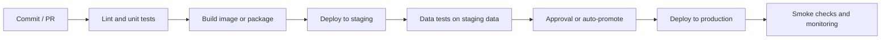

## 🎯 TL;DR

> **DataOps** applies software engineering discipline to data: everything (pipelines, tables, infrastructure, configuration) is **code in version control**, changes are **tested automatically**, and deployments are **repeatable and reversible**. The tools are Infrastructure as Code (Terraform, Ansible, Helm), CI/CD pipelines, and GitOps controllers such as Argo CD.

- **Infrastructure as Code (IaC)**: describe servers, networks, buckets and clusters in files; apply them the same way every time.
- **CI** (continuous integration) runs lint, unit tests and data tests on every change. **CD** (continuous delivery or deployment) promotes a tested artifact through environments.
- **GitOps**: the Git repository is the source of truth; a controller makes the cluster match it.
- For data, "deploy" is not just code: a **schema change**, a **table swap** or a **backfill** can break consumers. Tests and deployment strategy must cover data, not only code.
- A **blue/green** pattern for tables means building the new version beside the old one and switching readers atomically.

## 🌱 Start simple (Junior)

> **💡 Analogy:** A restaurant kitchen. Recipes are written down (code in Git), every new dish is tasted before it goes to customers (tests in CI), and the kitchen opens a new dish on a trial table before the main menu changes (staging). If a dish goes wrong, the old recipe is still on the shelf (rollback).

Without DataOps, a common story goes like this: someone edits a SQL file on the production server, nobody knows which version is live, the pipeline runs with a missing column, and the dashboard shows zeros for a day. With DataOps:

1. The change is a **pull request**, reviewed by someone else.
2. **CI** runs the SQL linter and the tests on a small test dataset.
3. After merge, the same artifact goes to **staging**, then to **production**.
4. Every version is traceable to a commit, so rollback is "deploy the previous commit".

A minimal CI workflow for a repository with SQL transformations and Python tests (GitHub Actions syntax):

```yaml
name: data-ci
on:
  pull_request:
    branches: [main]

jobs:
  test:
    runs-on: ubuntu-latest
    steps:
      - uses: actions/checkout@v4
      - uses: actions/setup-python@v5
        with:
          python-version: "3.12"
      - run: pip install -r requirements-dev.txt
      - name: Lint SQL
        run: sqlfluff lint models/ --dialect postgres
      - name: Unit tests
        run: pytest tests/unit -q
```

The workflow is short on purpose. Its job is to block broken changes before they reach shared environments.

## 🔧 How it really works (Mid)

### Infrastructure as Code

| Tool | What it manages | Typical use in data platforms |
|---|---|---|
| Terraform | Cloud or datacenter resources declaratively (VMs, networks, buckets, managed services) | Create object storage buckets, IAM roles, a Kubernetes cluster |
| Ansible | Configuration of machines (packages, files, services) by playbooks | Install Java, configure Kafka or Hadoop on bare-metal hosts |
| Helm | Packages of Kubernetes manifests with parameters (charts) | Install Airflow, Spark Operator or a monitoring stack with values files |

Terraform works with a **plan** step: it shows what would change before applying. Keep state in a remote backend with locking so two people do not apply at the same time.

```hcl
resource "aws_s3_bucket" "raw_events" {
  bucket = "acme-raw-events-${var.environment}"
}

resource "aws_s3_bucket_versioning" "raw_events" {
  bucket = aws_s3_bucket.raw_events.id
  versioning_configuration {
    status = "Enabled"
  }
}
```

On-premises, the same role is played by a Terraform provider for your virtualization platform, or by Ansible roles for servers. The principle is the same: no manual clicks that cannot be reproduced.

### CI/CD stages for data

A useful pipeline has these gates, in order:



- **Lint and unit tests**: SQL style, Python logic on small in-memory inputs. Fast, run on every commit.
- **Data tests**: row counts, uniqueness, not-null, referential checks and freshness, on staging data. dbt tests or a framework such as Great Expectations express these. See [[data-quality]].
- **Smoke checks**: after deployment, verify that the DAG is registered, the table exists and the first run finishes.

### Staging and data environments

Code environments are easy: run the same image with a different config. Data environments are harder. Options:

- **Sampled staging data**: a deterministic sample (for example, all rows for 1% of user IDs) so joins still work.
- **Synthetic data**: generated fixtures that cover edge cases (nulls, duplicates, late events).
- **Branching**: some table formats and warehouses can branch a table or create zero-copy clones, so a change runs against a snapshot of production.

Never run an untested transformation against production tables just because staging data is hard to build. Use the environment that exists and say what it does not cover.

### Deploying DAGs and SQL

Orchestrators such as Airflow load DAG files from a folder. Common patterns:

- Sync the DAG folder from Git on each merge (a git-sync sidecar or a deployment job).
- Package the DAG and its dependencies in a container image, and roll out a new image version. This makes the running code match the artifact that was tested.
- Keep credentials out of DAG files. Use the orchestrator's connection store or a secret backend.

### GitOps with Argo CD

In GitOps, the desired state of the cluster (Deployments, StatefulSets, Helm releases, Airflow values) lives in Git. Argo CD compares the live cluster with Git and syncs the difference. Benefits: every change is a commit, drift is detected, rollback is `git revert`. The trade-off: emergency fixes must go through Git too, or the next sync overwrites them.

### Blue/green for tables

A table is not a service, so blue/green works differently:

1. Build the new version into a **new table** (`sales_daily_v2`), with the new logic, from the same sources.
2. Validate it: counts, totals per day, and a diff against `v1` on a sample of keys.
3. **Switch** readers atomically: a view `sales_daily` points to `v2`, or a table format swaps a branch or tag.
4. Keep `v1` for a rollback window, then drop it.

```sql
-- Atomic switch of readers via a view (most engines support CREATE OR REPLACE VIEW).
CREATE OR REPLACE VIEW analytics.sales_daily AS
SELECT * FROM analytics.sales_daily_v2;
```

For schema-breaking changes, a view also gives consumers a stable name while the physical table evolves. The switch is only atomic for readers that query the view; a job that already started reading `v1` keeps its snapshot. Check your engine's semantics.

## 🧠 Senior depth & trade-offs

- **Migrations for data are not reversible by default.** Dropping a column loses data. Use expand and contract: add the new column, backfill and dual-write, switch readers, then remove the old column in a later release. This is slower, and it is what keeps rollbacks possible.
- **Idempotent deployment jobs.** Running a deploy twice should leave the system in the same state. This matters for retries after partial failures. Pair it with idempotent loads (see [[dedup-idempotent-loads]]).
- **Test pyramid for data.** Many fast unit tests on transformations, some contract tests on schemas, and a few end-to-end runs on staging data. Staging end-to-end tests are slow and flaky if they depend on live sources; mock the sources at the boundary.
- **Promotion without rebuilding.** Build the artifact once and promote the same image or package to each environment. Rebuilding per environment lets production run code nobody tested.
- **Secrets and config.** Config differs per environment; code does not. Inject it through environment variables or a secret manager. Never bake production credentials into a staging image.
- **Blast radius.** Limit each deployment to one domain or one DAG group, and use feature flags or per-team namespaces. A single pipeline that deploys everything at once makes rollback a coordinated event.
- **Drift and manual changes.** Any manual change in a console is drift. Terraform plan or Argo CD diff should show it; schedule drift detection, and treat unexplained drift as an incident.
- **Cost of environments.** Every extra environment costs compute and storage. Keep staging small, but representative enough to catch schema and volume problems (for example, a 2% sample for performance tests is not representative of skew).
- **Measure delivery.** Track lead time from merge to production, change failure rate, and time to restore. These are the standard DevOps metrics and they apply to data platforms.

> **⚠️ Watch out:** A passing CI run proves the code works on the test data, not that the production numbers are right. Pair deployment checks with data checks in production, and alert when row counts, freshness or key metrics move beyond their normal range.

## 🧪 Try it

You need Git, Python 3.12 and `pytest` (or any test runner).

1. Write a small Python function `daily_revenue(rows)` that sums an `amount` column by `day`, ignoring rows where `amount` is `None`. Write two unit tests: one with normal rows, one with `None` amounts. Put the CI YAML from the Junior section in `.github/workflows/data-ci.yml` (adapt the steps to your tools) and explain which step would fail if you break the function.
2. Write a blue/green switch for a table `sales_daily`. Describe in steps how you would validate `sales_daily_v2` before switching, and what you would check if the switch causes a dashboard to show zero.
3. Explain, in three sentences, why `git revert` is a rollback for code but not always for data, and what expand-and-contract changes about that.

<details><summary>Show solutions</summary>

**1.** A correct version:

```python
from collections import defaultdict

def daily_revenue(rows):
    totals = defaultdict(float)
    for row in rows:
        if row["amount"] is None:
            continue
        totals[row["day"]] += row["amount"]
    return dict(totals)
```

If you change `continue` into `totals[row["day"]] += row["amount"]` without the guard, the `None` test fails with a `TypeError`, and the `pytest` step of CI fails, blocking the merge.

**2.** Validate counts per day, totals per day, and a sample diff of keys between `v1` and `v2`; check nulls and freshness. Switch the view. If the dashboard shows zero, check whether the view points at the new table, whether the new table is populated for the requested dates, and whether the dashboard caches results from before the switch.

**3.** `git revert` restores the old code, so the next run uses old logic. But if the bad run already wrote data, or if a migration dropped a column, the data is not restored by reverting code. Expand-and-contract keeps the old column until readers have moved, so rolling back code remains safe.

</details>

## 💬 Interview corner

**Question: "How do you deploy a change to a data pipeline safely?"**

- **Mid answer:** "Through a pull request, with unit tests in CI, a staging deployment and then production. I'd roll back by redeploying the previous commit."
- **Senior answer:** "I separate code deployment from data deployment. Code goes through CI and promotion of one immutable artifact. Data changes use expand-and-contract, blue/green tables, and backfills that are idempotent and tested on a sample. I'd check schema compatibility with consumers before merge, and I'd monitor row counts and freshness after the rollout, because rolling back code does not undo bad writes."

**Question: "What is GitOps?"** Git holds the desired state of the infrastructure and applications; a controller reconciles the live system to match it, and drift is visible and reversible.

> **🎤 Say this in the interview:** "I treat pipelines and infrastructure as versioned code, build one artifact and promote it, and test the data as well as the code. For tables I use blue/green and expand-and-contract, because a code rollback alone does not fix data that has already been written."

## ⚠️ Common mistakes

> **⚠️ Watch out:** Editing production SQL or DAG files directly on the server. The next deployment silently overwrites the fix, or the fix is never in Git at all.

- Rebuilding the image separately per environment, so production runs untested code.
- Storing credentials in Git, CI logs or DAG files.
- Testing only code (unit tests) and never the data (counts, nulls, uniqueness, freshness).
- Dropping a column in the same release that stops using it, which removes the rollback path.
- Running backfills during a deployment without checking that the job is idempotent.
- Treating staging data as production-like without checking volume, skew or key distribution.
- Applying Terraform without reviewing the plan, or two people applying at the same time without a state lock.

## ✅ Check yourself (quiz)

1. What is the main purpose of Terraform's plan step?
   - A) To run the tests
   - B) To show what would change before anything is applied
   - C) To build the Docker image
   - D) To delete unused resources

<details><summary>Answer</summary>

**B** — plan is a dry run. It shows creates, updates and deletes so a reviewer can approve the change before it happens.

</details>

2. A CI pipeline builds a new image for staging and another new image for production from the same commit. Why is this a risk?
   - A) It doubles storage cost only
   - B) Two builds can differ (dependency drift, timestamps), so production may run an artifact that staging never tested
   - C) Images cannot be built twice
   - D) Production must always use an older image

<details><summary>Answer</summary>

**B** — promote one immutable artifact through environments. Rebuilding breaks the link between what was tested and what runs.

</details>

3. You want to rename a column used by 20 dashboards without downtime. Which sequence is safest?
   - A) Rename it in one release and fix the dashboards later
   - B) Add the new column, dual-write and backfill, move readers, then remove the old column in a later release
   - C) Drop the old column and let dashboards recreate it
   - D) Rename it only in staging

<details><summary>Answer</summary>

**B** — expand and contract keeps both names valid during the migration, which keeps rollback possible until the last reader has moved.

</details>

4. **(Senior)** A deployment ran, CI was green, and the next morning a revenue dashboard shows half the usual value. The code rollback did not fix it. What is your investigation order?

   - A) Redeploy the same commit and hope
   - B) Check whether the bad run wrote partial data, whether the switch or backfill was idempotent, which partitions are affected, then repair them and add a data check that would have caught the drop
   - C) Delete the dashboard
   - D) Increase the cluster size

<details><summary>Answer</summary>

**B** — the code rollback does not reverse data written by the bad run. Scope the damage, repair the affected partitions idempotently, and add the missing data test so the next deployment is blocked.

</details>

5. **(Senior)** Why are GitOps controllers like Argo CD useful, and what is their main operational risk?

   - A) They remove the need for tests; their risk is cost
   - B) They keep the cluster matching Git, making changes reviewable and rollback a revert; the risk is that emergency manual fixes are overwritten unless they also go through Git
   - C) They replace Kubernetes; their risk is version conflicts with Docker
   - D) They only work for Terraform

<details><summary>Answer</summary>

**B** — reconciliation gives auditability and drift detection. The operational trap is manual changes: the controller reverts them, so emergency fixes must be committed.

</details>

## 🗂️ Flashcards

| Front | Back |
|---|---|
| DataOps | Applying software engineering discipline to data: versioned code, automated tests, repeatable deployments |
| IaC | Describing infrastructure in files that can be applied the same way every time |
| Terraform plan | A dry run that shows what would change before apply |
| CI vs CD | CI: build and test every change; CD: promote a tested artifact through environments |
| Why promote one artifact | Rebuilding per environment can run code that was never tested |
| GitOps | Git is the source of truth; a controller reconciles the cluster to match it |
| Blue/green for tables | Build the new table beside the old, validate, then switch readers atomically |
| Expand and contract | Add the new structure, migrate, move readers, then remove the old one in a later release |

## 🔗 Go further

- **[[docker]]** explains how the images promoted by CI/CD are built.
- **[[kubernetes-for-data]]** covers the clusters that GitOps and Helm manage.
- **[[data-quality]]** describes the data tests that belong in the deployment gate.
- **[[dbt]]** and **[[airflow]]** show how SQL models and DAGs are tested and deployed in practice.
- **[[git-workflow]]** covers branching and review practices behind the pull-request flow.
- **[[onprem-iran]]** discusses internal mirrors for packages and images, which CI pipelines depend on when they cannot reach public registries.
- Read the documentation of Terraform, Argo CD and your CI system for the exact syntax of the version you use.

