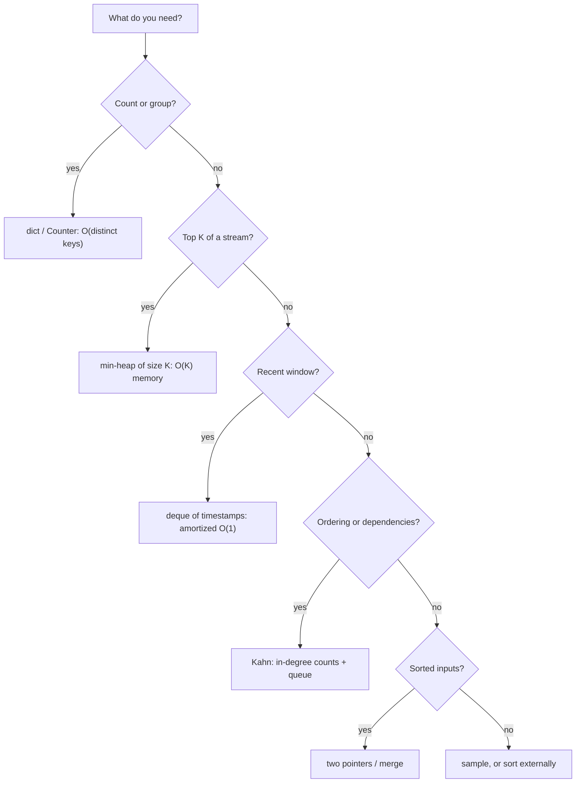

## 🎯 TL;DR

> Data coding interviews reward **streaming thinking**: process records one at a time, keep only the state you need, and say what that state costs.

- Most data problems reduce to a few patterns: hash-map aggregation, a heap for top-K, a deque for sliding windows, two-pointer merges, dependency ordering, and reservoir sampling.
- Ask three questions first: is the input bounded or a stream? Does the state fit in memory? Is the input already sorted? The answers pick the algorithm.
- Always state time and memory, then say how the same idea changes when the data is spread over many machines.

## 🌱 Start simple (Junior)

> **💡 Analogy:** Think of a busy kitchen. Nobody stores every order and sorts them at closing time. The cook keeps a tally on a notepad (counting), a short list of the best-selling dishes (top-K), and a timer per table (a window). Each tool keeps only what the next decision needs.

Ask these three questions before you write code:

1. **Bounded or streaming?** Can you read the input twice, or is it a log that never ends?
2. **Does the state fit in memory?** A dict of 10,000 user ids is fine. A dict of a billion ids is not.
3. **Is it sorted already?** Sorted input allows merges and two-pointer scans with almost no extra memory.

A warm-up that shows the core move (one pass, a dict of counts):

```python
from collections import Counter

events = ["click", "view", "click", "buy", "click"]
counts = Counter(events)          # one pass; memory grows with distinct keys
print(counts.most_common(2))      # [('click', 3), ('view', 1)]
```

Every problem in this lesson asks a version of the same question: how do I count, rank, group or order this without holding everything at once?

## 🔧 How it really works (Mid)

Each pattern maps to a standard structure. Pick it by the question you are answering:



The mechanics behind the exercises:

- **Heap of size K.** Keep a min-heap of the K largest items seen so far. A new item enters only if it beats the smallest kept item. Each insert costs O(log K), not O(log n).
- **Deque sliding window.** Append new timestamps on the right and pop expired ones from the left. Each element enters and leaves once, so the work is amortized O(1) per event.
- **Merge of sorted runs.** Two sorted inputs are joined with two pointers. Memory is the size of one equal-key block, not the whole input. External sort and sort-merge join use the same idea.
- **Kahn's algorithm.** Jobs with zero unfinished parents go into a queue. Finishing a job decrements the counts of its children. If fewer jobs come out than went in, the graph has a cycle.
- **Reservoir sampling.** Keep the first k items. Item i (0-based, i ≥ k) replaces a random slot with probability k/(i+1). Every item ends in the sample with probability k/n, in a single pass.

| Pattern | Problems |
|---|---|
| Hash-map aggregation | 1, 8, 13 |
| Recursive flatten / schema validation | 2, 12 |
| Sort, then sweep | 3, 10, 13 |
| Heap | 4 |
| Deque / sliding window with expiry | 5, 6 |
| Cache with eviction | 7 |
| Map-reduce simulation | 8 |
| Dependency ordering | 9, 14 |
| Reservoir sampling | 11 |

## 🧠 Senior depth & trade-offs

- **Memory is the real constraint.** An in-memory `Counter` is O(distinct keys). With unbounded keys (session ids, client IPs), switch to approximate structures: a Count-Min Sketch with a heap for top-K, or [[hyperloglog]] for distinct counts. State the error bound you accept.
- **Sorting is a shuffle.** The Spark version of problem 13 is `lag` over a window partitioned by user and ordered by time. The partition key is both the unit of parallelism and the unit of skew: one bot user becomes one slow task (see [[data-skew]]).
- **Streaming state needs expiry.** Problems 6 and 7 are the same idea as state retention in Flink or Structured Streaming. Without a TTL the state grows forever. A [[watermark]] tells you when it is safe to forget old keys.
- **Retries need idempotent writes.** Problem 14 retries failed work. Retrying a non-idempotent load duplicates rows. Make the write idempotent first (overwrite a partition, or `MERGE` by key), then retry. See [[idempotency]].
- **Route bad records, do not crash.** Problem 12 sends rejected rows to a separate sink (see [[dead-letter-queue]]). One bad record does not stop the pipeline, and the rejects can be audited and replayed.
- **Do not hand-roll production systems.** In production use `heapq`, the engine's sort, and an orchestrator such as [[airflow]]. The interview tests whether you can reason about the structure, not whether you can rebuild an orchestrator.

## 🧪 Try it

Solve each problem before you open its hint. Every solution is standalone Python 3.10+ with asserts, so you can paste it into a file and run it.

### 1. Parse & aggregate log lines

**Problem:** Each line is `timestamp path status latency_ms`. Count requests and the average latency per path, and count malformed lines separately. The file can be huge, so read it as a stream.

<details><summary>Hint</summary>

Split each line once. Keep a dict keyed by path that stores `[count, total_ms]`. Never build a list of all lines.

</details>

<details><summary>Solution</summary>

```python
from collections import defaultdict

def aggregate(lines):
    stats = defaultdict(lambda: [0, 0])     # path -> [count, total_ms]
    bad = 0
    for line in lines:
        parts = line.split()
        if len(parts) != 4 or not parts[3].isdigit():
            bad += 1
            continue
        _, path, _status, ms = parts
        stats[path][0] += 1
        stats[path][1] += int(ms)
    return {p: (c, t / c) for p, (c, t) in stats.items()}, bad

logs = [
    "2026-01-01T10:00:00 /home 200 120",
    "2026-01-01T10:00:01 /home 500 80",
    "garbage",
    "2026-01-01T10:00:02 /cart 200 50",
]
result, bad = aggregate(logs)
assert result == {"/home": (2, 100.0), "/cart": (1, 50.0)} and bad == 1
```

**Complexity:** time O(n) over lines, memory O(distinct paths). Any iterable works, so passing an open file object streams it.

</details>

### 2. Flatten nested JSON

**Problem:** Turn `{"user": {"id": 7, "tags": ["a", "b"]}}` into `{"user.id": 7, "user.tags.0": "a", "user.tags.1": "b"}`.

<details><summary>Hint</summary>

Recurse. For a dict, join the parent key and child key with a dot. For a list, use the index as the key. Scalars are the base case.

</details>

<details><summary>Solution</summary>

```python
def flatten(obj, prefix=""):
    if isinstance(obj, dict):
        items = obj.items()
    elif isinstance(obj, list):
        items = ((str(i), v) for i, v in enumerate(obj))
    else:
        return {prefix: obj}
    out = {}
    for key, value in items:
        out.update(flatten(value, f"{prefix}.{key}" if prefix else str(key)))
    return out

doc = {"user": {"id": 7, "tags": ["a", "b"]}, "ok": True}
assert flatten(doc) == {"user.id": 7, "user.tags.0": "a", "user.tags.1": "b", "ok": True}
```

**Complexity:** time O(total nodes × depth) because of the dict copies in `update`; memory O(output). Empty containers produce no keys. Very deep documents can hit Python's recursion limit (about 1,000 frames), so an explicit stack is the production fix.

</details>

### 3. Merge overlapping time intervals

**Problem:** Given closed intervals `(start, end)`, return the disjoint intervals that cover the same points. Treat touching intervals such as `(1, 3)` and `(3, 5)` as overlapping.

<details><summary>Hint</summary>

Sort by start. A new interval either extends the last merged interval or starts a new one.

</details>

<details><summary>Solution</summary>

```python
def merge(intervals):
    merged = []
    for start, end in sorted(intervals):
        if merged and start <= merged[-1][1]:
            merged[-1][1] = max(merged[-1][1], end)
        else:
            merged.append([start, end])
    return [tuple(iv) for iv in merged]

assert merge([(1, 3), (2, 6), (8, 10), (15, 18), (17, 20)]) == [(1, 6), (8, 10), (15, 20)]
assert merge([(1, 3), (3, 5)]) == [(1, 5)]
```

**Complexity:** time O(n log n) for the sort, memory O(n) for the output. Sorting is the dominant cost, and it is the same shuffle-and-sort cost you pay in Spark.

</details>

### 4. Top-K with a heap (stream)

**Problem:** Given a stream of `(key, count)` pairs, return the K keys with the largest counts, highest first. Memory must be O(K), not O(number of pairs).

<details><summary>Hint</summary>

Use a min-heap of size K. The smallest kept item sits at the root, so one comparison decides whether a new item enters.

</details>

<details><summary>Solution</summary>

```python
import heapq

def top_k(pairs, k):
    heap = []                                   # min-heap of (count, key), size <= k
    for key, count in pairs:
        if len(heap) < k:
            heapq.heappush(heap, (count, key))
        elif count > heap[0][0]:
            heapq.heapreplace(heap, (count, key))
    return [(key, count) for count, key in sorted(heap, reverse=True)]

pairs = [("a", 5), ("b", 9), ("c", 1), ("d", 7), ("e", 9)]
assert top_k(pairs, 2) == [("e", 9), ("b", 9)]     # ties: larger key first
assert top_k([("x", 3), ("y", 4)], 5) == [("y", 4), ("x", 3)]
```

**Complexity:** time O(n log k), memory O(k). Ties are broken by key, so the output is deterministic. For keys that are not pre-aggregated, count with a `Counter` (memory O(distinct keys)) or a Count-Min Sketch when that is too large.

</details>

### 5. Sliding-window rate limiter

**Problem:** Allow at most `limit` events per user in any window of `window` seconds. Return `True` if the event is allowed and `False` otherwise. Rejected events are not recorded.

<details><summary>Hint</summary>

Keep one deque of allowed timestamps per user. Before deciding, pop timestamps from the left that fell out of the window.

</details>

<details><summary>Solution</summary>

```python
from collections import defaultdict, deque

class SlidingWindowLimiter:
    def __init__(self, limit, window):
        self.limit, self.window = limit, window
        self.hits = defaultdict(deque)          # user -> allowed timestamps

    def allow(self, user, now):
        q = self.hits[user]
        while q and q[0] <= now - self.window:  # expired: outside (now - window, now]
            q.popleft()
        if len(q) < self.limit:
            q.append(now)
            return True
        return False

rl = SlidingWindowLimiter(limit=2, window=10)
assert [rl.allow("u", t) for t in (0, 1, 2, 10, 10)] == [True, True, False, True, False]
```

**Complexity:** amortized O(1) per event, memory O(limit) per active user. The deque is what makes the left pop O(1); a Python list's `pop(0)` is O(n).

</details>

### 6. Deduplicate events with TTL

**Problem:** Given `(timestamp, event_id)` pairs in non-decreasing time order, yield each event whose id was not seen in the last `ttl` seconds. Memory must be bounded by the TTL, not by the whole stream.

<details><summary>Hint</summary>

Keep a dict from id to nothing (a set works) and a deque of `(timestamp, id)` in arrival order. Before each event, evict the entries older than the TTL from the left of the deque, removing their ids from the dict.

</details>

<details><summary>Solution</summary>

```python
from collections import deque

def dedup(events, ttl):
    seen = set()          # ids currently inside the TTL window
    expiry = deque()      # (timestamp, id) in arrival order
    for ts, eid in events:
        while expiry and expiry[0][0] <= ts - ttl:
            _, old_id = expiry.popleft()
            seen.discard(old_id)
        if eid in seen:
            continue
        seen.add(eid)
        expiry.append((ts, eid))
        yield ts, eid

ev = [(0, "a"), (5, "a"), (9, "b"), (10, "a"), (12, "a")]
assert list(dedup(ev, ttl=10)) == [(0, "a"), (9, "b"), (10, "a")]
```

**Complexity:** amortized O(1) per event, memory O(events inside one TTL). The TTL clock starts at first sight: a duplicate does not extend the window. Note that a Flink or Spark job does this with keyed state and a timer, which is the same logic with checkpointing.

</details>

### 7. LRU / TTL cache

**Problem:** Build a cache with `get(key, now)` and `put(key, value, now)`. It holds at most `capacity` entries, evicts the least recently used one when full, and treats an entry as missing after `ttl` seconds.

<details><summary>Hint</summary>

`OrderedDict` keeps insertion order and supports `move_to_end` and `popitem(last=False)`. Store `(value, expires_at)` as the value. Check expiry on `get`.

</details>

<details><summary>Solution</summary>

```python
from collections import OrderedDict

class LRUTTLCache:
    def __init__(self, capacity, ttl):
        self.capacity, self.ttl = capacity, ttl
        self.data = OrderedDict()           # key -> (value, expires_at), LRU first

    def get(self, key, now):
        if key not in self.data:
            return None
        value, expires_at = self.data[key]
        if now >= expires_at:
            del self.data[key]
            return None
        self.data.move_to_end(key)          # now the most recently used
        return value

    def put(self, key, value, now):
        self.data[key] = (value, now + self.ttl)
        self.data.move_to_end(key)
        if len(self.data) > self.capacity:
            self.data.popitem(last=False)   # evict least recently used

c = LRUTTLCache(capacity=2, ttl=10)
c.put("a", 1, now=0)
c.put("b", 2, now=1)
assert c.get("a", now=2) == 1               # a is now most recent
c.put("c", 3, now=3)                        # evicts b
assert c.get("b", now=3) is None and c.get("c", now=3) == 3
assert c.get("a", now=12) is None           # a expired at t=10
```

**Complexity:** O(1) per get and put. Expired entries that are never read stay until they reach the LRU end, so a production cache adds a periodic sweep.

</details>

### 8. Map-reduce word count

**Problem:** Count word occurrences across many lines using explicit map, shuffle (group by key) and reduce phases. Words are case-insensitive and split on whitespace.

<details><summary>Hint</summary>

Map emits `(word, 1)` pairs. Shuffle groups the values by key. Reduce sums each group. Keep the three phases as separate functions so each one can be parallelized on its own.

</details>

<details><summary>Solution</summary>

```python
def map_phase(line):
    return [(word, 1) for word in line.lower().split()]

def shuffle(pairs):
    groups = {}
    for key, value in pairs:
        groups.setdefault(key, []).append(value)
    return groups

def reduce_phase(groups):
    return {key: sum(values) for key, values in groups.items()}

lines = ["Data is big", "big data big pipelines"]
pairs = [pair for line in lines for pair in map_phase(line)]
assert reduce_phase(shuffle(pairs)) == {"data": 2, "is": 1, "big": 3, "pipelines": 1}
```

**Complexity:** time O(total words), memory O(distinct words) for the shuffle. A combiner (summing per mapper before the shuffle) cuts the data moved across the network; it is valid here because addition is associative.

</details>

### 9. Topological sort of job dependencies

**Problem:** Given `{job: [parents]}`, return an execution order where every job comes after all its parents. Raise an error if the dependencies contain a cycle.

<details><summary>Hint</summary>

Kahn's algorithm. Count the unfinished parents of each job. Start a queue with the jobs that have none. When a job is output, decrement its children, and enqueue any child that reaches zero. If the output is shorter than the job set, there is a cycle.

</details>

<details><summary>Solution</summary>

```python
from collections import deque

def topo_sort(deps):
    indegree, children = {}, {}
    for job, parents in deps.items():
        indegree.setdefault(job, 0)
        children.setdefault(job, [])
        for parent in parents:
            indegree.setdefault(parent, 0)
            children.setdefault(parent, []).append(job)
            indegree[job] += 1
    queue = deque(sorted(j for j, d in indegree.items() if d == 0))
    order = []
    while queue:
        job = queue.popleft()
        order.append(job)
        for child in children[job]:
            indegree[child] -= 1
            if indegree[child] == 0:
                queue.append(child)
    if len(order) != len(indegree):
        raise ValueError("cycle detected")
    return order

deps = {"load": ["clean"], "clean": ["extract"], "report": ["load", "dim"],
        "dim": ["extract"], "extract": []}
order = topo_sort(deps)
assert order.index("extract") < order.index("clean") < order.index("load") < order.index("report")
assert order.index("extract") < order.index("dim") < order.index("report")
try:
    topo_sort({"a": ["b"], "b": ["a"]})
except ValueError:
    pass
else:
    raise AssertionError("cycle not detected")
```

**Complexity:** time O(V + E), memory O(V + E). A missing parent (a job named in a dependency but never defined) is treated as a job with no parents, so decide whether your scheduler should reject it instead.

</details>

### 10. Join two large sorted files (merge join)

**Problem:** Inner-join two iterables of `(key, value)` pairs that are both sorted by key, without loading either side into memory. Duplicate keys on both sides must produce every combination.

<details><summary>Hint</summary>

Walk both iterators with two pointers. When the keys differ, advance the smaller one. When they match, buffer the run of equal keys on the right side only, then pair it with every equal-key row on the left.

</details>

<details><summary>Solution</summary>

```python
def merge_join(left, right):
    left, right = iter(left), iter(right)
    l, r = next(left, None), next(right, None)
    while l is not None and r is not None:
        if l[0] < r[0]:
            l = next(left, None)
        elif l[0] > r[0]:
            r = next(right, None)
        else:
            key = l[0]
            r_block = []
            while r is not None and r[0] == key:
                r_block.append(r[1])
                r = next(right, None)
            while l is not None and l[0] == key:
                for r_value in r_block:
                    yield key, l[1], r_value
                l = next(left, None)

left = [(1, "a"), (2, "b"), (2, "c"), (4, "d")]
right = [(2, "x"), (2, "y"), (3, "z"), (4, "w")]
assert list(merge_join(left, right)) == [
    (2, "b", "x"), (2, "b", "y"), (2, "c", "x"), (2, "c", "y"), (4, "d", "w"),
]
```

**Complexity:** time O(n + m) plus the output size, memory O(size of the largest equal-key run on the right). The input must be sorted by the same key with the same ordering, or the join silently misses rows. Spark's sort-merge join does this per partition after a shuffle and sort.

</details>

### 11. Reservoir sampling

**Problem:** Pick a uniform random sample of `k` items from a stream whose length you do not know in advance, in one pass and O(k) memory.

<details><summary>Hint</summary>

Fill the reservoir with the first k items. For item index i ≥ k, draw a random integer j in `[0, i]`. If j < k, replace `sample[j]`.

</details>

<details><summary>Solution</summary>

```python
import random

def reservoir_sample(stream, k, rng=random):
    sample = []
    for i, item in enumerate(stream):
        if i < k:
            sample.append(item)
        else:
            j = rng.randint(0, i)           # inclusive on both ends
            if j < k:
                sample[j] = item
    return sample

assert reservoir_sample(range(5), 10) == [0, 1, 2, 3, 4]

rng = random.Random(42)
hits = [0] * 10
for _ in range(20000):
    hits[reservoir_sample(range(10), 1, rng)[0]] += 1
assert all(1700 < h < 2300 for h in hits)     # each value is picked about 2000 times
```

**Complexity:** time O(n), memory O(k). Every item ends in the sample with probability k/n. Use a seeded generator in tests so the results are reproducible.

</details>

### 12. Validate and clean CSV rows with a schema

**Problem:** Parse CSV text against a schema of `column -> converter`. Return the clean rows and a list of rejected rows with their line number and reason. Do not stop at the first bad row.

<details><summary>Hint</summary>

Use `csv.DictReader` and convert each column inside a `try`. Catch `ValueError` (bad value), `KeyError` or `AttributeError` (missing column). Collect the failures instead of raising.

</details>

<details><summary>Solution</summary>

```python
import csv
import io
from datetime import date

SCHEMA = {"user_id": int, "amount": float, "day": date.fromisoformat}

def clean_csv(text, schema=SCHEMA):
    good, rejected = [], []
    for lineno, row in enumerate(csv.DictReader(io.StringIO(text)), start=2):
        try:
            good.append({col: cast(row[col].strip()) for col, cast in schema.items()})
        except (KeyError, ValueError, TypeError, AttributeError) as exc:
            rejected.append((lineno, str(exc), row))
    return good, rejected

data = ("user_id,amount,day\n"
        "1,9.5,2026-01-02\n"
        "x,3,2026-01-02\n"
        "2,4,2026-13-01\n"
        "3,1.25,2026-01-05\n")
good, bad = clean_csv(data)
assert good == [
    {"user_id": 1, "amount": 9.5, "day": date(2026, 1, 2)},
    {"user_id": 3, "amount": 1.25, "day": date(2026, 1, 5)},
]
assert [line for line, _, _ in bad] == [3, 4]
```

**Complexity:** time O(rows × columns), memory O(rows) if you keep the result in a list. For a huge file, yield the good rows and write the rejects to a file as you go. Writing rejects with their reason to a [[dead-letter-queue]] is the production version of this.

</details>

### 13. Sessions per user from a click stream

**Problem:** Given `(user, timestamp_seconds)` events, split each user's events into sessions. A new session starts when the gap to the previous event is greater than 30 minutes. Return `(user, session_no, start, end, n_events)` with session numbers starting at 1.

<details><summary>Hint</summary>

Sort by user and time, then group by user. Inside a group, compare each timestamp with the previous one. When the gap is too large, close the current session and open a new one.

</details>

<details><summary>Solution</summary>

```python
from itertools import groupby

GAP = 30 * 60   # seconds; a gap of exactly 30 minutes stays in the same session

def sessionize(events):
    out = []
    for user, group in groupby(sorted(events), key=lambda e: e[0]):
        session_no, start, prev, count = 0, None, None, 0
        for _, ts in group:
            if prev is None or ts - prev > GAP:
                if prev is not None:
                    out.append((user, session_no, start, prev, count))
                session_no += 1
                start, count = ts, 0
            count += 1
            prev = ts
        out.append((user, session_no, start, prev, count))
    return out

events = [("u1", 0), ("u1", 600), ("u1", 4000), ("u2", 100), ("u1", 4100)]
assert sessionize(events) == [
    ("u1", 1, 0, 600, 2),
    ("u1", 2, 4000, 4100, 2),
    ("u2", 1, 100, 100, 1),
]
```

**Complexity:** time O(n log n) for the sort, memory O(n) here. In a streaming job you keep only the last timestamp and the open session per key, which is the state a Flink keyed process function holds. Late events are the hard part; see [[sessionization]].

</details>

### 14. Mini scheduler with retries

**Problem:** Run named jobs in dependency order. Each job is a callable that may raise. Retry a failing job up to `max_retries` times, recording a backoff delay of 1, 2, 4, ... seconds between attempts (record it, do not sleep). If a job still fails, mark it `failed` and mark everything that depends on it `skipped`.

<details><summary>Hint</summary>

Loop in rounds. In each round, run every job whose parents all succeeded, and skip every job with a failed or skipped parent. Wrap each run in a retry loop, and use `for ... else` to detect that all attempts failed.

</details>

<details><summary>Solution</summary>

```python
def run_jobs(jobs, deps, max_retries=2):
    status, delays = {}, []
    remaining = dict(jobs)
    while remaining:
        ready = [n for n in remaining
                 if all(status.get(p) == "ok" for p in deps.get(n, []))]
        for n in [n for n in remaining
                  if any(status.get(p) in ("failed", "skipped") for p in deps.get(n, []))]:
            status[n] = "skipped"
            del remaining[n]
        if not ready:
            if remaining:
                raise ValueError("cycle or missing dependency")
            break
        for n in ready:
            for attempt in range(max_retries + 1):
                try:
                    remaining[n]()
                    status[n] = "ok"
                    break
                except Exception:
                    if attempt < max_retries:
                        delays.append((n, 2 ** attempt))
            else:
                status[n] = "failed"
            del remaining[n]
    return status, delays

calls = {"n": 0}

def flaky():
    calls["n"] += 1
    if calls["n"] < 3:
        raise RuntimeError("temporary")

def always_fails():
    raise RuntimeError("permanent")

jobs = {"extract": flaky, "load": lambda: None, "bad": always_fails, "after_bad": lambda: None}
deps = {"load": ["extract"], "bad": [], "after_bad": ["bad"]}
status, delays = run_jobs(jobs, deps, max_retries=2)
assert status == {"extract": "ok", "load": "ok", "bad": "failed", "after_bad": "skipped"}
assert delays == [("extract", 1), ("extract", 2), ("bad", 1), ("bad", 2)]
```

**Complexity:** time O(attempts × V) in this simple round-based form, memory O(V). Production schedulers add jitter to the backoff so many retries do not hit the source at the same moment, and they retry only errors that are transient. Retrying is only safe with idempotent tasks, as in the Senior section above.

</details>

## 💬 Interview corner

**Question: "Top 10 pages from a log that does not fit in memory."** Mid answer: "Count per page in a hash map, then sort and take 10." Senior answer: "I'd partition the input by a hash of the page so each partition's counts fit in memory, keep a heap of size 10 per partition, then merge the heaps. In Spark that is a `groupBy` and an `orderBy` with `limit`, and the shuffle is the cost to name."

**Question: "Sessionize clicks with a 30-minute inactivity gap."** Mid answer: "Sort by user and time, and compare each timestamp with the previous one." Senior answer: "In Spark I'd use `lag` over a window partitioned by user and ordered by time, flag a new session where the gap is over 30 minutes, then take a running sum of the flag as the session id. I'd call out skew from heavy users and how late events change old sessions."

**Question: "How do you retry a failed load safely?"** Mid answer: "Retry with backoff." Senior answer: "Only after the write is idempotent: overwrite the partition or `MERGE` on a key. Then bounded retries with jittered backoff, and a dead-letter path for failures that are not transient."

> **🎤 Say this in the interview:** "First I ask whether the input is bounded and whether the state fits in memory. Then I pick the structure: a counter, a heap of size K, or a deque for a window. I state time and memory, and I say what changes once the data is spread over many machines."

## ⚠️ Common mistakes

> **⚠️ Watch out:** Sorting a billion items just to get the top K. A heap of size K does it in O(n log K) time and O(K) memory.

- `heapq` is a min-heap. For top-K, the root is the smallest kept item, which is the one to replace.
- Removing items from a list while iterating over it. Use a deque with `popleft`, or build a new list.
- Using `>=` in one place and `>` in another for gaps and window edges. Pick one convention and state it.
- Treating touching intervals as disjoint without saying so. `(1, 3)` and `(3, 5)` merge under the convention in problem 3.
- Assuming a merge join works on unsorted input. It fails silently and drops rows.
- Retrying a non-idempotent write, which duplicates data.
- Keeping dedup or cache state with no TTL. Memory grows without bound.
- Recursing on very deep JSON and hitting the recursion limit.

## ✅ Check yourself (quiz)

1. Which structure gives the top K items from a stream with O(K) memory?
   - A) A sorted list of all items
   - B) A min-heap of size K
   - C) A `set` of all keys
   - D) A stack

<details><summary>Answer</summary>

**B** — a min-heap of size K keeps only the K best candidates and rejects anything smaller than its root in O(1). A sorted list of all items needs O(n) memory.

</details>

2. In the sliding-window limiter, why is a `deque` used instead of a `list` for each user?

   - A) A `deque` is thread-safe
   - B) `popleft` is O(1), while `list.pop(0)` shifts every element and is O(n)
   - C) A `deque` sorts itself automatically
   - D) A `list` cannot store integers

<details><summary>Answer</summary>

**B** — expiring old timestamps happens at the left end on every event. O(1) pops keep the limiter amortized O(1) per event.

</details>

3. A merge join sees many duplicate keys on both sides. What must fit in memory?

   - A) The whole right side
   - B) The run of equal keys on one side (the right block in problem 10)
   - C) Nothing; the join is always O(1) memory
   - D) The hash of the left side

<details><summary>Answer</summary>

**B** — the merge only buffers one equal-key run, so the memory cost is the size of the largest such run. A skewed key with millions of duplicate rows is therefore the risk.

</details>

4. **(Senior)** Your Spark sessionization job is slow and one executor runs out of memory. The skew comes from a single bot user with 50 million events. Which first move directly attacks the cause?

   - A) Add more executors
   - B) Raise the driver memory
   - C) Filter or isolate the heavy key (for example, handle bot traffic separately), because one user's sequential window is one task no matter how many executors you add
   - D) Convert the CSV input to JSON

<details><summary>Answer</summary>

**C** — the per-user window is sequential by nature, so all of that user's events land in one partition and one task. More executors or driver memory do not split it. Isolating or pre-filtering the heavy key changes the work that one task has to do.

</details>

5. **(Senior)** A load job fails halfway and is retried. Why is the retry only safe with an idempotent write?

   - A) Retries are rate-limited by the scheduler
   - B) A retry after a partial write without idempotency appends the already-written rows again
   - C) Retries reorder rows within a partition
   - D) Retries disable checkpointing

<details><summary>Answer</summary>

**B** — the first attempt may have written some rows before it failed. A plain append repeats them. An overwrite of the same partition or a `MERGE` by key gives the same result however many times it runs.

</details>

## 🗂️ Flashcards

| Front | Back |
|---|---|
| Top K from a stream in O(K) memory | Min-heap of size K; replace the root when a bigger item arrives |
| Why a deque for sliding windows | `popleft` is O(1); each event enters and leaves once |
| Merge join memory | The equal-key block on one side, not the whole input |
| Kahn's algorithm | Queue of zero-in-degree nodes; decrement children; fewer outputs than nodes means a cycle |
| Reservoir sampling probability | Item i (i ≥ k) enters the sample with probability k/(i+1) |
| Why a counter can fail at scale | Memory is O(distinct keys); use sketches for unbounded keys |
| Why retries need idempotency | A retry after a partial write would otherwise duplicate rows |
| Sessionization rule | Start a new session when the gap to the previous event exceeds the threshold |

## 🔗 Go further

- [[dsa-for-de]] covers the underlying data structures and their complexity in more depth.
- [[python-large-files]] shows how to stream files that do not fit in memory, which is the setting for most of these problems.
- [[mapreduce]] explains the map, shuffle and reduce phases from problem 8 at cluster scale.
- [[sql-window-functions]] is the SQL version of problems 5, 13 and the top-K and sessionization ideas.
- [[dlq-bad-records]] describes how production pipelines route invalid rows, as in problem 12.
- Practise by writing each solution twice: once in plain Python and once in Spark or SQL, then compare the shuffles and the memory each version needs.
