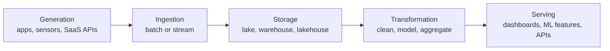

## 🎯 TL;DR

> A **data engineer** builds and runs the systems that move data from where it is created to where people and programs can use it, reliably, on time, and at a cost the business can accept.

- The job is about **pipelines and platforms**, not about the final chart or the model. The analyst or data scientist is the user; the data engineer makes sure their input exists, is correct and is fresh.
- The work follows a **lifecycle**: generation → ingestion → storage → transformation → serving.
- Around the lifecycle sit the **undercurrents**: security, data management, DataOps, orchestration, architecture and software engineering. Senior engineers are judged mostly on these.
- Titles overlap a lot. Learn the three role variants so you can answer "what would you do here?" for any of them.

## 🌱 Start simple (Junior)

> **💡 Analogy:** A restaurant. The customers (analysts, product managers, ML models) order dishes (dashboards, reports, features). The chef (data scientist or analyst) cooks the dish. The data engineer runs the supply chain and the kitchen: deliveries arrive (ingestion), go into the fridge in the right place (storage), get cut and cooked into usable ingredients (transformation), and reach the table on time (serving). If the delivery is late or spoiled, the best chef cannot save the dinner.

A simple example of the job. A shop's website writes an order row to a database every time someone buys something. Every morning the finance team wants yesterday's revenue per city in a dashboard. A data engineer:

1. Copies new orders from the production database every hour, without slowing down the shop (**ingestion**).
2. Stores them in a warehouse table (**storage**).
3. Removes duplicates, converts currencies and joins city names (**transformation**).
4. Publishes a clean `daily_revenue` table the dashboard reads (**serving**).
5. Gets an alert when the load fails or the numbers look wrong (**undercurrents**).

Nothing in that list is "analysis". It is plumbing that must work every day.

## 🔧 How it really works (Mid)

### The lifecycle

| Stage | Question the engineer answers | Typical tools (examples) |
|---|---|---|
| Generation | What systems produce data, and in what shape? | Application databases, event producers, third-party APIs |
| Ingestion | How do we get it out, how often, and what if it is late? | CDC tools, Kafka, batch extract jobs |
| Storage | Where does it live and in what format? | Object storage with Parquet, warehouses, table formats |
| Transformation | How do raw records become trustworthy tables? | Spark, SQL engines, dbt |
| Serving | Who reads it, with what latency and access rules? | BI tools, feature stores, reverse-ETL, APIs |

The undercurrents run through all five stages: security (who can read which column), data quality and lineage, DataOps (testing and deployment of pipelines), orchestration (scheduling and dependencies), architecture (the design trade-offs) and software engineering (version control, tests, code review).

### Three role variants

| Variant | Focus | Typical day |
|---|---|---|
| Pipeline-focused | Building and operating ingestion and transformation jobs | Fixing a late Airflow DAG, adding a new source, backfilling a month |
| Platform-focused | Building the tools other engineers use | Cluster upgrades, a self-service ingestion framework, cost controls |
| Analytics-focused | Modeling data for analysts and BI | Warehouse models, metric definitions, semantic layer, dbt tests |

Companies mix these. A small team may need one person to do all three; a large one splits them.

### How the role differs from neighbours

- **Data analyst:** answers questions with existing data; writes SQL and dashboards. Uses the engineer's tables.
- **Data scientist:** builds models and experiments. Needs clean features and training data, often from the engineer.
- **Analytics engineer:** owns the modeling layer (usually SQL and dbt) between raw data and BI. Overlaps most with the analytics-focused variant.
- **Data platform engineer:** owns the infrastructure (clusters, orchestration, access control) that the others use.
- **Software engineer:** builds products. Data engineers build the systems that record and move what products produce.

> **⚠️ Watch out:** Companies use these titles inconsistently. Always ask "what does the team own, and what gets paged at night?" rather than trusting the title.

## 🧠 Senior depth & trade-offs

A senior data engineer is expected to reason about the **whole lifecycle** and its costs, not one tool.

- **Latency vs cost:** a 5-minute stream is not automatically better than a daily batch. Ask who consumes the data and what a delay costs them.
- **Correctness contracts:** agree on schema, freshness and ownership with producers (data contracts). Most incidents start upstream, not in your code.
- **Failure modes:** late data, duplicate data, schema drift, partial loads, a source API that silently changes meaning. Design for each, do not just hope.
- **Operations:** what do you monitor (freshness, volume, null rates, job duration, cost), and what runs automatically when a load fails?
- **Security and privacy:** personal data (for example phone numbers and national IDs) must be masked or restricted by role. This is a design requirement, not a later patch.
- **When not to build a pipeline:** if one team needs one query once, a saved query or an export may be cheaper than a platform.

## 🧪 Try it

1. Pick a product you use every day (a food delivery app, a bank app, a ride-hailing app). Write down five data sources it probably produces.
2. For each source, name the ingestion method (batch, CDC, streaming, API pull) and the latency that the business would probably need.
3. Name one table an analyst would want, and the three checks you would add so it does not break silently.

Example answer for source 1

A ride-hailing app: trip records (application database), GPS pings (event stream), payment events (payment provider API), driver documents (file uploads), and support tickets (SaaS API). Each one needs a different ingestion method, which is exactly why the role is hard.

## 💬 Interview corner

**Question:** "What does a data engineer do, and how is it different from a data scientist?"

> **🎤 Say this in the interview:** "A data engineer builds the pipelines and storage that make data reliable and available: ingestion, transformation and serving, plus monitoring and security. A data scientist uses that data to build models and experiments. I see my job as making sure their inputs are correct, documented and fresh, so they spend their time on the analysis, not on debugging the source."

- **Junior answer:** lists tools (Spark, Airflow, SQL) without the purpose.
- **Mid answer:** describes the lifecycle and gives one example pipeline with a quality check.
- **Senior answer:** talks about ownership, contracts with producers, cost trade-offs and what they monitor, and admits when a simpler tool is enough.

## ⚠️ Common mistakes

- **"Data engineering is ETL."** ETL is one step. Ownership of reliability, contracts and cost is what makes the role senior.
- **Starting with tools.** Interviewers want the problem first (what data, how fresh, who reads it), then the tool.
- **Ignoring the consumer.** A table nobody reads is wasted cost; a table without a clear owner breaks silently.
- **Treating pipelines as one-off scripts.** Production pipelines need tests, version control, retries and alerts (the undercurrents).

## ✅ Check yourself (quiz)

1. Which stage of the lifecycle does a CDC tool that copies row changes from a production database mainly belong to?
   - A) Generation
   - B) Ingestion
   - C) Serving
   - D) Transformation

Answer

**B** — copying data out of a source into the platform is ingestion. The data was already generated by the application; the CDC tool moves it.

2. An analyst asks for a table of "monthly active users". Who usually owns the metric definition and the modeling layer in a team that has an analytics engineer?
   - A) The data platform engineer
   - B) The analytics engineer, usually in SQL and dbt
   - C) The product manager only
   - D) The database administrator

Answer

**B** — analytics engineers own the modeling layer between raw data and BI, so metric definitions usually live there. Platform engineers run the infrastructure they use.

3. **(Senior)** A product team wants a 1-minute freshness SLA for a dashboard that only the weekly business review reads. What is the best first question?
   - A) Which streaming engine should we use?
   - B) Who consumes this, and what does a delay of a few hours actually cost them?
   - C) Can we add more executors?
   - D) Should the table be partitioned by hour?

Answer

**B** — latency is a business requirement with a cost. A weekly review does not need a 1-minute pipeline, and the cheapest reliable design is usually a daily or hourly batch. Tool choice comes after this.

4. **(Senior)** Why do senior engineers insist on data contracts with upstream producers?
   - A) Contracts make storage cheaper
   - B) Many incidents start when a source changes schema or meaning silently; a contract makes the expectation explicit and testable
   - C) Contracts replace the need for monitoring
   - D) Contracts are only needed for streaming

Answer

**B** — the producer and consumer agree on schema, freshness and ownership, so changes are visible before they break downstream tables. Monitoring is still needed, but contracts prevent many failures.

## 🗂️ Flashcards

| Front | Back |
|---|---|
| The five stages of the DE lifecycle | Generation, ingestion, storage, transformation, serving |
| What are the undercurrents? | Cross-cutting concerns: security, data management, DataOps, orchestration, architecture, software engineering |
| Data analyst vs data engineer | Analyst answers questions with existing data; engineer makes the data reliable and available |
| Analytics engineer's main area | Modeling layer between raw data and BI (often SQL and dbt) |
| Data platform engineer's main area | Shared infrastructure and tooling used by other engineers |
| First question before choosing a tool | Who consumes the data, how fresh must it be, and what does a delay cost? |

## 🔗 Go further

- **iran-de-market** shows which stacks and company types you will meet in Iran.
- **senior-expectations** explains what changes at the senior level.
- **pipeline-design-principles** and **dwh-fundamentals** cover the design ideas behind the lifecycle.
- **interview-loop** describes the stages of a typical data engineering interview.
- Read the book *Fundamentals of Data Engineering* (Reis & Housley) for the lifecycle and undercurrents in depth.
