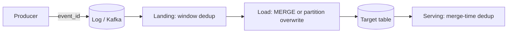

## 🎯 TL;DR

> Duplicates are **not a bug you can fully prevent**. Retries, consumer restarts and overlapping backfills will deliver the same record twice. Make the pipeline tolerate it: **deduplicate by a key** at each layer, and make every load **idempotent**, so running it again gives the same table.

- Under at-least-once delivery, a duplicate is the normal case after any failure. Plan for it.
- Deduplicate with a **deterministic rule**: a key, plus an ordering column (for example `updated_at`), plus a tie-breaker (for example `event_id`).
- Remove duplicates in **layers**: at the source (event IDs), at landing (window dedup), at load (`MERGE` or partition overwrite), and at serving time for stores that merge later.
- An idempotent load is one you can run twice. The second run changes nothing. That property is what makes retries and backfills safe.

## 🌱 Start simple (Junior)

> **💡 Analogy:** A payment reference number. You press "pay" and the network times out. You press it again. The bank sees the same reference number and charges you once. The reference number is the key that makes the retry safe.

Duplicates come from the simplest things:

- A producer retries a send after a timeout, but the first send had actually succeeded.
- A consumer processes 100 records, writes them, then crashes before it commits its position. On restart it reads the same 100 again.
- Someone reruns yesterday's job, and the time window overlaps the day before.

Here is a tiny example. Two copies of the same order event arrive:

| order_id | status | updated_at | event_id |
|---|---|---|---|
| o1 | created | 1 | e1 |
| o1 | paid | 2 | e2 |
| o1 | created | 1 | e1 |

The table should contain **one** row for `o1`, with status `paid`. Two questions decide that: which row is the same thing (the key `order_id`, or `event_id`), and which row wins (the latest `updated_at`). The rest of the lesson is about making those two answers explicit and applying them everywhere.

## 🔧 How it really works (Mid)

**Where duplicates come from.** Delivery guarantees define the baseline. With at-most-once you lose data; with at-least-once you get duplicates; with exactly-once **end to end** you need either transactions or an idempotent sink. See [[delivery-semantics]] and [[exactly-once]]. Most real systems are "at-least-once plus idempotent writes", which is the practical meaning of exactly-once.

**Layers where you remove duplicates:**



1. **Source:** give every event a stable `event_id` at creation, not at ingestion. A retry must reuse the same ID.
2. **Landing:** within the batch, keep one row per key with a window function.
3. **Load:** merge the deduplicated batch into the target by key, so rows already present are updated, not duplicated.
4. **Serving:** some stores deduplicate during background merges, so reads must account for duplicates still waiting to be merged.

**Window dedup.** This query keeps one row per order, with a deterministic winner:

```sql
-- Keep one row per order_id: latest updated_at, then highest event_id as a tie-breaker
WITH ranked AS (
  SELECT e.*,
         ROW_NUMBER() OVER (
           PARTITION BY order_id
           ORDER BY updated_at DESC, event_id DESC
         ) AS rn
  FROM staging.order_events e
)
SELECT order_id, status, amount, updated_at, event_id
FROM ranked
WHERE rn = 1;

-- Idempotent load: merge the deduplicated batch into the target by key
MERGE INTO warehouse.orders AS t
USING deduped_batch AS s
  ON t.order_id = s.order_id
WHEN MATCHED AND s.updated_at > t.updated_at THEN
  UPDATE SET status = s.status, amount = s.amount, updated_at = s.updated_at
WHEN NOT MATCHED THEN
  INSERT (order_id, status, amount, updated_at)
  VALUES (s.order_id, s.status, s.amount, s.updated_at);
```

The `ORDER BY` in the window is the important part. Without the tie-breaker, two rows with the same `updated_at` can swap places between runs, and the "winner" changes. A deterministic rule is what makes the job repeatable. The `WHEN MATCHED AND s.updated_at > t.updated_at` condition makes an old replayed event unable to overwrite a newer state.

**Why the condition matters.** Here is a Python version of the same rule. Run it twice and the table does not change:

```python
def apply_batch(table: dict, batch: list[dict]) -> dict:
    # table: key -> row ; the batch may contain duplicates and replays
    for ev in batch:
        key = ev["order_id"]
        current = table.get(key)
        if current is None or ev["updated_at"] > current["updated_at"]:
            table[key] = ev
    return table

table = {}
batch = [
    {"order_id": "o1", "status": "created", "updated_at": 1},
    {"order_id": "o1", "status": "paid",    "updated_at": 2},
    {"order_id": "o1", "status": "created", "updated_at": 1},  # duplicate of an old event
]
apply_batch(table, batch)
once = dict(table)
apply_batch(table, batch)          # replay the same batch
print(table == once)               # True: the result does not change on replay
print(table["o1"]["status"])       # paid
```

**Partition overwrite.** For large fact tables, a common idempotent pattern is to rebuild whole partitions. For a given day, delete the partition and insert the recomputed rows in one transaction, or overwrite it in one step. In Spark, dynamic partition overwrite (`spark.sql.sources.partitionOverwriteMode = dynamic`) overwrites only the partitions present in the new data. Running the job twice gives the same partition.

**Serving-time dedup.** ClickHouse's `ReplacingMergeTree` keeps one row per sorting key, but only during background merges. Until a merge runs, duplicates can be visible, so queries use `FINAL` or aggregate with `argMax` on the version column. StarRocks primary-key tables apply an upsert by primary key, so the latest version of a key wins at write time. Flink deduplicates with keyed state: store seen IDs per key and drop repeats, with a TTL so the state does not grow forever.

## 🧠 Senior depth & trade-offs

- **Choose the dedup key carefully.** `event_id` identifies an event; a natural key (`order_id`) identifies an entity. Event-level dedup removes retries. Entity-level dedup keeps the latest state. Usually you need both: dedup events, then merge entities.
- **Ordering column.** "Latest wins" needs a reliable ordering column. A device clock or a producer wall clock is not reliable across machines. Prefer a source version number, a database log position (LSN, binlog position) or a sequence from the source.
- **Bounded state in streams.** Stream dedup needs memory for every seen key. Set a TTL longer than the maximum expected duplicate delay, or the same event arriving later counts as new. This is a real trade-off: longer TTL means more state, shorter means possible duplicates. See [[state-store]].
- **Cost on big tables.** A window dedup over a billion rows is a shuffle and a sort. Limit the work with partitions: dedup only the partitions that the batch touches, not the full history.
- **Deletes.** A `MERGE` that only inserts and updates leaves deleted source rows behind. Handle deletes explicitly (tombstones or a deleted flag), or a replay can resurrect a deleted row. See [[cdc]].
- **Exactly-once is an end-to-end property.** A transactional producer does not help if the sink writes duplicates on retry. The sink needs an idempotent write (keyed upsert) or a transaction that spans the offset commit and the write.
- **When NOT to dedup.** Some data is legitimately repeated (a page view counted twice is still two views). Dedup by key only where duplicates are retries, not real events. Put a business rule in the key, not a guess.
- **Monitor.** Duplicate ratio per partition (`count(*) - count(distinct key)`), rows rejected by the merge condition, TTL-expired keys in Flink, and a reconciliation count between source and target after each run. See [[pattern-reconciliation]].

## 🧪 Try it

A payment service emits `payment_events` with fields `payment_id`, `event_id`, `status`, `event_time` (set by the producer). A consumer retries after timeouts, so duplicates arrive hours later.

1. Which key do you use for dedup at landing, and which for the final `payments` table? Why?
2. Your team proposes `ORDER BY ingestion_time` in the window. What is the problem and what do you use instead?

<details><summary>Model answer</summary>

1. At landing, dedup by `event_id`, because it identifies a retry of the same event. For the final table, key by `payment_id`, because there is one current state per payment. Use `event_time` (plus `event_id` as tie-breaker) as the ordering column, so late duplicates cannot override newer states.
2. `ingestion_time` depends on when your system received the event, not when it happened. A retry arrives later, so it gets a newer ingestion time and wins even though it is older data. Use the producer's `event_time` or a source version, with a deterministic tie-breaker.

</details>

## 💬 Interview corner

**Question:** "How do you avoid duplicates in a pipeline with retries?"

> **🎤 Say this in the interview:** "I assume duplicates will happen under at-least-once delivery, so I design for them. Each event has a stable ID from the producer. At landing I keep one row per key with a window function, ordered by a source version and a deterministic tie-breaker. The load is an idempotent MERGE, guarded so an older event cannot overwrite a newer state. I verify with a duplicate-ratio metric and a reconciliation count after each run."

A mid answer names the key and the MERGE. A senior answer adds the ordering column, the TTL trade-off in streams, deletes, and the fact that the serving layer may still show duplicates until merges finish.

## ⚠️ Common mistakes

- **Using arrival time as the ordering column.** Retries arrive late and win wrongly. Use the source's event time or version.
- **Non-deterministic ties.** `ROW_NUMBER` without a tie-breaker can pick a different winner on each run.
- **INSERT for retried loads.** It doubles rows. Use a keyed MERGE or a partition rebuild.
- **Forgetting deletes.** Replays resurrect rows that were removed at the source.
- **Trusting `ReplacingMergeTree` for exact counts** without `FINAL` or `argMax`. Duplicates may still exist until a merge.
- **Deduping only at the end.** Duplicates that reach the raw zone still cost storage and can break joins upstream.

## ✅ Check yourself (quiz)

1. Why do duplicates appear in an at-least-once pipeline?
   - A) The broker stores each message twice by design
   - B) A producer or consumer retries after a failure that may have happened after the work succeeded
   - C) Spark always writes files twice
   - D) Primary keys are missing in the source

<details><summary>Answer</summary>

**B** — at-least-once means a message is redelivered when the sender cannot be sure it was processed, for example after a timeout or a crash before the offset commit. The retry can deliver work that already succeeded.

</details>

2. Which ordering makes a window dedup repeatable across runs?
   - A) `ORDER BY ingestion_time` only
   - B) `ORDER BY updated_at DESC, event_id DESC`
   - C) No `ORDER BY`; the engine picks randomly
   - D) `ORDER BY random()`

<details><summary>Answer</summary>

**B** — the ordering column expresses "latest wins" and the tie-breaker makes equal timestamps deterministic. Options A and D use a non-source time or randomness, and C leaves the winner to the engine.

</details>

3. A replayed batch contains an old `created` event after a newer `paid` event is already in the target. Which merge condition protects the target?
   - A) `WHEN MATCHED THEN UPDATE` with no condition
   - B) `WHEN MATCHED AND s.updated_at > t.updated_at THEN UPDATE`
   - C) `WHEN NOT MATCHED THEN INSERT` only
   - D) `TRUNCATE` before every merge

<details><summary>Answer</summary>

**B** — the guard means only a newer version overwrites the target. Without it, the replay moves the order back to `created`. Option C never updates existing rows, and D loses history.

</details>

4. **(Senior)** A Flink job dedups payment events by `event_id` with a 1-hour TTL in keyed state. Some retries arrive 3 hours after the original and are counted twice. What should you change, and what does it cost?

   - A) Set the TTL longer than the maximum realistic retry delay, and accept the extra state, memory and checkpoint cost
   - B) Remove dedup; retries are harmless
   - C) Use processing time instead of event time for the TTL, which fixes the issue
   - D) Increase the parallelism to 100 to hold more keys

<details><summary>Answer</summary>

**A** — the TTL is shorter than the retry delay, so the state for that key is gone when the duplicate arrives. The fix is a TTL that covers the maximum realistic delay. The cost is more state, which means more memory and larger checkpoints. Option D adds parallelism but does not change the TTL problem.

</details>

## 🗂️ Flashcards

| Front | Back |
|---|---|
| Why duplicates happen under at-least-once | A retry can redeliver work that already succeeded |
| Idempotent load | A load you can run twice with the same result |
| Dedup at landing | Window function, one row per key, ordered by source version with a tie-breaker |
| Why a tie-breaker | Makes the winner deterministic when ordering values are equal |
| Guard in a MERGE | Update only when the incoming version is newer than the target |
| ReplacingMergeTree gotcha | Duplicates are removed during merges, so reads need FINAL or argMax |
| Flink dedup state | Seen keys in keyed state; the TTL must exceed the maximum retry delay |
| Delete handling in replays | Explicit tombstones or deleted flags, or deleted rows reappear |

## 🔗 Go further

- [[pattern-dedup]] walks through dedup queries for common interview problems.
- [[pattern-exactly-once]] explains how idempotent sinks and transactions combine.
- [[kafka-exactly-once]] covers the idempotent producer and transactions in Kafka.
- [[spark-writes]] covers save modes, partition overwrite and committers for safe writes.
- Check the documentation for your version of ClickHouse and StarRocks before you depend on merge timing, key semantics or table-model options.
