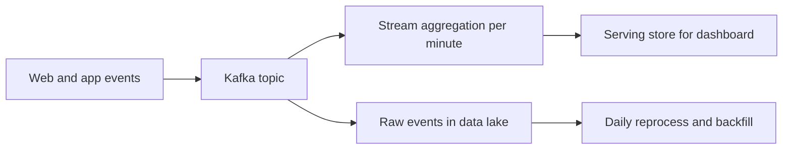

## 🎯 TL;DR

> For any data system design question, follow one fixed sequence: **requirements, numbers, data model, architecture, deep dives, operations**. The order keeps you from drawing boxes before you know the problem.

- Spend the first 10 minutes on questions, not on the diagram.
- Put numbers on the board early (volume, rate, freshness). Every later choice should follow from them.
- Pick two or three deep dives and go deep, rather than covering everything shallowly.
- Finish with operations: quality, monitoring, recovery. Most candidates forget this, and seniors notice.

## 🌱 Start simple (Junior)

> **💡 Analogy:** Cooking from a recipe. First you check who is eating and how many people (requirements). Then you count the ingredients for that many people (numbers). Then you choose the pan and the order of steps (architecture). Only then do you cook. Cooking without the count gives you a pot of soup for two people that feeds twenty.

Here is a small example prompt: **"Build a daily report of sales per store for the operations team."** The framework turns it into questions:

- **Who** reads it, and **what** do they decide with it?
- **How fresh** must it be? Daily, hourly, or near real time?
- **How much** data per day? Ten thousand rows or a billion?
- **Where** does the data come from, and can it arrive late or twice?

Only after these questions do you name tools. For a daily report with a few million rows a day, a batch job into a warehouse is often enough. A streaming system would be a choice you must justify, not a default.

> **🎤 Say this in the interview:** "Before I design, let me confirm who uses this, how fresh it must be, and roughly how much data we have per day."

## 🔧 How it really works (Mid)

The framework has seven steps. Each has an output you write on the board.

1. **Functional requirements (about 5 min).** Who reads, what data, what output. Write 3–5 bullets.
2. **Non-functional requirements.** Latency (how late), freshness (how old), volume, correctness (can we lose or duplicate data?), cost, and availability.
3. **Sources and sizing.** Where data comes from, and back-of-envelope numbers (see [[data-estimation]]).
4. **Data model.** The main tables or topics, keys, grain, partitioning.
5. **High-level architecture.** Sources, ingestion, processing, storage, serving. Keep it to one diagram.
6. **Deep dives.** Two or three hard parts: exactly-once, late data, skew, backfill.
7. **Operations.** Data quality checks, lag and freshness monitoring, reprocessing, and recovery.

**Time budget for 45 minutes:** requirements 5, numbers 4, model 5, architecture 10, deep dives 15, operations 4, buffer 2. For 60 minutes add the extra time to the deep dives.

**Whiteboard layout.** Keep three areas: left for requirements and numbers, centre for the architecture, right for the data model and a list of open questions. The right column is what you return to when the interviewer pushes back.

**Worked example: clickstream dashboard.** Requirements: product team wants page views per minute per page, freshness under 2 minutes, retention 90 days of raw events.

Numbers, with the arithmetic shown:

- 50 million events per day ÷ 86,400 seconds ≈ **579 events/s** on average.
- Peak at 3× the average ≈ **1,740 events/s**. Design for peak, not average.
- Raw event size 500 bytes: 50 M × 500 B = **25 GB/day** before compression; 90 days ≈ **2.25 TB** raw.

The architecture follows from these numbers. Peak of about 1,740 events/s is comfortable for a Kafka topic with a few partitions, so ingestion is not the hard part here. The hard parts are late events and the minute aggregates.

Deep dives to name: a 2-minute freshness target needs a **watermark** that decides when a minute is closed (see [[watermark]] and [[late-arriving-data]]). Duplicate events need an [[idempotency]] strategy at the serving store.

## 🧠 Senior depth & trade-offs

- **Make the trade-off explicit.** "Watermark at 5 minutes: we accept 5-minute-late events and get a result in 6 minutes. A longer watermark is more complete but slower." Interviewers score the trade-off, not the number.
- **Correctness words need definitions.** "Exactly-once" is ambiguous. Say what you guarantee: end to end with idempotent writes, or only inside the processing engine. See [[exactly-once]].
- **Sizing decides the shape.** If the numbers say a single database handles it, do not invent a cluster. If the numbers say a billion keys, say what happens to a hot key (see [[data-skew]]).
- **Push-back is data.** When the interviewer changes a requirement ("now 10 seconds freshness"), restate it, show which numbers and components change, and say what you would drop. Do not defend a design that no longer fits.
- **Time is a constraint you manage.** Keep a 2-minute buffer. Ask early: "Which deep dive do you want me to go into?" That turns a guessing game into a conversation.
- **Operations is where you show ownership.** Name at least: a freshness alert, a row-count or reconciliation check against the source, a replay path, and how you backfill a bad day. See [[pipeline-monitoring]].

## 🧪 Try it

Pick three design problems from the roadmap's Track 14 (or [[design-clickstream-analytics]] and [[design-top-k]] as starters). For each one:

1. Set a 45-minute timer and speak the seven steps out loud, without notes.
2. Write the numbers on paper and check the arithmetic.
3. Record yourself and count: how many minutes did you spend before the first box?

Show solutions

**1–3.** There is no single right answer. Good signs: requirements in the first 5–8 minutes, numbers with arithmetic, two or three deep dives chosen on purpose, and an operations section. Bad signs: the diagram appears in minute 2 and the numbers never appear.

## 💬 Interview corner

> **🎤 Say this in the interview:** "I will go in order: requirements, numbers, model, architecture, then the two hardest parts, and finally how we would operate it. Let me start with the questions."

**How it is asked:** "Design a pipeline that does X." or "Walk me through how you would approach this design."

- **Junior answer:** names a tool stack right away and draws it.
- **Mid answer:** asks about freshness and volume, gives rough numbers, and draws ingestion, storage and serving.
- **Senior answer:** states the trade-offs for each choice, identifies the hardest part without being asked, and covers failure and recovery.

**Model answer (3–5 sentences):** "I would start by clarifying who uses the data, how fresh it must be and how much data arrives per day. From the numbers I would design for peak rather than average, and choose batch or streaming based on freshness. The two hard parts here are late events and exactly-once results, so I would go deep on a watermark and an idempotent write. I would finish with quality checks, freshness alerts and a backfill path."

## ⚠️ Common mistakes

- **Jumping to tools.** "We use Spark and Kafka" before anyone knows the volume.
- **No numbers.** Designing without sizing gives you a design that cannot be checked.
- **Averages instead of peaks.** Peak load usually decides the capacity.
- **Ignoring reprocessing.** Every pipeline needs a backfill or replay story.
- **Spending 25 minutes on one deep dive.** Breadth of the structure matters too.
- **Skipping operations.** No monitoring and no quality checks is a red flag at senior level.

## ✅ Check yourself (quiz)

1. A system receives 50 million events per day. What is the average rate in events per second?
   - A) About 58 events/s
   - B) About 579 events/s
   - C) About 5,787 events/s
   - D) About 57,870 events/s

Answer

**B** — 50,000,000 ÷ 86,400 ≈ 579. A common slip is dividing by 8,640 (off by ten). Peak is what you design for, so check the peak multiple too.

2. You are asked for near real-time (under 2 minutes) freshness. Which step should come first, and why?
   - A) The data model, so you know the tables
   - B) Non-functional requirements, so the freshness target is fixed before you pick a tool
   - C) The deep dive on skew
   - D) The operations plan

Answer

**B** — freshness is a non-functional requirement that drives the architecture (batch or streaming, watermark, storage). Fix the target first, then choose the design that meets it.

3. **(Senior)** In a streaming minute-aggregation design, you set the watermark to 10 minutes instead of 1 minute. What do you gain and what do you pay?
   - A) You gain lower latency and pay with more duplicates
   - B) You accept events that arrive up to 10 minutes late, so results are more complete, but each result is emitted later and state is kept longer
   - C) You gain exactly-once and pay with more storage only
   - D) Nothing changes; the watermark only affects logs

Answer

**B** — a longer watermark trades latency and state size for completeness. Say this trade-off out loud; interviewers score it. The exact behaviour depends on the engine, so check the docs for your version.

4. **(Senior)** You are 35 minutes into a 45-minute design and have only the architecture. What is the best move?
   - A) Keep drawing until the time is up
   - B) Quickly cover operations and name the remaining deep dives, then ask which one the interviewer wants to go into
   - C) Restart with a new design
   - D) Apologise and end the session

Answer

**B** — a short operations section and a clear list of open deep dives shows the full framework even when time is short. Asking which deep dive to take keeps the conversation with the interviewer.

## 🗂️ Flashcards

| Front | Back |
|---|---|
| What are the seven steps? | Functional and non-functional requirements, sizing, data model, architecture, deep dives, operations |
| What is the first output on the board? | Three to five functional requirement bullets |
| 50 M events/day is about how many events/s on average? | About 579 (50 M ÷ 86,400) |
| Why design for peak? | Peak load decides capacity and the cost of a design that fails under it |
| What does a watermark decide? | When a window is considered complete and late events are dropped |
| What should you say when requirements change? | Restate them, update the numbers, and say which components change |
| What must operations include? | Quality checks, freshness and lag monitoring, reprocessing or backfill path |

## 🔗 Go further

- **interview-loop** explains where the system design round sits in the full loop.
- **numbers-to-know** and **data-estimation** give the reference numbers for step 2 and 3.
- **pattern-late-data** and **pattern-backfill** cover the two most common deep dives.
- **pipeline-monitoring** covers step 7 in depth.
- **design-clickstream-analytics** applies this framework to a full problem.
