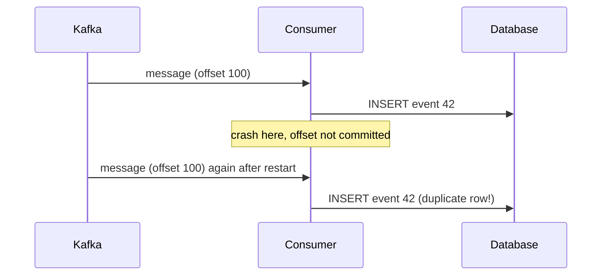

## 🎯 TL;DR

> **Delivery semantics** describe what happens to a message across failures: it may be lost (**at-most-once**), it may be repeated (**at-least-once**), or the **effect** happens once (**exactly-once**). Over an unreliable network, true exactly-once delivery is impossible. Exactly-once **processing** is achieved by **at-least-once delivery plus an idempotent or transactional effect**.

- At-most-once: send and never retry. No duplicates, but data can be lost.
- At-least-once: retry until acknowledged. No loss, but duplicates after a failure.
- Exactly-once (in practice): at-least-once delivery, plus deduplication or an atomic commit of the effect and the progress marker.
- Kafka's exactly-once is inside Kafka. For an external database you still need an idempotent sink or a transaction that spans both systems.

## 🌱 Start simple (Junior)

> **💡 Analogy:** Sending a parcel by post. Option 1: you post it once and never check (it may get lost). Option 2: you keep posting until you get a delivery receipt (the parcel may arrive twice, because the receipt got lost). Option 3: you post until you get a receipt, and the receiver checks the parcel number and ignores the second copy.

The third option is what engineers mean by exactly-once in practice. The receiver does the work of ignoring duplicates.

Walk through a tiny example. A producer sends `order 42 paid` to a queue.

- The queue stores it, but the acknowledgement is lost. The producer retries. Now the queue holds two copies. That is **at-least-once**.
- The producer never retries. If the message was lost on the wire, nobody notices. That is **at-most-once**.
- The consumer writes `order 42 paid` to a table keyed by `order_id`. Writing it twice leaves one row. The final state is the same. That is **idempotent processing**.

## 🔧 How it really works (Mid)

**The three guarantees.**

| Semantics | Mechanism | Risk | Typical use |
|---|---|---|---|
| At-most-once | Send, do not retry, commit progress before processing | Loss | Metrics where sampling is fine |
| At-least-once | Retry until ack, commit progress after processing | Duplicates | Most pipelines, with dedup downstream |
| Exactly-once (effect) | At-least-once + idempotent or atomic effect | Complexity, sink support | Money, counters, reporting totals |

The order of "commit progress" versus "process" decides the guarantee. Consider a consumer that reads a message, writes to a database, and then records its offset:



If the offset were committed first and the consumer crashed before the insert, the message would be lost. That is the at-most-once order.

**An idempotent sink, in SQL.** A standard `MERGE` upserts by business key, so a replayed batch changes nothing the second time. The staged batch must have **one row per key** first, because many engines reject a `MERGE` where several source rows match one target row. Deduplicate with a window function (see [[shuffle]] for the cost of doing this at scale):

```sql
WITH ranked AS (
  SELECT s.*,
         ROW_NUMBER() OVER (PARTITION BY order_id
                            ORDER BY event_ts DESC, event_id DESC) AS rn
  FROM staged_orders s
)
MERGE INTO orders_gold AS t
USING (SELECT * FROM ranked WHERE rn = 1) AS s
  ON t.order_id = s.order_id
WHEN MATCHED AND s.event_ts > t.event_ts THEN
  UPDATE SET status = s.status, amount = s.amount, event_ts = s.event_ts
WHEN NOT MATCHED THEN
  INSERT (order_id, status, amount, event_ts)
  VALUES (s.order_id, s.status, s.amount, s.event_ts);
```

Run the same batch twice and `orders_gold` ends in the same state. The `WHEN MATCHED AND s.event_ts > t.event_ts` guard also means an older replay cannot overwrite a newer row. `MERGE` exists in PostgreSQL 15+, Snowflake, BigQuery and Databricks, but not in MySQL, so check your engine.

**A deduplicating consumer in Python.** The check and the effect must be **atomic**. If you record the id before applying the effect, a crash between the two loses the effect. If you record it after, a crash between the two repeats it.

```python
def handle(event, db):
    with db.transaction():                       # one atomic unit
        if db.exists("processed", event["event_id"]):
            return "duplicate-skipped"
        db.apply_balance_change(event)           # the effect
        db.insert("processed", event["event_id"])  # the marker
    return "applied"
```

Both writes commit together, so the marker and the effect cannot diverge.

**Kafka's pieces.** The **idempotent producer** lets the broker detect retries within one producer session using per-partition sequence numbers, so a retry does not duplicate a record. **Transactions** (a `transactional.id`, with consumers reading only committed data via `isolation.level=read_committed`) make a batch of writes plus the consumer's offset commit atomically. That covers read-process-write **inside Kafka**. Check the docs for your version for defaults and limits.

## 🧠 Senior depth & trade-offs

- **Why exactly-once delivery is impossible.** Under message loss, a sender cannot tell "lost" from "received, ack lost" without an answer, and the two generals problem shows that no finite protocol removes that doubt. So the practical goal is an exactly-once **effect**, not exactly-once transport.
- **Where the guarantee ends.** Kafka transactions cover Kafka topics. The moment you write to an external database or an object store, you need one of: an idempotent sink (upsert by key), a transactional sink that commits in the same unit as the offsets, or a two-phase commit with the sink.
- **Two-phase commit sinks.** Flink's checkpointing and the two-phase commit sink pattern pre-commit the output during a checkpoint and commit it when the checkpoint completes. The sink must support a transaction that survives a restart. Read the connector's docs for your version.
- **Spark Structured Streaming.** Its file sinks write a checkpoint log and output in a way that lets a restarted query skip batches it already committed. Exactly-once depends on a replayable source, a checkpoint location, and a sink that honours the commit log. Replace the checkpoint and the guarantee is gone.
- **StarRocks and similar OLAP sinks from Kafka.** Use a Primary Key table for upserts. A replayed record overwrites the same row, so duplicates collapse. Confirm the loader's delivery behaviour in its docs, and check with a count-distinct on the business key after a failover test.
- **Dedup state has a cost.** A `processed` table grows forever unless you bound it. Keep a window (for example 7 days) and make sure replays older than the window are impossible, or accept a reconciliation job.
- **Ordering is a separate problem.** Idempotency does not restore order. An old event arriving late needs a timestamp guard (as in the `MERGE` above) or a watermark-based design; see [[watermark]].
- **What to monitor.** Consumer lag, redelivery counts, duplicate-skipped counters, and count or sum reconciliation between source and sink.
- **When not to chase exactly-once.** Logs, clickstream and approximate metrics often tolerate duplicates. Choose at-least-once with an idempotent aggregate and save the cost.

## 🧪 Try it

1. A consumer commits its offset, then writes to a database, and crashes between the two steps. Which guarantee does the consumer provide, and what would you change?
2. Write a `MERGE` (or an `INSERT ... ON CONFLICT` for PostgreSQL) that upserts `daily_totals(day, amount)` from a staging table, keeping the largest `amount` for each day. Explain why replaying the same batch is safe.
3. A `processed` table keeps every event id forever. Propose a bounded alternative and state the one case where it can fail.

<details><summary>Show solutions</summary>

**1.** The offset is committed before the write, so a crash loses that message. That is at-most-once. Move the offset commit after the write, and make the write and the offset commit atomic if the store supports it. Otherwise make the insert idempotent by key, which gives at-least-once with an idempotent effect.

**2.**
```sql
INSERT INTO daily_totals (day, amount)
SELECT day, MAX(amount) FROM staging_totals GROUP BY day
ON CONFLICT (day) DO UPDATE
SET amount = GREATEST(daily_totals.amount, EXCLUDED.amount);
```
Replaying the batch gives `GREATEST(x, x) = x`, so the table does not change. The rule depends only on the key and the data, not on how many times the batch ran.

**3.** Keep ids for a bounded window, for example 7 days, and expire older ids. It fails when a message older than the window is redelivered, because its id is gone and it is applied twice. Mitigate with a timestamp guard, a reconciliation job, or by bounding redelivery (for example, dead-lettering very old events).

</details>

## 💬 Interview corner

**Question: "How do you guarantee no duplicate rows in StarRocks from Kafka?"** Mid answer: "I'd use a Primary Key table and upsert by the business key." Senior answer: "Delivery from Kafka is at-least-once, so replays happen after failures. I'd load into a Primary Key table keyed by the business id, so a replayed record overwrites the same row. I'd dedupe the batch by key first, add a timestamp guard for late events, and verify with a count-distinct check after a failover test. I would not promise exactly-once across the whole path without checking the loader's docs for my version."

**Question: "What happens to exactly-once if the sink is not transactional?"** Mid: "It becomes at-least-once, so duplicates can appear." Senior: "Kafka's transactions stop at the Kafka boundary. A non-transactional sink can receive a record twice when a job restarts before it commits its offset. I'd make the sink idempotent by key, or move the offset into the same transaction as the write. If neither is possible, I'd accept at-least-once and reconcile."

> **🎤 Say this in the interview:** "I never promise exactly-once delivery. I promise an exactly-once effect: at-least-once delivery, plus an idempotent or transactional sink, plus a check that proves it."

## ⚠️ Common mistakes

> **⚠️ Watch out:** Enabling Kafka transactions does not make a Postgres or StarRocks write exactly-once. The sink must take part.

- Committing the offset before processing, which turns a crash into silent loss.
- Recording the processed id in a separate step from the effect, which leaves a window for duplicates or loss.
- Using an auto-generated surrogate key in the sink, so each replay creates a new row. Use the business key instead (see [[surrogate-key]]).
- Assuming `MERGE` is safe with several source rows per key.
- Letting the dedup window expire before the maximum redelivery delay.

## ✅ Check yourself (quiz)

1. Which guarantee means "never retry, so messages can be lost but never repeated"?
   - A) At-least-once
   - B) At-most-once
   - C) Exactly-once
   - D) Effectively-once

<details><summary>Answer</summary>

**B** — at-most-once sends without retrying. Loss is possible, duplicates are not.

</details>

2. A consumer writes to a database and commits its offset afterwards. It crashes after the write. What happens after restart?
   - A) The message is lost
   - B) The message is processed again, so the sink can see a duplicate
   - C) The database rolls back automatically, because Kafka is transactional
   - D) Nothing; offsets are never replayed

<details><summary>Answer</summary>

**B** — the offset was not committed, so the record is redelivered. That is at-least-once. Only an idempotent or transactional sink prevents the duplicate effect.

</details>

3. **(Senior)** Your pipeline uses Kafka transactions and writes to an external PostgreSQL table without an idempotent key. Which statement is correct?
   - A) The pipeline is exactly-once end to end
   - B) Kafka transactions cover only Kafka; the external write can still duplicate on replay
   - C) PostgreSQL enforces exactly-once on every insert
   - D) Duplicates are impossible when the producer is idempotent

<details><summary>Answer</summary>

**B** — the transaction boundary stops at Kafka. The external write needs an idempotent key or a transaction that spans both systems.

</details>

4. **(Senior)** Why must the dedup check and the effect be in one atomic unit?
   - A) Otherwise the database locks up
   - B) A crash between recording the id and applying the effect either loses the effect or repeats it
   - C) Atomic units are faster
   - D) Kafka requires it

<details><summary>Answer</summary>

**B** — the two steps need to succeed or fail together. Otherwise a crash between them produces loss or duplication.

</details>

5. **(Senior)** A batch with two rows for the same `order_id` runs through `MERGE`. Why is this risky, and what fixes it?
   - A) `MERGE` cannot update numbers
   - B) Many engines reject or nondeterministically apply several source rows matching one target row; dedupe the batch by key first, for example with `ROW_NUMBER`
   - C) `MERGE` deletes the source rows
   - D) The fix is to add `DISTINCT` to the target table

<details><summary>Answer</summary>

**B** — a `MERGE` needs at most one source row per target key. Deduplicate the staged batch with a window function so the choice of row is explicit and deterministic.

</details>

## 🗂️ Flashcards

| Front | Back |
|---|---|
| At-most-once | Never retry: loss possible, duplicates impossible |
| At-least-once | Retry until ack: duplicates possible, loss unlikely |
| Why is exactly-once delivery impossible? | A sender cannot tell "lost" from "received, ack lost" over an unreliable network |
| Practical exactly-once | At-least-once delivery plus an idempotent or transactional effect |
| Scope of Kafka transactions | Kafka topics and offsets; external sinks need their own guarantee |
| Why dedupe before `MERGE`? | Several source rows for one key make the result undefined |
| Why bound a `processed` table? | It grows forever; a bounded window needs a redelivery-age guarantee |

## 🔗 Go further

- **kafka-exactly-once** covers idempotent producers and transactions in detail.
- **pattern-exactly-once** shows end-to-end designs for pipelines.
- **dedup-idempotent-loads** covers keys, upserts and reload-safe jobs.
- **distributed-transactions** explains two-phase commit, sagas and the outbox pattern.
- **spark-structured-streaming** explains checkpoints and the commit log.
- Check the docs for your version of Kafka, Flink, Spark and your sink before quoting any configuration default.
