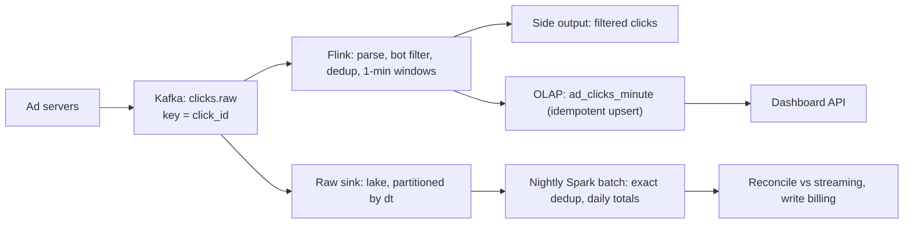

## 🎯 TL;DR

> **Problem:** Build a system that ingests ad click events from many ad servers, removes duplicates, aggregates clicks per ad and per minute, serves near-real-time dashboards to advertisers, and produces **billing-grade** daily totals that match the raw data.

- Two paths share one truth: a **streaming** path (seconds to minutes of latency) and a **batch** path (hours, exact) that **reconciles** the streaming numbers.
- The hard parts are **deduplication**, **late events** (watermarks), **exactly-once effects** at the sink, and **hot ads** that receive most of the clicks.
- Keep the raw events immutable. Every aggregate must be reproducible from them, so a bug can be fixed by a backfill.

## 🌱 Start simple (Junior)

> **💡 Analogy:** A cashier counts how many people walk through a shop door, minute by minute, for each shop window display. A bored visitor who walks in and out twice must count once. At the end of the day, the manager recounts from the security camera tape to confirm the numbers the cashier reported.

**Problem statement.** An advertising platform shows ads on many websites. When a user clicks an ad, the ad server sends a click event. Advertisers pay per click, so the platform must count clicks correctly. Advertisers also want to see clicks per campaign, updated every minute.

**Functional requirements**

1. Ingest click events from ad servers.
2. Count each click once, even if the event was sent twice.
3. Aggregate clicks per `ad_id` per one-minute window.
4. Serve advertiser dashboards: clicks by ad, by time range (last hour, last 7 days).
5. Produce daily totals used for billing, and keep the raw events.

**Non-functional requirements**

- **Freshness:** dashboards updated within about 1 minute of the click.
- **Correctness:** billing totals must be exact after reconciliation (no double charge, no missed clicks).
- **Scale:** 500 million clicks per day, with peaks four times the average.
- **Availability:** ingestion must survive a broker or a job restart without losing clicks.
- **Cost:** raw data kept for 30 days, aggregates for longer.

The first thing to say in an interview is which of these is hardest. Here, it is correctness under duplicates and late events, not raw throughput.

## 🔧 How it really works (Mid)

### Step 3: Estimation (show the arithmetic)

| Quantity | Calculation | Result |
|---|---|---|
| Average event rate | 500,000,000 / 86,400 s | ≈ 5,800 events/s |
| Peak event rate | 5,800 × 4 | ≈ 23,000 events/s |
| Raw event size | assume 250 bytes per event | 250 B |
| Raw data per day | 500,000,000 × 250 B | 125 GB/day |
| Raw kept 30 days (uncompressed) | 125 GB × 30 | 3.75 TB |
| Raw kept 30 days (Parquet, ~4:1) | 3.75 TB / 4 | ≈ 0.94 TB, call it 1 TB |
| Kafka retention 7 days with 3 replicas | 125 GB × 7 × 3 | ≈ 2.6 TB |
| Dedup state (1-hour window) | 5,800/s × 3,600 s ≈ 20.8 M keys | |
| Dedup state size | 20.8 M × 64 B ≈ 1.3 GB, spread over 64 tasks | ≈ 21 MB per task |
| Minute aggregates, upper bound | 300,000 active ads × 1,440 minutes | 432 M rows/day |

The dedup state estimate is a *raw* size: real state stores (RocksDB) add overhead, so budget 2 to 3 times that. The aggregate upper bound is loose on purpose: most ads have no clicks in most minutes, so the real row count is far smaller.

### Step 4: Data model

- **Raw click** (immutable, lake): `click_id` (unique per click, set by the ad server), `ad_id`, `campaign_id`, `advertiser_id`, `user_hash`, `event_time`, `ingest_time`, `source` (site or app), `dt` (partition).
- **Minute aggregate** (serving, OLAP): key `(ad_id, window_start)`, value `clicks`, `campaign_id`, `updated_at`.
- **Daily billing table** (batch, lake): `(ad_id, dt)`, `billable_clicks`, `filtered_clicks`, `version`.

The key decision is that `click_id` is a **business key** that the ad server must generate once per click and reuse on retries. Without it, deduplication is guesswork.

### Step 5: High-level design

Walk through it in order: ad servers produce events keyed by `click_id`, so retries of the same click land on the same partition. Flink does the stateful work. The lake keeps the raw truth. A nightly batch job recomputes the day exactly and compares it with what the streaming path produced.

## 🧠 Senior depth & trade-offs

### Deep dive 1: Streaming aggregation and watermarks

Aggregate by **event time** (`event_time`, when the click happened), not by processing time. Use tumbling one-minute windows keyed by `ad_id`. A watermark says "I believe no event older than T will arrive"; when the watermark passes a window's end, the window is emitted.

- A watermark that is too tight drops late clicks (mobile devices send events after a network outage).
- A watermark that is too loose delays dashboards and keeps more state.
- A reasonable design: an allowed lateness of about 5 minutes for the dashboard, with a **correction path**: late events after that are counted by the batch job, not silently lost.

The output is a sequence of updates for the same `(ad_id, window_start)`. The sink must treat them as upserts, not appends, otherwise a window is counted several times.

### Deep dive 2: Deduplication

Duplicates come from client retries, at-least-once delivery between the ad server and Kafka, and Flink restarts. The fix is keyed state: Flink keeps `click_id` in state, with a TTL of one hour, and drops any event whose `click_id` is already there.

- The TTL is a trade-off. An hour catches almost all retries (they happen within seconds or minutes). A duplicate that arrives after the TTL is counted twice by the stream, which is why the batch job deduplicates the full day.
- State size is the cost (the estimate above: about 1.3 GB raw for one hour at average load). Size it for the peak, not the average.
- Sketches such as a Bloom filter can save memory, but a false positive drops a real click. For billing, prefer exact state and accept its size.

### Deep dive 3: Exactly-once effects

You do not need exactly-once delivery everywhere. You need **exactly-once effects** in the table advertisers and billing see:

- Kafka source offsets are part of Flink checkpoints, so after a restart the job replays from the last checkpoint: at-least-once processing.
- The sink is **idempotent**: each write is an upsert on `(ad_id, window_start)` with the full recomputed value, so replaying a window overwrites the same row instead of adding to it.
- Together, at-least-once plus idempotent writes gives an end result that behaves as if each click was counted once.

Check how your OLAP engine handles duplicate rows and merges (for example, table engines that replace rows on merge need a `FINAL`-style read or a deduplicating view). Do not assume a sink is idempotent until you have tested a replay. See [[kafka-exactly-once]] and [[pattern-exactly-once]].

### Deep dive 4: Reconciliation with batch

Streaming gives speed; batch gives truth. Each night:

1. Read the day's raw clicks from the lake and deduplicate on `click_id` over the whole day.
2. Apply the same bot filter rules and compute `billable_clicks` per `(ad_id, dt)`.
3. Compare with the streaming totals. Differences within a small tolerance (for example 0.1%) are expected and explained by late events; larger differences alert and trigger a backfill of the affected hour.
4. Write the batch result as the billing source. Advertisers see the streaming numbers during the day and the reconciled numbers from the next morning.

This is the **lambda** pattern in its practical form: see [[pattern-reconciliation]] and [[pattern-lambda-kappa]]. The reconciliation job is also the safety net for the dedup TTL and for the watermark's late data.

### Deep dive 5: Hot ads

One ad from a large advertiser may receive a large share of all clicks. Keyed aggregation by `ad_id` then puts that ad's whole load on one Flink subtask.

- Use two-phase aggregation: pre-aggregate per `(ad_id, salt)` in the first phase, then merge per `ad_id` (see [[pattern-hot-keys]] and [[salting]]).
- Watch the max-to-median subtask time per job.
- Dedup itself is keyed by `click_id`, which is spread evenly, so hot ads do not hurt dedup.

### Deep dive 6: Serving queries

Advertisers ask for "clicks per ad for the last 7 days". Querying raw minute rows at that scale is wasteful. Roll up in the serving layer: minute aggregates for the last 7 days, hourly for 90 days, daily for longer. Each rollup comes from the same pipeline, so the numbers agree. See [[materialized-view]] and [[olap]].

### Trade-offs to name

- **Freshness vs. completeness:** a short watermark is fresh and incomplete; the batch job closes the gap.
- **Exact dedup vs. memory:** a longer TTL is exact for more cases but needs more state.
- **Cost:** keeping raw data for 30 days costs about 1 TB of storage; the storage is cheap, the reprocessing time is not.
- **Bot filtering is not exact:** rules are heuristic, so keep filtered clicks in a side output, so that you can re-classify them when the rules change.

## 🧪 Try it

1. **Scale it.** The business doubles to 1 billion clicks per day, with 250-byte events and the same 4× peak factor. Recompute the average rate, the peak rate, the raw size for 30 days (uncompressed), and the Kafka size for 7 days with 3 replicas.
2. **Dedup sizing.** At 1 billion clicks per day, how large is the one-hour dedup state at average load (64 bytes per key, 64 tasks)? What changes if you extend the TTL to 6 hours?
3. **Late data.** A mobile user goes offline for 2 hours, then sends 40 clicks. Which path counts them, and what does the advertiser see at the time they are sent?

Show solutions

**1.** Average: 1,000,000,000 / 86,400 ≈ 11,600 events/s. Peak: 11,600 × 4 ≈ 46,300 events/s. Raw per day: 1,000,000,000 × 250 B = 250 GB; 30 days: 250 GB × 30 = 7.5 TB uncompressed. Kafka 7 days with 3 replicas: 250 GB × 7 × 3 = 5.25 TB.

**2.** Average events per hour: 11,600 × 3,600 ≈ 41.8 M keys. At 64 B each: 41.8 M × 64 B ≈ 2.7 GB raw, or ≈ 42 MB per task across 64 tasks. A 6-hour TTL multiplies it by six: about 16 GB raw, or ≈ 250 MB per task. Real stores need 2 to 3 times the raw size for overhead, so the 6-hour version needs careful memory planning, or the duplicate check should move to the batch job.

**3.** The 40 clicks arrive about 2 hours late, far beyond the 5-minute allowed lateness. The streaming path drops them from the live window (or routes them to a late side output), so the dashboard does not show them when they arrive. The batch job reads them from the lake the next night and includes them in the reconciled billing total. The advertiser sees them in the reconciled number, not in the live dashboard.

## 💬 Interview corner

### Expectations by level

- **Mid:** draws the pipeline (producer, Kafka, stream job, OLAP), explains tumbling windows and event time, names dedup by `click_id`, and does the basic arithmetic. Mentions that a batch job checks the streaming numbers.
- **Senior:** explains watermarks and allowed lateness with a concrete trade-off, sizes the dedup state and its TTL, separates at-least-once processing from idempotent writes, designs the reconciliation loop with a tolerance, and handles hot ads with two-phase aggregation.
- **Staff:** talks about billing as a contract: who owns the reconciled number, how disputes are handled with raw evidence, schema evolution of click events across SDK versions, multi-region ingestion with a single `click_id` namespace, and the cost of each retention choice. Proposes SLOs (for example, streaming within 2 minutes for 99% of clicks; reconciled totals within 0.1% by 06:00).

### Follow-up questions

1. **A click arrives 2 days late. What happens?** The stream drops it from the live view, and the nightly batch job counts it for its event day, so the reconciled billing total is correct. If that day's billing was already closed, the adjustment is a versioned correction, not an overwrite.
2. **How do you make sure an advertiser is not overcharged?** Dedup on `click_id`, exact batch reconciliation, a tolerance alert, and a dispute path with the raw events as evidence.
3. **Kafka is down for six hours. What happens?** Ad servers buffer or retry within their limits, and the lake raw sink may stop too. When the system recovers, the source offsets and the raw events allow replay. Clicks that are lost before reaching durable storage cannot be recovered; that is why the ad server must buffer durably.
4. **One ad gets 30% of all clicks.** Two-phase aggregation on that key, a separate subtask group, and a check that the sink can take a high update rate for one row (see [[pattern-hot-keys]]).
5. **Why not run only the batch job?** The advertisers want near-real-time dashboards, and a daily batch cannot give them that. Why not only the stream? The stream cannot be exact under late data and TTL limits without a recount.

## ⚠️ Common mistakes

- **Using `click_id` only in the batch path.** If the streaming dedup has no key, duplicates are counted live and the dashboard overstates clicks.
- **Aggregating by processing time.** A click sent two minutes late lands in the wrong minute, and the dashboard and the billing disagree.
- **Appending window updates.** Each update of a window is written as a new row, and the sum counts the window many times.
- **No reconciliation.** Streaming numbers without a batch check are a guess.
- **Forgetting the TTL cost.** A dedup window of "forever" is unbounded state. Always state the TTL and its memory budget.
- **Treating bot filtering as exact.** A heuristic filter drops real clicks. Keep the filtered events, so the rules can be changed and the billing re-computed.
- **Skipping the raw layer.** Without immutable raw events, a bug in the aggregation cannot be fixed by backfill.

## ✅ Check yourself (quiz)

1. The ad server retries a click after a timeout and sends the same `click_id` twice. Which component should drop the duplicate, and why is `click_id` the right key?
   - A) The dashboard, by grouping by `ad_id`
   - B) The stream job, by keeping `click_id` in keyed state with a TTL
   - C) Kafka, by compacting the topic on `ad_id`
   - D) The OLAP database, by deleting rows after a day

   

Answer

   **B** — The stream job keeps `click_id` in keyed state and drops repeats within the TTL. `click_id` is unique per click, so it identifies the duplicate; `ad_id` would merge different clicks.

   

2. Why aggregate by **event time** with watermarks, instead of processing time?
   - A) Processing time is not available in Flink
   - B) Event time puts each click in the minute it happened, even when it arrives late
   - C) Event time removes the need for dedup
   - D) Watermarks make the job faster

   

Answer

   **B** — Processing time puts a late click into the wrong minute. Event time, with a watermark and allowed lateness, keeps the minute correct as far as the lateness budget allows.

   

3. **Senior trade-off:** Doubling the dedup TTL from 1 to 2 hours costs memory and fixes only rare duplicates. What would you do instead?

   

Answer

   Keep the TTL short for the live path, because most retries arrive within minutes, and rely on the nightly batch dedup for the full-day guarantee. This keeps the stream state small and makes the billing number exact without a huge live state. Doubling the TTL is only worth it if the batch path is not available.

   

4. Which pair of properties gives effectively-once results at the sink?
   - A) Exactly-once delivery from Kafka and a non-idempotent append sink
   - B) At-least-once processing with checkpointed offsets and an idempotent upsert keyed by `(ad_id, window_start)`
   - C) At-most-once processing and a retry queue
   - D) A global lock around each window

   

Answer

   **B** — Replays after a failure reprocess some events, but the idempotent upsert writes the same recomputed value to the same row, so the result is as if each click counted once.

   

5. A single advertiser's ad gets 30% of clicks. The job's max subtask time is 20 times the median. What is the first fix to try?

   

Answer

   Two-phase aggregation for that key, salting the `ad_id` into sub-keys in a first phase and merging in a second. Check the skew first (top keys and subtask times), then pick the fix; scaling the cluster does not split a single key.

   

## 🗂️ Flashcards

| Front | Back |
|---|---|
| `click_id` | Business key generated once per click and reused on retries; the basis of dedup |
| Event time vs processing time | When the click happened vs when the system saw it; aggregate by event time |
| Watermark | The system's belief that no older events will arrive; triggers window emission |
| Allowed lateness | How long after a window closes late events still update it |
| Exactly-once effects | At-least-once processing plus idempotent upserts, so the stored result is as if counted once |
| Reconciliation | Nightly exact recount from raw data, compared with the streaming totals |
| Hot ad | One ad with a large share of clicks; handled with two-phase aggregation |

## 🔗 Go further

- Topic: [[pattern-dedup]], [[pattern-exactly-once]], [[pattern-late-data]], [[pattern-reconciliation]], [[pattern-realtime-aggregation]], [[pattern-hot-keys]], [[pattern-backfill]], [[design-clickstream-analytics]], [[design-campaign-analytics]], [[design-unique-counts]].
- Glossary: [[deduplication]], [[exactly-once]], [[watermark]], [[event-time]], [[late-arriving-data]], [[tumbling-window]], [[idempotency]], [[state-store]], [[checkpoint]].
- Reference: your stream processor's docs on watermarks, state TTL and checkpoints, and your OLAP engine's docs on duplicate handling and merges.
