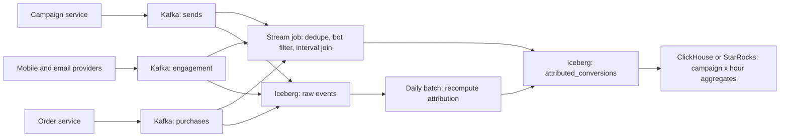

## 🎯 TL;DR

> Campaign analytics answers "did this notification make people buy?" That is a **join of event streams in time**: a send, then engagement (delivered, opened, clicked), then a conversion, each matched to the right campaign inside an **attribution window** you define.

- Use stable IDs: every send gets a `send_id`, and every event carries it. Without that key, joins are guesses.
- Build the **attribution** in two passes: a stream job for fresh, approximate dashboards, and a batch recompute for the numbers people report and pay for.
- Attribution is a **rule**. Version it, store it with the result, and expect to recompute when it changes.
- Plan for **late events**, **duplicates** and **bots** (mail scanners that "open" every message) before the first dashboard goes live.

## 🌱 Start simple (Junior)

**Problem statement.** An e-commerce company sends push notifications and emails to users about campaigns (a sale, a reminder, a new product). The marketing team wants, per campaign and per channel: how many were sent, delivered, opened and clicked, and how many users bought something within a few days of the click. Dashboards must be fresh (within about 15 minutes) and the reported numbers must be correct and reproducible.

> **💡 Analogy:** A postal shop that tracks a leaflet. It records when the leaflet was posted, whether it arrived, whether the reader came in, and whether they bought something in the next week. The "did the leaflet work?" question needs all four records joined by the leaflet's number, and the rule "bought within a week of coming in" must be written down.

**Functional requirements**

- Ingest sends, delivery receipts, opens, clicks and purchases.
- Attribute each purchase to at most one campaign (by a stated rule) and a time window.
- Show counts and rates by campaign, channel, day and segment.
- Answer "what changed since last week's rule?" by reprocessing.

**Non-functional requirements**

- Freshness: dashboards within 15 minutes; final numbers within 24 hours.
- Accuracy: no double counting; numbers reproducible for any past date.
- Scale: spikes during big sales events.
- Privacy: user IDs are pseudonymous in analytics, and deleted users drop out of future reports (see [[design-user-deletion]]).

**Estimation (show the arithmetic)**

- Users: 30 million. Each receives 4 notifications per day → 30M × 4 = **120 million sends per day**.
- Engagement events per send: delivered, opened, clicked ≈ 3 → 120M × 3 = **360 million events per day**.
- Purchases: 5 million per day.
- Total: 365 million events per day. Average rate: 365,000,000 / 86,400 s ≈ **4,200 events/s**. A big sale can give 4× average, so plan for **≈17,000 events/s** at peak.
- Event size about 400 bytes raw → 365M × 400 B ≈ **146 GB per day** raw JSON, about 4.4 TB per month. In columnar compressed form (Parquet, Iceberg) the size is much smaller, often several times smaller; measure your own data before you promise a number.

The volume is ordinary for Kafka and a lakehouse. The difficulty is the **time join** and the rules around it.

## 🔧 How it really works (Mid)

**Event model.** Keep one event per fact, all carrying the same keys:

```text
send        : send_id, campaign_id, user_id, channel, sent_at
engagement  : event_id, send_id, type (delivered|opened|clicked), event_ts, received_at
purchase    : order_id, user_id, amount, order_ts
```

`send_id` is generated **once** by the campaign service when it creates a send. Engagement events copy it. Purchases do not know the campaign, so attribution has to join them to clicks through `user_id` and time.

**Pipeline**



**The attribution rule (last click within a window).** For each purchase, find the latest click by the same user in the 7 days before the purchase, and credit that click's campaign. Count a purchase only once. Write the rule as data:

```sql
-- Last click within 7 days before the order (illustrative, batch version)
WITH clicks AS (
  SELECT e.send_id, s.campaign_id, s.user_id, e.event_ts AS click_ts
  FROM engagement e
  JOIN send s ON s.send_id = e.send_id
  WHERE e.type = 'clicked'
),
ranked AS (
  SELECT p.order_id, p.user_id, p.amount, p.order_ts,
         c.campaign_id, c.send_id, c.click_ts,
         ROW_NUMBER() OVER (
           PARTITION BY p.order_id
           ORDER BY c.click_ts DESC, c.send_id DESC
         ) AS rn
  FROM purchases p
  JOIN clicks c
    ON c.user_id = p.user_id
   AND c.click_ts <= p.order_ts
   AND c.click_ts >  p.order_ts - INTERVAL '7' DAY
)
SELECT order_id, user_id, amount, campaign_id, send_id, click_ts
FROM ranked
WHERE rn = 1;
```

The `ROW_NUMBER` with a unique tiebreaker (`send_id`) makes the result deterministic. Without it, two clicks with the same timestamp can credit different campaigns on different runs. See [[window-function]].

**Stream version.** The stream job does the same join with an **interval join**: a click matches a purchase when the purchase time is within `[click_ts, click_ts + 7 days]`. The engine keeps clicks in [[state-store]] for 7 days, so state is large. Keep only the fields you need, key the state by `user_id`, and expire entries when the window closes. The result is a fast estimate. It can change when late clicks arrive, so label it as provisional.

**Dedupe and bots.**

- Each engagement event has a unique `event_id`. Deduplicate on `(send_id, type, event_id)` with bounded state (see [[deduplication]]).
- Mail scanners and link checkers "open" and "click" messages automatically. Filter by known user agents and by impossible patterns (an open within 100 ms of delivery from a corporate IP range, for example). Keep the raw event, but exclude flagged events from the metric.

**Late data.** Mobile apps send events hours later after they were offline. Use event time (`event_ts`) for the windows and a watermark for the stream. Accept late events up to a stated lateness, and let the daily batch cover the rest. See [[watermark]] and [[late-arriving-data]].

**Writes that do not double count.** Sinks must be idempotent. Upsert the attributed table by `(order_id)` with the current rule version, or use `MERGE` in Iceberg keyed by the same key. A retried job then overwrites the same row instead of adding a new one. See [[upsert]] and [[idempotency]].

**Serving.** Aggregate to `campaign_id × channel × hour` in an OLAP store ([[olap]]). Keep the rule version and the "computed as of" timestamp in each row, so a dashboard can say "as of 10:15, provisional" or "final, rule v3".

## 🧠 Senior depth & trade-offs

**Deep dive 1: the join across event streams.**

- A stream-stream join buffers both sides for the window length. At 120M sends a day with a 7-day attribution window, a naive state holds about 840M send rows. That is large but workable with RocksDB-backed state, compact records and TTL. Measure the state size per key before committing to it.
- The batch join over the lake is cheaper and exact, because it sees all the data at once. The usual split: stream for minutes-old dashboards, batch for the reported numbers.
- Watch skew. A single very active user, or a bot account that clicks thousands of times, becomes a hot key. Cap or filter them before the join.

**Deep dive 2: attribution windows and rules.**

- Choose the rule with the business. Common options: last click, first click, linear across all clicks, and view-through (an impression without a click, usually with a short window). Each is a different number, and marketing will ask for several.
- Make the rule a **versioned artifact**: a config with `rule_version`, the window length and the priority of channels. Store the version in every result. When the rule changes, recompute the affected range and keep the old version available for comparison.
- Time zones matter. Define windows in UTC in the pipeline and convert only for display.

**Deep dive 3: exactly-once in practice.**

- Kafka and the stream engine can give exactly-once processing inside the pipeline (see [[kafka-exactly-once]]), but the external effects (writes to the lake and the OLAP store) still need idempotent keys. Design the key first, then the job.
- The reconciliation check is simple and worth it: daily count of sends in the raw table equals the count of distinct `send_id` in the curated table, plus or minus the explicitly excluded bot events.

**Deep dive 4: operations.**

- Monitor consumer lag per topic ([[consumer-lag]]), the age of the newest attributed row (freshness), the share of purchases with no attribution (a sudden jump means a broken join key), and the bot-filter rate.
- Put the **attribution rate** on a dashboard. If it drops from 25% to 5%, the most likely cause is a schema change that broke `send_id` propagation, not a marketing problem.

**Staff-level expectations.** Staff candidates usually:

- Separate the **fact** (every event, immutable) from the **attribution** (a derived, versioned result), and explain why they are different tables ([[fact-table]]).
- Explain the cost of exact joins versus the value of freshness, and propose the two-speed design with a clear label on provisional numbers.
- Address governance: who approves a rule change, how it is audited, how marketing can compare two rules side by side.
- Plan the privacy path: pseudonymous IDs, consent flags on each send, and deletion requests that remove a user from future rebuilds.

**When not to build this.** If the company runs a few campaigns a month and a single ad platform reports the numbers, use the platform's built-in reporting and skip the pipeline. Build it when cross-channel attribution, custom rules and an audit trail are required.

## 🧪 Try it

1. **Window arithmetic.** A purchase happens at 2026-10-10 12:00 UTC. Clicks at 2026-10-03 11:59, 2026-10-03 12:00 and 2026-10-10 09:00 exist. With a 7-day window `(order_ts - 7 days, order_ts]`, which clicks are eligible, and which campaign wins under last click?
2. **Duplicate defence.** A retried Kafka consumer writes the same attributed row twice. Describe the sink write that makes the table correct without a separate cleanup job.
3. **Rule change.** Marketing changes the window from 7 days to 3 days. Describe what you recompute, what you keep, and how the dashboard shows the change.

<details><summary>Show solutions</summary>

**1.** The window is `(2026-10-03 12:00, 2026-10-10 12:00]`. The click at 11:59 on 10-03 is outside it (it is 7 days and 1 minute before the order). The 12:00 click on 10-03 is at the boundary: whether it counts depends on whether the window is open or closed at the start. Pick one rule and state it; the common choice is `click_ts > order_ts - 7 days` (open at the start), which excludes it. The 09:00 click on 10-10 is eligible and wins under last click.

**2.** Use an upsert keyed by `order_id` (or `MERGE ... ON order_id`) with the rule version as part of the row, and keep only the latest attribution per order. The second write overwrites the same row with the same values, so the table has one row per order. Do not rely on a later cleanup job.

**3.** Recompute only the affected range, for example the last 3 days of orders and any orders whose click falls outside the new window. Keep the old version's results in a separate version column or table so marketing can compare. Show both numbers on the dashboard with the rule version and the "as of" time.

</details>

## 💬 Interview corner

**Question: "Design a campaign analytics pipeline for notifications."**

- **Mid answer:** "I'd collect sends, opens and clicks in Kafka, store them in a lake, and join purchases to the last click within 7 days with a SQL window. Aggregates go to an OLAP table for the dashboard."
- **Senior answer:** "Every event carries a `send_id`, which is the join key. Attribution is a versioned rule, computed in two passes: a stream interval join for fresh, provisional numbers and a daily batch recompute for final ones. I dedupe on event IDs, filter bots, use event time with a watermark for late mobile events, and make the sinks idempotent so retries don't double count."
- **Staff answer:** adds the cost of the stream state, the governance of rule changes, the privacy path for deletions, and the monitoring of attribution rate as a leading indicator of broken joins.

**Follow-ups to expect**

- Why not join everything in one stream job? (State size and the need to change rules; batch can recompute.)
- How do you handle a click that arrives after the purchase was already attributed to another campaign? (Keep the rule deterministic. Recompute the order in the next batch, or accept the provisional label and mark it as changed.)
- How do you prove the numbers are right? (Reconciliation counts from raw to curated, and a sample audit of joined rows against source logs.)

> **🎤 Say this in the interview:** "Campaign attribution is a time join across three streams, keyed by a `send_id` I make sure every event carries. I'd run it twice: a fast stream version that is clearly labelled provisional, and a versioned batch version that produces the reported numbers. Dedupe, bot filtering and idempotent writes are what keep the numbers honest."

## ⚠️ Common mistakes

> **⚠️ Watch out:** Joining purchases to clicks by `user_id` only, with no time bound. Every purchase then matches every click the user ever made, and the "last click" becomes arbitrary.

> **⚠️ Watch out:** Counting opens from mail scanners as human engagement. Open rates can look healthy while real engagement falls, and nobody notices until a campaign fails.

- Using arrival time instead of event time, so a click from yesterday's campaign lands in today's numbers.
- Forgetting a unique tiebreaker in `ROW_NUMBER`, so the same data gives different winners on different runs.
- Letting the stream result be reported as final, when late events can still change it.
- Changing the attribution rule in place with no version, which makes last month's numbers impossible to reproduce.
- Storing a "conversion rate" as a stored average of rates, instead of summing conversions and clicks and dividing at query time.
- Building the full stream join before checking whether the batch recompute alone meets the freshness need.

## ✅ Check yourself (quiz)

1. What is the main reason every engagement event should carry `send_id`?
   - A) It makes Kafka partitions faster
   - B) It is the stable key that links an open or click to the exact send and campaign without guessing
   - C) It replaces the need for timestamps
   - D) It is needed only for email, not push

<details><summary>Answer</summary>

**B** — without a shared key, you can only join by `user_id` and time, which is ambiguous when a user receives several campaigns. `send_id` is generated once and copied to every related event.

</details>

2. A purchase must be credited to the most recent click within 7 days before the order. Which SQL construct selects exactly one click per order deterministically?

   - A) `DISTINCT order_id`
   - B) `ROW_NUMBER() OVER (PARTITION BY order_id ORDER BY click_ts DESC, send_id DESC) = 1` in a subquery
   - C) `GROUP BY user_id`
   - D) `LIMIT 1` at the end of the query

<details><summary>Answer</summary>

**B** — the window function ranks clicks per order, and the `send_id` tiebreaker makes the choice repeatable. `DISTINCT` and `LIMIT` do not choose by a rule, and `GROUP BY user_id` collapses orders you need to keep.

</details>

3. Mobile opens arrive up to six hours late. Your stream job uses processing time for its windows. What goes wrong, and what is the fix?

   - A) Nothing; processing time is always correct
   - B) Late opens land in the wrong hour and the hourly numbers change after they were published; use event time with a watermark and a stated lateness, and let the daily batch recompute the rest
   - C) Opens cannot be stored in Iceberg
   - D) The fix is to drop all opens older than one minute

<details><summary>Answer</summary>

**B** — with processing time, an open that happened at 10:05 but arrived at 15:00 is counted in the 15:00 bucket, so the 10:00 hour is wrong. Event time puts it in the right bucket, and the watermark plus batch recompute finish the job.

</details>

4. **(Senior)** A stream-stream interval join keeps a 7-day window of clicks in state for 120 million sends per day. Give two concrete ways to reduce the state cost, and say what each gives up.

   - A) Increase the parallelism to 1
   - B) Keep only the needed fields and key state by `user_id` with TTL on expiry (gives up nothing but code effort), and move the exact result to a daily batch join (gives up freshness for the final number)
   - C) Remove the watermark
   - D) Store everything as JSON

<details><summary>Answer</summary>

**B** — compact state and TTL reduce memory without changing results. Moving exactness to batch removes the big state from the critical path, at the cost of the stream output being provisional. The interviewer wants you to name what you trade.

</details>

5. **(Senior)** Marketing wants to compare last-click against linear attribution for last quarter, and the dashboard must not mix them. What design makes this possible and auditable?

   - A) Overwrite the table each time the rule changes
   - B) Store the attribution result with a `rule_version` and the "as of" time, keep the rule definitions as versioned config, and expose both versions side by side in the serving layer
   - C) Compute linear attribution in the browser
   - D) Delete last quarter's data

<details><summary>Answer</summary>

**B** — a versioned result keeps every computed view reproducible, and the version column prevents accidental mixing. Overwriting destroys the baseline, and client-side computation cannot be audited.

</details>

## 🗂️ Flashcards

| Front | Back |
|---|---|
| Why each event carries `send_id` | It is the stable join key from a send to its engagement and its campaign |
| Last-click attribution | The latest eligible click before the purchase, within the window |
| Why `ROW_NUMBER` needs a tiebreaker | Equal timestamps otherwise give non-repeatable winners |
| Interval join condition | `click_ts` between `order_ts - window` and `order_ts` (state the open or closed edge) |
| Event time vs processing time for opens | Event time places a late event in the correct bucket |
| Idempotent sink for attributed rows | Upsert or MERGE keyed by `order_id` so retries overwrite, not add |
| Why store `rule_version` | Lets you reproduce, compare and audit numbers after a rule change |
| Leading indicator of broken joins | A sudden drop in the share of purchases with an attribution |

## 🔗 Go further

- Related lessons: [[design-clickstream-analytics]] (the same pattern for web clicks) and [[design-ad-click-aggregator]] (high-volume click counting).
- Modelling the curated tables: [[fact-table-types]] and [[dimensional-modeling]].
- Replay and recompute after a rule change: [[backfills]].
- Reliability of the pipeline: [[delivery-semantics]] and [[data-quality]].

