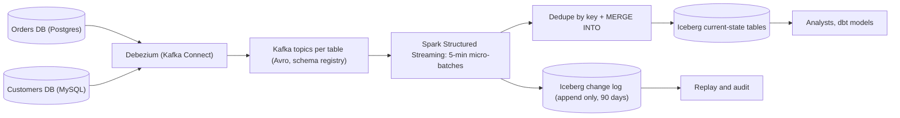

## 🎯 TL;DR

> Build a lake that mirrors the operational databases of many microservices by reading their **change logs**, not by querying them. Stream the changes through **Debezium** into Kafka, land every change in an **append-only history**, and apply the latest state to an **Iceberg** table with an idempotent `MERGE`. Ordering, deletes and schema changes are where the design succeeds or fails.

- Read the database's transaction log (WAL or binlog) with Debezium. Never poll the production tables.
- Order changes by the **log position** (LSN, binlog position), not by wall-clock timestamps.
- Keep two outputs: a **change log** (history, replayable) and a **current-state table** (what analysts query).
- Deletes are `MERGE` deletes in the state table, but they also need **snapshot expiry and file cleanup** to really disappear from the lake.
- Schema changes flow through a registry with compatibility rules; Iceberg tracks columns by ID, which makes renames safe.

## 🌱 Start simple (Junior)

> **💡 Analogy:** Think of a bank's ledger. The branch writes every transaction in order into a journal. A central accountant copies the journal, line by line, into a second book that always shows the current balance. If the accountant copies the journal in the right order and never skips a line, the second book matches the branch exactly. CDC is the journal; the lake table is the second book.

**The problem.** A company has about 60 microservices. Each service owns a PostgreSQL or MySQL database. Analysts need one place with the current state of every table, plus the history of changes, and the data must be fresh within **15 minutes**. The lake must also support deleting a customer's data when a legal request arrives.

**Functional requirements**

- Capture every insert, update and delete from the source databases, for about 300 tables.
- Maintain a **current-state table** per source table (one row per primary key).
- Keep a **change history** (every change event) for at least 90 days, for audit and replay.
- Support time travel on the lake table ("what did this order look like on 1 March?").
- Handle new columns and renamed columns in source tables without manual intervention in most cases.
- Support deletion of one customer's personal data across all tables.

**Non-functional requirements (our assumptions)**

- Change volume: **2,000 changes per second** on average, **6,000/s** at peak.
- Freshness: current-state table within **15 minutes** of the source commit, at p95.
- Source databases must not see extra load beyond the normal WAL or binlog reading.
- Exactly-once **effect** on the current-state table: replays must not create duplicates or resurrect deleted rows.
- Data loss is not acceptable; a lag is acceptable.

## 🔧 How it really works (Mid)

### Estimation

- Changes per day: 2,000 × 86,400 ≈ **173 million events/day**.
- Event size: a Debezium envelope with `before`, `after`, `source` and `op` fields is about **1 KB** as JSON, and about **0.4 KB** as Avro. Raw in Kafka (Avro): 173 M × 0.4 KB ≈ **69 GB/day**.
- Kafka retention of 7 days for the change topics: 69 × 7 ≈ **483 GB** (before replication).
- Change log in Iceberg (Parquet, roughly 4:1 compression over the Avro payload): 69 / 4 ≈ **17 GB/day**, or about **6.3 TB/year**. Keep 90 days hot: ≈ **1.5 TB**.
- Current-state tables: the operational data is about **2 TB** in total. In Parquet, that is about **500 GB**, before time-travel snapshots.
- Peak micro-batch: a 5-minute batch at peak holds 6,000 × 300 = **1.8 million** change events. Each batch must be deduplicated and merged in a few minutes, which fixes the cluster size.

The point of the arithmetic: the change log is cheap, but a naive `MERGE` on a 500 GB table rewrites many files per batch. The write pattern decides the cost, not the total size.

### Pipeline



Each source table has its own Kafka topic, named by the database and table. The connector runs in snapshot mode once, then streams from the log. The Spark job reads all topics, groups events into 5-minute micro-batches, writes them to the change log, then merges them into the current-state tables.

### Debezium: what the events look like

Every change event has an `op` field: `c` (create), `u` (update), `d` (delete), and `r` (read, emitted during the initial snapshot). A delete event has the `before` image and `after` set to null. Debezium then sends a **tombstone** (a message with a null value) so that Kafka log compaction can remove the key.

The `source` block holds the position in the log. For PostgreSQL it holds `lsn` and `txId`. For MySQL it holds `file` and `pos`. This is the ordering key. `ts_ms` is the time Debezium read the change, which is not a correct order between two changes to the same row.

Table-level prerequisites on the source:

- PostgreSQL: logical replication with the `pgoutput` plugin, a replication slot, and a publication for the included tables. Watch the replication slot: if the connector stops, WAL accumulates on the source and can fill its disk. Monitor slot lag and set an alert.
- MySQL: `binlog_format = ROW` and `binlog_row_image = FULL`, so that `before` images are complete.

### Deduplicate, then merge

Within one micro-batch, the same key can appear several times (an order created, updated twice, then updated again). A `MERGE` with several source rows for one target row fails in most engines, so reduce the batch to one row per key first:

```sql
MERGE INTO lake.orders AS t
USING (
  SELECT order_id, status, amount, op, source_lsn
  FROM (
    SELECT order_id, status, amount, op, source_lsn,
           ROW_NUMBER() OVER (PARTITION BY order_id
                              ORDER BY source_lsn DESC) AS rn
    FROM orders_cdc_batch
  ) ranked
  WHERE rn = 1
) AS s
ON t.order_id = s.order_id
WHEN MATCHED AND s.source_lsn > t.source_lsn AND s.op = 'd' THEN DELETE
WHEN MATCHED AND s.source_lsn > t.source_lsn THEN
  UPDATE SET t.status = s.status, t.amount = s.amount, t.source_lsn = s.source_lsn
WHEN NOT MATCHED AND s.op <> 'd' THEN
  INSERT (order_id, status, amount, source_lsn)
  VALUES (s.order_id, s.status, s.amount, s.source_lsn);
```

Why each part matters:

- `ROW_NUMBER ... ORDER BY source_lsn DESC` keeps the latest change per key inside the batch.
- `s.source_lsn > t.source_lsn` makes the merge **idempotent and order-safe**. If a batch is replayed after a restart, or an older event arrives late, the target keeps its newer state. Without this guard, a replay would roll rows back.
- Deletes keep the row out of the current state. The change log still has the delete event.

The target table must store `source_lsn` (or the composite of file and position) for every row, so the guard can work.

### Iceberg layout

- **Partitioning:** do not partition the current-state table by date; the primary key is what `MERGE` matches on. Use an Iceberg **bucket** transform on the key, for example `bucket(16, order_id)`. Then a batch touches only the buckets that changed, and each bucket's files are rewritten, not the whole table.
- **Change log:** partition by `day(event_time)`, append only. No merges, so it is cheap to write and easy to replay.
- **Small files:** a 5-minute micro-batch creates small files in each bucket. Schedule compaction (rewrite data files) hourly, and expire old snapshots and orphan files daily.

## 🧠 Senior depth & trade-offs

### Ordering across tables

The `MERGE` on one table is safe if the source positions are monotonic for each key. Across tables, there is no global order, and you should not try to build one. A foreign key can point to a row that has not arrived yet, so the lake state is **eventually consistent across tables**. Analysts must join with the expectation of a short window of inconsistency. If a report needs a consistent point in time across tables, use the change log and select a source position that is complete in all topics (a watermark on LSN per source database), not a wall-clock time.

### Initial snapshot without gaps

When a new table is added, Debezium takes a snapshot (`op = r` for every row) while streaming continues. Two rules keep the lake correct:

- The snapshot and streaming events for the same key may arrive in either order. The `source_lsn` guard handles this: snapshot rows have an LSN from the time of the snapshot, and any newer streamed change has a larger LSN.
- Do not truncate and reload the current-state table in production while CDC is running. Load the snapshot into a shadow table, let CDC catch up, then swap. The swap is a metadata operation in Iceberg.

Incremental snapshots (signal-based, in newer Debezium versions) avoid long locks on large tables. Check the version you run.

### Deletes: from the MERGE to the physical file

A `MERGE ... THEN DELETE` removes the row from the **current** table. Iceberg writes a new snapshot where the row is gone, but the old data files are still referenced by older snapshots. Time travel can still read the deleted customer's data.

For a legal deletion request, the full procedure is:

1. Delete the subject's rows from every current-state table with a `MERGE` or a row-level delete.
2. Delete their rows from the change log, or rewrite the affected partitions. The change log holds the original values in its `before` and `after` columns, so it is also personal data.
3. Expire snapshots older than the deletion so that no snapshot can read the old files.
4. Remove orphan files that no snapshot references.
5. Record the completion in an audit table, with the request ID and the snapshot ID after cleanup.

Alternative for very large histories: **crypto-shredding**. Encrypt personal columns with a per-customer key in the lake, and delete the key. This is faster than rewriting history, but it requires that every consumer handles missing keys. Choose this in the design interview if you are asked about rewrite cost.

### Schema evolution

Three layers change independently: the source table, the Debezium event schema, and the Iceberg table.

- **Source adds a column:** Debezium emits it in the next event. Register the new schema under a **BACKWARD-compatible** rule in the schema registry (new fields optional with defaults). Iceberg `ALTER TABLE ... ADD COLUMN` adds it; old files return null for it.
- **Source renames a column:** from the database side, this looks like a drop plus an add. Iceberg tracks columns by **field ID**, so a rename in Iceberg is a metadata change and old data keeps its values. Map the new name to the same ID deliberately, or the rename becomes data loss in the current table. Do this with a planned migration, not automatically.
- **Source changes a type:** only safe widenings (int to bigint, float to double) are allowed in Iceberg. Anything else needs a new column and a backfill.
- **Dropped and re-added columns:** Iceberg does not reuse field IDs, so a column re-added with the same name is a new column; old values stay null.

Put a **contract** on each source topic: the owning team publishes the schema, and a breaking change fails the producer's build, not the lake job at 3 a.m.

### Exactly-once effect, at-least-once transport

Debezium and Kafka deliver at least once. The design's correctness comes from three properties together:

- Deterministic ordering (`source_lsn`).
- A `MERGE` guard that ignores older events.
- A change log that can be replayed to rebuild the state table from scratch, which is the disaster-recovery path.

If the Spark job writes the change log and the state table in one micro-batch, a failure between the two writes causes a replay of the whole batch. Both writes must therefore be idempotent. Iceberg's commit is atomic per table, so write the change log first, then the state. If the state write fails, the replay rewrites the change log batch with the same event IDs, and deduplicate on event ID.

### Operations and failure modes

- **Replication slot lag (PostgreSQL):** the most dangerous failure. A stopped connector holds WAL on the source. Alert at a few GB of retained WAL, not at disk full.
- **Connector restarts:** Debezium resumes from the stored offset. Check that the offset topic is not compacted away.
- **Schema registry down:** producers fail, so the outage is at the source. Keep the registry highly available.
- **Hot keys:** a single very active row (a "system" account) produces many events per batch. The dedupe step handles it, but check the per-batch row count.
- **Compaction debt:** too many small files in the state tables make `MERGE` slow. Track file count per bucket.

### Monitoring

- Replication slot retained bytes (source) and connector lag (time between source commit and Kafka receive).
- Kafka consumer lag for the Spark job, and batch duration against the 5-minute trigger.
- Lag between source commit time and the latest state row visible in Iceberg (the freshness SLO, p95 under 15 minutes).
- Rate of `MERGE` rows deleted versus updated, to spot unexpected deletes.
- Snapshot count and orphan file count, per table.
- Schema registry compatibility failures.

### When NOT to use this design

- If the source tables are small and the business accepts a nightly batch extract, a query-based extract with a `updated_at` column is simpler. It misses deletes, which is the trade-off to explain.
- If the source database does not allow logical replication (some managed services restrict it), use the vendor's change feed or an outbox pattern in the service, not triggers on the production tables.
- If you need sub-second freshness for one table, stream that table to a serving store and keep the lake for analytics.

## 🎤 Interview corner

### Expectations by level

| Level | What a strong answer shows |
|---|---|
| Mid | Debezium reads the log, events go to Kafka, a MERGE applies the latest state, and deletes are handled. Knows the `op` values and the snapshot. |
| Senior | Ordering by log position, deduplication before MERGE, a replay-safe guard, bucket partitioning for the key, a schema compatibility policy, and a real GDPR deletion procedure that includes snapshots and the change log. |
| Staff | Platform contract for many teams (schema ownership, breaking-change policy), cost model for change log retention, failure drills (slot lag, connector loss, full replay), and a migration plan from existing batch extracts without duplicate or missing history. |

### Follow-up questions

1. A customer asks for deletion. The row is gone from the current table. Why is that not enough, and what exactly do you run?
2. The source renames `cust_name` to `customer_name`. What happens with and without a planned mapping?
3. Why is a plain `MERGE` on a 500 GB table expensive, and how does bucket partitioning help?
4. A connector was down for 6 hours. How do you know the lake is complete, and how do you catch up without duplicates?
5. Two services update the same logical customer through different tables. How does the lake show a consistent view?

> **🎤 Say this in the interview:** "I read the database log with Debezium, so I never load production tables. Events go to per-table topics, I batch them every five minutes, deduplicate by log position, and MERGE into Iceberg with a guard that ignores older events, which makes replays safe. The full history goes to an append-only change log for replay and audit. For deletes I expire snapshots and remove orphan files, because a MERGE alone does not remove data from time travel."

**Model answer (3–5 sentences):** Debezium streams row changes from each service's PostgreSQL or MySQL log into Kafka, one topic per table, with Avro schemas in a registry. Spark reads five-minute micro-batches, writes them to an append-only Iceberg change log, and merges the latest change per key into bucketed current-state tables, guarded by the source log position so that replays cannot roll rows back. Deletes remove rows from the current state, and a deletion request also rewrites or expires the change log and expires old snapshots so the data is physically gone. Schema changes go through backward-compatible registry rules, and Iceberg's field IDs make column renames a metadata operation.

## ⚠️ Common mistakes

- Ordering changes by `ts_ms` or by arrival time, and resurrecting deleted rows during replays.
- Polling production tables with `SELECT ... WHERE updated_at > ?` and calling it CDC. It misses deletes and can lose updates that commit out of order.
- A `MERGE` without a source-position guard, so a restart rolls rows back.
- Partitioning the current-state table by date while merging on a primary key, so every batch rewrites most files.
- Believing that a `DELETE` in the current table removes the data from the lake. Snapshots and files keep it until they are expired and cleaned.
- Forgetting that the change log also contains personal data, and leaving it out of the deletion procedure.
- Letting a source team rename a column without a planned ID mapping in the lake.
- Ignoring the replication slot, so a stopped connector fills the source database's disk.

## ✅ Check yourself (quiz)

1. Which field should decide the order of two changes to the same row?
   - A) `ts_ms`, the time Debezium read the change
   - B) The source log position, for example the PostgreSQL LSN
   - C) The Kafka partition offset only
   - D) The arrival time at the Spark job

<details><summary>Answer</summary>

**B** — the log position is the order in which the source committed the changes. `ts_ms` is when the connector read them, and arrival time depends on network and retries. Two changes to one row can be read out of order by these clocks.

</details>

2. A `MERGE` fails with an error that a target row matched more than one source row. What is the fix?
   - A) Increase the Spark executor memory
   - B) Reduce the source batch to one row per key with `ROW_NUMBER` ordered by the log position before the MERGE
   - C) Remove the `WHEN MATCHED` clause
   - D) Switch the table to Parquet

<details><summary>Answer</summary>

**B** — a key can change several times inside one micro-batch, so the batch must be reduced to the latest change per key first. Memory and file format do not affect this error.

</details>

3. **(Senior)** A customer's data was deleted from the current-state table yesterday, but a time-travel query on the same table still returns it. Why, and what is the correct procedure?

   - A) Time travel ignores deletes by design; nothing to do
   - B) Older snapshots still reference the data files that contain the row; expire the snapshots that predate the deletion, remove orphan files, and clean the change log that holds the same values
   - C) The `MERGE` did not run; run it twice
   - D) Iceberg does not support deletes

<details><summary>Answer</summary>

**B** — a delete creates a new snapshot, but older snapshots still point to the old files. Physical removal requires expiring those snapshots and deleting unreferenced files. The change log contains the same personal values and must be cleaned too.

</details>

4. **(Senior)** Why is partitioning the current-state table by date a poor choice when the job merges on `order_id`, and what does bucketing change?

   - A) Date partitions cannot be used with Iceberg
   - B) Every batch contains keys from all dates, so the MERGE touches most files; bucketing on `order_id` localizes each batch to the buckets that changed
   - C) Bucketing removes the need for compaction
   - D) Dates are not allowed as partition keys

<details><summary>Answer</summary>

**B** — the MERGE finds target rows by key, so the layout should match the key. With date partitions, a batch of recent changes can still touch old keys spread across all dates. Bucketing on the key limits the rewrite to the affected buckets.

</details>

5. **(Mid)** Your analyst reports a row that has `op = 'r'` in the change log. What does it mean, and is it a problem?

   - A) A read query was logged by the database; it should be removed
   - B) The row came from the initial snapshot of the table; it is expected and the guard ensures later changes win
   - C) A replication error occurred
   - D) The row was deleted and restored

<details><summary>Answer</summary>

**B** — `r` marks rows emitted during the initial snapshot. It is normal. The LSN guard makes sure that a newer streamed change overrides a snapshot row.

</details>

## 🗂️ Flashcards

| Front | Back |
|---|---|
| Why read the log instead of querying tables? | No extra load on production; captures deletes and every intermediate change |
| What do `op` values `c`, `u`, `d`, `r` mean? | create, update, delete, read (snapshot) |
| Which field orders changes? | The source log position (LSN for PostgreSQL, file and pos for MySQL), not `ts_ms` |
| Why deduplicate the batch before MERGE? | A MERGE cannot match one target row to several source rows |
| What does the `source_lsn` guard prevent? | Replays or late events overwriting newer state with older values |
| Why does a DELETE not remove data from time travel? | Older snapshots still reference the old data files until they are expired and cleaned |
| How does Iceberg make a column rename safe? | Columns are tracked by field ID, so a rename is a metadata change |
| What is the biggest operational risk with PostgreSQL CDC? | A stopped connector holds WAL on the source, which can fill its disk |

## 🔗 Go further

- **cdc** explains the log-based capture model and the outbox alternative in general terms.
- **lakehouse-table-formats** covers Iceberg snapshots, field IDs and time travel, which this design relies on.
- **kafka-connect-ops** covers running Debezium as a Kafka Connect connector, including offsets and restarts.
- **pattern-schema-evolution** and **schema-evolution** cover compatibility rules in more depth.
- **pattern-data-deletion** and **design-user-deletion** expand the deletion procedure for legal requests.
- **dedup-idempotent-loads** explains why the MERGE guard makes replays safe.
- **design-ecommerce-dwh** shows how current-state tables feed a warehouse model.
