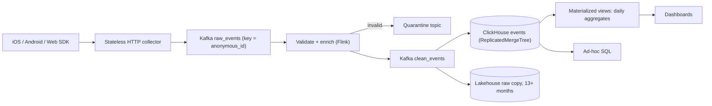

## 🎯 TL;DR

> Product analytics asks three questions over billions of user events: **how many people did X** (counts and uniques), **where did people drop off** (funnels), and **who came back** (retention). Build a schema that is stable, an ingestion path that tolerates duplicates and late events, and an OLAP store whose sort key matches the questions.

- Every event carries a stable envelope: `event_id`, client time, server time, identity fields, and a typed set of properties.
- **Sessionization** (grouping events into visits with a 30-minute gap) can run in the stream or at query time. Pick one and state the trade-off.
- **ClickHouse** answers funnels and retention with native aggregate functions, but the **sort key and sharding key** decide whether a query is fast or a full scan.
- Pre-aggregate the common dashboards, keep raw events for ad-hoc questions, and accept that late events change yesterday's numbers.

## 🌱 Start simple (Junior)

> **💡 Analogy:** A shop keeps a notebook of every visit: "Ali entered, looked at a shirt, put it in the cart, left." Counting how many people looked at a shirt is easy. Asking "how many of the people who looked also bought?" needs the notebook sorted by person and time. Product analytics is that notebook, at the scale of a national app.

**The problem.** A mobile and web product sends user events (screen views, button clicks, purchases) from its apps. Build a platform that lets product managers see daily active users (DAU), conversion funnels, and retention cohorts, usually within a few minutes of an event happening.

**Functional requirements**

- Collect events from iOS, Android and web SDKs, including events created while offline.
- Dashboards: DAU, events per day, top screens, funnel conversion over up to 30 days.
- Retention: of the users who first appeared on day 0, what share came back on day 1, 7 and 30?
- Ad-hoc queries by analysts on raw events, for any property, within a limited time range.
- Identity: a user is anonymous before login and known after; both views must connect.

**Non-functional requirements (our assumptions)**

- Scale: **5 million DAU**, **40 events per user per day**.
- Freshness: dashboards within **5 minutes** of the event. Funnels and retention may be hourly.
- Dashboard queries return in **under 2 seconds** at p95 for common questions.
- Duplicates are allowed to exist briefly, but dashboards must not double count after the platform settles.
- Data deletion for a user within **30 days** of a request, as privacy rules require.

## 🔧 How it really works (Mid)

### Estimation

- Events per day: 5,000,000 users × 40 events = **200 million events/day**.
- Average rate: 200,000,000 / 86,400 s ≈ **2,315 events/s**.
- Peak factor 3 (evening usage): 2,315 × 3 ≈ **6,950 events/s**. Design the ingest path for **10,000 events/s**.
- Event size: about 500 bytes of JSON on the wire. Raw: 200 M × 500 B = **100 GB/day**.
- ClickHouse compression on this kind of data is often around 8:1, so about 12.5 GB/day stored. Per year: 12.5 × 365 ≈ **4.6 TB** (before replication).
- Keeping 13 months of raw events for analysts: 4.6 × 13 / 12 ≈ **5 TB** per replica.

The numbers say the ingest path is ordinary for Kafka. The hard part is query shape and the cost of a bad sort key.

### Event schema

Use a single **envelope** for every event, with a typed payload inside:

| Field | Type | Why it exists |
|---|---|---|
| `event_id` | UUID (generated on the device) | Deduplication key across retries |
| `event_name` | `LowCardinality(String)` | `screen_view`, `add_to_cart`, `purchase`: grouping and funnels |
| `event_time` | `DateTime64(3)` (device clock, corrected) | When it happened; drives sessions and funnels |
| `received_time` | `DateTime64(3)` (server) | When we got it; drives partitions, TTL and freshness |
| `anonymous_id` | String | Stable per device before login |
| `user_id` | String, empty before login | Known identity; joined to `anonymous_id` by an alias table |
| `platform`, `app_version` | `LowCardinality(String)` | Filter and debug |
| `props` | `Map(String, String)` or JSON | Event-specific properties |
| `schema_version` | Int | Lets consumers handle changes |

Rules that prevent most future pain:

- **Schema registry** (Avro or Protobuf) with backward-compatible evolution: add optional fields, never rename or reuse a field number.
- **Event names are a controlled vocabulary.** Unknown names go to a quarantine topic, not to the fact table.
- **Never store raw IP addresses.** Derive country and city at the collector, then drop the IP.
- **Device clocks lie.** Store both `event_time` and `received_time`. Correct client skew only when the SDK sends a server offset.

### Pipeline



The collector does no work except authenticate, timestamp, and write to Kafka. It should be stateless so you can scale it horizontally. Partition Kafka by `anonymous_id` so one device's events stay ordered within a partition, which helps sessionization.

### Sessionization

A **session** is a run of events from one user with no gap longer than 30 minutes. Two implementations:

**1. Query-time (batch or ad-hoc), Spark SQL syntax:**

```sql
WITH gaps AS (
  SELECT user_id, event_time, event_name,
         CASE
           WHEN unix_timestamp(event_time)
                - unix_timestamp(lag(event_time) OVER (PARTITION BY user_id ORDER BY event_time))
                > 1800
           OR lag(event_time) OVER (PARTITION BY user_id ORDER BY event_time) IS NULL
           THEN 1 ELSE 0
         END AS new_session
  FROM events
  WHERE user_id <> ''
)
SELECT user_id, event_time, event_name,
       SUM(new_session) OVER (PARTITION BY user_id ORDER BY event_time
                              ROWS BETWEEN UNBOUNDED PRECEDING AND CURRENT ROW) AS session_seq
FROM gaps;
```

Each `new_session = 1` starts a session, and the running sum gives every event a session number within the user. The result is exact, reproducible, and can be recomputed for any range.

**2. Stream-time (Flink session window):** a session window keyed by `user_id` closes after 30 minutes of inactivity. It produces one record per session, which is what dashboards need. It also needs a watermark and an allowed lateness. An event that arrives after the window closed starts a new session or is routed to a correction path, so streaming sessions are **approximate for late data** unless you accept a longer delay.

Choose query-time when correctness and reprocessing matter more than latency, and stream-time when the product needs "sessions closed in the last 5 minutes".

### ClickHouse modeling

Core table, with replication and a time-based TTL:

```sql
CREATE TABLE events ON CLUSTER analytics (
    event_id      UUID,
    event_time    DateTime64(3),
    received_time DateTime64(3),
    tenant_id     LowCardinality(String),
    user_id       String,
    anonymous_id  String,
    event_name    LowCardinality(String),
    platform      LowCardinality(String),
    props         Map(String, String)
)
ENGINE = ReplicatedMergeTree('/clickhouse/tables/{shard}/events', '{replica}')
PARTITION BY toYYYYMM(event_time)
ORDER BY (tenant_id, user_id, event_time)
TTL toDateTime(received_time) + INTERVAL 400 DAY;
```

Funnel with the native aggregate `windowFunnel`. For each user, it returns how many ordered steps they completed within one day:

```sql
SELECT level, count() AS users
FROM (
    SELECT user_id,
           windowFunnel(86400)(event_time,
                               event_name = 'view_product',
                               event_name = 'add_to_cart',
                               event_name = 'purchase') AS level
    FROM events
    WHERE event_time >= now() - INTERVAL 30 DAY
    GROUP BY user_id
)
GROUP BY level
ORDER BY level;
```

Level 3 means the user completed all three steps in order within 86,400 seconds. Level 1 means only the first step.

For dashboards that run every few seconds, do not scan the raw table. A materialized view writes daily uniques to an `AggregatingMergeTree` table using the `uniqState` function, and the dashboard merges the states with `uniqMerge`. This keeps DAU queries cheap while raw events stay available for ad-hoc work.

## 🧠 Senior depth & trade-offs

### Event schema evolution

The schema is an API between the apps and the analytics team. Breaking it means old app versions (which users never update) keep sending the old shape for months. Rules:

- Versioned payloads (`schema_version`), with consumers that accept all versions still in the field.
- Store unknown properties in the `props` map instead of dropping them. You can promote a property to a column later, after you see it used.
- Promote a property to a real column when it appears in most queries. A `Map` lookup is a full read of the map for every row in the part.

### Sort key and sharding key

This is the most important ClickHouse decision in the design:

- `ORDER BY (tenant_id, user_id, event_time)` makes **per-user journeys and funnels** fast: the rows for one user are adjacent on disk, so the sparse primary index skips most of the table.
- The same key makes a **time-only dashboard** (events across all users for the last hour) slower, because `event_time` is not the leading column. The primary index cannot skip granules that span many users.
- `ORDER BY (tenant_id, toStartOfHour(event_time), event_name)` is the opposite: dashboards are fast, journeys are slow.

Options: pick the key for the most expensive workload, add a **projection** with a second sort order, or keep a second table fed by the same stream with a different sort key. The second table doubles storage, which is usually cheaper than a p95 of 10 seconds on the main dashboard.

**Sharding.** Shard by `user_id` (or a hash of it) so that all events for one user are on one shard. Then `windowFunnel` and sessionization run locally on each shard and the coordinator only merges the counts. If you shard by `event_id` or randomly, funnels need a full shuffle of raw events across the cluster. Replicate each shard for availability, and remember that the distributed table adds a coordinator hop for every query.

### Deduplication

Kafka and the SDK give **at-least-once** delivery, so the same `event_id` can arrive twice. Options:

- **Deduplicate in Flink** with keyed state on `event_id` and a TTL longer than the maximum retry window. Exact, but state grows with event volume; a bloom filter or a short TTL (for example, 24 hours) bounds it.
- **`ReplacingMergeTree` in ClickHouse** removes duplicates only during background merges. Until the merge runs, duplicates are visible. Queries that need correctness use `FINAL` (expensive) or dedupe with `argMax` in a subquery.

Explain to the interviewer that the system guarantees **eventual** uniqueness in ClickHouse and **near-exact** uniqueness in dashboards. Hiding that difference is how analytics teams lose trust.

### Late and offline events

Mobile apps buffer events while offline and send them hours later. The event's `event_time` belongs to yesterday, but `received_time` is today.

- Partition and TTL on `event_time` or `received_time` consistently, and document which.
- **Materialized views fire on insert**, so a late event updates the aggregate for the day it arrives, not the day it happened. Either accept that yesterday's dashboard number can rise, or run a daily correction job that recomputes the last 3 days from the raw table and overwrites the aggregate partitions.
- Funnels and retention should use `event_time`, and their cohort definitions must be stable: a user's "day 0" is fixed when the cohort is built, not recalculated when a late event arrives.

### Identity stitching

`anonymous_id` becomes `user_id` at login. Do not rewrite history. Store an alias table `(anonymous_id, user_id, first_seen, linked_at)` and resolve at query time, or write a `canonical_user_id` column in a periodic job. Choose resolve-at-query-time when you need to show "what did this device do before login"; choose the periodic job when dashboards must be fast and the alias table is small.

### Privacy and deletion

- Consent flags travel with events. Events without consent are not written to the analytics tables at all, rather than being filtered later.
- Deleting one user's events from ClickHouse with `ALTER TABLE ... DELETE` rewrites parts and is expensive. Batch deletions daily, or use **crypto-shredding**: encrypt `user_id` and properties with a per-user key, and destroy the key on deletion. Check what your legal team accepts.
- Hash identifiers that are not needed in raw form, with a salted hash managed as a secret.

### Operations and monitoring

- Ingest lag (Kafka consumer lag and the difference between `received_time` and the latest row visible in ClickHouse).
- Ratio of events in the quarantine topic per SDK version: a spike means an app release broke the schema.
- Duplicate rate per platform (a sign of retry storms).
- Merge backlog in ClickHouse (too many parts means inserts are too small or too frequent; batch them).
- Dashboard query p95 and the share of queries that scan raw tables.

### When NOT to use this design

- Below a few million events per month, a warehouse such as BigQuery, Snowflake, or PostgreSQL with partitioning is simpler, and it gives you SQL without cluster operations.
- If you only need exact counts of a fixed set of events for billing, a transactional counter table is a better tool.

## 🎤 Interview corner

### Expectations by level

| Level | What a strong answer shows |
|---|---|
| Mid | A clear event envelope, a Kafka-to-ClickHouse path, a correct session definition, and a working `windowFunnel` or retention query. |
| Senior | Sort key and sharding key chosen from the query mix, dedup strategy with its visibility window, late-event policy, and identity stitching. |
| Staff | Cost model for raw versus pre-aggregated storage, schema governance across many app teams, privacy deletion design, and a plan for migrating the event schema without breaking old app versions. |

### Follow-up questions

1. A product manager asks for a funnel across three days with a 1-day window. What changes in the query and in the data you keep?
2. The DAU number changed by 0.3% after a day closed. Is that a bug? What would you tell the product team?
3. Why shard by user and not by event time, and what breaks if you change the sharding key later?
4. How would you support an A/B test that splits users by experiment group, where the group can change mid-experiment?
5. An app release adds a new property that is a free-text string with 10 million distinct values. What happens to `Map(String, String)`, and what do you do?

> **🎤 Say this in the interview:** "Events have a stable envelope with a device ID and a server receive time. Sessions are a 30-minute gap rule, computed in batch for correctness and in Flink for freshness. In ClickHouse I sort by user first so funnels are local, shard by user so the aggregate is a merge, and add materialized views for DAU. I state that late events move past aggregates and that duplicates merge out eventually."

**Model answer (3–5 sentences):** Events arrive through stateless collectors into Kafka, keyed by device ID, and a Flink job validates the schema and quarantines unknown events. ClickHouse stores them in replicated MergeTree tables, sorted by tenant, user and time, and sharded by user so that funnels and sessionization run locally on each shard. Dashboards read materialized views of daily uniques, while analysts query raw events for 13 months. Duplicates are removed by an event ID key in the stream or by merges in ClickHouse, and late events trigger a short correction window for the affected aggregates.

## ⚠️ Common mistakes

- Using the **server** time for sessions and funnels, so batched offline events land in the wrong session.
- Sorting the main ClickHouse table by time only, and then wondering why per-user funnels scan everything.
- Sharding randomly, so every funnel needs a cluster-wide shuffle.
- Assuming `ReplacingMergeTree` removes duplicates immediately.
- Letting every SDK release add event names and properties without a registry, until the dashboards are unreadable.
- Storing raw IP addresses in the analytics table "for later geolocation".
- Recomputing a retention cohort's "day 0" from data that arrived late.

## ✅ Check yourself (quiz)

1. Why is `event_id` generated on the device rather than in the collector?
   - A) So the collector can be stateless
   - B) So a retried upload of the same event carries the same ID, which lets the pipeline deduplicate it
   - C) So the server knows the device's clock
   - D) Kafka requires a device-generated key

<details><summary>Answer</summary>

**B** — the ID must be created once, when the event happens, so that every retry carries the same value. An ID created in the collector would be different on each retry and could not be used to deduplicate.

</details>

2. A user's events for one day are split across two sessions in your report, although the user never paused for 30 minutes. What is the most likely cause?
   - A) The sessionization query uses `ROWS` instead of `RANGE`
   - B) Session boundaries use server receive time, and offline events arrived out of order
   - C) ClickHouse does not support sessions
   - D) The `user_id` is empty for all events

<details><summary>Answer</summary>

**B** — sessions must be computed from `event_time` in the order it happened. Using receive time, with events delivered in batches after an offline period, creates false gaps and false session boundaries.

</details>

3. **(Senior)** Your main table is `ORDER BY (tenant_id, user_id, event_time)`. A dashboard asks for "events per minute across all users in the last hour" and takes 40 seconds. Why, and what is the best fix?

   - A) The `event_time` column needs an index
   - B) `event_time` is not the leading sort column, so the sparse primary index cannot skip granules; add a projection or second table sorted by time, or a materialized view at minute granularity
   - C) ClickHouse cannot aggregate by minute
   - D) Increase the replica count only

<details><summary>Answer</summary>

**B** — the sparse index works on a prefix of the sort key. Without `user_id` or `tenant_id` in the filter, nearly every granule matches. The fix is a projection or a second table sorted for the time-based query, or a pre-aggregated view. More replicas help throughput, not the scan.

</details>

4. **(Senior)** Why does sharding by user make `windowFunnel` cheap, and what does it cost you?

   - A) It removes the need for `GROUP BY user_id`
   - B) Every event for a user lives on one shard, so each shard computes the funnel levels for its users, and the coordinator only merges counts; the cost is that queries about one event type across all users still fan out, and resharding later moves a large part of the data
   - C) It makes replication unnecessary
   - D) It guarantees exactly-once ingestion

<details><summary>Answer</summary>

**B** — a user-keyed shard keeps the aggregate local, so only small per-level counts cross the network. The trade-off is that changing the sharding key later is a large data migration, and some cross-user queries need every shard.

</details>

## 🗂️ Flashcards

| Front | Back |
|---|---|
| Why does the envelope carry both `event_time` and `received_time`? | `event_time` drives sessions and funnels; `received_time` drives partitions, TTL and freshness |
| What makes a session in this design? | Events from one user with no gap longer than 30 minutes |
| What does `windowFunnel(86400)` return per user? | The number of ordered funnel steps completed within one day |
| Why sort by `user_id` first? | Journeys and funnels read contiguous rows per user, so the sparse index skips most of the table |
| Why is `ReplacingMergeTree` not enough for exact counts? | Duplicates are removed only during background merges; queries see them until then |
| What happens to a materialized view when a late event arrives? | It updates the aggregate for the day the event is inserted, not the day it happened |
| Why not store raw IP addresses? | Privacy: derive country or city at the collector, then drop the IP |
| Why does `ALTER ... DELETE` matter for privacy? | It rewrites data parts and is expensive, so deletes are batched or handled with crypto-shredding |

## 🔗 Go further

- **event-modeling** explains how to name events and design the envelope before any tool is chosen.
- **clickhouse** covers MergeTree, sparse indexes and projections, which this design depends on.
- **sql-window-functions** explains the `LAG` and running-sum pattern used for sessions.
- **pattern-late-data** and **pattern-realtime-aggregation** cover the late-event and streaming-aggregate trade-offs in more depth.
- **design-unique-counts** explains HyperLogLog and why approximate DAU is acceptable.
- **realtime-olap** compares ClickHouse with other real-time OLAP engines for the same kind of workload.
