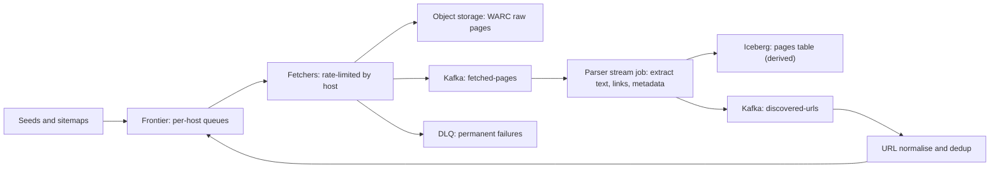

## 🎯 TL;DR

> A web crawler is a **work queue with politeness rules**. The hard parts are the frontier (what to fetch next, and how often each host may be hit), **deduplication** of URLs and content at billion scale, and storing raw pages so the pipeline can be replayed when the parser changes.

- Split the system into **frontier**, **fetchers**, **raw page store**, **parsers** and **link feedback**. Each has a different scaling and failure profile.
- Partition work by **host**, not by URL. Politeness (robots.txt, crawl delay, concurrency per host) is a per-host property.
- Deduplicate in two places: URLs before fetching (cheap, approximate with a Bloom filter, then exact), and content after fetching (hash, near-duplicate with SimHash).
- Store **raw bytes** in object storage and **derived fields** in a table format. Re-parsing from raw is how you fix extraction bugs without re-crawling the web.

## 🌱 Start simple (Junior)

**Problem statement.** A search company wants an index of the public web. Build the pipeline that discovers URLs, downloads pages, extracts text and links, and stores the results. Target: about 1 billion pages per month, refreshing popular pages more often than rare ones, and never overloading any website.

> **💡 Analogy:** A librarian sent to collect every book in a city. She keeps a to-do list of shelves (the frontier), never sends more than one person to the same shop at once (politeness), keeps a list of books already collected so she does not buy duplicates (dedup), and photographs every page so a cataloguer can re-read them later (raw store).

**Functional requirements**

- Accept seed URLs and discover new URLs from fetched pages.
- Fetch pages over HTTP(S), following redirects, with timeouts.
- Respect `robots.txt` and per-host crawl delays.
- Store raw responses, extracted text, links and metadata (status, headers, fetch time).
- Refresh pages on a schedule based on how often they change and how important they are.

**Non-functional requirements**

- Throughput: about 1 billion fetches per month, with bursts.
- Politeness: a host must never get more than the agreed rate.
- Correctness: no URL fetched twice in one refresh cycle by accident; content duplicates are detected.
- Replayability: a parser fix must apply to old pages without fetching them again.
- Robustness: crawler traps (infinite calendars, session IDs) must not exhaust the budget.

**Estimation (show the arithmetic)**

- Fetches: 1,000,000,000 per 30 days. Seconds in a month: 30 × 86,400 = 2,592,000. Average rate: 1e9 / 2.592e6 ≈ **386 fetches/s**. Peak at 3× average ≈ **1,160 fetches/s**.
- Raw bytes: assume an average response of 100 KB uncompressed → 1e9 × 100 KB = **100 TB per month** before compression. With gzip inside WARC files (assume 4× on HTML; measure this), about **25 TB per month** stored. Keep 90 days of raw → roughly 75 TB on hot object storage; older data moves to cheaper tiers.
- Network: 386 × 100 KB ≈ **38.6 MB/s ≈ 310 Mbit/s** average; peak 3× ≈ 0.93 Gbit/s.
- Known URLs: assume each fetched page reveals 10 new outbound links, so about **10 billion URLs** seen in the first year. An exact in-memory set of 10 billion 8-byte hashes is 80 GB, which is too big for one machine, so the dedup store must be sharded or disk-based, or approximate for the first check (see the deep dives).

The fetch rate is modest. The difficulty is the **politeness and dedup logic** running at that scale, and making sure every stage can be replayed.

## 🔧 How it really works (Mid)

**Stages**

- **Frontier** decides what to fetch next. Its state is the queue of URLs plus, for each host, the earliest time the next request is allowed.
- **Fetchers** are stateless workers. Each takes a host lease from the frontier, sends requests at the allowed rate, and writes the response.
- **Raw store** keeps the response bytes exactly as received, packed into WARC files (the standard web archive format) on object storage.
- **Parsers** read the fetched-pages topic and produce derived tables. They can be rerun from the raw store.

**URL normalisation.** The same page has many spellings. Before any dedup, normalise: lowercase the scheme and host, drop default ports, remove fragments (`#...`), sort query parameters, remove known tracking parameters, resolve `.` and `..`, and follow `<link rel="canonical">` when the site provides it. Normalisation rules are product decisions; version them.

**Politeness.** Three controls, per host:

- `robots.txt`: fetched once, cached (for example, 24 hours), and checked before each URL. Disallowed paths are never queued.
- Crawl delay: the minimum time between two requests to the same host (the site's `Crawl-delay`, or your default, whichever is safer).
- Concurrency cap: at most N simultaneous connections per host, usually 1 or 2 for small sites.

Partition the frontier and the fetchers by **host hash** (consistent hashing; see [[consistent-hashing]]). Then one worker owns one host at a time, and politeness becomes a local rule instead of a distributed lock.

**Frontier queue.** Use a two-level structure: a priority score per URL (importance and freshness) and a FIFO per host. A scheduler picks hosts whose next-allowed time has passed, and within a host it takes the highest-priority URL. Backlog grows when fetchers slow down, so the frontier must apply [[backpressure]]: stop enqueuing discovered links from a host whose queue is already long.

**Dedup, two levels.**

1. **URL dedup before fetching.** Check the normalised URL against a "seen" set. A Bloom filter gives a fast answer with no false negatives and a small false-positive rate. For 10 billion URLs and a 1% false positive rate, the filter needs about 9.6 bits per item: 10e9 × 9.6 / 8 ≈ **12 GB**, which fits across a few machines. A false positive means a URL is skipped by mistake, so use an exact store (sharded key-value store such as RocksDB or a distributed key-value store) for the authoritative answer, and keep the Bloom filter only as a fast pre-check.
2. **Content dedup after fetching.** Hash the normalised body with SHA-256 (32 bytes). Exact duplicates share the hash. Near duplicates (same article, different ads) need SimHash or MinHash, which produce a fingerprint that changes little with small edits. Keep the content hash in the pages table so you can group mirrors.

**Refresh scheduling.** Store `next_fetch_at` per URL and shorten the interval for pages that changed, lengthen it for pages that did not. Send `ETag` and `Last-Modified` on refetch, so an unchanged page returns `304 Not Modified` with no body.

**Failure handling.**

- Timeouts and 5xx: retry with exponential backoff and jitter, up to a limit, then requeue with a lower priority.
- 404 and 410: mark the URL gone, do not retry.
- Redirect loops: stop after a small hop limit (for example, 5).
- Parse failures: keep the raw page, send the record to a DLQ ([[dead-letter-queue]]), and fix the parser later. Never drop raw data because parsing failed.

## 🧠 Senior depth & trade-offs

**Deep dive 1: the frontier queue.**

- The frontier is the heart of the system and the hardest to scale. Options: a database table with a `(host, next_fetch_at)` index (simple, but locks and hot hosts hurt), a sharded key-value store with a per-host list (more code, better throughput), or a log-based queue with one partition per host group (cheap replay, but you manage ordering yourself).
- Hot hosts are the trap. A large news site has millions of URLs and one host. Its queue dominates one partition, and that shard becomes the bottleneck. Cap per-host backlog, interleave URLs from different sections, and keep the politeness rate strict.
- Crawler traps: calendars that generate infinite pages, session IDs in the URL, and faceted search pages. Budget per host (max pages per refresh cycle), max path depth, and a URL pattern blocklist are the standard defences. Measure the share of pages with low content value.

**Deep dive 2: dedupe at billion scale.**

- Exact dedup of 10 billion keys is a storage problem first. Shard by hash of the normalised URL, and use the same partitioning as the frontier so a dedup check is local.
- Bloom filter sizing: false positives grow when the filter is full. Plan capacity for the next year and rebuild with a bigger size when you are close. A Bloom filter cannot remove items, so for refresh you keep the exact store for "last seen" and use the filter only to say "definitely new".
- The content hash catches mirrors. For an index, you often keep one canonical copy and link the others, which saves storage and avoids ranking duplicates.

**Deep dive 3: storage and replay.**

- Raw pages go to object storage in WARC files of a few hundred MB, one set per fetch hour. Small objects are costly on S3-style stores, and so are millions of tiny files in a lake ([[small-files-problem]]).
- The derived tables (page metadata, links, text) go to an Iceberg or Parquet table partitioned by fetch date. Upserts for "latest version of this URL" are a merge operation; keep history as append-only snapshots so you can answer "what did we know on day X".
- Replay is the superpower. When the parser changes, rerun the parse job over WARC files for the affected dates. You never need to re-crawl the web, which would be slow and rude.

**Deep dive 4: operations.** Watch fetch success per host, queue depth per host bucket and the share of `304` responses. A sudden rise in 429 or 403 responses from many hosts means you are misbehaving or blocked: stop, check rates and robots rules, and resume gradually.

**Legal and ethics.** Respect `robots.txt` and applicable terms, identify the crawler with a User-Agent that includes contact details, and set retention and deletion rules for raw pages, which can contain personal data (see [[data-retention]]).

**Staff-level expectations.** Staff candidates usually:

- Separate the **frontier** (control plane) from the **raw store** (data plane) and explain why the raw store is what makes the system maintainable.
- Give the cost model: fetches per second, bytes per month, dedup memory, and how each number moves with the refresh policy.
- Plan for hot hosts, traps and blocking as normal events, with budgets and automatic backoff.
- Make replay and parser versioning first-class: every derived row records the parser version and the WARC file it came from.

**When not to build this.** A few thousand known pages need a scheduled job with sitemaps and a plain HTTP client. A distributed crawler pays off only when you must discover unknown pages at scale.

## 🧪 Try it

1. **Politeness math.** A host allows one request every 2 seconds. You have 100,000 URLs for that host, and you want the first full pass done in one day. Is it possible with one connection? Show the arithmetic.
2. **Bloom sizing.** You expect 5 billion URLs and accept a 0.5% false-positive rate. Estimate the filter size in GB (use m = −n·ln(p) / (ln 2)²).
3. **Replay plan.** The parser had a bug for 3 weeks of fetches. Describe the minimal set of steps to fix the derived tables, including what you do with the duplicates the bug created.

Show solutions

**1.** One request every 2 seconds is 0.5 requests/s, which is 43,200 requests per day at most. A full pass of 100,000 URLs needs 100,000 / 0.5 = 200,000 seconds ≈ 55.6 hours, which is more than one day. So it is impossible with one connection under this rule. Options: ask the site for a higher limit, prioritise the important URLs in the first day, or accept that the pass takes about 2.3 days.

**2.** n = 5 × 10^9, p = 0.005. ln(p) = −5.298. m = 5e9 × 5.298 / 0.4805 ≈ 5.51 × 10^10 bits ≈ 6.9 GB. That is about 11 bits per item.

**3.** (a) Pause or scope the affected parse job by the fetch date range. (b) Fix the parser and bump the parser version. (c) Rerun the parse over the WARC files for the 3 weeks, writing into a new partition or snapshot. (d) Remove the bad rows from the derived table by partition (not row by row) and swap in the new snapshot. (e) Deduplicate by URL and fetch timestamp, keeping the latest parse. (f) Check counts against raw WARC record counts. No re-crawl is needed, because the raw bytes already exist.

## 💬 Interview corner

**Question: "Design a web crawler data pipeline."**

- **Mid answer:** "I'd keep a queue of URLs, workers that fetch them and store the HTML in object storage, a Bloom filter to skip URLs already seen, and a parser that extracts text and links. Links go back into the queue."
- **Senior answer:** "I'd partition the frontier by host so politeness is a local rule, with robots.txt and a crawl delay per host. Dedup is two-level: a Bloom filter as a fast pre-check and an exact sharded store for the answer, plus a content hash after fetch. Raw pages go to WARC files, so parsers can be rerun without re-crawling. I'd track per-host failures and back off on 429s."
- **Staff answer:** adds the cost model, the hot-host and crawler-trap defences, the refresh policy with conditional requests, and the versioning of parsers and normalisation rules, so a bug fix is a replay, not a re-crawl.

**Follow-ups to expect**

- How do you avoid crawling the same page twice in parallel? (Host-level leasing: one fetcher per host at a time, and a short lock on the URL in the exact store.)
- What if a site blocks you? (Detect 403 and 429 patterns, back off per host, respect the signal, and contact the site if needed.)
- How do you find duplicate content across domains? (Content hash for exact copies, SimHash or MinHash for near copies, computed in the parser stream.)

> **🎤 Say this in the interview:** "A crawler is a politeness-aware work queue. I partition by host so each host's rate limit is enforced in one place, dedupe URLs before fetching with a Bloom filter backed by an exact store, and dedupe content after fetching by hash. Raw pages land in WARC files, so every derived table can be rebuilt by replay."

## ⚠️ Common mistakes

> **⚠️ Watch out:** Partitioning the frontier by URL hash. Then one host's URLs spread across every worker, and no single place can enforce its rate limit.

> **⚠️ Watch out:** Throwing away raw HTML after parsing. A parser bug then means re-crawling the web, which is slow, expensive and impolite.

- Ignoring URL normalisation, so `http://Example.com/a?x=1&y=2` and `https://example.com/a?y=2&x=1` are fetched as different pages.
- Using a Bloom filter as the only dedup store, and missing pages because of a false positive.
- Retrying every failure immediately. A host that returns 503 needs time, not more requests.
- Following redirects with no limit, and falling into loops or crawler traps.
- Forgetting `robots.txt` cache expiry, so a rule change on the site is ignored for weeks.
- Writing one tiny object per page instead of batching into WARC files.

## ✅ Check yourself (quiz)

1. Why partition the frontier and the fetchers by host instead of by URL?
   - A) Hosts are easier to name than URLs
   - B) Politeness (rate and concurrency limits) becomes a local rule owned by one worker, not a distributed lock
   - C) It removes the need for a Bloom filter
   - D) It guarantees that every page is fetched exactly once

Answer

**B** — a host's rate limit is only enforceable if one owner sees all of that host's requests. Partitioning by URL spreads them across workers, which makes the limit hard to honour.

2. A Bloom filter says a URL has been seen. What can you conclude?

   - A) The URL was definitely fetched
   - B) The URL was possibly seen; a false positive means it may be new, so the authoritative answer comes from the exact store
   - C) The URL is a duplicate of a page with the same content
   - D) The URL is blocked by `robots.txt`

Answer

**B** — Bloom filters never give false negatives, but they do give false positives. A "seen" answer is a hint, and the exact store decides before a URL is skipped for good.

3. Which HTTP response should make the crawler stop requesting a URL and not retry it?

   - A) 503 Service Unavailable
   - B) 429 Too Many Requests, forever
   - C) 410 Gone
   - D) A connection timeout

Answer

**C** — 410 says the resource is permanently gone, so retries waste budget. 503 and timeouts are transient and deserve backoff. 429 means slow down, which is a rate-control signal, not a permanent failure.

4. **(Senior)** A parser bug has corrupted three weeks of derived metadata. The raw WARC files are intact. What is the cheapest correct recovery?

   - A) Re-crawl the three weeks from scratch
   - B) Fix the parser, record a new parser version, rerun the parse over the stored WARC files for those dates into a new snapshot, then swap the affected partitions
   - C) Delete all raw pages and start again
   - D) Edit the corrupted rows by hand

Answer

**B** — replay from raw data needs no network traffic and produces a correct, versioned result. Re-crawling is slow and impolite, and manual edits do not scale. Partition-level swaps keep the change atomic.

5. **(Senior)** Your frontier has one hot host with 20 million URLs, and its partition has a growing backlog and high latency. Which two changes address the cause?

   - A) Add more partitions for every host
   - B) Cap per-host backlog and apply backpressure on discovered links from that host; and enforce budgets (pages per cycle, depth limits) so the host cannot dominate the shared capacity
   - C) Remove robots.txt checks to go faster
   - D) Increase the crawl delay to zero

Answer

**B** — the root problem is one host consuming a shared partition. Backpressure stops new work from piling up, and budgets keep one host from starving the rest. Removing politeness rules is never the answer.

## 🗂️ Flashcards

| Front | Back |
|---|---|
| Why partition by host | One owner enforces a host's rate limit and concurrency |
| Bloom filter answer "seen" | Possibly seen; false positives mean an exact store must decide |
| Bloom filter false negatives | None (it never misses an item it has stored) |
| Why keep raw pages | Parsers can be fixed and replayed without re-crawling |
| 410 vs 503 | 410 is permanent (stop); 503 is transient (back off and retry) |
| Two-level dedup | URL dedup before fetch; content hash (and SimHash) after fetch |
| Conditional request for refresh | `ETag` / `Last-Modified`; a `304` costs no body |
| Crawler trap defence | Per-host budget, max depth, URL pattern blocklist |

## 🔗 Go further

- Related lessons: [[design-search-indexing]] (what happens to the pages after they are fetched) and [[design-log-platform]] (large append-only storage and replay patterns).
- Storage layout and small files: [[data-lake-object-storage]] and [[file-ingestion]].
- Bad records and flow control: [[dlq-bad-records]] and [[backpressure]].

