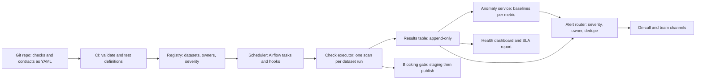
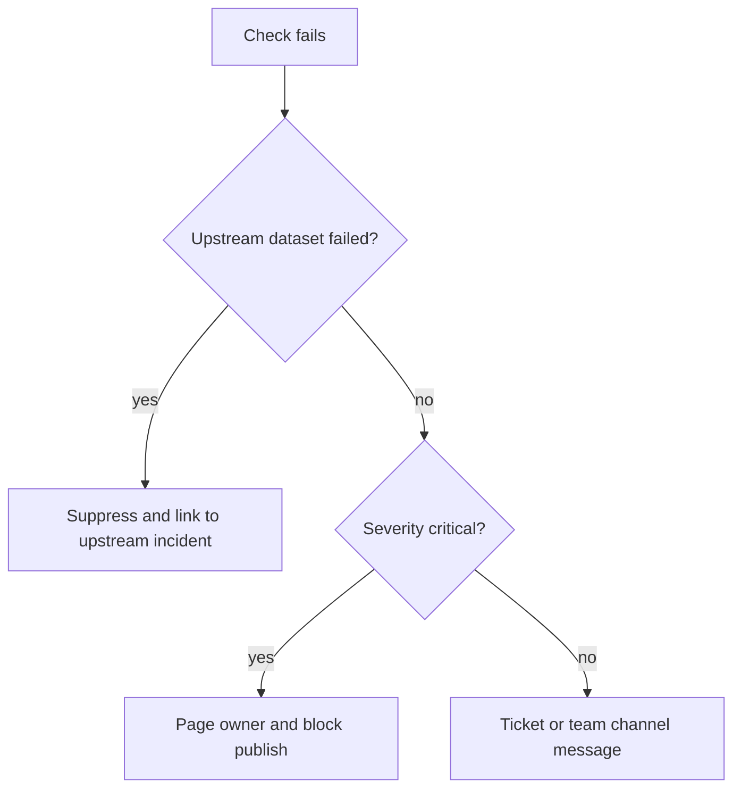

## 🎯 TL;DR

> A data quality (DQ) platform answers one question for every dataset, every day: **"can I trust this table right now, and if not, who must act?"** It runs checks, stores the results, detects silent drift, and routes alerts to the right owner without flooding them.

- **Checks are code**: versioned in Git, reviewed, tested in CI, and deployed like any other change.
- **Consolidate queries**: one profiling scan per dataset run beats one query per check by about 10 times in the arithmetic below.
- **Blocking checks guard publishing** for critical datasets; **monitors** watch everything else after the fact.
- **Anomaly detection** uses a seasonal, robust baseline, not a fixed threshold.
- **Routing is the product**: severity, ownership from the catalog, lineage-aware suppression, grouping, and an alert budget.

## 🌱 Start simple (Junior)

> **💡 Analogy:** A hospital triage desk. Every patient (dataset) gets vital signs checked on a schedule (freshness, row count, nulls). The desk writes the readings in a chart (results store), flags unusual readings against that patient's normal (anomaly detection), and pages the right doctor, not the whole ward (routing).

### 1. Problem statement

A bank has **2,000 datasets** in its warehouse and lake, produced by **300 pipelines** owned by **40 teams**. Last quarter, a silently empty partition reached a risk dashboard for three days. Build a DQ platform that catches this class of failure, tells the owner within minutes, and does not bury teams in false alarms.

### 2. Functional requirements

- Teams define checks for their datasets: freshness, volume, uniqueness, nulls, ranges, referential integrity, and custom SQL.
- Checks run **inside pipelines** (blocking, before publish) and **on a schedule** (monitors) for data that arrives from outside.
- Results are stored with history, so trends and past incidents can be queried.
- Metrics such as row count and null rate are tracked over time with anomaly detection.
- Alerts reach the owner, with severity, a runbook link, and a status page per dataset.

### 3. Non-functional requirements

- **Latency:** a critical check result within 15 minutes of the data landing.
- **Coverage:** every dataset in the catalog has at least the minimum check set.
- **Noise:** fewer than one page per on-call engineer per week from automated checks.
- **Cost:** check queries must not dominate warehouse spend.
- **Auditability:** the answer to "was this table trusted on day X?" must be reproducible from stored results.

## 🔧 How it really works (Mid)

### 4. Estimation

| Quantity | Arithmetic | Result |
|---|---|---|
| Checks defined | 2,000 datasets × 10 checks | **20,000 checks** |
| Scheduled suite runs per day | 500 critical × 24 (hourly) + 1,500 others × 1 (daily) = 12,000 + 1,500 | **13,500 runs/day** |
| Naive check queries | 13,500 runs × 10 checks | **135,000 queries/day** |
| Naive warehouse time | 135,000 × 5 s (assumed average) | **675,000 s ≈ 187.5 warehouse-hours/day** |
| Consolidated scans | 13,500 runs × 1 profiling scan × 5 s | **67,500 s ≈ 18.75 warehouse-hours/day** |
| Result rows | 135,000 × 1 KB | **135 MB/day ≈ 49 GB/year** |
| Anomaly series | 2,000 datasets × 4 metrics | **8,000 daily series** (≈ 2.9 M points/year) |
| Hourly anomaly points | 500 critical × 4 metrics × 24 × 365 | **≈ 17.5 M points/year** |

The consolidation is the key number: one scan computes every aggregate a dataset needs. The 5-second average is an assumption, so state it and ask the interviewer for the real warehouse profile.

### 5. Data model

Checks are definitions. Results are an append-only fact table, one row per check per run:

```sql
CREATE TABLE dq_results (
    run_id         VARCHAR(64),
    dataset        VARCHAR(256),
    check_name     VARCHAR(128),
    check_version  INTEGER,        -- the definition that produced the result
    run_ts         TIMESTAMP,
    data_date      DATE,           -- the partition being judged, not the run time
    status         VARCHAR(16),    -- PASS, FAIL, ERROR, SKIPPED
    observed       DOUBLE PRECISION,
    expected       VARCHAR(256),
    PRIMARY KEY (run_id, dataset, check_name)
);
```

`data_date` and `check_version` are the two fields people forget. Without `data_date`, a late run for yesterday looks like today's failure. Without `check_version`, a changed threshold rewrites history.

### 6. High-level design



The check definition is the contract between the owner and the platform. Here is one dataset, written as code:

```yaml
dataset: marts.orders_daily
owner: team-payments
severity: critical            # decides who is paged
freshness:
  column: loaded_at
  max_lag: 2h
checks:
  - name: order_id_unique
    type: unique
    columns: [order_id]
  - name: amount_not_negative
    type: range
    column: amount
    min: 0
  - name: row_count_anomaly
    type: anomaly
    metric: row_count
    sensitivity: 3.5
```

The executor compiles all checks for one dataset into a **single profiling query**, so the warehouse scans the partition once:

```sql
-- PostgreSQL dialect; the same shape works on most warehouses
SELECT
  COUNT(*)                                       AS row_count,
  COUNT(*) - COUNT(customer_id)                  AS null_customer_id,
  COUNT(*) - COUNT(DISTINCT order_id)            AS duplicate_order_rows,
  MAX(loaded_at)                                 AS max_loaded_at
FROM marts.orders_daily
WHERE load_date = CURRENT_DATE - INTERVAL '1 day';
```

`COUNT(DISTINCT)` is expensive on large tables. For very large datasets, use a sketch such as HyperLogLog and say that the result is approximate.

## 🧠 Senior depth & trade-offs

### 7. Deep dive: checks as code

- **Repository and review.** Definitions live next to the pipeline code. A PR that weakens a threshold needs the owner's approval, which makes the change visible.
- **CI tests for checks.** Validate the YAML schema, reject checks with no owner, and run each SQL check against a small fixture to catch typos before deployment.
- **Templates.** Give teams default bundles per table type (fact, dimension, mart). Coverage then comes from defaults, and custom checks are the exception.
- **Versioning.** Every result stores `check_version`. Changing a threshold is a new version, not an edit of history.

### 8. Deep dive: where checks run

There are two placements, and a good design uses both:

- **Blocking gate (in the pipeline).** Write the new partition to a staging location, run the critical checks, and publish only if they pass. This protects consumers, but it adds latency to every run and fails pipelines for non-critical reasons if misused.
- **Monitor (after publish).** A scheduled job checks the live table. It catches data that arrives from outside, late data, and changes made by other tools, but bad data may already be visible. Use it for everything the gate cannot see.

Only blocking checks should block. Use the `severity` field to decide: a critical check fails the gate, a warning check only records a result.

### 9. Deep dive: anomaly detection

A fixed threshold ("row count above 10,000") breaks on the first growth year. A baseline that compares today with the **same weekday over the last 8 weeks** handles weekly seasonality. Use the median and the median absolute deviation (MAD), so one past outage does not distort the baseline:

```python
from statistics import median

def robust_z(history: list[float], today: float) -> float:
    """history: same weekday, last 8 weeks. Median and MAD resist past outages."""
    med = median(history)
    mad = median(abs(x - med) for x in history)
    if mad == 0:
        return 0.0 if today == med else float("inf")
    return 0.6745 * (today - med) / mad  # modified z-score

def is_anomaly(history: list[float], today: float, threshold: float = 3.5) -> bool:
    if len(history) < 6:
        return False  # cold start: not enough history to judge; say so in the UI
    return abs(robust_z(history, today)) > threshold
```

Anomaly detection has three failure modes to name in the interview: **cold start** (new datasets have no baseline), **holidays and launches** (the baseline is wrong for a known event, so add an "expected change" annotation that suppresses the alert), and **alert fatigue** (every alert needs a feedback button: "real" or "expected", which tunes the sensitivity per dataset).

### 10. Deep dive: alert routing



- **Lineage-aware suppression.** When an upstream table fails, its 30 downstream checks should not each page someone. Use lineage from the catalog to attach them to one incident.
- **Grouping and dedupe.** One incident per dataset per day, with a counter, not one message per run.
- **Maintenance windows and expected changes** suppress alerts on purpose, and every suppression expires.
- **Escalation.** An unacknowledged critical page goes to the team lead after a fixed time. Each alert links to a runbook; an alert without a runbook is a bug.
- **Alert budget.** Track pages per on-call per week and treat a rising number as a defect in the checks, not a staffing problem.

### 11. Scale, cost and operations

- Run **incremental checks**: validate only the new partition, plus cheap table-level invariants such as the row count trend.
- Use **sampling only for distributions**, never for uniqueness or referential integrity. A sample can miss a duplicate.
- Monitor the platform itself: check execution lag, error rate of the checks (an ERROR result is not a PASS), and the share of datasets with no checks at all.

## 🧪 Try it

A critical table has these row counts on the last 8 Mondays (sorted: 9,900, 9,900, 9,950, 10,000, 10,000, 10,050, 10,100, 10,100). Compute the median, the MAD and the modified z-score for two new values, and decide the alert for each with threshold 3.5:

1. Today's count is **6,200**.
2. Today's count is **9,800**.

<details><summary>Show solutions</summary>

**Median.** The middle two values are 10,000 and 10,000, so median = **10,000**.

**MAD.** Absolute deviations from 10,000 are 100, 100, 50, 0, 0, 50, 100, 100. Sorted: 0, 0, 50, 50, 100, 100, 100, 100. The middle two are 50 and 100, so MAD = **75**.

**1.** z = 0.6745 × (6,200 − 10,000) / 75 = 0.6745 × (−50.67) ≈ **−34.2**. |z| > 3.5, so **alert**. This is a real drop, and the owner should check the load.

**2.** z = 0.6745 × (9,800 − 10,000) / 75 = 0.6745 × (−2.67) ≈ **−1.8**. |z| < 3.5, so **no alert**. This is normal variation.

</details>

## 💬 Interview corner

**Interviewer question:** "Design a data quality platform for 2,000 datasets."

- **Mid answer:** "Teams write SQL checks, an orchestrator runs them after each load, results go to a table, and failures send a Slack message."
- **Senior answer:** "I start with coverage and cost: 13,500 suite runs a day, so I consolidate each dataset's checks into one profiling scan instead of 135,000 queries. Checks are YAML in Git with CI tests. Critical datasets have a blocking gate, the rest have monitors. Anomaly checks use a same-weekday robust baseline with a cold-start rule. Alerts go through a router that suppresses downstream failures using lineage, groups by dataset, and escalates unacknowledged pages."

**Expectations per level**

- **Mid:** checks as SQL, scheduled runs, a results table, and alerts. Clear definitions of freshness, uniqueness and null checks.
- **Senior:** cost consolidation, blocking versus monitoring placement, seasonal anomaly detection with its failure modes, lineage-aware routing, and an alert budget.
- **Staff:** the operating model: who owns which checks, how coverage is measured and enforced, how the platform's signal becomes an SLO for data trust, and how to migrate teams off ad hoc scripts without a flag day.

**Follow-ups to expect**

- "A pipeline writes correct data, but the source sent half the rows. How does the platform know?" (Volume and freshness checks against the baseline, plus reconciliation with the source count where one exists.)
- "How do you test that a check catches what it should?" (Fixture datasets with known defects, run in CI, one per check type.)
- "The anomaly detector pages every Monday. What do you change?" (Use the same-weekday baseline, check the seasonality setting, and add the weekly pattern as expected behaviour.)

> **🎤 Say this in the interview:** "I treat checks as code, and I pay for them in warehouse hours, so each dataset gets one profiling scan. Critical data is gated before publish and everything else is monitored. Anomalies are judged against a seasonal, robust baseline, and alerts go to the owner with lineage-aware suppression, so one upstream failure makes one incident."

## ⚠️ Common mistakes

> **⚠️ Watch out:** A check that returns ERROR and is counted as PASS. An exception in the check is a failed monitor, not a green light. Track it separately and alert on it.

- Running one query per check on a large table, then discovering the warehouse bill.
- Using a fixed threshold for row counts on a business with weekly or yearly seasonality.
- Sampling a table to check uniqueness, then missing the duplicates.
- Paging the owner of every downstream table when one upstream table fails.
- Storing results without `data_date` and `check_version`, so history cannot be explained.
- Making every check blocking. A noisy gate teaches teams to bypass it.
- Measuring success by the number of checks rather than the number of incidents caught early.

## ✅ Check yourself (quiz)

1. What does "consolidated profiling scan" save in the estimation table?
   - A) Storage for result rows
   - B) Warehouse time, by computing all of a dataset's aggregates in one pass instead of one query per check
   - C) Network latency between the scheduler and the warehouse
   - D) The need for CI tests

<details><summary>Answer</summary>

**B** — in the estimate, 135,000 queries become 13,500 scans, which is about 10 times less warehouse time. It does not change storage, and CI is a separate concern.

</details>

2. Why should `dq_results` store `data_date` as well as `run_ts`?

   - A) Because `run_ts` cannot be a timestamp
   - B) A late run for yesterday's partition would otherwise look like a failure of today's data
   - C) Because the primary key needs two date columns
   - D) So the platform can delete old runs faster

<details><summary>Answer</summary>

**B** — the result describes the partition being judged, not the moment the check ran. Mixing the two makes backfills and reruns look like new incidents.

</details>

3. A daily row count has a strong weekly pattern. Which anomaly baseline is most appropriate?

   - A) The global mean of all days ever
   - B) A fixed threshold of 10,000 rows
   - C) The same weekday over recent weeks, with a robust center and spread
   - D) The last value only

<details><summary>Answer</summary>

**C** — comparing like with like removes the weekly cycle, and the median and MAD resist past outages. A global mean ignores seasonality, and a single last value is noisy.

</details>

4. **(Senior)** An upstream `raw.payments` load fails, and 25 downstream checks in three marts fail in the same run. What should the router do, and why?

   - A) Page 25 owners so that everyone knows
   - B) Suppress the downstream checks and open one incident linked to the upstream failure, using lineage from the catalog
   - C) Disable the checks until the upstream data is fixed
   - D) Retry the downstream checks ten times

<details><summary>Answer</summary>

**B** — the downstream failures have one cause. One linked incident goes to the owner of the root, and the downstream owners see the link. Disabling checks hides real problems, and retries do not fix missing upstream data.

</details>

5. **(Senior)** Why is sampling acceptable for a null-rate check but not for a duplicate-key check?

   - A) Sampling is never acceptable
   - B) A null-rate estimate is an approximation by nature and drifts slowly, while a single duplicate can be missed entirely by a sample
   - C) Duplicate keys are always stored in a separate table
   - D) Null checks run on the metadata only

<details><summary>Answer</summary>

**B** — a sample gives an approximate rate, which is acceptable for monitoring trends with a stated error. Uniqueness is a yes-or-no property of every row, so a sample can miss it. This is the trade-off behind the rule "sample for distributions, scan for keys".

</details>

## 🗂️ Flashcards

| Front | Back |
|---|---|
| What is a check, in this design? | A versioned definition in Git, reviewed and tested in CI, that produces results |
| Blocking gate vs monitor | Gate blocks publish for critical data; monitor checks the live table after the fact |
| Why one profiling scan per dataset | It replaces one query per check, cutting warehouse time about 10 times in the estimate |
| Two fields people forget in results | `data_date` (partition judged) and `check_version` (definition used) |
| Why median and MAD for baselines | One past outage does not move them, unlike mean and standard deviation |
| Cold start for anomaly detection | Too little history to judge; say so explicitly and do not alert silently |
| Lineage-aware suppression | One upstream failure creates one linked incident, not one page per downstream check |
| Sampling rule | Sample for distributions and trends; scan every row for keys and referential checks |

## 🔗 Go further

- **data-quality** and **data-observability** define the dimensions and monitoring concepts this design relies on.
- **data-lineage** explains how the catalog provides the upstream and downstream graph that suppression needs.
- **governance-contracts-mesh** covers data contracts, which are the producer side of the same checks.
- **incidents-postmortems** shows how a platform's alerts turn into follow-up work.
- Published write-ups from data platform teams describe their alert volumes and check counts. Their numbers differ widely by company, so use this lesson's arithmetic as the method and verify any real figure against the original post.
