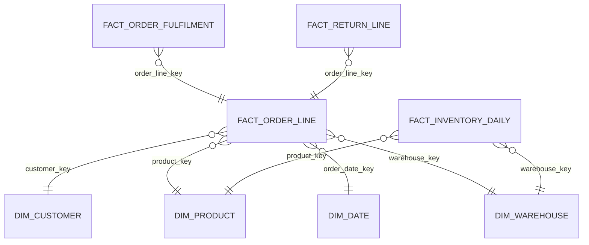

## 🎯 TL;DR

> Design a warehouse that loads **orders, order lines, inventory and returns** from an OLTP database through CDC, models them as a **Kimball star schema** with **SCD2** dimensions, and publishes **daily marts** that finance and merchandising can trust.

- Pick the **grain** first: one row per order line. Everything else hangs off it.
- Use three fact types: a transactional fact for lines, an **accumulating snapshot** for the order lifecycle, and a **periodic snapshot** for inventory.
- Customer and product attributes that change over time become **SCD2** dimensions, so history stays correct.
- Late changes (a return 25 days after purchase) are normal. Build marts with a **lookback window** and **idempotent MERGE/overwrite** so reruns are safe.

## 📋 Problem statement

An online retailer runs its order system on PostgreSQL. Analysts need a warehouse with sales, fulfilment, inventory and return metrics. Finance needs a daily revenue number by 06:00 that matches the source. Merchandising needs to see stock and returns by category. The company has about 1 million orders per day at peak.

### Functional requirements

- Ingest changes from `orders`, `order_items`, `customers`, `products`, `warehouses`, `inventory_movements` and `returns`.
- Model sales, fulfilment lifecycle, daily inventory and returns for BI.
- Keep history of customer address and segment, and product category, so historical reports stay correct.
- Publish daily marts: sales by day, category and country; return rate; inventory health.
- Support backfill when a bug or a rule change requires reprocessing a past period.

### Non-functional requirements

- **Freshness:** daily marts ready by 06:00 local time; inventory no older than 1 hour for ops.
- **Correctness:** daily revenue equals the source within 0.01% after reconciliation; no duplicate order lines.
- **Recoverability:** a failed load can be rerun without manual cleanup.
- **Privacy:** personal data (names, phones, addresses) is masked or restricted. This matters in Iran under local data rules as much as under GDPR-style rules.

## 📐 Estimation

Assume 1 million orders per day at peak, an average of 3 lines per order, and 10 million inventory movements per day.

- Order lines per day: 1,000,000 × 3 = **3 million rows per day**.
- Per year: 3,000,000 × 365 = **1.1 billion** fact rows. At roughly 120 bytes per row uncompressed, that is 1.1 × 10⁹ × 120 B ≈ **132 GB per year** before compression. Columnar compression typically reduces this several times.
- Order status changes: about 5 per order (placed, paid, packed, shipped, delivered). That is 5 million CDC events per day from `orders`, plus item-level and inventory events.
- Inventory movements: 10 million × ~100 B ≈ **1 GB per day** of raw events. The **daily inventory snapshot** is much smaller: 50,000 products × 20 warehouses = 1 million rows per day, roughly 100 MB per day.
- Returns: 5% of orders, so 50,000 returns per day, about 60,000 return lines.

The conclusion: the volume is modest for a columnar warehouse. The hard parts are **correctness under change** (CDC ordering, SCD2, late returns) and **the cost of reprocessing**, not raw throughput.

## 🗃️ Data model

We use a Kimball star schema because BI tools and analysts query it directly.



| Table | Type | Grain | Notes |
|---|---|---|---|
| `fact_order_line` | Transactional | one row per order line | Quantity, unit price, discount, net amount |
| `fact_order_fulfilment` | Accumulating snapshot | one row per order line | Timestamps for placed, shipped, delivered, returned; updated in place |
| `fact_return_line` | Transactional | one row per returned unit | Links to the order line; reason code |
| `fact_inventory_daily` | Periodic snapshot | product × warehouse × day | On-hand quantity at end of day |
| `dim_customer` | SCD2 | one row per customer version | Address, segment; `valid_from`, `valid_to`, `is_current` |
| `dim_product` | SCD2 | one row per product version | Category, brand; history matters for category reports |
| `dim_date`, `dim_warehouse` | Type 1 | one row per day / warehouse | Static or rarely changing |

The **grain** decides everything. If someone asks for "revenue by customer segment" and segment changes over time, the join must use the customer version valid at the order time. That is only possible if the fact has the order timestamp and the dimension has a validity range.

Each dimension has a **surrogate key** (`customer_key`), so that the source's natural key can change or be reused without rewriting history.

## 🏗️ High-level design

```mermaid
flowchart LR
    PG["PostgreSQL OLTP"] -->|"logical replication"| DBZ["Debezium CDC"]
    DBZ --> K["Kafka: cdc topics"]
    K --> RAW["Raw CDC log, append-only"]
    RAW --> STG["Staging: latest change per key"]
    STG --> DIMS["SCD2 dimensions (MERGE)"]
    STG --> FACTS["Facts (MERGE on order line key)"]
    DIMS --> FACTS
    FACTS --> MART["Daily marts (lookback rebuild)"]
    MART --> BI["BI and finance reports"]
    FACTS --> DQ["Data quality checks"]
    DQ --> MART
```



The raw CDC log is kept as an **append-only** table with `op` (insert, update, delete), the source log position (LSN or binlog offset) and a source timestamp. Nothing is overwritten at this layer. Staging then keeps **one row per key**: the latest change in the batch. Dimensions and facts are built from staging with MERGE. Marts are built from facts.

This is a medallion layout: raw, staged and modelled layers, each rerunnable from the one before.

## 🧠 Deep dives

### 1. CDC ordering and deletes

- Order by the **source log position**, not the arrival time in Kafka. Kafka partitioning by primary key keeps the order of one row, but a re-sent batch or a consumer restart can replay events. Deduplicate on `(table, primary_key, lsn)`.
- The **initial snapshot** of a table is a set of `op = 'r'` events. Keep it separate from the live stream in the raw layer, so you can replay it without touching live changes.
- **Deletes.** An OLTP delete should become a soft delete in the warehouse (`is_deleted = true`, `deleted_at`). Hard deletes break history and make reconciliation harder. A real delete request (privacy) goes through a separate, audited process; see [[pattern-data-deletion]].

### 2. SCD2 customers

A customer moves from Tehran to Isfahan. The warehouse must keep both versions so that last year's revenue for Tehran stays in Tehran.

```sql
-- Dialect: ANSI style (PostgreSQL / Snowflake / BigQuery-like).
-- In Spark, replace "IS DISTINCT FROM" with "NOT (a <=> b)" for each pair.
-- stg_customer holds one row per customer: the latest change in this batch.
MERGE INTO dim_customer AS t
USING (
    -- Branch 1: every staged row, keyed by customer_id (closes old versions)
    SELECT s.customer_id AS merge_key, s.customer_id, s.city, s.segment, s.changed_at
    FROM stg_customer AS s
    UNION ALL
    -- Branch 2: changed rows with a NULL key, so they do not match and get inserted
    SELECT NULL, s.customer_id, s.city, s.segment, s.changed_at
    FROM stg_customer AS s
    JOIN dim_customer AS cur
      ON cur.customer_id = s.customer_id AND cur.is_current
    WHERE cur.city IS DISTINCT FROM s.city
       OR cur.segment IS DISTINCT FROM s.segment
) AS src
ON t.customer_id = src.merge_key AND t.is_current
WHEN MATCHED AND (t.city IS DISTINCT FROM src.city
               OR t.segment IS DISTINCT FROM src.segment) THEN
    UPDATE SET is_current = FALSE, valid_to = src.changed_at
WHEN NOT MATCHED THEN
    INSERT (customer_id, city, segment, valid_from, valid_to, is_current)
    VALUES (src.customer_id, src.city, src.segment, src.changed_at, DATE '9999-12-31', TRUE);
```

The two-branch trick is the key idea: a changed customer must match once (to close the old row) and be inserted once (as the new version). A single MERGE cannot do both with one source row.

Point-in-time join for facts:

```sql
SELECT f.order_line_id, c.customer_key, f.net_amount
FROM fact_order_line AS f
JOIN dim_customer AS c
  ON c.customer_id = f.customer_id
 AND f.order_ts >= c.valid_from
 AND f.order_ts <  c.valid_to;
```

> **⚠️ Watch out:** join on `is_current` instead of the validity range, and last year's revenue silently moves to the customer's current city.

**Late-arriving dimensions.** A fact can arrive before its customer change is loaded. Insert an "inferred" dimension row with the known key, flag it, and let the next SCD2 run correct it. Do not drop the fact.

### 3. Fact types and the order lifecycle

- `fact_order_line` is written once per line and rarely changes. It answers "what was sold".
- `fact_order_fulfilment` is an **accumulating snapshot**. One row per line, with timestamps for each milestone. A MERGE updates the row when a milestone arrives. It answers "how long did shipping take".
- `fact_return_line` has its own grain, one row per returned unit. A return can arrive 25 days after the order. It links to the order line by key, so it never changes the sale; it adds a negative fact.

Keep a **periodic snapshot** for inventory, not a sum of movements. Summing movements every day is slow, and a single missed event makes the total wrong. The daily snapshot is cheap to rebuild for a single day.

### 4. Daily marts and late data

Marts such as `mart_daily_sales` are built from facts with a **lookback window**: each run rebuilds the last `N` days (for example 7) rather than only yesterday. A return or a status change that arrives late then updates the affected days.

- Use **partition overwrite** on `order_date` for the rebuilt days. Overwrite is idempotent: rerunning the same day gives the same result.
- A mart that depends on a late change for a closed period is a **restatement**. Decide the policy with finance: restate silently, restate with a version, or keep the original number and show the adjustment. Write the decision down.

### 5. Orchestration, quality and reconciliation

An orchestrator such as Airflow runs the chain: CDC load, dimensions, facts, marts, quality checks, publish. Each task is idempotent so a retry is safe. Quality checks you should always have:

- **Source reconciliation:** row count and sum of `net_amount` for yesterday's orders, compared with the OLTP replica. A difference beyond a threshold blocks publishing.
- **Referential integrity:** every `customer_key` and `product_key` in facts exists in its dimension, with the unknown member `-1` used only for known late cases, and counted.
- **Freshness:** the latest `changed_at` in staging is recent enough.
- **Uniqueness:** one row per `(order_line_id)` in `fact_order_line`.

## 🧠 Senior depth & trade-offs

- **Why star, not one wide table.** A one-big-table (OBT) is fast to query for one question but expensive to change and hard to keep correct for SCD. A star keeps dimensions shared across facts. Many teams use a star for the core and an OBT as a mart on top.
- **MERGE cost.** A MERGE rewrites the files that contain matched rows. On a table with 1 billion rows, updating a small set of keys can rewrite many files. Partition by a stable key, cluster by the merge key, and check how many files a typical MERGE touches. In Iceberg or Delta, compaction and file-size tuning matter; check the docs for your version.
- **Accumulating snapshot cost.** Updating in place means rewriting history of that row. In an append-only lakehouse, keep the milestone changes as events and derive the snapshot in a view or mart when the query volume is low.
- **Restatements vs audit.** Restating silently is wrong for finance. Keep a version or a reason code, so a reported number can be explained a month later.
- **Privacy in the warehouse.** Masking and column-level access control should apply to `dim_customer` (phone, address). Do not copy PII into marts. Mart users rarely need a name.
- **Orchestration.** Keep the DAG on dependencies, not on time offsets. "Start facts at 03:00" fails silently when dimensions are late; "facts wait for dims" fails loudly, which is what you want.
- **On-prem context.** Many Iranian retailers run PostgreSQL on-prem with Debezium, Kafka and a Spark lakehouse on object storage or HDFS. The design is the same; the operational cost (backups, upgrades, capacity) is higher, so plan capacity for peak season (for example Nowruz or Black Friday style campaigns).
- **What to monitor:** CDC lag (seconds behind the source), MERGE duration and files rewritten, SCD2 inferred-member count, reconciliation difference, and the number of restated days per week.
- **When not to build this:** if you have one source, one team and daily reports, a single nightly ELT job into a warehouse with views may be enough. Add SCD2 only when a historical question appears.

## 🧪 Try it

Predict first, then check your answer.

> A customer moves from Tehran to Isfahan on 2026-03-10. An order placed on 2026-03-05 is joined to `dim_customer` with `is_current = TRUE`. Which city does that order report?

<details><summary>Your guess?</summary>

**Isfahan.** The current row is the new version, so the old order is attributed to the new city. The point-in-time join on `order_ts` between `valid_from` and `valid_to` returns **Tehran**, which is correct. This is exactly the bug the lesson warns about.

</details>

## 💬 Interview corner

> **🎤 Say this in the interview:** "I start with the grain: one row per order line. Lines are a transactional fact, the order lifecycle is an accumulating snapshot, and inventory is a daily periodic snapshot. Customers and products are SCD2, so facts join on the version valid at order time. CDC lands in an append-only raw layer, and marts rebuild a lookback window so late returns are included."

**What a mid answer sounds like:** a star schema with a fact table, dimensions, a CDC load and a daily mart.

**What a senior answer adds:** the grain statement, SCD2 with point-in-time joins, the difference between transactional and snapshot facts, the cost of MERGE on large tables, and a restatement policy agreed with finance.

**What a Staff answer adds:** ownership of each mart and its SLA, how the company decides what is "revenue" across teams (a metric definition layer), and a migration plan from the existing reporting database without breaking dashboards.

### Likely follow-ups

1. **"A return arrives 40 days after the order. What changes?"** A new row in `fact_return_line` links to the original line. The sales fact is unchanged. The lookback window covers the return's date, and the mart restates only the period affected, under the agreed policy.
2. **"Finance says yesterday's revenue is 0.5% off. Where do you look?"** Compare row counts and sums per stage: source, raw, staging, facts, mart. Check duplicates from CDC replay, deletes, and currency or discount logic.
3. **"How do you backfill the last 2 years after a bug in discount logic?"** Fix the logic, rebuild facts for the affected partitions with overwrite, rebuild marts, and run reconciliation. Do it in batches so the warehouse stays usable.
4. **"A customer asks to be deleted. How does the warehouse comply?"** Pseudonymise the personal columns in `dim_customer` across all versions, keep the keys for aggregates, and log the request. Do not delete order facts that finance needs.
5. **"Why not use the OLTP read replica for analytics?"** It mixes analytics load with the live system, has no history, and cannot combine sources. The warehouse adds history and joins.

## ⚠️ Common mistakes

- **No grain statement.** Facts with mixed grain produce double-counted revenue. State the grain before the columns.
- **Joining SCD2 on `is_current`** for historical facts. Use the validity range.
- **Hard deletes in the warehouse.** They erase history and break reconciliation.
- **Summing inventory movements** instead of keeping a snapshot. One missed event makes the total wrong forever.
- **Rebuilding only yesterday.** Late returns and status changes never reach the mart.
- **MERGE without a stable key or dedup.** Duplicate keys in the source cause non-deterministic results.
- **No reconciliation.** Without it, you only learn about a wrong number from finance.

## ✅ Check yourself (quiz)

1. **Recall.** What is the grain of `fact_order_line`?
   - A) One row per order
   - B) One row per order line
   - C) One row per customer per day
   - D) One row per CDC event

   <details><summary>Answer</summary>

   **B** — One row per order line is the lowest level that carries quantity and price. A per-order grain would lose item detail, and a per-event grain would mix status changes into sales.

   </details>

2. **Scenario.** Which table type fits "how many days from shipped to delivered, per warehouse"?
   - A) Transactional fact
   - B) Periodic snapshot
   - C) Accumulating snapshot
   - D) Type 1 dimension

   <details><summary>Answer</summary>

   **C** — An accumulating snapshot holds one row per process with a timestamp per milestone, so the difference between two milestones is a simple subtraction. A transactional fact would need a self-join across event rows.

   </details>

3. **Scenario.** A MERGE for SCD2 closes the old customer row but does not insert the new version. What is the most likely cause?
   - A) The dimension has no surrogate key
   - B) The changed row matched the existing key in the same MERGE, so it was only used for the update, with no NOT MATCHED insert for the new version
   - C) MERGE does not support UPDATE
   - D) The lookback window is too short

   <details><summary>Answer</summary>

   **B** — A source row that matches the target can only trigger the matched branch. The usual fix is the two-branch source: one row to close the old version, and one row with a NULL key to insert the new version.

   </details>

4. **Senior trade-off.** Finance asks to keep last quarter's revenue fixed while a late return changes the total. What is the right approach?
   - A) Update the sales fact silently
   - B) Keep the sales fact, add a return fact, and agree a restatement policy with finance
   - C) Delete the return
   - D) Rebuild the marts without the lookback window

   <details><summary>Answer</summary>

   **B** — The return is a separate event with its own grain, so the sale stays as it was. Whether the closed period is restated, and how, is a business decision that should be documented.

   </details>

5. **Recall.** Why keep the raw CDC log append-only?
   - A) It is faster to write than a MERGE
   - B) It lets you replay, debug and rebuild staging and facts without going back to the source
   - C) It removes the need for primary keys
   - D) It stores the final state for BI

   <details><summary>Answer</summary>

   **B** — Keeping every change with its source position makes reruns and debugging possible. Staging and facts can be rebuilt from the raw log.

   </details>

## 🗂️ Flashcards

| Front | Back |
|---|---|
| What is a grain? | The meaning of one row in a fact table; state it first |
| Transactional vs accumulating snapshot | One row per event vs one row per process updated at each milestone |
| What is SCD2? | Keep a new row per version of a dimension, with a validity range |
| Why use a point-in-time join? | To attribute a fact to the dimension version valid at the event time |
| Why append-only raw CDC? | Allows replay and rebuild without re-reading the source |
| Why a lookback window in marts? | Late returns and status changes update recent days |
| What is an inferred member? | A placeholder dimension row for a fact that arrived before its dimension |

## 🔗 Go further

- Prerequisites: [[dimensional-modeling]], [[scd]], [[cdc]].
- Related patterns: [[pattern-cdc-analytics]], [[pattern-history]], [[pattern-backfill]].
- Related designs: [[design-cdc-lake]], [[design-payment-reconciliation]].
- Glossary: [[fact-table]], [[dimension-table]], [[grain]], [[surrogate-key]], [[scd]], [[cdc]].
