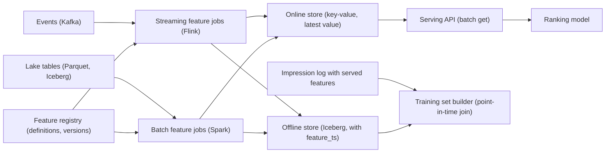

## 🎯 TL;DR

> Design a feature platform that computes **features** (numbers that describe users and items, such as "clicks in the last 7 days") once, serves them to a ranking model in **under 20 ms**, and produces **training data that matches what the model saw at serving time**.

- Define each feature **once**, then materialize it twice: an **offline store** for training and an **online store** for serving.
- Training must use **point-in-time correct** joins. Using today's value for a past event leaks the future into the model.
- The biggest silent failure is **training-serving skew**: the same feature computed differently in two places.
- Backfills rebuild history when a definition changes. Version them, rate-limit them, and never overwrite what old models were trained on.

## 🌱 Start simple (Junior)

> **💡 Analogy:** A recipe card kept in two kitchens. The restaurant kitchen (online) needs the current dish fast; the test kitchen (offline) needs to know exactly what was in the pot on any past day to judge a new recipe. If the two kitchens use different cards, the test results mean nothing in the restaurant.

A **feature** is a value the model uses as input. Examples:

- `user.clicks_7d`: how many items the user clicked in the last 7 days.
- `item.ctr_1h`: click-through rate of an item in the last hour.
- `user.preferred_category`: the category the user engaged with most.

A **feature store** is the system that defines these, computes them, stores them, and serves them consistently.

**The problem statement** we design for:

> A recommendation service ranks candidate items for each user request. The ranking model needs about 50 features per candidate and about 200 features for the user. Requests arrive at 100,000 per second at peak, with a p99 budget of 20 ms for feature lookup. Data scientists train new models weekly on 90 days of history, and they must trust the training data.

**Functional requirements**

- Register feature definitions with an owner, a description, a data type and a freshness target.
- Serve features for a batch of entities (one user plus many items) by key in one call.
- Produce training datasets for any labelled event time, joined to the feature values that were valid at that time.
- Backfill history when a definition changes, and track which version each model used.

**Non-functional requirements**

- Online lookup p99 under 20 ms, and availability of the online path higher than the ranking service itself.
- Freshness: streaming features within 1 to 5 minutes; batch features once per day.
- Consistency: the value used at serving equals the value a training job would compute for the same moment.
- Cost: the online store must not grow with every event, only with the number of entities and features.

**Estimation (show the arithmetic)**

- Users: 200 million. Features per user: 200. Average value size: 8 bytes. Per user: 200 × 8 = 1,600 bytes ≈ 1.6 KB.
- Online user features: 200 million × 1.6 KB = **320 GB**. With keys and store overhead of roughly 2×, plan for **about 640 GB** across replicas and shards.
- Requests: 100,000 per second at peak. Each request reads 1 user record and 50 item records, so 51 keys per request.
- Key reads: 100,000 × 51 = **5.1 million reads per second**. At an assumed 100,000 operations per second per node, that is about **51 nodes** before replicas. Use batched multi-get calls to cut round trips; the node count is the same but latency drops.
- Offline change log: 200 million users, about 20% of feature groups change per day, so 40 million changed rows per day. Per year: 40 M × 365 = **14.6 billion rows**. At about 100 bytes per compressed row: **1.5 TB per year**.
- Training scan: 90 days of labelled events at 500 million impressions per day is 45 billion rows. You do not train on all of it; sample negatives and filter, and keep the point-in-time join cost in mind.

> **⚠️ Watch out:** The 100 bytes per row and the operations per node are assumptions. Say so, and say how you would measure them in a load test.

## 🔧 How it really works (Mid)

**Architecture.**



The **registry** is the source of truth for each feature's definition, owner, version and freshness target. Streaming and batch jobs both read the same definition. The **online store** keeps only the latest value for each key. The **offline store** keeps history, with a `feature_ts` column saying when each value became valid.

**The online write path.** A streaming job computes an update and upserts it into the online store with the event time. The store must **reject older writes**: keep `max(event_time)` per key, and apply an update only if its time is newer. Without that rule, a replay or a late batch can roll a feature back to an old value. This is a compare-and-set write, and most key-value stores support it with a conditional update or a version field.

**The offline write path.** Each job appends rows of `(entity_id, feature_ts, values...)` to an Iceberg or Parquet table partitioned by day. Each row is a version of the feature, valid from `feature_ts` until the next row. This is a slowly changing structure, so a point-in-time query becomes a "latest row at or before time t" lookup.

**Point-in-time join.** A training example is a label at time `t` (a click at 09:14). Its features must be the values that were valid at 09:14, not the values from today. In PostgreSQL syntax:

```sql
-- labels: one row per impression with its event time and outcome
-- user_features: one row per change, with feature_ts
SELECT l.impression_id,
       l.user_id,
       l.event_ts,
       l.clicked,
       f.clicks_7d,
       f.preferred_category
FROM impressions AS l
JOIN LATERAL (
    SELECT uf.clicks_7d, uf.preferred_category
    FROM user_features AS uf
    WHERE uf.user_id = l.user_id
      AND uf.feature_ts <= l.event_ts
    ORDER BY uf.feature_ts DESC
    LIMIT 1
) AS f ON true;
```

The `feature_ts <= event_ts` condition is the entire point. Without it, the join returns the latest value, which may be from after the click. The model then learns from information it will not have at serving time, and offline metrics look better than production. Some engines have an `ASOF JOIN` that expresses the same idea more directly, and it is worth knowing its syntax for your engine.

**Feature logging, the cleanest fix for skew.** Log the feature values **as served** into the impression log. Train on those logged values for the training window where logs exist. Use the offline recomputation only for history before logging started, and compare the two over an overlap window to measure skew. Logging costs storage (for example, 200 features × 8 bytes per impression, so about 1.6 KB per impression, or 800 GB per 500 million impressions), but it removes the largest class of training-serving bugs.

**Serving.** The serving API receives a user and a candidate list, builds the keys, issues one batch get for the user and one for the candidates, substitutes **default values** for missing features, and returns the vectors to the model. Defaults must be the same values training used for missing features; otherwise every missing value is a silent shift.

**Backfill.** When a definition changes (for example, the window changes from 7 to 14 days), history must be recomputed. The backfill job runs the same feature code over past daily partitions, writes to a **new version** of the feature in the offline store, and leaves the old version intact. Models keep their version pinned in the registry. Run backfills on a separate cluster or with a rate limit so they do not starve the streaming jobs that feed production.

## 🧠 Senior depth & trade-offs

**Training-serving skew, the central risk.** Skew appears when the offline and online paths disagree. Typical causes:

- Two codebases: a Python function for training and a Java one for serving. Fix: one definition compiled to both, or a single SQL or DataFrame transform that both paths call.
- Different time semantics: training uses event time, serving uses processing time, so features that look ahead differ.
- Different defaults or null handling.
- Different windows: an "last 7 days" window computed at midnight offline and at the current minute online.

Measure it. For a sample of requests, compare the logged served vector with the offline recomputation for the same timestamp, and alert when the mismatch rate passes a threshold (for example, 0.1% of values per feature). A feature with high skew is not safe to use, however good its offline metric looks.

**Freshness is a model property.** A feature computed daily is up to 24 hours stale at serving time, and the training data must reflect that staleness. If the model is trained on minute-fresh values but served daily-fresh values, skew appears again, in the time dimension. Each feature in the registry carries its freshness target, and the training builder uses the same staleness rule.

**Online store choice and sizing.** The online store is a key-value store with low latency and high concurrency (Redis, DynamoDB, Cassandra, Bigtable and similar). Trade-offs:

- **Memory-based stores** (Redis) give the lowest latency and cost RAM per GB. With 320 to 640 GB of features, a memory store is expensive but feasible; keep only the features the model uses.
- **Disk-based stores** (Cassandra, DynamoDB) hold more data cheaply, with slightly higher tail latency. Check p99 under real batch sizes, not p50 on single keys.
- Use TTLs for entities that go inactive, so the store does not grow forever.

**Hot keys.** A viral item can receive a large share of reads. One key on one node becomes the bottleneck. Mitigate with replicated reads for hot keys, a short-term local cache in the serving process (with a few seconds of staleness that is part of the freshness budget), or request coalescing.

**Point-in-time correctness at scale.** The point-in-time join is the costliest step in training. Partition the feature table by entity hash and by day, sort by `(entity_id, feature_ts)`, and make the labels table use the same partitioning so the join is a co-located merge, not a full shuffle. A sort-merge or ASOF join over sorted data avoids repeated lookups. Check the plan: a broadcast join on a 200-million-row table is a mistake.

**Backfill economics and correctness.** Recomputing two years of daily snapshots for 200 million users is 730 daily partitions. If each partition takes 20 minutes on a shared cluster, a sequential backfill is 730 × 20 min ≈ 243 hours, about ten days. Run partitions in parallel within the cluster budget, and cut over only when the new version passes the skew and null-rate checks. Keep the old version until every model that depends on it has been retrained or retired.

**Ownership, governance and privacy.** Features outlive the team that built them. Require an owner, a description and a deprecation policy for each feature. Feature reuse is a benefit (one definition, many models), but it means a breaking change touches many models, so version features and deprecate rather than edit. For privacy, a user deletion must reach the online store (delete key), the offline store (rewrite or delete the affected files) and the logs that contain served features. Plan that path in the design, not after the first deletion request.

**Failure modes to rehearse.**

- The online store is slow or down. Serve defaults or the last cached value, and make the ranking service degrade (for example, fall back to a simpler model) instead of failing the request. Count the fraction of requests served with defaults and alert on it.
- A streaming job replays a window and an update arrives out of order. Protected by the `max(event_time)` rule.
- A feature becomes null for a whole segment because an upstream table changed its schema. Null-rate alerts per feature catch this within minutes.
- A backfill writes to the live version by mistake. Prevent with separate version paths and write permissions.

**When not to build a feature store.** A single model with a dozen features, computed in one nightly job, does not need a feature store. Add one when several models share features, when freshness is minutes rather than days, or when skew has already caused a production incident.

**Operating signals:** online lookup p99 and error rate, fraction of defaults served, skew rate per feature, freshness lag per feature, store memory and hot-key share, backfill progress and cost, and training-set join duration.

## 🧪 Try it

Use these inputs: 300 million users, 150 features per user at 8 bytes each, 80,000 requests per second, 40 candidate items per request, 40 features per item, and each lookup key costs one operation at 100,000 operations per second per node.

1. How big is the online user feature store, in GB, before replicas?
2. How many key reads per second does the serving path issue, and how many nodes does that need at 100,000 operations per second each?
3. A model was trained on feature values computed from a 7-day window at midnight. Serving computes the same window every minute. Describe the skew, how you would measure it, and what you would change.

<details><summary>Show solutions</summary>

**1.** 150 × 8 B = 1,200 B per user. 300 M × 1.2 KB = 360 GB (300 × 10⁶ × 1,200 = 3.6 × 10¹¹ bytes = 360 GB).

**2.** Keys per request: 1 user plus 40 items = 41. Reads per second: 80,000 × 41 = 3,280,000 (3.28 million). Nodes: 3,280,000 / 100,000 ≈ 32.8, so **33 nodes** before replicas.

**3.** The offline value is computed at midnight, so it is up to a day stale at the boundary and the window is anchored on a fixed time. The online value is up to a minute fresh. The model learns from one definition of the feature and serves another, which is skew in time semantics. Measure it by logging served values and recomputing the offline value for the same timestamps, then alert on the mismatch rate. The fix is one definition with one freshness rule (for example, both paths use a sliding window on event time with the same staleness bound), or log served features and train on those.

</details>

## 💬 Interview corner

**How it is asked:** "Design a feature store for a recommendation system." Expect questions on skew, point-in-time joins and backfills.

**Mid-level answer:** "Features are defined once in a registry and computed by batch and streaming jobs. Batch features go into an offline store for training, streaming features into a key-value store for serving. For training I'd join labels to features with the value valid at the event time, not the latest value, so the model does not see the future."

**Senior-level answer:** "The main risk is training-serving skew, so I'd use one definition for both paths and log the served feature vectors, then train on the logs where they exist and measure the mismatch against recomputation. The online store keeps the latest value per key and rejects older writes, so replays cannot roll values back. I'd size it at roughly 320 to 640 GB for 200 million users, serve with batch gets and per-feature defaults, and run backfills as versioned jobs with rate limits, cutting over only after skew and null-rate checks pass."

> **🎤 Say this in the interview:** "A feature store is mainly a consistency system. Its job is to make the number the model sees in production the same number it was trained on, at the same point in time. Freshness, point-in-time joins and versioned backfills all serve that goal."

**Staff-level signals:** a feature ownership and deprecation policy; a cost model per feature and per model; privacy deletion across online, offline and logs; a plan for multi-region serving with consistent feature versions; and an SLO for freshness and skew that product teams can rely on.

**Likely follow-ups.** *How do you handle labels that arrive days later?* Join with the feature value valid at the impression time, and wait for the label window to close before building the training set; the join key is the event time, not the label arrival time. *Why not use the online store for training?* It holds only the latest value, so historical point-in-time values are gone. *How do you add a new feature quickly?* Backfill its history as a new version, shadow-log it for a week to measure skew, then let models use it.

## ⚠️ Common mistakes

> **⚠️ Watch out:** Joining training labels to the latest feature values. The model learns from the future, and offline metrics look far better than the live system delivers.

> **⚠️ Watch out:** Writing the online store without a time check. A replayed window or a late batch silently rolls features back to old values.

- Maintaining one feature implementation in Python for training and another in Java for serving.
- Logging nothing about what was served, so skew can only be guessed.
- Forgetting defaults for missing features, or using different defaults in training and serving.
- Backfilling into the live version so that old models silently change.
- Storing the whole history in the online store, which grows without bound instead of keeping the latest value.
- Using a broadcast join for the point-in-time step on a huge feature table.
- Designing deletion for privacy only after the first request arrives.

## ✅ Check yourself (quiz)

1. Why must the training join use `feature_ts <= event_ts` and not the latest feature value?
   - A) It makes the query faster
   - B) Latest values can come from after the event, so the model learns information it will not have at serving time
   - C) Iceberg requires it
   - D) It removes duplicates

<details><summary>Answer</summary>

**B** — the latest value may include information from after the event. That is leakage: offline metrics look better than production results.

</details>

2. What is the purpose of the rule "apply an online update only if its event time is newer than the stored one"?

   - A) It makes writes faster
   - B) It stops replayed or late updates from rolling a feature back to an older value
   - C) It deletes stale keys
   - D) It compresses the store

<details><summary>Answer</summary>

**B** — streaming replays and late batches can deliver old updates after new ones. A compare on event time keeps the latest value correct.

</details>

3. Which is the cleanest fix for training-serving skew?

   - A) Train on a larger dataset
   - B) Log the feature values as served and train on those logs where they exist, measuring recomputation against them
   - C) Increase the online store TTL
   - D) Use the mean value for every missing feature

<details><summary>Answer</summary>

**B** — logged served values are exactly what the model saw. Recomputation is then only needed for history before logging began, and the overlap measures the skew.

</details>

4. **(Senior)** You need a 14-day window instead of a 7-day window for a feature, and two years of history. What is the safe rollout?

   - A) Overwrite the existing feature column in place and retrain every model
   - B) Backfill the new definition as a new version in the offline store, check skew and null rates, keep the old version pinned until dependent models are retrained or retired
   - C) Compute the 14-day window only in the online store
   - D) Skip the backfill and let the model learn from the next month

<details><summary>Answer</summary>

**B** — a versioned backfill keeps old models reproducible and lets you verify the new definition before anything depends on it. In-place overwrites silently change every model that reads the column.

</details>

5. **(Senior)** The online store is unavailable for 10 minutes at peak. What should the serving path do, and what must be true about the defaults?

   - A) Fail every request until the store recovers
   - B) Serve defaults or cached values, degrade the ranking if needed, count and alert on the fraction served with defaults; the defaults must match what training used for missing values
   - C) Switch to the offline store for every request at peak
   - D) Return an empty ranking

<details><summary>Answer</summary>

**B** — graceful degradation keeps the product responding. Defaults must match training, or the fallback itself becomes skew. The fraction of degraded requests is the operational signal.

</details>

## 🗂️ Flashcards

| Front | Back |
|---|---|
| What is training-serving skew? | Offline and online paths compute the same feature differently, so the model sees different inputs in production |
| Why a point-in-time join? | It returns the feature value valid at the event time, which avoids leaking future data |
| What does the online store keep? | The latest value per key, with a time check so older writes are rejected |
| What does the offline store keep? | Versioned history with `feature_ts`, enough to rebuild any past point in time |
| Best fix for skew? | Log served feature vectors and train on them; compare with recomputation |
| Why version a backfill? | Old models stay reproducible; the new version is verified before use |
| What is a default value for? | A safe substitute when a feature is missing; it must match what training used |
| Why sort the feature table by entity and time? | It makes the point-in-time join a co-located merge instead of a full shuffle |

## 🔗 Go further

- **feature-stores** introduces the concepts (registry, online and offline stores) that this design uses.
- **pattern-backfill** explains how to recompute history safely, which is the core of the backfill section.
- **stream-joins** and **delivery-semantics** cover the streaming side: late data, replays and the at-least-once behaviour of the online write.
- **serving-layer** covers how the serving path, caching and latency budgets fit together.
- **design-fraud-detection** is another system with the same freshness and skew trade-offs, in a different domain.
- Check the documentation of your online store and table format for conditional writes, TTL and time travel, since these features and their syntax differ between versions.
