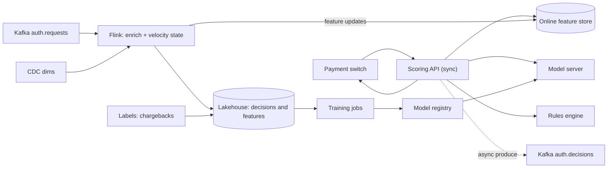
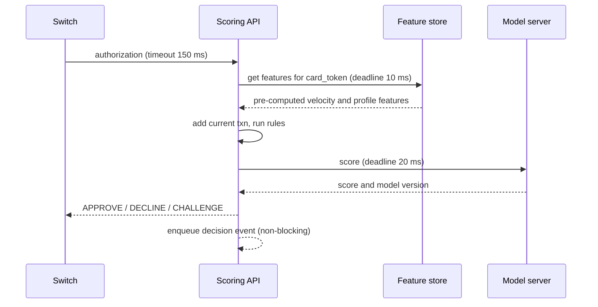

## 🎯 TL;DR

> A card authorization needs an **approve / decline / challenge** decision in **about 100 ms**, using features that were true **seconds ago**. Build two paths: a **synchronous** scoring path that reads pre-computed features from memory, and an **asynchronous** stream path that keeps those features fresh from the same events.

- Keyed streams (per card, per account) hold the velocity state: counts, sums and distinct merchants over a window.
- Dimension data (customers, cards, merchants) is joined from **versioned state** fed by CDC, never by a database call per event.
- Freshness is a budget you measure. Every feature family has a maximum age and an alert.
- Confirmed fraud and chargebacks arrive days or months late. They train models. They do not change the live path directly.

## 🌱 Start simple (Junior)

> **💡 Analogy:** A bank teller who glances at a customer's recent history before approving a large withdrawal. If the same card made nine payments in five minutes in three cities, the teller asks for an extra check. The teller must decide while the customer is still at the counter.

**The problem.** A bank receives card authorization requests from the card network through a payment switch. For each request, the bank must return a decision. Build the system that scores each request for fraud and returns that decision, and keeps the evidence for audits and model training.

**Functional requirements**

- Score every authorization request.
- Return one of three decisions: `APPROVE`, `DECLINE`, or `CHALLENGE` (ask for an OTP or 3-D Secure step-up).
- Combine **rules** (for example, "amount above X for a card that is less than 7 days old") with an **ML score**.
- Analysts can add or change rules in hours, without a code release.
- Store every decision with the exact features it used, for disputes and retraining.
- Chargebacks and confirmed fraud labels flow back into training data.

**Non-functional requirements (our assumptions)**

- Decision latency: **p99 under 100 ms** inside our system. The switch has a hard timeout; if we miss it, the switch applies its own default.
- Availability of the decision path: 99.99%. If the model is down, the system degrades to rules only and says so in the decision.
- Exactly one decision record per authorization ID, even when the switch retries.
- Card numbers (PAN) never reach analytics. Use a token.
- Retention for decisions and features: set by bank policy and regulator. We assume 5 years.

## 🔧 How it really works (Mid)

### Estimation

Assumptions for a large bank:

- Volume: 20 million card transactions per day.
- Average rate: 20,000,000 / 86,400 s ≈ **231 TPS**.
- Peak factor 4 (evenings, payday, holidays): 231 × 4 ≈ **925 TPS**.
- Design target: **2,000 TPS**, which gives about 2× headroom over peak.
- Event size: about 1 KB per request (fields plus metadata). Raw volume: 20 M × 1 KB = **20 GB/day**, or 20 GB × 365 ≈ **7.3 TB/year**.
- Five-year retention in compressed Parquet at 5:1 ratio: 7.3 TB × 5 years / 5 ≈ **7.3 TB** in the lake.
- Online feature state: 30 M active cards × 40 features × 8 bytes ≈ 9.6 GB. With index and replication overhead (×2), plan for about **20 GB** of memory across the online store.

The numbers tell you three things: the sync path is a memory lookup problem (20 GB fits in RAM), the event stream is modest (about 2,000 msg/s, easy for Kafka), and storage is cheap compared with the cost of a wrong decision.

### Data model

| Object | Source / topic | Key fields |
|---|---|---|
| Authorization request | Kafka `auth.requests`, key = `card_token` | `auth_id`, `card_token`, `merchant_id`, `mcc`, `amount`, `currency`, `country`, `device_id`, `event_time` |
| Decision | Kafka `auth.decisions`, key = `auth_id` | `auth_id`, `decision`, `score`, `rule_hits[]`, `model_version`, `feature_snapshot_id`, `latency_ms` |
| Customer, card, merchant | CDC (Debezium) into state and lake | Business key plus `valid_from`, `valid_to` (SCD type 2 in the lake) |
| Feature definition | Config registry (versioned) | `name`, `source`, `window`, `max_age`, `owner` |
| Label | Dispute and chargeback system | `auth_id`, `label`, `label_time` |

### High-level design

The synchronous path touches only the API, the online store, the rules engine and the model server. Flink is never in the request path. Flink keeps the online store up to date and writes the audit trail.

One detail matters here. Flink's velocity counters do not yet include the transaction being scored. The API adds the current transaction locally, so the count is correct, and it must not add the transaction a second time if the event later reaches Flink. Use `auth_id` to deduplicate on the Flink side.

## 🧠 Senior depth & trade-offs

### Stream-table enrichment

A transaction stream must be joined with slowly changing dimensions: the merchant's category, the card's status, the customer's segment. There are three options:

| Option | Problem |
|---|---|
| Lookup per event in the operational database | Latency spikes, and it loads the core banking system during peaks |
| Dimension state built from CDC topics, joined locally | Needs state management, but reads are local and fast (**chosen**) |
| Broadcast small dimensions to every task | Works for hundreds of rows, not for millions of cards |

With CDC-built state, the join must be **temporal**. A transaction should join the merchant record that was valid **at the event time**, not the current one. Keep versioned rows keyed by `merchant_id` with `valid_from` and `valid_to`, and let the event-time watermark decide when old versions can be dropped.

> **⚠️ Watch out:** if a card is blocked two seconds after an authorization, the historical decision must not change, but the next decision must see the block. The live cache and the audit join answer different questions. Document which one each consumer uses.

CDC events arrive late or out of order, so a dimension can be missing when a transaction arrives. Do not block. Mark `dim_missing = true` on the decision, apply a conservative rule, and count how often it happens. A rising count usually means a broken CDC connector, not a fraud trend.

### Stateful rules

Typical velocity rules: "more than 5 transactions in 10 minutes from different countries", or "more than 3,000 USD in 24 hours on a card younger than 30 days". Both are **keyed** by card.

- **Bucketed counters.** Split time into 10-second buckets and keep, for each card, the sums of the last 60 buckets (10 minutes) or the last 8,640 buckets (24 hours). Memory is bounded and the arithmetic is cheap. Exact sliding windows keep every event and cost much more.
- **State TTL.** Clear state for cards idle longer than the longest window (24 hours plus margin). Without TTL, state grows with every card the bank has ever seen.
- **Distinct counts.** "Distinct merchants in 24 hours" needs a set. Exact sets are expensive. A HyperLogLog sketch gives an estimate with a small relative error and fixed memory. Use it only where the rule threshold can tolerate an estimate.
- **Hot keys.** A merchant or a corporate account can produce far more events than a card. One key then overloads one task. Give merchant-level aggregates a salted key (`merchant_id` plus a hash suffix) and merge the partial results. Monitor per-key rates to find them early.
- **Rules are data, not code.** Keep the raw bucket counters in state and let rules read them. A new rule that needs "distinct devices in 1 hour" should not reset the state of the existing rules.

### Feature freshness

Every feature family gets a freshness SLO:

- Velocity features: no more than **5 seconds** behind the event.
- Customer profile features from CDC: no more than **15 minutes** behind the source.
- Model features computed in batch: described by their as-of date, never silently mixed with live features.

Measure `feature_age = decision_time − max(event_time of the inputs)` for each feature family and export it as a metric. Alert on the p99. Typical sources of lag:

- Kafka consumer lag when partitions are unbalanced.
- Long checkpoints. With exactly-once sinks, a slow checkpoint delays the transactional commit to the online store.
- Online store write latency under a burst.

Record a `feature_snapshot_id` on every decision so that a dispute can be reproduced. Compute the same features in batch for training with the same definitions, so training and serving see the same values. The gap between them is **training-serving skew**, and it is the most common silent failure in production fraud models.

### Latency budget

A realistic breakdown for a 100 ms p99 target at the scoring API. These are budgets to design against, and you must measure them:

| Step | Budget (p99) |
|---|---|
| Network, switch to API and back | 15 ms |
| Feature store read (one lookup, pipelined) | 10 ms |
| Rules evaluation (in-process) | 5 ms |
| Model inference (in-process gradient-boosted trees) | 20 ms |
| Decision assembly and non-blocking enqueue | 5 ms |
| Headroom for GC, retries and tail latency | 45 ms |

Rules for the budget:

- Every dependency has its own deadline. If the model misses its deadline, return a **rules-only** decision with a reason code. The request still completes.
- The audit enqueue is asynchronous with a bounded local buffer. If the buffer is full, drop the audit record, count it, and alert. Never drop the decision.
- No synchronous calls to the lakehouse, to Flink, or to the operational database from the request path.

### Idempotency and delivery guarantees

- Key every decision by `auth_id`. Switch retries must get the **same** decision back, so keep a short response cache for the duration of the switch timeout.
- In Flink, use checkpointing with an exactly-once sink or an idempotent `MERGE` on `auth_id` for the lakehouse table. Duplicate decision records are a reporting error. Duplicate money movement would be a financial error, and this design keeps money movement out of this path.
- After a restart, velocity counters can double count events that were replayed. Keep a deduplication window of recent `auth_id` values in state, sized to the replay horizon.

### Failure modes

- **Model server down:** rules-only decisions, flagged in the record. Alert on the fallback rate.
- **Feature store down:** apply conservative rules (lower limits, more challenges). Approve rates will drop; that is the correct trade-off.
- **Flink job restarts:** replay from the last checkpoint, deduplicate by `auth_id`, check that the lag recovers within the SLO.
- **Late labels:** chargebacks arrive 30 to 120 days after the transaction. Train with time-aware splits so that no feature uses information from after the decision (**label leakage**).

### What to monitor

- Decision latency p50, p99 and p99.9, and the timeout rate.
- Fallback rate (rules-only) and dimension-missing rate.
- Feature age per family, and consumer lag per topic.
- Decision mix per merchant category: approve, decline, challenge.
- Challenge precision: the share of challenged transactions later confirmed as fraud.
- Score distribution drift between training and live traffic.

### When NOT to use this design

- At low volume (under about 50 TPS), a single service with a relational database and a set of batch rules is simpler and cheaper. Streaming state is not free.
- If the business accepts post-authorization review (decide within 24 hours), skip the synchronous path and run batch scoring with an alerting pipeline.

## 🎤 Interview corner

### Expectations by level

| Level | What a strong answer shows |
|---|---|
| Mid | Correct split between synchronous scoring and asynchronous features. Keyed state for velocity rules. Knows about late labels and training-serving skew. |
| Senior | Latency budget with deadlines and fallbacks. Temporal joins for dimensions. Bounded state, TTL and hot-key handling. Freshness is measured per feature family. |
| Staff | Explains the cost of wrong decisions in both directions (false declines and missed fraud), designs the rule and model release process, the replay and backfill strategy, and the org boundaries between platform and fraud teams. |

### Follow-up questions

1. A customer travels and uses the card in a new country. How do you avoid a false decline without weakening the rule for real fraud?
2. A merchant's category changes 10 minutes after a transaction. Which category should the audit record show, and why?
3. How do you evaluate a new model offline without label leakage when chargebacks arrive 90 days late?
4. How would you add a feature that links cards sharing a device, across millions of cards?
5. A rule needs the last 30 days of spending per card. What changes in the state design?

> **🎤 Say this in the interview:** "I split the system into a synchronous scoring path that only reads memory, and an asynchronous stream that keeps the features fresh from the same events. Dimensions join as versioned state with event-time semantics. Every feature has a freshness SLO, and every decision stores the snapshot it used. When a dependency misses its deadline, the system falls back to rules and says so."

**Model answer (3–5 sentences):** Authorizations go through a scoring API with a 100 ms budget. The API reads pre-computed velocity and profile features from an online store and runs rules and a model in-process. Flink consumes the same events from Kafka, joins CDC dimensions as temporal state, maintains keyed velocity counters with TTL, and writes features to the online store with a measured freshness SLO. Every decision is logged asynchronously with the feature snapshot ID, and labels from chargebacks feed time-aware retraining.

## ⚠️ Common mistakes

- Calling the feature database synchronously **from Flink** for every event. Flink should write features, and the API should read them.
- Computing training features from processing time instead of event time, which makes the offline model look better than it is.
- Keeping state for every card with no TTL, so memory grows until the job fails.
- Using one global window for all cards, which turns the whole stream into one partition.
- Joining dimensions with the current value instead of the value valid at event time.
- Treating a retried authorization as a new one, and producing two decisions.
- Adding a synchronous audit write to the request path because "we need the record". Use an async buffer and count the drops.

## ✅ Check yourself (quiz)

1. Why is the Kafka topic for authorization requests keyed by `card_token`?
   - A) So that all transactions for one merchant land in one partition
   - B) So that all events for one card go to the same partition, which keeps per-card velocity state on one task
   - C) So that the switch can find the card faster
   - D) Kafka requires a key on every topic

Answer

**B** — keyed streams put each card's events on one partition, and Flink keeps the velocity state for each key on one task. Any other key would split one card's history across tasks.

2. The sync scorer's p99 is 140 ms and the model step is the cause. What is the correct immediate change?
   - A) Remove the rules engine to save time
   - B) Give the model call its own deadline and fall back to a rules-only decision with a reason code when it expires
   - C) Move the feature store read into Flink
   - D) Increase the switch timeout until the p99 fits

Answer

**B** — every dependency needs a deadline and a fallback. The request still completes within budget, and the fallback is recorded and alerted. Option C puts Flink in the request path, and option D hides the problem from the switch.

3. **(Senior)** A rule needs "distinct merchants per card in 24 hours". Exact sets are too large for the card population. What is the trade-off of a HyperLogLog sketch, and when is it not acceptable?

   - A) It is exact but slower
   - B) It gives a bounded-memory estimate with a small relative error; it is not acceptable when the rule threshold is so close to the true value that the error changes decisions, or when auditors need the exact count
   - C) It cannot be used in streaming
   - D) It removes the need for TTL

Answer

**B** — a sketch trades exactness for fixed memory. Use it where a small error does not change the decision. For thresholds at the boundary, or for audit evidence, keep an exact count or store the raw events.

4. **(Senior)** A model scores well offline but performs much worse in production. Name two likely causes related to this design and how you would check each.

   - A) The model is too simple; use a deeper network
   - B) Training-serving skew (features computed differently offline and online) and label leakage (training features using data from after the decision); check by comparing feature distributions per `feature_snapshot_id` against the batch recomputation, and by enforcing as-of joins in training
   - C) The switch timeout is too short
   - D) Kafka is losing messages

Answer

**B** — the two classic causes are skew between online and offline feature definitions, and leakage from future information. Both are checked with reproducible snapshots and as-of (point-in-time) joins, not by changing the model.

## 🗂️ Flashcards

| Front | Back |
|---|---|
| Why keep the sync path away from Flink? | Flink is asynchronous and can lag; the request path must only read pre-computed state within its budget |
| What does a temporal join give you? | The dimension version valid at the event time, not the current value |
| Why bucketed counters instead of exact sliding windows? | Bounded memory and cheap arithmetic, at the cost of approximation at bucket edges |
| What is `feature_age`? | Decision time minus the event time of the newest input; measured per feature family against an SLO |
| Why deduplicate by `auth_id`? | Switch retries and Flink replays would otherwise produce double counts or double decisions |
| What is training-serving skew? | Features computed one way offline and another way online, so the model sees different values in production |
| Why must state have a TTL? | Otherwise state grows with every key ever seen and eventually exhausts memory |
| What does a rules-only fallback protect? | Availability: the request completes with a flagged, conservative decision when the model misses its deadline |

## 🔗 Go further

- **kafka-architecture** and **stream-joins** cover partitioning by key and the join types used here.
- **streaming-state** explains keyed state, TTL and checkpointing in more depth.
- **design-feature-store** and **feature-stores** cover the online and offline store split and the skew problem.
- **pattern-late-data** and **pattern-exactly-once** cover the late-event and idempotency patterns used in the audit path.
- **delivery-semantics** explains at-least-once versus exactly-once in the same terms as this design.
- **design-telco-cdr** is a related high-volume streaming design with similar keyed-state concerns.
