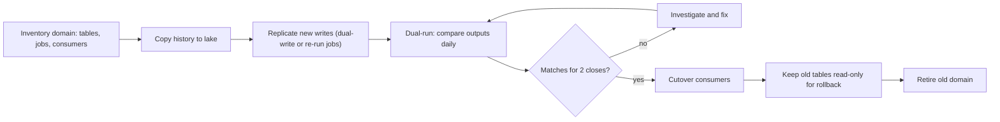

## 🎯 TL;DR

> Migrating from a Hadoop estate (HDFS, Hive, Spark-on-YARN, Oozie) to a **lakehouse** (object storage, open table format, a modern catalog) is a **risk-management** project. Move **one domain at a time**, run **old and new side by side** until the numbers match, then **cut over** reads and writes with a rollback path, and retire the old system last.

- The data is the easy part. The hard parts are the **1,000+ jobs and their implicit dependencies**, the **catalog** (Hive Metastore definitions and permissions) and the **trust** that business numbers did not change.
- **Dual-run** doubles compute for a while. Size the new cluster for it, and plan the budget before the first domain moves.
- **Validation** must compare business outputs (counts, sums, keys by partition), not only file checksums, because formats and types change in the move.
- **Cutover** is a per-table or per-domain switch of consumers (views, aliases, connection settings), not a single weekend event.

## 🌱 Start simple (Junior)

> **💡 Analogy:** Moving a bank's branch to a new building while customers keep coming. You do not close the old branch on Friday and open the new one on Monday. You open a small new branch, move the accounts one floor at a time, check every account balance in both places, and only then close each floor of the old building.

**The problem.** A bank runs a Hadoop cluster with 400 TB of logical data (after compression and 3× replication, about 1.2 PB of raw disk). It has about 1,500 Hive tables, 1,200 Spark and Hive jobs, some Sqoop imports from Oracle and about 300 daily Oozie workflows. Reporting, risk and the mobile team depend on it. Leadership wants to move to a lakehouse on object storage within 18 months, without a reporting outage and without changing any published number.

**Functional requirements**

- Move tables, their history and their metadata (schemas, partitions, permissions) to the new platform.
- Keep all daily jobs producing the same business outputs during and after the move.
- Support the same SQL access for analysts, with the same table names during the transition.
- Provide a rollback path for every domain until it is retired.

**Non-functional requirements (our assumptions)**

- Availability: no reporting outage longer than 2 hours during business days. Regulatory reports are never late.
- Correctness: every migrated table must match the source for counts and business totals before its cutover, and differences must be explained.
- Team: 8 data engineers, 2 platform engineers, and a reporting team of 20 people who depend on the current names.
- Constraints: all data stays on-prem. Object storage and the new compute cluster are deployed inside the bank's data centre.
- Time: 18 months for the migration, with the old cluster decommissioned at month 20 at the latest.

## 🔧 How it really works (Mid)

### Estimation

- Logical data: 400 TB. Replicated on HDFS, that is 1.2 PB of raw disk. Object storage with its own erasure coding or replication has a different overhead, so plan the **logical** size and budget the new storage on that.
- Transfer: a 10 Gbps link gives 1.25 GB/s. At about 60% efficiency after protocol and contention costs, that is **0.75 GB/s**. Moving 400 TB = 400,000 GB ÷ 0.75 GB/s ≈ 533,000 s ≈ **6.2 days** of continuous transfer. With retries, validation reads and business-hours throttling, plan **about 3 weeks** of copy window spread across the 18 months.
- Daily compute: suppose the Hadoop cluster spends 6,000 core-hours per day on the 300 daily jobs. Running the same jobs on the new platform during dual-run adds another 6,000 core-hours. A new cluster that runs them within an 8-hour batch window needs 6,000 ÷ 8 ≈ **750 cores** average, or about **1,000 cores** with headroom for peaks. That is the cost of dual-run; put it in the budget.
- Validation cost: a full row-and-sum comparison reads every byte once on each side, so it costs roughly one more copy. Use **partition-level aggregates** (count, sums, distinct keys per partition) for everything, and full-row hashes only for the critical tables.
- Metadata: 1,500 tables × average 40 partitions = 60,000 partitions to register. That is small, but each one must be checked.

The numbers show dual-run compute and validation are the expensive parts. The data copy itself is a week of network time.

### Migration strategy

Move by **domain** (for example risk, cards, lending, reporting), not by technology layer. A domain includes its tables, jobs, consumers and owners. Each domain follows the same cycle:



The **two-close rule** is a useful standard: a domain cuts over only after two consecutive period closes (for example two month-ends, or two weekly regulatory reports) match. A single matching day can hide a monthly job that has not run yet.

### Dual-run design

During dual-run, the same business output is produced twice: once by the old Hive or Spark job, and once by the migrated job writing to the lake. Two options exist:

- **Re-run the logic** on the new platform, reading the copied history and the replicated new data. This is the usual choice. It forces you to rewrite Hive SQL and Oozie dependencies, which is where hidden logic is found.
- **Dual-write** from the ingestion layer, so both systems receive the same new raw data. It works for raw zones, not for derived business tables, which can differ in timing.

Keep the old job as the **source of truth** until cutover. The new job writes to a shadow table with the same schema and a different location, so nothing downstream changes during comparison.

### Validation

Validation is the place where migrations fail silently. A few checks that catch most problems:

```sql
-- Compare partition-level aggregates for one table between the old and new platform.
-- old_sales and new_sales are the two copies (for example, two catalog names).
SELECT o.load_date,
       o.row_cnt AS old_rows, n.row_cnt AS new_rows,
       o.amt_sum AS old_amt,  n.amt_sum AS new_amt
FROM (SELECT load_date, COUNT(*) row_cnt, SUM(amount_cents) amt_sum
      FROM old_sales GROUP BY load_date) o
FULL OUTER JOIN
     (SELECT load_date, COUNT(*) row_cnt, SUM(amount_cents) amt_sum
      FROM new_sales GROUP BY load_date) n
  ON o.load_date = n.load_date
WHERE o.row_cnt IS NULL
   OR n.row_cnt IS NULL
   OR o.row_cnt <> n.row_cnt
   OR o.amt_sum <> n.amt_sum;
```

Checks, in order of cost:

1. **Schema contract**: column names, types and nullability. Hive types such as `decimal(18,2)` vs `double`, and timestamps with and without time zone, are the most common silent differences.
2. **Partition inventory**: every partition that exists on the old side exists on the new side, with the same row count.
3. **Business aggregates** per partition: counts, sums of money columns (in integer minor units), distinct keys.
4. **Key-level hashes** on the critical tables (for example a hash of the sorted primary keys per day) to find a few changed rows when aggregates match by coincidence.
5. **Business-report diff** for regulatory and executive reports: the reports from both systems must be identical or differ only for explained reasons.

A rule that saves weeks: the validator reports every difference, but a **known-difference register** lists each accepted one with an owner and a reason. Without it, teams learn to ignore the report.

### Cutover and rollback

Cutover changes **consumers**, not data. Use a **view layer** or **catalog aliases** so that analysts keep the same table name:

- Create the new table in the lake under a new schema.
- Change the view that consumers read so that it points to the new table.
- Keep the old table **read-only** for the rollback window (for example 30 days). Rolling back is repointing the view.
- Change the write path last: the old job stops writing only after the consumer switch is verified.

Cutover happens at a quiet time for the domain, usually after a period close is complete and before the next one starts.

### Catalog and metadata migration

The **Hive Metastore** is the de facto catalog for Hadoop. It holds table definitions, partition locations and, through the security layer, often the access rules. Migrating it is a separate workstream:

- Export table and partition definitions, and rebuild them in the new catalog. Partition registration is a bulk operation; test it on a copy first.
- Map Hive types to the target format's types, and record every mapping that changes a value.
- Migrate **permissions** explicitly (for example from Ranger or Hadoop groups to the new platform's roles). A table that is readable on the old cluster and denied on the new one looks like an outage to the business.
- Keep the Hive Metastore running during the transition, because old jobs and some tools still read it. Retire it only after the last consumer has cut over.

Choose the target table format deliberately. Open table formats such as Iceberg, Delta Lake or Hudi add snapshots, schema evolution and safe rewrites. Check the migration procedures in the docs for your chosen version (for example in-place import of existing Parquet files versus rewriting with `CREATE TABLE AS SELECT`), because support and behaviour vary.

### Job migration

The 300 daily Oozie workflows and their Sqoop imports need a new orchestrator. Migrate them **with** the domain, not in a separate big-bang project:

- Replace Oozie with Airflow (or the bank's chosen orchestrator), keeping the same schedule and dependencies, and make dependency edges explicit.
- Replace Sqoop imports with the bank's ingestion tooling, using CDC or incremental extracts where the source allows it, so the new job does not copy whole Oracle tables each night.
- Retire the old jobs in the same order as their outputs cut over, so no job depends on a retired input.

## 🧠 Senior depth & trade-offs

- **Hidden dependencies.** Hadoop estates accumulate implicit contracts: a file written by one job and read by a shell script nobody remembers, a partition created by a manual command, or a Hive view used by a report. Find them with query logs and lineage, not interviews. Inventory from the Hive audit logs and the Spark history server for six months, then compare with the workflow list. Anything read but not scheduled is a risk. See [[data-lineage]].
- **Small files.** Years of Hive writes produce many small files, and an object store makes them slower and more expensive to list. Compact during the copy, and set file-size targets for the new writers. See [[small-files-problem]] and [[compaction]].
- **Semantics drift.** Spark, Hive and Trino disagree on edge cases: null handling in joins, integer division, time zones, implicit casts and string collation. A migrated job that "works" can return slightly different totals. Dual-run exists to catch this; do not skip it for "simple" tables.
- **Dual-run cost and time.** Dual-run is the most expensive phase. Keep it per domain, and cap its duration. A dual-run that lasts nine months is a sign that validation criteria are unclear or that owners are not reviewing differences.
- **Consistency during cutover.** If a job writes to both old and new, a crash between the two writes can leave them different. Write to one authoritative place, then publish the other from it, and make the publish idempotent. See [[idempotency]].
- **Security.** Kerberos principals, Ranger policies and column masking all need an equivalent on the new side before the first user query. A migration that loses row-level security is a compliance incident. Test access as each role, not as the admin.
- **Rollback scope.** Rollback works only while the old data is intact and the old write path is still reachable. After the old tables are deleted, rollback means restoring from the lake's own snapshots. Decide the retention window before cutover, not during an incident.
- **Trade-off on the table format.** Using an open format keeps you vendor-neutral and gives snapshots and schema evolution. It also brings compaction, snapshot expiry and metadata maintenance into your operations. Name those costs in the design.
- **When not to migrate everything.** Some workloads, such as archived raw data read once a year, may be better as a cheap archive than as a fully migrated domain. Some Hive tables are abandoned. Retire them first; migrating dead data is expensive and gives no value.

### Expectations by level

- **Mid:** describes the dual-run and validation steps, explains why cutover is a view or alias change, and lists the Hive Metastore and job dependencies to migrate. Uses a partition-level comparison query.
- **Senior:** plans by domain with the two-close rule, sizes dual-run compute and the copy window with arithmetic, defines the known-difference register, and designs the rollback window and permission migration.
- **Staff:** sequences the program across teams and budgets, decides table format and catalog strategy with the operating cost, sets the policy for retiring the old cluster, and manages stakeholder agreement on what "the same number" means when semantics differ.

### Follow-ups the interviewer will ask

1. **"The new numbers differ by 0.01% in one month. What do you do?"** Do not average it away. Find the first partition where it differs, then the first row through key-level hashes. Check semantic causes: rounding, time zones, late data, nulls. Record the explanation in the register, and decide whether the difference blocks cutover.
2. **"How do you migrate 20 years of history?"** Copy historical partitions in the background by domain, validate their aggregates once, and keep the recent window in dual-run. Old history is rarely queried, so it can cut over later, behind the same view.
3. **"Can the business keep writing to the old cluster during the move?"** Yes, and that is the normal case. Writes stay on the source of truth until the domain cuts over; the copy replays new data.
4. **"What if the lake is slower than Hadoop for one query?"** Measure it first. Then decide between partitioning and file layout changes, a materialized aggregate, or keeping that workload on the old system until it is redesigned. Do not cut over a domain with a known regression in a critical report.

## 🧪 Try it

A bank has a Hive table `cards.txn` with 3 partitions. Use the small dataset below in PostgreSQL 13 or later (or Spark SQL) to simulate old and new copies. The new copy has one row missing from partition `2026-10-02` and one changed amount.

```sql
CREATE TABLE old_txn (load_date date, txn_id int, amount_cents bigint);
INSERT INTO old_txn VALUES
 ('2026-10-01',1,1000),('2026-10-01',2,2500),
 ('2026-10-02',3,400),('2026-10-02',4,700),
 ('2026-10-03',5,900);

CREATE TABLE new_txn (load_date date, txn_id int, amount_cents bigint);
INSERT INTO new_txn VALUES
 ('2026-10-01',1,1000),('2026-10-01',2,2500),
 ('2026-10-02',3,400),
 ('2026-10-03',5,950);
```

1. Write a query that reports, per `load_date`, the row count and amount sum in each copy, and flags partitions that differ.
2. Write a query that finds the `txn_id` values present in one copy but not the other.
3. Explain why matching aggregates on all partitions would not prove the migration is correct, and name one check that would catch that situation.

<details><summary>Show solutions</summary>

**1.**
```sql
WITH o AS (
  SELECT load_date, COUNT(*) AS old_rows, SUM(amount_cents) AS old_amt
  FROM old_txn GROUP BY load_date
), n AS (
  SELECT load_date, COUNT(*) AS new_rows, SUM(amount_cents) AS new_amt
  FROM new_txn GROUP BY load_date
)
SELECT COALESCE(o.load_date, n.load_date) AS load_date,
       o.old_rows, n.new_rows, o.old_amt, n.new_amt,
       (o.old_rows IS DISTINCT FROM n.new_rows
        OR o.old_amt IS DISTINCT FROM n.new_amt) AS differs
FROM o FULL OUTER JOIN n ON o.load_date = n.load_date
ORDER BY load_date;
```
Result: `2026-10-01` matches; `2026-10-02` differs (2 rows vs 1, sum 1100 vs 400); `2026-10-03` differs (sum 900 vs 950). `IS DISTINCT FROM` handles a missing partition on one side as a difference, which plain `<>` would miss as NULL.

**2.**
```sql
SELECT 'only_old' AS side, txn_id
FROM (SELECT txn_id FROM old_txn EXCEPT SELECT txn_id FROM new_txn) a
UNION ALL
SELECT 'only_new', txn_id
FROM (SELECT txn_id FROM new_txn EXCEPT SELECT txn_id FROM old_txn) b;
```
Result: `only_old 4`. Each `EXCEPT` is wrapped in its own subquery so the two directions do not interfere. Txn 5 is in both copies, so it is not listed, and its changed amount needs a separate check, see question 3.

**3.** Aggregates can match by coincidence: a dropped row and an added row with the same total amount leave the sums unchanged. Partition counts and key-level hashes catch that case. Compare the sorted list of `txn_id` (or a hash of `txn_id, amount_cents` per partition) so that a changed value is found even when the totals balance.

</details>

## 💬 Interview corner

**Question: "Design the migration of a Hadoop data platform to a lakehouse."**

> **🎤 Say this in the interview:** "I would migrate by domain, not by technology layer, and each domain moves through inventory, a history copy, dual-run, validation and cutover. Dual-run re-runs the migrated logic on the new platform and compares outputs at partition level, plus key hashes for critical tables. A domain cuts over only after two matching period closes. Cutover is a view or alias change, so rollback is repointing the view while the old table stays read-only. The catalog and permissions move explicitly, and the Hive Metastore stays up until the last consumer moves. I would size the new cluster for the dual-run and put that cost in the budget."

**Model answer by level:** A mid engineer names dual-run, validation and cutover, with the view switch. A senior adds the two-close rule, the copy and compute arithmetic, the known-difference register and the rollback window. A staff engineer ties the program to budgets and retirement policy, and agrees with the business what "the same number" means.

## ⚠️ Common mistakes

> **⚠️ Watch out:** Declaring a table "migrated" when the copy finished. The copy is the start of validation, not the end. Cutover needs matching business outputs over real closes.

> **⚠️ Watch out:** Comparing only file checksums. The data files differ by format, compression and file layout even when the business values are identical, so checksums will always differ. Compare the values.

- Moving the data before inventorying the jobs, so the hidden dependencies break after cutover.
- Migrating Hive SQL unchanged without checking semantic differences in the new engine (null handling, casts, time zones).
- Running dual-run with no end date and no owner for differences.
- Cutting over by moving writers first, which leaves consumers reading an old table that no longer updates.
- Losing row-level security or column masking in the move and finding out from an auditor.
- Deleting the old tables before the rollback window ends.
- Migrating abandoned tables and dead pipelines, which spends budget with no value.

## ✅ Check yourself (quiz)

1. What is the main purpose of dual-run?
   - A) To store the same data twice for backup
   - B) To produce the same business outputs in old and new systems and compare them before cutover
   - C) To test network speed between clusters
   - D) To shorten the migration by running jobs in parallel forever

<details><summary>Answer</summary>

**B** — dual-run is evidence. It shows that the new logic produces the same numbers under real load and real data, which is the basis for cutover.

</details>

2. Why is a checksum on the data files not a valid migration test?
   - A) Checksums are too slow for large data
   - B) Formats, compression and file layout differ between systems, so the bytes differ even when the business values are equal
   - C) Checksums cannot be computed on object storage
   - D) Checksums only work on integers

<details><summary>Answer</summary>

**B** — the test has to compare what consumers see: counts, sums, keys and reports. File-level checksums would report differences that are not business differences.

</details>

3. A domain matches for one month-end close. What is the rule the design uses before cutover?
   - A) One matching day is enough
   - B) Two consecutive period closes match, because a single period can miss a job that runs only at the close
   - C) Three years of history must match
   - D) The cutover happens whatever the result

<details><summary>Answer</summary>

**B** — the two-close rule guards against false confidence from one period. Monthly and quarterly jobs often run only at close, so a single match can hide a broken job.

</details>

4. **(Senior)** A cutover is planned for a Saturday. What makes it safe?

   - A) The new cluster is faster than the old one
   - B) Consumers switch through a view or alias, the old tables stay read-only for the rollback window, and the write path moves only after the consumer switch is verified
   - C) All jobs are deleted from the old cluster on Friday
   - D) The migration uses a single big copy at night

<details><summary>Answer</summary>

**B** — cutover is a reversible change of consumers. If something breaks, repointing the view restores the old behaviour quickly, and the old data is still there.

</details>

5. **(Senior)** Dual-run is costing a large amount of extra compute and has run for nine months on one domain. What do you do?

   - A) Keep it running until the budget ends
   - B) Review the validation criteria and the known-difference register with owners, set a deadline, and treat unexplained differences as blockers that need an owner and a fix
   - C) Turn it off and cut over without checks
   - D) Double the cluster size to speed it up

<details><summary>Answer</summary>

**B** — a long dual-run usually means the stop criteria are unclear or differences are not being resolved. The fix is process and ownership, with a deadline, not more hardware.

</details>

## 🗂️ Flashcards

| Front | Back |
|---|---|
| Migration unit | A domain (tables, jobs, consumers, owners), not a technology layer |
| Dual-run | Old and new produce the same business outputs; compare before cutover |
| Two-close rule | Cut over after two consecutive period closes match |
| Why not file checksums? | Format and layout differ; compare business values instead |
| Cutover mechanism | Repoint a view or alias; old table stays read-only for rollback |
| Known-difference register | Accepted differences with owner and reason; without it, teams ignore reports |
| Hive Metastore role | De facto catalog: table definitions, partitions, often access rules |
| Dual-run compute cost | Roughly doubles batch compute for the domain until retirement |

## 🔗 Go further

- **hadoop-ecosystem** reviews HDFS, YARN, Hive and the Metastore, which this migration replaces.
- **mapreduce** explains the origin of the batch model you are moving away from.
- **lakehouse-table-formats** compares open table formats and their snapshot and evolution features.
- **data-catalogs** and **data-lineage** cover the metadata work that finds hidden dependencies.
- **pattern-backfill** and **pattern-schema-evolution** cover copying history and changing types safely.
- **design-cdc-lake** shows the target ingestion pattern that replaces nightly Sqoop copies.
