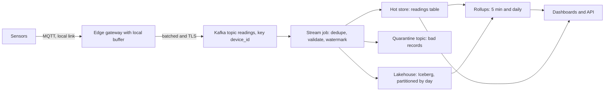
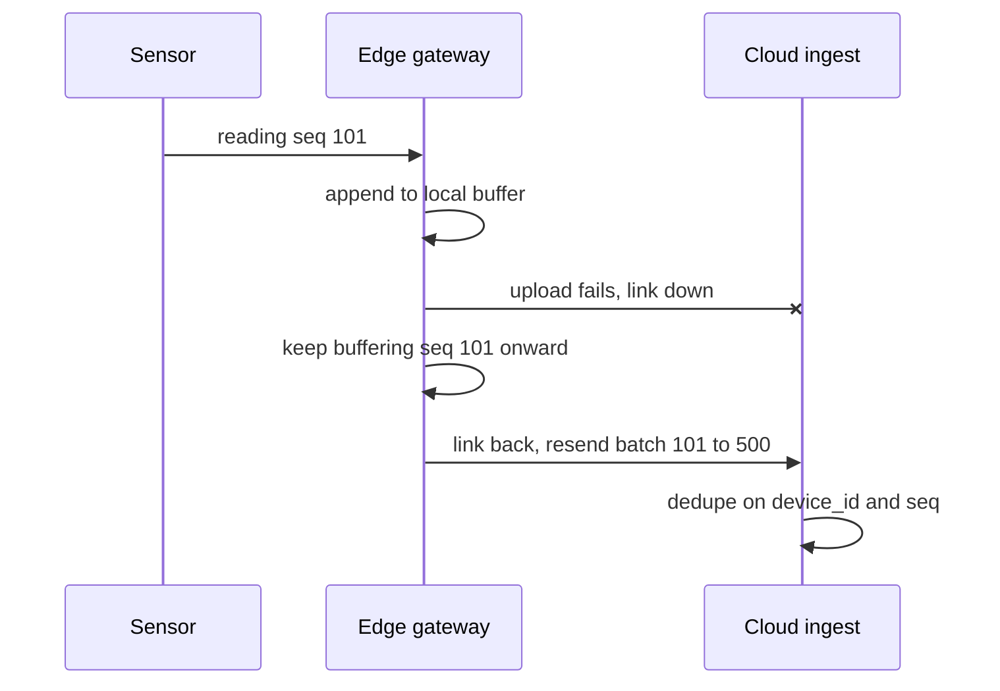

## 🎯 TL;DR

> An IoT platform is a **high-volume, append-mostly time-series pipeline**. Millions of small readings arrive from devices on unreliable networks, must not be lost during outages, and must answer "what did sensor X do between 10:00 and 10:05?" quickly, while years of history stay cheap.

- Size the system from **messages per second, bytes per message, and retention per layer**. Do the arithmetic out loud in the interview.
- **Edge gateways buffer locally** (store-and-forward), so a network outage delays data instead of losing it.
- Ingest through a log (Kafka, or MQTT bridged into Kafka), **partitioned by `device_id`** to keep per-device order.
- Device clocks are untrusted. Keep both `device_ts` (when it happened) and `ingested_at` (when we got it), and dedupe on `(device_id, seq)`.
- Serve recent data from a time-series-friendly store, keep history in a lakehouse table, and precompute rollups for dashboards.

## 🌱 Start simple (Junior)

> **💡 Analogy:** A network of weather stations. Each station writes a line in its logbook every 10 seconds. When the radio link is down, it keeps writing into its local logbook and reads the missing lines out later. The central office must put all logbooks in order, keep the recent ones easy to find, and archive the old ones in a cheap room.

### 1. Problem statement

A manufacturer runs **200,000 sensors** (temperature, vibration, pressure, power) across 40 plants. Each sensor sends a reading every 10 seconds. Design the data platform that:

- ingests the readings,
- shows live dashboards with less than 1 minute of delay,
- supports analytics over years of history,
- survives plant internet outages of up to 72 hours without losing data.

### 2. Functional requirements

- Ingest readings from sensors through an edge gateway in each plant.
- Query the last N minutes for one device, or one plant, with low latency.
- Query history for any device and metric over an arbitrary date range.
- Maintain rollups (5-minute and daily aggregates) for dashboards and reports.
- Keep a device registry (plant, model, unit of each metric) to interpret raw values.

### 3. Non-functional requirements

- **Freshness:** p95 under 60 seconds from sensor to dashboard.
- **Durability:** no loss after an outage of up to 72 hours. Delivery is at-least-once at the edge, and the platform makes the result effectively-once with dedupe.
- **Peak:** design for 3 times the average rate (reconnect bursts after an outage).
- **Retention:** raw readings 30 days hot (fast queries) and 2 years in the lake; rollups 5 years.
- **Cost:** storage is the dominant bill, so compression and tiering are first-class requirements.

## 🔧 How it really works (Mid)

### 4. Estimation

All numbers below are assumptions to state out loud, then check with the interviewer.

| Quantity | Arithmetic | Result |
|---|---|---|
| Average message rate | 200,000 sensors / 10 s | **20,000 msg/s** |
| Message size | one JSON message, 5 metrics | **200 B** |
| Average ingest bandwidth | 20,000 × 200 B | **4 MB/s** |
| Raw volume per day | 4 MB/s × 86,400 s | **345.6 GB/day** (JSON) |
| Columnar size per day | 345.6 GB / 8 (assumed Parquet + zstd gain) | **≈ 43 GB/day** |
| Peak rate | 3 × 20,000 | **60,000 msg/s** (12 MB/s) |
| Metric points per second | 20,000 × 5 metrics | **100,000 points/s** |
| Hot store (30 days) | 30 × 43.2 GB | **≈ 1.3 TB** |
| 5-minute rollup rows per day | 200,000 × 5 metrics × 288 buckets | **288 M rows/day** (≈ 11.5 GB at 40 B/row) |
| Edge buffer per gateway | 500 sensors × 8,640 msgs/day × 200 B = 864 MB/day | **≈ 2.6 GB for 72 h** |

The gateway number matters most in the interview: a 72-hour outage is a disk-sizing problem at the edge, not a cloud problem.

### 5. Data model

Store one row per **reading and metric**, not one wide row per message, so new metrics do not change the schema:

```sql
CREATE TABLE readings
(
    device_id    UInt64,
    seq          UInt64,              -- per-device sequence number from the sensor
    ts           DateTime64(3, 'UTC'), -- device time (untrusted)
    metric       LowCardinality(String),
    value        Float64,
    ingested_at  DateTime64(3, 'UTC') DEFAULT now64(3)
)
ENGINE = ReplacingMergeTree(ingested_at)
PARTITION BY toYYYYMMDD(ts)
ORDER BY (device_id, metric, ts, seq);
```

`ReplacingMergeTree` removes duplicates with the same sorting key **eventually, during background merges**. Until a merge runs, a query can still see duplicates, so either read with `FINAL` or aggregate in a way that is duplicate-safe. Check the engine docs for your version before relying on exact merge timing.

A rollup query for dashboards:

```sql
SELECT device_id, metric,
       toStartOfFiveMinutes(ts) AS bucket,
       avg(value) AS avg_v,
       max(value) AS max_v
FROM readings FINAL
WHERE ts >= now() - INTERVAL 1 DAY
GROUP BY device_id, metric, bucket;
```

### 6. High-level design



Each stage has one job. The gateway absorbs outages. Kafka decouples the bursty producers from the consumers and keeps the replay log. The stream job cleans and dedupes. The hot store serves the last 30 days. The lakehouse keeps cheap history, and rollups serve the dashboards.

The outage path is the one interviewers ask about:



### 7. Edge buffering with a bounded disk

A gateway needs a durable local queue. A minimal store-and-forward loop with SQLite:

```python
import json
import sqlite3

db = sqlite3.connect("buffer.db")
db.execute("""CREATE TABLE IF NOT EXISTS outbox (
    seq INTEGER PRIMARY KEY, payload TEXT, sent INTEGER DEFAULT 0)""")

def record(seq: int, reading: dict) -> None:
    # seq is unique per gateway in this sketch; INSERT OR IGNORE keeps a retry harmless
    db.execute("INSERT OR IGNORE INTO outbox (seq, payload) VALUES (?, ?)",
               (seq, json.dumps(reading)))
    db.commit()

def flush(send, batch: int = 500) -> None:
    rows = db.execute(
        "SELECT seq, payload FROM outbox WHERE sent = 0 ORDER BY seq LIMIT ?",
        (batch,)).fetchall()
    for seq, payload in rows:
        send(json.loads(payload))  # the server must dedupe: a crash after send re-sends
        db.execute("UPDATE outbox SET sent = 1 WHERE seq = ?", (seq,))
        db.commit()
```

Two rules make this safe. The gateway writes locally **before** it acknowledges the sensor. The server dedupes, because a crash between `send` and the `UPDATE` causes a resend. Add a size cap and a drop policy (for example, drop the lowest-priority metric first) so a long outage cannot fill the disk silently.

## 🧠 Senior depth & trade-offs

### 8. Deep dive: high-frequency ingestion

- **Partition by `device_id`.** All readings of one device land in one Kafka partition, so their order is preserved and the stream job can keep per-device state. The cost is hot partitions if one plant has most of the traffic. Use a key with more spread (for example `device_id` hashed) and check the per-partition rate, not just the total.
- **Batch at the edge, not in the cloud.** Each message is 200 bytes; a Kafka record per reading is wasteful. Gateways batch 100 to 500 readings per produce request.
- **Backpressure.** When consumers lag, Kafka retains the data (up to the retention limit) and the edge keeps buffering. Watch consumer lag and the gateway disk, both leading indicators. See [[consumer-lag]] and [[backpressure]].
- **Dedupe.** At-least-once delivery plus dedupe on `(device_id, seq)` gives an effectively-once result. Dedupe in the stream job with keyed state and a bounded time window, or rely on the sink's merge semantics. Exactly-once across the whole path is rarely needed and expensive; say so.

### 9. Deep dive: time-series storage

- **Sort key first.** `ORDER BY (device_id, metric, ts)` makes "one device, one metric, last hour" a short range scan. A sort key of `ts` alone would scatter one device across the whole table.
- **Cardinality.** The number of distinct `(device_id, metric)` pairs drives index size and rollup count. Never use per-request IDs or free-text tags as labels; they explode the series count. Keep metric names in a small enum (`LowCardinality`).
- **TTL and tiering.** Drop or move raw data after 30 days from the hot store; the lake keeps the history. Rollups have longer retention than raw data.
- **Downsampling.** A dashboard for one month should read the 5-minute rollup. For one device and one metric, a month has 30 × 8,640 = 259,200 raw readings but only 30 × 288 = 8,640 five-minute buckets. Pick the rollup grain from the query, not from the sensor.

### 10. Deep dive: time, late data and clocks

- Device clocks drift and sometimes reset. Store `device_ts` for analysis, but partition the lake by **ingestion date** or by a bounded event-time window, and say which one you chose.
- A gateway that reconnects after 72 hours delivers 3 days of late data. The stream job uses a **watermark** with allowed lateness, and anything later goes to a **reprocessing** path (backfill the affected hour or day). See [[watermark]] and [[late-arriving-data]].
- Rollups that are already published must be **corrected**, not silently changed. Recompute the affected buckets and record the revision.

### 11. Operations

Monitor, per plant: messages received against expected count (a gap means a dead gateway or a dead link), gateway buffer fill, Kafka consumer lag, quarantine rate, and freshness (max `ts` per plant against now). The silent failure is a sensor that stops sending; alert on missing data, not only on bad data.

## 🧪 Try it

Take the same 200,000-sensor fleet and change one assumption: the sensors now send every **2 seconds** instead of every 10 seconds. Recompute the table and answer:

1. What is the new average message rate, bandwidth and raw volume per day?
2. What is the compressed daily volume with the same 8× assumption, and the hot 30-day size?
3. Which single design element would you change first, and why?

<details><summary>Show solutions</summary>

**1.** 200,000 / 2 s = **100,000 msg/s**. Bandwidth = 100,000 × 200 B = **20 MB/s**. Raw per day = 20 MB/s × 86,400 s = 1,728 GB ≈ **1.73 TB/day** (JSON).

**2.** 1,728 GB / 8 ≈ **216 GB/day** compressed. Hot 30 days = 30 × 216 GB ≈ **6.5 TB**.

**3.** The gateway buffer grows five times faster per device (1 message per 2 s), so a 72-hour outage needs about 13 GB per 500-sensor gateway instead of 2.6 GB. The first change is the edge disk and the drop policy. The cloud side also grows 5 times, so the hot store needs a shorter raw TTL or a larger rollup share.

</details>

## 💬 Interview corner

**Interviewer question:** "Design the ingestion for 200,000 sensors that sometimes lose the network for hours."

- **Mid answer:** "Sensors publish to Kafka, a Spark job writes to a table, and dashboards query the table. I'd buffer on the device if it has space."
- **Senior answer:** "I start with the rates: 20,000 messages per second, 4 MB/s, about 350 GB a day raw. The gateway must buffer 72 hours, which is about 2.6 GB per 500 sensors, and it must write locally before it acknowledges. Kafka is partitioned by device to keep order. The stream job dedupes on device and sequence number, because retries are normal. Device timestamps are untrusted, so I keep ingestion time too and use a watermark to decide when a window is closed."

**Expectations per level**

- **Mid:** a correct pipeline with the right components, a sensible partition key, and basic arithmetic.
- **Senior:** estimates with a stated gap factor, outage and replay design, idempotent dedupe, rollups by query pattern, and monitoring of silent failures.
- **Staff:** cost model and tiering over years, multi-region or regulated data residency, schema evolution for thousands of device models, and an operating model for firmware and unit changes.

**Follow-ups to expect**

- "A plant has a hot sensor sending 10 times more data. What breaks?" (Hot partition; split the key or give that device a dedicated partition range.)
- "How do you handle a firmware update that changes the unit from Celsius to Fahrenheit?" (Versioned metric definitions in the registry; never overwrite history; convert at read time or in a versioned view.)
- "Do you need exactly-once end to end?" (Usually no. At-least-once plus idempotent merge gives the same result for these aggregates.)

> **🎤 Say this in the interview:** "I size first: messages per second, bytes per message, and retention per layer. Then I push durability to the edge with a bounded local buffer, ingest through a log partitioned by device, and dedupe on device and sequence. Recent data sits in a time-series store and history in a lakehouse, with rollups matched to the dashboards."

## ⚠️ Common mistakes

> **⚠️ Watch out:** Trusting the device clock. A sensor with a wrong date will write data into 2019 or 2099. Validate and quarantine out-of-range timestamps, and keep ingestion time.

- Forgetting the edge. Designing only the cloud side makes a 72-hour outage a data loss problem.
- Putting one reading per Kafka record with no batching, then being surprised by broker cost.
- Choosing the sort key `ts` only, so every device query scans the whole time range.
- Keeping raw data forever in the hot store. Retention is a design decision, not a default.
- Using unbounded tags (request IDs, free text) as metric labels.
- Promising exactly-once end to end without naming the sink's dedupe mechanism.
- Alerting on bad values but not on missing data.

## ✅ Check yourself (quiz)

1. A plant of 5,000 sensors reports every 10 seconds, and each message is 200 bytes. What is the average bandwidth?
   - A) 100 KB/s
   - B) 1 MB/s
   - C) 10 MB/s
   - D) 100 MB/s

<details><summary>Answer</summary>

**A** — 5,000 / 10 = 500 msg/s; 500 × 200 B = 100,000 B = 100 KB/s. Option B would need 5,000 msg/s, which is 10 times more.

</details>

2. Why partition the Kafka topic by `device_id` rather than by a random key?

   - A) Random keys are not allowed for JSON messages
   - B) It keeps each device's readings in one partition, so their order is preserved and per-device state works
   - C) It makes the broker store data without replication
   - D) It removes the need for dedupe

<details><summary>Answer</summary>

**B** — ordering is guaranteed only within a partition. A random key scatters one device across partitions, and then "the previous reading" is not well defined.

</details>

3. The gateway resends 72 hours of data after reconnecting. Which mechanism makes the result correct in the warehouse?

   - A) Turning off retries on the gateway
   - B) Deduplicating on `(device_id, seq)` and writing with an idempotent merge or a keyed upsert
   - C) Using `ORDER BY ts` in the table
   - D) Increasing the Kafka retention to 1 day

<details><summary>Answer</summary>

**B** — at-least-once delivery produces duplicates by design. A stable key plus an idempotent write makes replays harmless. Retention and ordering do not fix duplicates.

</details>

4. **(Senior)** A dashboard for one month of one device's temperature is slow. The table has 30 days of raw readings. What is the best change, and what does it cost?

   - A) Add more CPU to the hot store
   - B) Serve the month from a 5-minute rollup and keep raw data only for the recent window; it costs extra storage and a rollup job that must be corrected when late data arrives
   - C) Remove `device_id` from the sort key
   - D) Use `SELECT *` so the engine can cache the data

<details><summary>Answer</summary>

**B** — the query reads 8,640 buckets instead of 259,200 raw readings. The trade-off is the rollup pipeline and its correction path for late data. Adding CPU hides the problem; removing `device_id` from the sort key makes it worse.

</details>

5. **(Senior)** Why is `ORDER BY (device_id, metric, ts)` a better sort key than `ORDER BY ts` for this workload?

   - A) `ts` cannot be sorted
   - B) The common query filters by device and metric; a sort key that starts with them turns the query into a short range scan instead of a scan across the whole time range
   - C) Sort keys do not affect scans
   - D) Because `ts` is always unique

<details><summary>Answer</summary>

**B** — the sort key defines the physical layout. Queries that match its prefix read few granules or blocks. The trade-off is that queries by time alone across all devices get less benefit, which is why partitioning by day also matters.

</details>

## 🗂️ Flashcards

| Front | Back |
|---|---|
| First step in any sizing answer | Messages per second, then bytes per message, then retention per layer |
| Why buffer at the edge | Outages delay data instead of losing it; the gateway writes locally before it acknowledges |
| Kafka key for sensor data | `device_id`, so one device's order is kept in one partition |
| Duplicate-safe identity of a reading | `(device_id, seq)` from the sensor |
| Why keep `ingested_at` | Device clocks drift or reset; ingestion time is the trusted fallback |
| `ReplacingMergeTree` gotcha | Duplicates are removed during merges, not on insert; read with `FINAL` or handle duplicates in the query |
| Watermark in a stream job | The point after which late events are no longer waited for; later data goes to reprocessing |
| Silent sensor failure | Missing data, which needs its own alert separate from bad values |

## 🔗 Go further

- Read **time-series-db** for storage engines built for this workload, and **realtime-olap** for serving queries on fresh data.
- **delivery-semantics** explains why at-least-once plus dedupe is the usual answer.
- **pattern-late-data** and **design-metrics-monitoring** cover the late-data and rollup mechanics in more depth.
- **design-log-platform** applies the same method to a different high-volume ingestion problem, which makes a good second exercise.
- Vendor or company write-ups about industrial IoT platforms differ a lot in their numbers. Use this lesson's arithmetic as the method, and check any real figure against the original post.
