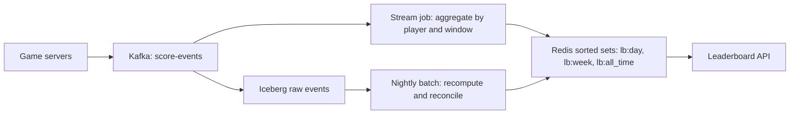

## 🎯 TL;DR

> Design a leaderboard as **two problems**: a fast **ranking store** that answers "what is my rank and who is above me" in milliseconds, and a **batch or stream pipeline** that makes the scores correct, auditable and reproducible.

- Use a **Redis sorted set** (one member per player, score = points) for the live "top N" and "my rank" reads.
- Model **time windows** (daily, weekly, all-time) as separate keys with their own TTLs, and reset by creating a new key, not by deleting members.
- Keep the **raw score events** in a log or lake table. The sorted set is a derived view you can rebuild.
- Be explicit about **ties**, **late events** and **what happens when Redis is lost**.

## 🌱 Start simple (Junior)

**Problem statement.** A mobile game has players who earn points. Show the top 100 players for today, this week and all-time, and show each player their own rank and the players just above and below them. Scores change many times per minute.

> **💡 Analogy:** A school noticeboard that is re-sorted every time a student gets a new mark. You do not want to re-sort the whole school on every change. You want a board that keeps students in order as their marks change, so you can read "the top 10" or "where am I" at once.

**Functional requirements**

- Submit a score change (`player_id`, `points`, `event_time`).
- Read top N for a window (`today`, `this_week`, `all_time`).
- Read one player's rank and score, and neighbours (rank ± 5).
- Windows reset at a fixed time (say, midnight in UTC) without downtime.

**Non-functional requirements**

- Reads: p99 under 50 ms for top N and rank.
- Writes: a score change shows up on the board within about 5 seconds (near real time).
- Correctness: totals must match the sum of the raw events, and a disputed score must be fixable.
- Availability: the board may be a few seconds stale, but it must come back after a node failure without a manual rebuild.

**Estimation (show the arithmetic)**

- Players: 50 million total, 5 million daily active (DAU).
- Score events: 5 per DAU per day → 5M × 5 = 25 million events/day.
- Average write rate: 25,000,000 / 86,400 s ≈ **290 writes/s**.
- Peak (assume 5× average during evening events): 290 × 5 ≈ **1,450 writes/s**.
- Reads are higher: assume 20 reads per DAU per day → 100M reads/day ≈ 1,160 reads/s average, ~6,000/s peak.
- Memory for the all-time sorted set: 50M members × roughly 100 bytes each (member string, score and per-entry overhead, an estimate you must measure with `MEMORY USAGE` on your own key) ≈ **5 GB**. Daily and weekly sets are smaller, because only active players are in them: 5M × 100 B ≈ 0.5 GB each.

The numbers say: one well-sized Redis primary (or a primary with replicas) can handle this read and write load. The hard parts are correctness and windows, not raw throughput.

## 🔧 How it really works (Mid)

**Data model.** Keep two things apart:

| Layer | Store | Purpose | Rebuildable? |
|---|---|---|---|
| Raw events | Kafka topic, then an Iceberg or Parquet table | Source of truth, audit, backfill | Yes (it is the source) |
| Ranking view | Redis sorted set per window key | Fast reads | Yes, from the raw events |

Redis key naming for windows:

```text
lb:all_time                 (no TTL)
lb:week:2026-W41            (TTL: about 8 days after week end)
lb:day:2026-10-13           (TTL: about 2 days after day end)
```

Each sorted set member is a `player_id`, and the score is the points total for that window.

**High-level flow**



**The core Redis commands** (Redis 6.2 or newer, check the docs for your version):

```bash
# Add points to a player in each window (ZINCRBY adds to the existing score)
ZINCRBY lb:day:2026-10-13   25 player:42
ZINCRBY lb:week:2026-W41    25 player:42
ZINCRBY lb:all_time         25 player:42

# Top 10, highest score first, with scores
ZRANGE lb:day:2026-10-13 0 9 REV WITHSCORES

# My rank (0-based, highest first) and my score
ZREVRANK lb:day:2026-10-13 player:42
ZSCORE   lb:day:2026-10-13 player:42

# Neighbours: 5 above and below (ZRANGE by rank index; start = max(rank-5, 0), stop = rank+5)
ZRANGE lb:day:2026-10-13 0 10 REV WITHSCORES   # example with rank = 5, so start 0, stop 10
```

The rank of an existing member is O(log N). Top-N reads are O(log N + N). Both are fast at 50M members on one node, which is why this design is common.

**Windows and resets.** Two patterns are common:

- **Calendar windows (recommended).** One key per day or week. A new day means a new key, so the reset is instant and never touches the old data. Set a TTL on the old keys and let Redis expire them.
- **Sliding windows (for "last 7 days").** Keep daily keys and combine them with `ZUNIONSTORE` into a temporary key on read. This is costly per request. Cache the result for a short time, or precompute it every few minutes in a job.

Do not reset a window by deleting every member, and do not use `ZREMRANGEBYSCORE` to trim a sorted set on each write. Both are long operations on a hot key.

**Ties.** When two players have the same score, Redis orders them lexicographically by member. That is deterministic but not what players expect. If "earlier to reach the score wins" matters, encode the time into the score, for example `score * 10^10 + (MAX_TS - event_time_seconds)`, where `MAX_TS` is a fixed constant in seconds. Earlier events get a larger tie part, so they rank higher. Check that the value stays below 2^53 so the double-precision score is exact. Write this down as a product rule, because it changes what the number means.

**Late and duplicate events.** A mobile client may send the same event twice, or send it an hour late after it was offline. Two rules fix most of this:

1. Give every event a unique `event_id`, and deduplicate in the stream job with a state store that keeps recent IDs for a bounded time (for example, 48 hours). This is [[deduplication]], and it turns at-least-once delivery into an effectively-once result.
2. Assign points to the **window of `event_time`**, not the arrival time, so a late event for yesterday still updates yesterday's board. Allow updates to a closed window for a bounded lateness period, then stop, and let the nightly batch handle the rest. See [[watermark]] and [[late-arriving-data]].

**Recovery.** Redis is a cache of derived state. If a node is lost, the fast path is a replica promoted by failover. The slow path is a rebuild: replay the raw events for the open windows from Kafka or from the lake and write them into a new key, then switch the pointer. Keep the rebuild job tested, because it is what you run on a bad day.

## 🧠 Senior depth & trade-offs

**Deep dive 1: Redis sorted sets.**

- A sorted set is a skip list plus a hash table. You get fast rank and range queries but pay memory per member. Measure memory per member on your data.
- Scores are IEEE double. Integers are exact up to 2^53 (about 9 × 10^15). Beyond that, do not silently pack composite scores.
- Keep the key hot but small. A single key with 50M members is one shard in Redis Cluster. Hot leaderboards cannot be spread across shards by default, so either keep the all-time board on one node with replicas, or split by region or by player-ID range and merge the top N at read time.
- Write amplification: each event does one `ZINCRBY` per window (3 here). Batch in the stream job: sum points per player per 5-second micro-batch, then issue one `ZINCRBY` per player per window.

**Deep dive 2: Windowed resets and the source of truth.**

- The raw log decides the truth. Redis only shows it. If the stream job and Redis disagree, the nightly reconcile job recomputes the window from the lake and rewrites the sorted set under a new key, then flips a pointer in a small config store.
- Keep a **reconciliation metric**: for each window, compare the sum of scores in Redis with the sum from the batch job. Alert when the gap is above a threshold.

**Deep dive 3: Consistency of reads.**

- Redis replication is asynchronous. A player who just scored may not see their own update on a replica. Route rank reads for the current player to the primary, or accept a few seconds of staleness and say so in the design.

**Staff-level expectations.** Staff candidates usually:

- Propose the split between a **fast view** and a **replayable log**, and argue why the view can be thrown away.
- Put a number on the cost of a hot all-time key, and propose a shard strategy with a merge step.
- Name the anti-cheat boundary: the leaderboard trusts whatever the score service accepts, so validation (rate limits, signed events, server-side rules) must happen before the event enters Kafka.
- Plan for the big event: a seasonal launch can give 10× traffic. Pre-create keys, pre-warm, and rate-limit writes per player.

**When not to use Redis.** If the board is only read once a day for a report, a SQL `ORDER BY score DESC LIMIT 100` over a summary table is enough and much simpler. Use Redis when the same board is read thousands of times per second and changes constantly.

## 🧪 Try it

1. **Rank arithmetic.** Player 42 has rank 0 (first). Write the `ZRANGE` call for "the player above and the player below me" when rank 0 has no one above. Explain how you handle the edge case.
2. **Window math.** Your daily key expires two days after the day ends. A late event for 2026-10-13 arrives on 2026-10-15 at 10:00 UTC. What happens to the board, and what does the batch job do?
3. **Tie-break encoding.** Propose a score encoding so that equal points are ranked by the earlier `event_time`. State the maximum points value your encoding supports before doubles lose precision.

<details><summary>Show solutions</summary>

**1.** Use the rank `r` from `ZREVRANK`. The window is `ZRANGE key MAX(r-1,0) r+1 REV WITHSCORES`, so you get the player and up to one neighbour on each side. For rank 0, `MAX(r-1,0)` keeps the start at 0, and the result contains only you and the player below. Clamp at both ends.

**2.** The stream job only accepts late events up to the allowed lateness (say, 48 hours) for the day's window. Two days after the window ends, the key may already be expired, so the increment would create a new, mostly empty key. Correct behaviour: drop the event from the live path, keep it in the raw log, and let the nightly batch recompute the affected window from the lake. Alert on the count of events dropped this way.

**3.** Use `score * 10^10 + (MAX_TS - event_time_seconds)` where `MAX_TS` is a fixed constant in seconds. The tie part is below 10^10 (about 300 years of seconds), so the composite is exact only while `score * 10^10` stays below 2^53 (about 9.0 × 10^15). That limits `score` to roughly 900,000 points. If points can be larger, split the score into two sorted sets or use a tie part with coarser resolution.

</details>

## 💬 Interview corner

**Question: "Design a real-time leaderboard."**

- **Mid answer:** "I'd store scores in a Redis sorted set and use `ZINCRBY` on each event. Top N is `ZREVRANGE`, rank is `ZREVRANK`. For daily and weekly boards I'd use one key per window with a TTL."
- **Senior answer:** "Redis is the fast view, and the raw events in Kafka and the lake are the truth. Each window is its own key, so resets are instant. I'd dedupe on `event_id`, assign points to `event_time`, and run a nightly reconcile that rebuilds the windows and compares totals. I'd call out tie-breaking and the hot all-time key as the two things that need product decisions."
- **Staff answer:** adds the cost model (writes per second, memory per member), the failover and rebuild runbook, the anti-cheat boundary, and the trade-off between sliding and calendar windows.

**Follow-ups to expect**

- What if Redis loses data? (Rebuild from the log, see "Recovery".)
- How do you show a player's rank among friends? (A separate sorted set per friend group, or compute ranks from a friend list in the API. Do not build a sorted set per user.)
- How would you scale to 10× players? (Shard by region or by ID range with a merge step for the top N, or move the all-time board to a store that sorts on disk.)

> **🎤 Say this in the interview:** "The leaderboard is a derived view over an event log. I keep reads fast with Redis sorted sets and per-window keys, and I keep correctness with deduplication, event-time windows and a nightly reconcile against the lake. The two product decisions I'd confirm first are tie-breaking and how late events are treated."

## ⚠️ Common mistakes

> **⚠️ Watch out:** Treating Redis as the only copy of the scores. Without the raw log you cannot audit, rebuild or fix a disputed score.

> **⚠️ Watch out:** Resetting a daily board by deleting members, instead of switching to a new key. The delete is slow on a hot key and creates a window where the board is half-empty.

- Using arrival time instead of event time, so late events land in the wrong window.
- Forgetting deduplication, so a retried event adds points twice.
- Ignoring ties. The board order for equal scores then depends on player ID, which players notice.
- Packing a composite score into a double without checking the 2^53 limit.
- Sending one `ZINCRBY` per event to a hot key instead of batching per player per micro-batch.
- Designing a sorted set per user for friend rankings. That creates millions of tiny keys and is hard to maintain.

## ✅ Check yourself (quiz)

1. Which Redis command returns a player's rank in a highest-first sorted set?
   - A) `ZRANK`
   - B) `ZREVRANK`
   - C) `ZSCORE`
   - D) `ZCOUNT`

<details><summary>Answer</summary>

**B** — `ZREVRANK` ranks members from highest score to lowest (0-based). `ZRANK` ranks from lowest. `ZSCORE` returns the score, not the rank, and `ZCOUNT` counts members in a score range.

</details>

2. A daily leaderboard must reset at midnight without downtime. What is the best approach?
   - A) Run `DEL` on the key at midnight
   - B) Run `ZREMRANGEBYRANK` on all members at midnight
   - C) Start writing to a new key named with the new date and let the old key expire by TTL
   - D) Restart Redis at midnight

<details><summary>Answer</summary>

**C** — a new key is an instant switch, and the old data is removed by expiry. Deleting or trimming a large hot key blocks Redis and leaves the board half-empty during the operation.

</details>

3. An event is retried by the mobile client and arrives twice. Which mechanism prevents double-counting?

   - A) A larger Kafka partition count
   - B) Deduplication on a unique `event_id` in the stream job, with a bounded state retention
   - C) Setting Redis to `appendonly yes`
   - D) Using `ZADD` instead of `ZINCRBY`

<details><summary>Answer</summary>

**B** — the producer may retry, so consumers see duplicates. A stateful dedupe keyed on `event_id` (kept for a bounded window) makes the increment effectively once. `ZADD` with a score would overwrite instead of adding, which is a different bug.

</details>

4. **(Senior)** Your all-time sorted set has 50M members and one shard is at 100% CPU during the launch event. What are two concrete options, and what does each cost?

   - A) Add more `DEL` calls to free memory
   - B) Split by region or player-ID range into several sorted sets and merge the top N at read time (costs: a merge on read and a harder global rank); or move the high-write path to a batched job that updates the board every few seconds (costs: staleness)
   - C) Turn off replication
   - D) Replace the sorted set with a list

<details><summary>Answer</summary>

**B** — splitting spreads write load but makes exact global rank expensive, because you must combine counts across shards. Batching reduces write rate but makes the board less fresh. Both are real trade-offs, and the interviewer wants you to name them.

</details>

5. **(Senior)** Why is the nightly reconcile job more important than the stream job's correctness for a disputed score?

   - A) Redis cannot store integers
   - B) The stream job may have already applied an event that was later found invalid; only a recompute from the immutable raw log can produce an auditable, corrected total
   - C) Batch jobs are always faster than streams
   - D) The stream job never handles late events

<details><summary>Answer</summary>

**B** — streaming state is incremental, so an invalidated event has already moved the totals. Recomputing the window from the raw log (with the rule set as of that run) gives a result you can explain and reproduce, which is what dispute handling needs.

</details>

## 🗂️ Flashcards

| Front | Back |
|---|---|
| Core Redis structure for a leaderboard | Sorted set: member = player, score = points |
| `ZINCRBY` vs `ZADD` for points | `ZINCRBY` adds to the score; `ZADD` overwrites it |
| How to reset a daily board safely | Write to a new date-keyed key; expire the old one with a TTL |
| Rank of a player, highest first | `ZREVRANK` (0-based) |
| Which timestamp decides the window for a late event | Event time, not arrival time |
| Limit for exact integer scores in a double | 2^53 (about 9 × 10^15) |
| Source of truth for the leaderboard | The raw event log; Redis is a rebuildable view |
| Why one key per window, not one global key | Resets are instant and old windows expire without touching hot data |

## 🔗 Go further

- Related design lessons: [[design-top-k]] (approximate top-K with sketches, when exact sorted sets are too costly) and [[design-unique-counts]].
- Stream semantics behind the dedupe and late-event rules: [[delivery-semantics]] and [[kafka-exactly-once]].
- Replay and reconcile patterns: [[backfills]].
- Read the Redis documentation for sorted sets and check the exact command syntax (for example `ZRANGE ... REV`) for your server version.
