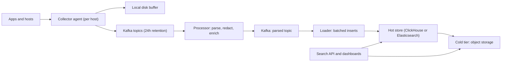

## 🎯 TL;DR

> Design a platform that **collects logs from every host and service**, buffers them so a slow store never loses data, makes them searchable by service, level, time and text, and deletes them on a retention schedule that the business can afford.

- Collect at the edge with a lightweight agent that keeps a **local disk buffer**.
- Put a **Kafka buffer** between collectors and storage, so the store can fail or slow down without losing events.
- Pick the store by **query pattern**: full-text search (inverted index, e.g. Elasticsearch) or aggregation-heavy analytics over structured fields (columnar, e.g. ClickHouse).
- Retention is a **cost decision with tiers**: hot SSD for days, cheaper storage for weeks, object storage for months.

## 🌱 Start simple (Junior)

> **💡 Analogy:** A post office for a whole city. Every house (host) drops letters (log lines) into a local box (the collector's disk buffer). Trucks collect the boxes and drop them at a central sorting hub (Kafka). The hub sorts letters into shelves (indexes and partitions) so a clerk can find "all letters from the cart service with errors, last hour" quickly. Old letters move to a warehouse and are finally shredded on a schedule.

A log line is an event with a timestamp and a message, and usually some fields:

```text
2026-10-13T09:14:02.381Z level=ERROR service=cart host=node-17 trace_id=9f1c message="payment timeout after 3000ms"
```

**The problem statement** we design for:

> Hundreds of services on thousands of hosts write logs. Engineers search recent logs during incidents, build error-rate charts, and need logs kept for 14 days hot and 90 days cold. Logs must not be lost when the search cluster is down for an hour.

**Functional requirements**

- Collect log lines from files, stdout of containers and applications that send over HTTP or a protocol like OTLP.
- Search by time range, service, level, host and free text (`"payment timeout"`).
- Aggregate: counts per minute, error rates, top messages.
- Retention per team, with a way to delete data for a legal or privacy reason.

**Non-functional requirements**

- Durability: an acknowledged event is not lost when one component fails.
- Freshness: p95 under 10 seconds from emit to searchable during normal operation.
- Search latency: last hour, one service, p95 under 2 seconds.
- Degrade gracefully: when storage is slow, drop low-value logs (debug) before high-value logs (errors).

**Estimation (show the arithmetic)**

- Hosts and services produce an average of **300,000 lines per second**, with peaks at 3× = **900,000 lines per second**.
- Average line size: **400 bytes**. Average raw rate: 300,000 × 400 B = **120 MB/s**. Peak: **360 MB/s**.
- Raw per day: 120 MB/s × 86,400 s = 10.4 TB/day.
- Columnar compression at about **8×** for logs (an assumption to verify on real data): 10.4 TB / 8 = **1.3 TB/day** stored.
- Hot tier, 14 days: 1.3 TB × 14 = **18.2 TB**. With 2 replicas: **36.4 TB** of SSD.
- Cold tier, 90 days in object storage with erasure coding (no full replicas, about 1.3× overhead): 1.3 TB × 90 × 1.3 = **152 TB**, or about 117 TB before the overhead.
- Kafka buffer for 24 hours: 10.4 TB raw per day. With producer compression at about 4×: 2.6 TB per copy, × 3 replicas = **7.8 TB**. Without compression it is 31 TB, which is why compression is a design choice.

> **⚠️ Watch out:** Every compression ratio here is an assumption. Say so, and say how you would measure it: take a day of real logs, compress a sample, and compare.

## 🔧 How it really works (Mid)

**High-level design.**



**Collectors.** Run one agent per host (a DaemonSet in Kubernetes). Fluent Bit, Vector, Filebeat and the OpenTelemetry Collector are common choices. Each agent tails files or container stdout, attaches metadata (namespace, pod, service, host), batches lines, compresses them and sends them to Kafka. If Kafka is unreachable, it writes batches to its **local disk buffer** and retries with backoff. That disk buffer is the first line of backpressure: the host keeps its logs for hours instead of losing them.

**Kafka as the shock absorber.** Kafka sits between producers and the store for three reasons:

1. **Decoupling.** The search cluster can be upgraded or rebuilt while collectors keep writing.
2. **Replay.** If a loader has a bug that corrupts a day of data, you reset its consumer offset and reprocess the topic (the retention window is the replay budget).
3. **Fan-out.** The same stream can feed the search store, a metrics extractor and an archive, without touching the hosts.

Partition by a stable key such as `service` or `host` to keep one source's events together. Order across hosts is not required for logs, so do not pay for global order. Size partitions so that each one carries a few megabytes per second at peak, and make sure the partition count is high enough for the number of consumers you will run.

**Processing.** A processor (Flink, Kafka Streams or a simple consumer service) parses messages into fields, normalizes timestamps to UTC, drops or masks sensitive fields (card numbers, tokens) before data reaches long-term storage, and routes lines to topics by tenant. Parse errors go to a **dead-letter topic** with the raw line, not to `/dev/null`.

**Choosing the store.** This is the design decision interviewers care about most.

| Need | Elasticsearch-style inverted index | ClickHouse-style columnar store | Label-only index (e.g. Loki) |
|---|---|---|---|
| Free-text search on rare terms | Strong | Good with token skip indexes, slower on rare terms | Weak (scans chunks) |
| Aggregations (counts per minute) | Good, costly at scale | Very strong | Limited |
| Storage cost | Higher (index plus raw) | Low (columnar compression) | Lowest (chunks in object storage) |
| Operations | Heap tuning, shard management | Schema and merge tuning | Simple, but query cost depends on label design |

**A ClickHouse example.** Structured fields become columns; the message stays a string with a token skip index:

```sql
CREATE TABLE logs (
    ts       DateTime64(3),
    service  LowCardinality(String),
    level    LowCardinality(String),
    host     String,
    trace_id String,
    message  String,
    attrs    Map(String, String),
    INDEX msg_tok message TYPE tokenbf_v1(32768, 3, 0) GRANULARITY 4
) ENGINE = MergeTree
PARTITION BY toYYYYMMDD(ts)
ORDER BY (service, level, ts)
TTL toDateTime(ts) + INTERVAL 14 DAY DELETE;

-- Error count per minute for one service, last hour
SELECT toStartOfMinute(ts) AS minute, count() AS errors
FROM logs
WHERE service = 'cart' AND level = 'ERROR' AND ts >= now() - INTERVAL 1 HOUR
GROUP BY minute
ORDER BY minute;
```

The `ORDER BY (service, level, ts)` key lets the query skip most of the data for this filter. `LowCardinality` stores repeated strings as dictionary codes. `PARTITION BY` by day makes retention a cheap partition drop rather than a row-by-row delete.

**Loader behaviour.** Loaders write in **large batches**. ClickHouse creates a new data part per insert, and background merges must combine them. Many tiny inserts create too many parts and slow the cluster. Batch by size and time (for example, flush at 10,000 rows or every 5 seconds, whichever comes first). Elasticsearch has the same principle through its bulk API.

## 🧠 Senior depth & trade-offs

**Delivery semantics.** Collectors retry, so a log line can arrive twice. Treat the pipeline as **at-least-once** and make the write idempotent: each event gets an ID (for example, a hash of host, file inode, offset, and line number), and the store or a dedup step drops duplicates. ClickHouse can drop identical retried insert blocks on replicated tables, but do not rely on that alone, because a changed batch is not identical. Elasticsearch can take a document ID to overwrite instead of duplicate. Exactly-once for logs is usually not worth its cost.

**Backpressure and what to drop.** Under overload, the chain of buffers fills from the bottom: the store slows, Kafka consumer lag grows, the collector's disk buffer fills. Plan the order of loss on purpose: first drop `DEBUG` and sampled `INFO`, then cap per-host rate, and never drop `ERROR` without an alert. Monitor consumer lag in time, not bytes: "the lag is 40 minutes" is a clear freshness statement.

**Schema drift.** Developers add new fields every week. If each new JSON key becomes a column, the table explodes and merges slow down. Keep a fixed set of promoted columns (service, level, host, trace_id) and store the rest in a `Map` or a JSON column. Promote a field to a column only when queries filter on it often. This is the same cardinality lesson as in metrics, and it applies to logs too.

**Retention tiers and deletion.**

- **Hot:** SSD, 7 to 14 days, replicated. Serves incident search.
- **Warm:** cheaper disks, 30 to 60 days, read-mostly.
- **Cold:** object storage, months, queried less often through a slower path or rehydrated on demand.

Delete with partitions (drop a day) rather than row deletes, which rewrite data. Per-tenant retention is a configuration on the tier boundaries, not separate pipelines. For a privacy deletion request, the pragmatic answer is to mask at the processor before storage, and to purge the affected partitions or re-run a filtered copy for the rare hard cases.

**Sizing the Kafka buffer.** A 24-hour buffer at 120 MB/s average is about 10 TB raw per day, or 31 TB at replication factor 3 with no compression. That cost is the price of replay and of surviving a multi-hour store outage. Shorter retention (for example, 6 hours) is a reasonable compromise when the store is reliable. Make the number a decision you can justify, not a default.

**Security and data residency.** Logs often contain personal data and secrets. Redact at the source where possible (the collector), again in the processor, and restrict who can search which tenant. If the company runs on-premises, the whole pipeline stays inside its network, and the object store is a local system such as MinIO or a Ceph-based store.

**Failure modes to rehearse.**

- A collector loses its disk and buffered logs. Accept this, and alert on the gap by comparing expected and received counts per host.
- A poisoned message (a huge line, a bad encoding) breaks a loader. Cap line size at the collector and send bad records to the dead-letter topic.
- A hot partition: one noisy service writes 50% of the volume. Per-service rate limits at the collector protect the others.
- Merge storm after a backfill. Throttle the loader during reprocessing.

**When not to build this.** A small company with a few services can start with a managed log service. The design above is worth building when log volume makes per-GB pricing dominant, when data must stay on premises, or when the same stream must feed analytics and search.

**Operating signals:** freshness per tenant, consumer lag in time, collector buffer usage, rejected or dropped lines by level, parse error rate, store insert latency, part count per table, and disk usage per tier.

## 🧪 Try it

Size the platform for these inputs: 600,000 lines per second average, 500 bytes per line, peak at 2× average, 7× compression, hot retention 7 days with 2 replicas, cold retention 60 days.

1. What is the average raw data rate in MB/s and the raw TB per day?
2. What is the stored size per day after compression, and the hot-tier size with replicas?
3. Your loader inserts one row per request (about 5,000 rows per second, one insert each). Explain what breaks and how you would change it.

<details><summary>Show solutions</summary>

**1.** 600,000 × 500 B = 300 MB/s. 300 MB/s × 86,400 s = 25.9 TB/day (about 26 TB).

**2.** 25.9 TB / 7 ≈ **3.7 TB/day**. Hot tier: 3.7 TB × 7 days = 25.9 TB, × 2 replicas = **about 52 TB**.

**3.** Each insert creates a new data part, so 5,000 small inserts per second create thousands of parts per second. Background merges fall behind, reads slow down, and the cluster spends its time merging. Fix it by batching: collect rows for a few seconds or tens of thousands of rows per insert, and let the loader flush by size or time. Add a dedicated async insert or a buffer stage if the store supports it.

</details>

## 💬 Interview corner

**How it is asked:** "Design a log aggregation platform, like the ELK stack or Loki." Expect questions about the store choice, backpressure and retention cost.

**Mid-level answer:** "Each host runs a collector with a local buffer. Logs go through Kafka to a processor that parses and redacts them, then into a search store. I'd use Elasticsearch for full-text search, or ClickHouse if the main queries are aggregations. Retention is tiered: SSD for two weeks, object storage for three months."

**Senior-level answer:** "I'd estimate first: 300,000 lines per second at 400 bytes is 120 MB/s, about 10 TB a day raw and about 1.3 TB stored with columnar compression. Kafka gives a 24-hour replay buffer and absorbs store outages; collectors keep their own disk buffer. I'd choose the store from the query mix, and I'd promote only a small set of fields to columns so that schema drift does not explode the table. Under pressure I'd drop debug logs first, and I'd monitor freshness as consumer lag in minutes."

> **🎤 Say this in the interview:** "The pipeline is only as durable as its buffers, so I'd place buffers at the host and in Kafka, then decide what to drop when they fill. The store choice follows the queries, and retention is a cost decision expressed as tiers."

**Staff-level signals:** a cost model per GB and per query; a standard log schema across teams; a sampling policy approved by the owners of the services; multi-region collection with regional storage for data residency; and an incident runbook for "logs are missing" that starts with per-host received-versus-expected counts.

**Likely follow-ups.** *Why not store logs in the metrics system?* Logs have high cardinality, free text and per-event detail; metrics pre-aggregate that away. *How do you find all logs for one trace ID across services?* Index `trace_id` as a column or use a skip index, and accept that the query scans recent partitions only. *How do you delete one user's logs?* Mask at ingestion so you rarely need it, and use partition-level deletion or a rewrite job for the exceptions.

## ⚠️ Common mistakes

> **⚠️ Watch out:** Sending logs straight from every host to the search cluster with no buffer. The first outage of the cluster becomes a data-loss incident.

> **⚠️ Watch out:** Indexing every JSON key as a column or field. The mapping or table explodes, and merges and memory costs grow with it.

- Choosing Elasticsearch by default without asking what the queries are, then paying for index storage on data nobody searches.
- Writing one insert per log line into a columnar store.
- Keeping all tiers on SSD forever. Retention without tiers is the largest cost line in most logging bills.
- Treating a dead-letter topic as optional. Bad records must go somewhere you can inspect.
- Assuming exactly-once delivery. Design the event ID and the dedupe path instead.
- Forgetting that logs contain secrets and personal data, and redacting only at query time.

## ✅ Check yourself (quiz)

1. What is the main job of Kafka in this design?
   - A) Store logs forever for search
   - B) Decouple collectors from the store and give a replay window during store outages
   - C) Compress logs to the final storage size
   - D) Parse JSON into columns

<details><summary>Answer</summary>

**B** — Kafka absorbs bursts and outages, lets consumers be rebuilt or replayed, and feeds several consumers from one stream. It is a buffer with a retention window, not the search store.

</details>

2. Which choice best fits a workload dominated by "count errors per minute for each service over the last 30 days"?
   - A) An inverted index on every free-text token
   - B) A columnar store ordered by service and time, with partitions by day
   - C) A flat file per host with grep
   - D) One table per service with no partitioning

<details><summary>Answer</summary>

**B** — aggregations over structured fields with time filters are what columnar stores are built for. Ordering by service and time skips most data, and daily partitions make retention cheap.

</details>

3. Your loader writes one row per insert into ClickHouse and the cluster slows down. What is the root cause and the fix?

   - A) ClickHouse does not support `DateTime64`; use strings
   - B) Each insert creates a data part, and too many small parts overload merges; batch rows by size or time
   - C) Kafka partitions are too few; add more brokers
   - D) The `TTL` clause is missing

<details><summary>Answer</summary>

**B** — many tiny inserts create many small parts that background merges must combine. Batching inserts into larger blocks keeps the part count manageable.

</details>

4. **(Senior)** During a store outage of three hours, you want no data loss. Which buffers must exist, and what is the limiting one?

   - A) Only the search index cache
   - B) The collector's local disk buffer and the Kafka retention window; the limit is whichever fills first, so size both from the outage target
   - C) A second search cluster in the same rack
   - D) Turning off redaction

<details><summary>Answer</summary>

**B** — the collector buffers on disk when Kafka is unreachable, and Kafka retains events while the store is down. Both must cover the outage duration at peak rate, and the smaller one sets the real limit.

</details>

5. **(Senior)** Why is deleting old data by dropping daily partitions preferable to deleting rows with a predicate on `ts`?

   - A) Row deletes are not allowed in columnar stores, so there is no alternative
   - B) Dropping a partition removes whole files without rewriting data, while row-level deletes rewrite data parts and cost merge work
   - C) Partitions compress better
   - D) It keeps logs for longer

<details><summary>Answer</summary>

**B** — columnar stores are optimized for append and bulk operations. A partition drop is a metadata operation on whole files, while row-level deletes rewrite affected parts and add background cost.

</details>

## 🗂️ Flashcards

| Front | Back |
|---|---|
| Why does each host have a disk buffer? | So logs survive Kafka or network outages; it is the first line of backpressure |
| What does Kafka buy you in a log pipeline? | Decoupling, replay within the retention window, and fan-out to several consumers |
| Elasticsearch vs ClickHouse | Inverted index for text search; columnar store for aggregations over structured fields at lower storage cost |
| Why batch loader inserts? | Each insert creates a part; many small parts overload background merges |
| How do you make ingestion safe to retry? | Give each event a stable ID and dedupe; design for at-least-once |
| Why keep few promoted columns? | Schema drift from new JSON keys would explode the table and slow merges |
| Cheapest way to delete old data? | Drop whole partitions rather than delete rows |
| What do you drop first under overload? | Debug and sampled info logs; never silently drop errors |

## 🔗 Go further

- **design-metrics-monitoring** is the companion problem; it shares the ingest path but has a different cardinality and storage story.
- **kafka-architecture** and **kafka-retention-compaction** explain the buffer's partitions, retention and replay in detail.
- **columnar-storage** and **clickhouse** cover why the columnar store compresses and aggregates well.
- **backpressure** and **dlq-bad-records** give the patterns used for overload and poisoned messages.
- **data-retention** covers retention policy design, legal holds and deletion requests.
- Check the current documentation of your chosen search engine for its index options and tiering features, since they change between versions.
