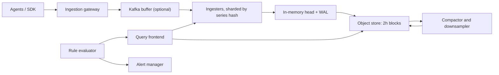

## 🎯 TL;DR

> Design a system that **ingests millions of numeric samples per second**, stores them compactly by time, answers "show me this metric for these labels over the last 6 hours" in under a second, keeps old data at lower resolution, and fires alerts within a minute.

- A **sample** is `(series, timestamp, value)`. A **series** is one metric name plus one unique set of labels.
- Writes are append-only and time-ordered; compression is the main cost lever.
- **Downsampling** keeps long history cheap, but only if you store aggregates that combine correctly.
- **High cardinality** (too many unique label combinations) is the failure that kills these systems. Limit it at ingestion, not after the bill arrives.

## 🌱 Start simple (Junior)

> **💡 Analogy:** A car dashboard that records your speed once a second. One speed reading is a point. The list of readings for one sensor, in time order, is a line. A monitoring system stores millions of these lines and lets you draw any of them quickly.

A metric sample looks like this:

```text
http_requests_total{service="cart", status="500", pod="cart-7f9"}  1532  @1697200000
```

- `http_requests_total` is the **metric name**.
- `{service, status, pod}` are **labels** (key-value tags).
- `1532` is the **value** and `@1697200000` is the **timestamp** (Unix seconds).

The same name with a different label set is a different **series**. Every series has its own history.

**The problem statement** we design for:

> Thousands of services and hosts emit metrics. Engineers need dashboards with a few seconds of freshness, alerts that fire within about one minute of a problem, 30 days of full-resolution history and one year of lower-resolution history.

**Functional requirements**

- Ingest counters, gauges and histograms from agents or SDKs.
- Query by metric name, label filters and time range, with aggregations such as `sum by (service)` and `rate()`.
- Evaluate alert rules on a schedule and route notifications.
- Apply retention and downsampling policies per tenant (team).

**Non-functional requirements**

- Ingestion must stay up during partial failures. Losing a few seconds of data on one node is acceptable; losing the whole pipeline is not.
- Data freshness: p99 under 30 seconds from emit to queryable.
- Dashboard queries over the last 6 hours: p95 under 1 second.
- Alerts must keep working when the query front end is overloaded.
- Cost per million samples is a design input, not an afterthought.

**Estimation (show the arithmetic)**

- Hosts: 50,000. Series per host: 400. Active series: 50,000 × 400 = **20 million**.
- Scrape interval: 15 seconds. Average ingest: 20,000,000 / 15 = **1.33 million samples/s**. Peak at 2×: about 2.7 million/s.
- Raw sample size: 8 bytes timestamp + 8 bytes value = 16 bytes. Raw rate: 1.33M × 16 B = 21 MB/s, about **1.8 TB/day**.
- With compression at roughly 10× (we assume 1.5 bytes per sample, see the deep dive): 1.33M × 1.5 B = 2 MB/s, about **168 GB/day**.
- 30 days raw compressed: 168 GB × 30 = **5 TB**. With 3 replicas: **15 TB**.
- Downsampled to 5-minute resolution for 1 year: 20M / 300 s = 66,667 points/s. Each rollup stores 5 aggregates (about 40 bytes): 66,667 × 40 B = 2.7 MB/s, about 230 GB/day, 84 TB/year raw. At about 4× compression: **21 TB/year**, before replication.

> **⚠️ Watch out:** The compression ratio is an assumption. In an interview, say so, and say how you would measure it on real data.

## 🔧 How it really works (Mid)

**Data model.** Two structures do most of the work:

- A **series index** maps each unique label set to a numeric `series_id`, and an **inverted index** maps `label=value` to the list of series IDs that match (a postings list). A query `service="cart", status="500"` intersects two postings lists.
- A **sample store** keeps values per series, sorted by time, in blocks (for example, two-hour blocks, the default block size in Prometheus).

**High-level design.**



The gateway validates samples, applies relabeling and enforces per-tenant series limits. Ingesters hold the newest data in memory and write a write-ahead log (WAL) so a restart does not lose acknowledged samples. Every two hours the head is cut into an immutable block and uploaded. The query path merges results from ingesters (recent data) and blocks (history).

**Write path, step by step.**

1. The agent sends a batch of samples, for example every 15 seconds for each series.
2. The gateway hashes each series' labels to pick an ingester on a consistent-hash ring.
3. The ingester appends to the WAL, then to the in-memory chunk for that series.
4. With replication factor 3, the write is acknowledged after 2 of 3 replicas confirm (quorum), so one node can fail without data loss.
5. Duplicate samples (same series, same timestamp) are idempotent: the second write is dropped or overwrites with the same value. Retries are safe.

**Compression in one example.** Scrapes arrive every 15 seconds: timestamps `t0, t0+15, t0+30, t0+45`. Store the first timestamp, then the **delta of deltas**: the deltas are 15, 15, 15, and the delta-of-delta is 0, 0. A zero costs one bit. Values use XOR with the previous value: a gauge that does not change costs one bit, and small changes cost a few bits. This is the Gorilla scheme from Facebook's 2015 paper. It is why 16 bytes per sample can shrink to around 1.5 bytes on regular data.

**Query path.** The query frontend splits a long query into time slices (for example one slice per day), runs them in parallel, caches results for completed slices, and merges the partial results. Label matchers go to the inverted index first, so the engine reads only the series it needs.

## 🧠 Senior depth & trade-offs

**Downsampling must preserve what queries need.** Store **sum, count, min, max** (and last, for gauges). These compose: the sum of sums is the sum, and a 1-hour average is `sum(sum) / sum(count)`. Storing only the average breaks this. Averaging two 5-minute averages gives the wrong answer when the windows have different counts. Percentiles are the same trap: you cannot average p99 values. For latency, store **histograms** (bucket counters). Buckets add up across shards and time, and you can compute an approximate p99 from them.

**Counter resets.** `rate()` assumes a counter only increases. When a process restarts, the counter drops to zero, and the query engine must treat the drop as a reset. This is also why downsampling a raw counter by its last value needs care at reset boundaries.

**Sharding by series, not by time.** Hashing by series keeps all samples for one series on one ingester, which keeps compression effective. A query that filters on labels can hit only a few shards only if the label is part of the shard key. A query such as `sum by (service) (...)` must fan out to every shard and merge partial sums. Plan for that fan-out and cap the number of shards a single query may touch.

**Memory is the real budget.** Each active series keeps an in-memory chunk, an index entry and labels. Assume a few kilobytes per active series (measure yours). Then 20 million active series needs on the order of tens of gigabytes of RAM across the ingester fleet, before replication. Series count, not sample rate, usually decides the cluster size.

**High cardinality, the core failure.** The number of series is the product of the label value counts:

- `http_requests_total` with `method` (5), `status` (20), `endpoint` (200) and `pod` (1,000) gives 5 × 20 × 200 × 1,000 = **20 million series for one service**.
- Adding `user_id` with 10 million users multiplies that by 10 million.

Controls, in the order you should apply them:

1. Per-tenant **series limits** at the gateway. Reject new series above the limit with a clear error, and surface it in a dashboard.
2. **Relabeling** rules that drop or aggregate labels (for example, replace `pod` with `deployment` for long-term storage).
3. Move per-user or per-request dimensions to **logs or traces**, which are built for that cardinality. Use **exemplars** (a trace ID attached to a histogram sample) to jump from a metric spike to a trace.
4. Alert on cardinality growth itself: series count per tenant, per day.

**Alerting must not depend on what it watches.** If the alert evaluator queries the same overloaded front end it is monitoring, it fails exactly when you need it. Run rule evaluation with its own resource budget, and add a **dead man's switch**: an alert that fires continuously while the pipeline is healthy and pages when it stops. Silence that is never tested is not an alert.

**Multi-tenancy and query protection.** Limit each query by number of series, number of samples and time range, and reject queries that exceed them with a readable error. One team's expensive dashboard must not slow another team's alerts. Use separate query pools for alerting and for dashboards.

**When not to build this.** For a small company with a few thousand series, a managed service or a single open-source TSDB is cheaper than a custom system. The design above matters when you own the ingestion path, the cardinality policy, and the retention cost.

**Operating signals to watch:** ingestion rate per tenant, rejected samples, series count and its growth rate, WAL replay time after restart, object store upload lag, query latency by tier, rule evaluation lag, and the dead man's switch.

## 🧪 Try it

Size the platform with these inputs: 50,000 hosts, 400 series per host, one sample every **10 seconds**, 1.5 bytes per compressed sample, 30 days retention, replication factor 3.

1. How many active series and samples per second?
2. How many terabytes of compressed raw data per day, and in total for 30 days with 3 replicas?
3. A team adds a `request_id` label that is unique per request, with 2 million requests per hour. Explain why this breaks the estimate, and what you would do instead.

<details><summary>Show solutions</summary>

**1.** 50,000 × 400 = 20,000,000 series. 20,000,000 / 10 s = **2,000,000 samples/s**.

**2.** 2,000,000 × 1.5 B = 3 MB/s. 3 MB/s × 86,400 s = 259.2 GB/day, about **0.26 TB/day**. For 30 days: 259.2 GB × 30 = 7,776 GB ≈ **7.8 TB**. With 3 replicas: about **23.3 TB**.

**3.** A `request_id` is unique per request, so every request creates a new series. At 2 million requests per hour, that is 2 million new series per hour and about 48 million new series per day, which is more than the whole fleet's current active series. Each series costs memory and index entries whether or not it is queried again. Instead, log the request ID with a log platform, keep the metric labels to bounded values (route, status class), and use an exemplar to link a slow histogram bucket to a trace.

</details>

## 💬 Interview corner

**How it is asked:** "Design a metrics and monitoring system like Prometheus or Datadog." Expect follow-ups on storage size, cardinality and alerting.

**Mid-level answer:** "Agents push or are scraped, a gateway routes samples to a time-series store, data is compressed and kept in tiers, and a query service serves dashboards. Alerts run as rules on a schedule. I'd use a TSDB and object storage for history, and cap labels so the series count stays bounded."

**Senior-level answer:** "I'd size it first: 20 million series at a 15-second interval is about 1.3 million samples per second, so about 5 TB for 30 days compressed before replication. Ingesters shard by series hash and acknowledge on a 2-of-3 quorum. I'd downsample to sum, count, min and max so the rollups compose, store latency as histograms, enforce per-tenant series limits at the gateway, and run alerting on its own query pool with a dead man's switch."

> **🎤 Say this in the interview:** "The core of this system is the series count, not the sample rate. I'd put the cardinality limit at the front door, store rollups that can be re-aggregated, and make sure alerting still works when the dashboards are down."

**Staff-level signals:** cost per series as a planning metric; a migration path from an existing monitoring stack; multi-region federation (local for alerts, global for dashboards); and a monitoring-of-monitoring SLO.

**Likely follow-ups.** *How do you handle late samples?* Accept a bounded out-of-order window per series, and reject older samples with a clear counter. *How do you answer p99 over a week?* From histogram rollups, not from averaged p99s. *What if an ingester dies mid-batch?* The quorum write means the batch is either on two replicas or the agent retries, and the idempotent (series, timestamp) key makes the retry safe.

## ⚠️ Common mistakes

> **⚠️ Watch out:** Averaging averages. An average of 5-minute averages is not the hourly average if the windows have different sample counts. Store sum and count.

> **⚠️ Watch out:** Putting an unbounded value (user ID, URL with query string, request ID) in a label. The cost is paid in memory and index size, not in the query.

- Designing one row per sample in a general-purpose relational table, with no time partitioning and no compression. It works for a demo and fails at 1 million samples per second.
- Sharding by time only. Recent data becomes a hot spot and series history gets split across nodes.
- Forgetting **counter resets** on process restart. The `rate()` result turns negative or spikes.
- Sending alerts through the same query path as dashboards, so a dashboard surge delays paging.
- Declaring exactly-once delivery for samples. Idempotent writes keyed by series and timestamp are the practical answer.
- Ignoring clock skew between hosts. Timestamp at the source with a bounded tolerance, and reject samples far in the future.

## ✅ Check yourself (quiz)

1. A team wants a `user_id` label on a request counter, with 5 million users. What is the best first response?
   - A) Add more ingesters so the extra series fit
   - B) Reject or relabel the label at the gateway, and move per-user detail to logs or traces
   - C) Store the counter as a string to save memory
   - D) Turn off downsampling for that metric

<details><summary>Answer</summary>

**B** — the series count multiplies by 5 million. Adding nodes raises cost without bounding it. Limit the label at ingestion and use logs or traces for per-user detail.

</details>

2. Which set of stored rollup aggregates lets you correctly compute an hourly average from 5-minute rollups?
   - A) Average only
   - B) Min and max only
   - C) Sum and count
   - D) P99 only

<details><summary>Answer</summary>

**C** — hourly average is `sum(sum) / sum(count)`. Averages of averages are wrong when the windows have different counts; min and max cannot give an average.

</details>

3. With 15-second scrapes, why does Gorilla-style delta-of-delta encoding compress timestamps so well?

   - A) It stores timestamps as strings
   - B) Regular intervals make the delta-of-delta zero, which costs about one bit
   - C) It removes timestamps and keeps only the order of samples
   - D) It sorts series by name

<details><summary>Answer</summary>

**B** — on a regular schedule, deltas are constant, so the delta of deltas is zero. Zeros are cheap to encode.

</details>

4. **(Senior)** An ingester crashes after appending to memory but before flushing a block. What protects the data, and what is the trade-off?

   - A) Nothing; the samples are lost and the agent must resend in a week
   - B) The WAL replays on restart and replicas hold the same samples; the trade-off is replay time and extra write amplification
   - C) The query path keeps the only copy
   - D) Downsampling restores the raw samples

<details><summary>Answer</summary>

**B** — the write-ahead log replays on restart, and a quorum of replicas already holds the samples. The cost is replication traffic on every write and replay time after a restart.

</details>

5. **(Senior)** Dashboards are slow because a team runs expensive queries. Alerts are delayed too. What architectural change fixes the root cause?

   - A) Increase the alert evaluation interval to 5 minutes
   - B) Separate query pools (or quotas) for alerting and dashboards, with per-query limits on series and samples
   - C) Turn off the dead man's switch
   - D) Move all data to one shard

<details><summary>Answer</summary>

**B** — alerting and dashboards compete for the same resources. Isolating them and capping query cost means one user cannot starve the paging path.

</details>

## 🗂️ Flashcards

| Front | Back |
|---|---|
| What is a series? | One metric name plus one unique label set; each series has its own history |
| Why does cardinality hurt? | Series count multiplies with each label; memory and index grow with it, not with sample rate |
| Which rollup aggregates compose? | Sum, count, min, max (and last for gauges); averages and percentiles do not compose |
| How do you store latency across shards? | As histograms (bucket counters) that add up; approximate p99 from buckets |
| Why delta-of-delta for timestamps? | Regular scrape intervals give zero deltas, which cost about one bit |
| What is a dead man's switch? | An alert that always fires when healthy and pages when it stops |
| Why shard by series hash? | Keeps one series on one ingester for compression, at the cost of query fan-out |
| What makes writes safe to retry? | Idempotent keys: the same (series, timestamp) overwrites with the same value |

## 🔗 Go further

- **time-series-db** covers the storage engines behind this design; read it before the deep dive on compression.
- **data-estimation** and **numbers-to-know** give the arithmetic habits used in the estimation section.
- **design-log-platform** is the companion problem: logs have the same ingest path but a very different cardinality story.
- **design-unique-counts** explains the sketch-based counting used in dashboards that need distinct values.
- Read the documentation of your chosen monitoring stack for its current series limits and retention options, since these change between versions.
