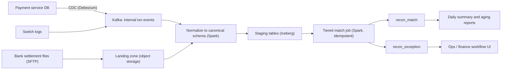
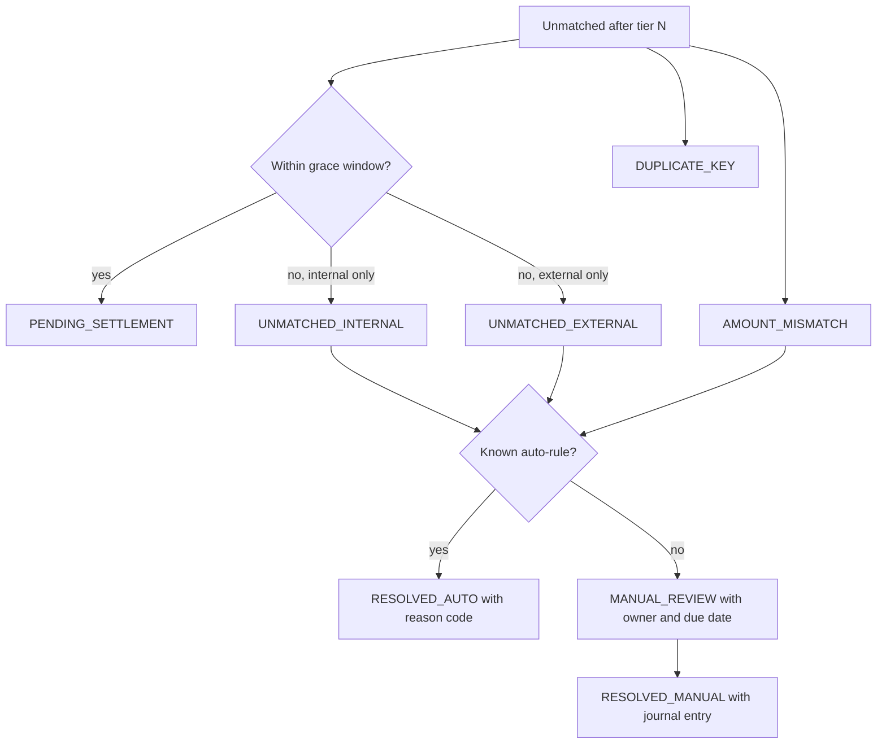

## 🎯 TL;DR

> **Payment reconciliation** compares what **we think happened** (our ledger) with what **the outside world says happened** (the switch, the bank, the settlement file), finds every disagreement, and routes each one to an owner until it is closed.

- Every money movement needs a **stable matching key** (for example RRN + STAN + terminal) and a **tiered** matching strategy, from exact to tolerant.
- External data **arrives late and out of order**. Use a business date, a grace window and **re-runnable** jobs; never assume the file for day D is complete at midnight.
- Matching is the easy part. The **exception workflow** (states, owners, SLAs, auto-rules and audit) decides whether the system is usable by finance.
- Store money as **integers** in the smallest unit (rial), and make every job **idempotent**, so a re-run gives the same answer.

## 🌱 Start simple (Junior)

> **💡 Analogy:** Think of a shop owner who writes every sale in a notebook, and at the end of the week compares the notebook with the bank statement. Some sales are in both, some only in the notebook (the bank has not posted them yet), some only at the bank (the customer paid twice). Reconciliation is the careful comparison and the list of questions it produces.

**The problem.** A payment company processes card payments for merchants. Each payment creates records in our system, in the payment switch (the national interbank network), and finally in the bank settlement file. Build a pipeline that reconciles these sources every day and gives finance a clear list of exceptions to fix.

**Functional requirements**

- Ingest internal transactions (from our payment service), switch logs, and daily settlement files from banks.
- Match records per transaction, with the match rule recorded.
- Classify every unmatched or mismatched record into an exception with a status, an owner and a due date.
- Support reversals, refunds and partial refunds as separate events that must also match.
- Give finance a daily summary: totals by merchant, match rate, open exceptions and their age.
- Allow a day to be re-reconciled after a late file arrives, without duplicating results.

**Non-functional requirements (our assumptions)**

- Scale: **5 million transactions per day**, each with one internal row and about one external row.
- Freshness: **daily** reconciliation is the requirement. Intraday checks are a nice-to-have for alerts.
- Correctness: no money is lost from the books. Every difference is visible, even when it is not auto-fixed.
- Auditability: every match or status change keeps who or what changed it, when, and from which input.
- Retention: 7 years of reconciliation records for finance and regulatory audit.

## 🔧 How it really works (Mid)

### Estimation

- Transactions: 5,000,000 per day. External rows (settlement + switch confirmations): about 5,000,000 more. Total input: **10,000,000 rows/day**.
- Row size after normalization, about 300 bytes. Raw volume: 10 M × 300 B = **3 GB/day**.
- Per year: 3 GB × 365 ≈ **1.1 TB**. Seven years: 1.1 × 7 ≈ **7.7 TB** before replication and compression.
- Shuffle for the daily match: 3 GB ÷ 128 MB per partition ≈ 24 partitions. Double it for headroom: **64 shuffle partitions**.
- Exceptions: assume 0.1% of 5 M = **5,000 exceptions/day**. At 2 minutes of manual work each, that is 10,000 minutes ≈ **167 hours/day**, which no team can absorb.
- Auto-rules must cut the manual share to 0.01%: 500 exceptions/day × 2 min = 1,000 min ≈ **17 hours/day**, which is about 2–3 analysts.

The lesson of the numbers: the matching job is cheap. The **exception volume** is what determines the team and the design.

### Data model

Use one canonical shape for each source after normalization, and never keep the source's raw field names in the core model:

| Table | Key | Important columns |
|---|---|---|
| `txn_internal` | `txn_id` | `rrn`, `stan`, `terminal_id`, `merchant_id`, `amount_rial` (BIGINT), `txn_type`, `txn_time`, `business_date`, `source_run_id` |
| `txn_external` | `ext_id` (source file row) | `rrn`, `stan`, `terminal_id`, `amount_rial`, `settle_date`, `file_id`, `file_received_at` |
| `recon_match` | `(txn_id, business_date)` | `ext_id`, `match_rule`, `status`, `run_id`, `updated_at` |
| `recon_exception` | `exception_id` | `txn_id` or `ext_id`, `reason`, `status`, `owner`, `due_at`, `resolution`, `opened_at` |
| `recon_audit` | append-only | `entity_id`, `from_status`, `to_status`, `actor`, `run_id`, `at` |

Two rules matter more than the column list:

- **Amounts are integers** in rials. Never use floating point for money. Iranian transactions normally have no sub-unit, so `BIGINT` or `DECIMAL(18,0)` is enough.
- **Keep the source file row** as the lineage key. Any question from finance ("where did this number come from?") must lead back to a file and a line.

### High-level design



The internal side comes from CDC or the outbox pattern, so the reconciler never queries the production payment database directly. The external side is file-based, so the landing zone keeps every file as received, with a checksum and a receive time.

### Matching keys and tiers

A **matching key** is the set of fields that identify the same real-world payment on both sides. Card systems commonly use a retrieval reference number (RRN, a bank-side reference), a system trace audit number (STAN), the terminal ID and the amount. The exact field names depend on your switch and bank, so treat the list as an example.

Match in tiers, from strict to tolerant. Each tier only sees what the previous tier left unmatched:

```sql
-- Tier 1: exact composite key
CREATE OR REPLACE TEMP VIEW tier1 AS
SELECT i.txn_id,
       e.ext_id,
       i.amount_rial AS int_amount,
       e.amount_rial AS ext_amount,
       'T1_RRN_STAN_TERM' AS match_rule
FROM txn_internal i
JOIN txn_external e
  ON i.rrn = e.rrn
 AND i.stan = e.stan
 AND i.terminal_id = e.terminal_id
WHERE i.business_date = DATE '2026-10-12';

-- Tier 2: same RRN and amount, but the external row has a different terminal string
-- (for example a normalization difference). Only rows not matched in tier 1 are considered.
```

Rules to enforce:

- **Duplicate keys on either side are an exception, not a join.** If two external rows share the same key, a plain join produces two matches and doubles the amount. Count keys first, and send any key with count > 1 to `DUPLICATE`.
- **Amount mismatch is a status, not a silent match.** Join on the key, then compare amounts. A mismatch becomes `AMOUNT_MISMATCH` with both values stored.
- **Tolerance is a written policy.** For rials there is no rounding, so tolerance is usually zero. A known fee difference becomes an explicit rule with a reason code, not a generic "within 1%" that hides real errors.

### Late records and the business date

External data is late. A settlement file for transactions on day D may arrive on D+1 morning, a correction may arrive on D+3, and a transaction at 23:59:59 can be settled the next day. So:

- Reconcile by **business date** (the date the payment happened), not by file arrival date.
- Keep a **grace window** (for example 3 days). A missing external row inside the window is `PENDING_SETTLEMENT`, not a failure.
- Make the job **re-runnable**. When a late file arrives, re-run matching for the affected business dates. Use `MERGE` so that an already-matched row is updated only when its status really changes, and every change writes an audit row:

```sql
MERGE INTO recon_match t
USING staged_matches s
  ON t.txn_id = s.txn_id AND t.business_date = s.business_date
WHEN MATCHED AND t.status <> s.status THEN
  UPDATE SET status = s.status, match_rule = s.match_rule,
             run_id = s.run_id, updated_at = current_timestamp()
WHEN NOT MATCHED THEN
  INSERT (txn_id, business_date, ext_id, match_rule, status, run_id, updated_at)
  VALUES (s.txn_id, s.business_date, s.ext_id, s.match_rule, s.status, s.run_id, current_timestamp());
```

Because the statement is keyed and conditional, running it twice with the same inputs changes nothing the second time. That is the idempotency you need for a retried Spark stage.

### Exception workflow

Every record that is not cleanly matched ends in an exception with a state. The states should be few and each should have one meaning:



Operational rules:

- Each exception has an **owner team**, a **due date** and an **aging** field. Dashboards show count and age by state, not just the total.
- Auto-rules are **data**, not code branches: a table of rules with a reason code, a version and an approver. Every auto-resolution keeps the rule ID.
- A resolution that changes money creates a **journal entry** (a balancing pair of debit and credit), so the books stay balanced. Reconciliation never edits a balance in place.
- Cross-check **control totals** every run: number of rows and sum of amounts per source and per file. If the file's control total does not match its own rows, the whole file is rejected, not partially loaded.

## 🧠 Senior depth & trade-offs

- **Watermarks for batch.** The "watermark" here is the business-date cut-off plus the grace window. Be explicit: after D+3 the system stops waiting and opens exceptions. Anything later is a late correction that re-opens a closed day, and finance must approve that re-open.
- **Reruns versus restatement.** Re-running a day after a late file changes its match results. Decide whether the daily report is **restated** (updated numbers, with a change log) or **frozen** (the first close is final, and adjustments appear as next-day entries). Most finance teams prefer frozen closes plus explicit adjustments. Say which one you chose.
- **Match rate as a health signal.** Track match rate per source, per merchant and per file. A sudden drop usually means a broken normalization rule or a changed bank format, not fraud. Alert on the rate, not only on the count.
- **Schema changes from banks.** Bank file formats change without notice. Validate the file header and record layout at the landing zone, keep the raw file, and version the parser. A parser change should be a reviewed, re-runnable change, see [[schema-evolution]].
- **Exactly-once is not required for the match, but the audit trail is.** The job can be at-least-once if its writes are keyed and idempotent. What must be exact is that every status change is recorded once. See [[idempotency]] and [[exactly-once]].
- **Money on Spark.** Use integer arithmetic only. Shuffle skew is likely when a few large merchants dominate keys; isolate them or salt their keys (see [[data-skew]]).
- **When not to build it this way.** If volume is in the hundreds of rows per day, a SQL script and a spreadsheet control total may be the right first version. Build the workflow when exceptions need owners and an audit trail, not before.

### Expectations by level

- **Mid:** explains the internal vs external sources, defines a matching key, writes a join with duplicate handling, and names the exception states. Knows why amounts are integers.
- **Senior:** designs the grace window and business-date logic, makes the job re-runnable with `MERGE` and audit rows, sizes the exception workload with arithmetic, and states the frozen-vs-restated decision.
- **Staff:** defines ownership between engineering and finance, the control-total and file-rejection contract with each bank, retention and regulatory audit needs, and a migration path from the spreadsheet process. Talks about what the team will not automate.

### Follow-ups the interviewer will ask

1. **"The switch sends the same confirmation twice. What happens?"** The duplicate key rule catches it: two external rows with one key become `DUPLICATE_KEY`, and only one counts toward the totals. Ask whether the second copy is a retry or a second real payment.
2. **"How would you reconcile intraday?"** Run the tier-1 match on a short window with the same keys, but keep the state `PENDING_SETTLEMENT` until the grace window ends. Intraday results are for alerts, not books.
3. **"A refund arrives three days after the purchase. How do you match it?"** Refunds are separate events with their own keys (and a link to the original transaction ID). Match them in their own tier, and never net them against the purchase silently.
4. **"What do you do with a partial refund?"** Keep one row per refund event, match each against the original amount, and track the remaining balance per original transaction.

## 🧪 Try it

Use these tiny tables in PostgreSQL 13 or later, or Spark SQL. The internal table has 4 rows, the external table has 3.

```sql
CREATE TABLE txn_internal (txn_id int, rrn text, stan text, amount_rial bigint);
INSERT INTO txn_internal VALUES
 (1,'R001','S01',1500000),(2,'R002','S02',250000),
 (3,'R003','S03',90000),(4,'R004','S04',400000);

CREATE TABLE txn_external (ext_id int, rrn text, stan text, amount_rial bigint);
INSERT INTO txn_external VALUES
 (101,'R001','S01',1500000),(102,'R002','S02',255000),(103,'R003','S03',90000);
```

1. Write a query that returns each internal transaction with its external match on `(rrn, stan)`, and a `status` column with values `MATCHED`, `AMOUNT_MISMATCH` or `UNMATCHED_INTERNAL`.
2. Add a third status for the case where the external side has duplicate keys. Explain why you must check duplicates before the join.
3. Compute the total difference in rials between the two sources for matched rows, and explain why this number is a useful control total.

<details><summary>Show solutions</summary>

**1.**
```sql
SELECT i.txn_id,
       CASE
         WHEN e.ext_id IS NULL THEN 'UNMATCHED_INTERNAL'
         WHEN e.amount_rial <> i.amount_rial THEN 'AMOUNT_MISMATCH'
         ELSE 'MATCHED'
       END AS status
FROM txn_internal i
LEFT JOIN txn_external e
  ON e.rrn = i.rrn AND e.stan = i.stan
ORDER BY i.txn_id;
```
Result: txn 1 `MATCHED`, txn 2 `AMOUNT_MISMATCH` (250000 vs 255000), txn 3 `MATCHED`, txn 4 `UNMATCHED_INTERNAL`.

**2.** Count the keys first:
```sql
WITH dup AS (
  SELECT rrn, stan FROM txn_external GROUP BY rrn, stan HAVING COUNT(*) > 1
)
SELECT i.txn_id,
       CASE
         WHEN EXISTS (SELECT 1 FROM dup d WHERE d.rrn = i.rrn AND d.stan = i.stan)
           THEN 'DUPLICATE_KEY'
         WHEN e.ext_id IS NULL THEN 'UNMATCHED_INTERNAL'
         WHEN e.amount_rial <> i.amount_rial THEN 'AMOUNT_MISMATCH'
         ELSE 'MATCHED'
       END AS status
FROM txn_internal i
LEFT JOIN txn_external e ON e.rrn = i.rrn AND e.stan = i.stan;
```
With the sample data no key is duplicated, so the result is the same as in question 1. Add a second row for `R001`/`S01` to the external table to see `DUPLICATE_KEY` appear.
Without this check, a key with two external rows produces two joined rows and counts the same payment twice, which inflates both matches and totals.

**3.**
```sql
SELECT SUM(i.amount_rial - e.amount_rial) AS matched_diff_rial
FROM txn_internal i
JOIN txn_external e ON e.rrn = i.rrn AND e.stan = i.stan;
```
Result: `1500000-1500000 + 250000-255000 + 90000-90000 = -5000`. A non-zero control total is an alert even when each row is an explainable exception. Finance compares it with the bank's own summary.

</details>

## 💬 Interview corner

**Question: "Design a payment reconciliation pipeline."**

> **🎤 Say this in the interview:** "I would reconcile the internal ledger, switch logs and bank settlement files by business date, not arrival date. Matching is tiered: an exact composite key first, then tolerant rules, and duplicate keys are exceptions, not joins. Everything runs as an idempotent Spark job that writes with MERGE and keeps an audit row per status change. Unmatched items become exceptions with states, owners, due dates and reason-coded auto-rules, and every money change becomes a journal entry. The success metrics are match rate, control-total differences and exception aging."

**Model answer by level:** A mid engineer describes the sources, the join key and the exception table. A senior adds the grace window, the re-runnable job and the exception workload arithmetic. A staff engineer also defines the file contract with each bank, the frozen-versus-restated policy and the boundary between engineering and finance.

## ⚠️ Common mistakes

> **⚠️ Watch out:** Joining on a key that is not unique on one side. A duplicate row doubles the amount, and the reconciliation still "matches". Check key uniqueness before the join.

> **⚠️ Watch out:** Treating "not in the file yet" as a failure. External data is late by design. Use a grace window and a `PENDING_SETTLEMENT` state.

- Storing money as `FLOAT` or `DOUBLE`. Use integer rials.
- Matching by business date in one source and file date in the other.
- A single tolerance such as "within 1%" that hides real errors. Use explicit, reason-coded rules.
- Editing balances in place instead of writing journal entries.
- Overwriting the daily report on a re-run without a change log, so finance cannot explain what moved.
- Keeping only the final status and losing the audit trail of who changed it and why.
- Building the exception UI before measuring the exception volume.

## ✅ Check yourself (quiz)

1. Which field type should hold a transaction amount in rials?
   - A) `FLOAT`
   - B) `DOUBLE`
   - C) `BIGINT` (or `DECIMAL` with scale 0)
   - D) `STRING`

<details><summary>Answer</summary>

**C** — integer types are exact. Floating point cannot represent every decimal value, so sums drift. Rials have no sub-unit in normal use, so `BIGINT` fits.

</details>

2. A settlement file for 2026-10-12 arrives on 2026-10-14. Which design choice handles it correctly?
   - A) Reject the file because it is late
   - B) Reconcile by file arrival date so the day is closed
   - C) Reconcile by business date, keep the rows inside the grace window as `PENDING_SETTLEMENT`, and re-run the affected day with an idempotent `MERGE`
   - D) Delete yesterday's matches and start from zero

<details><summary>Answer</summary>

**C** — late files are normal. Business date keeps the logic stable, the grace window stops false exceptions, and an idempotent re-run with audit rows updates only what changed.

</details>

3. Two external rows share `(rrn, stan)`, and a plain join returns two matches for one internal transaction. What should happen?
   - A) Keep the first row and ignore the second without recording it
   - B) Sum the two external amounts and match the total
   - C) Mark the key `DUPLICATE_KEY` as an exception with both source rows referenced
   - D) Join again on `terminal_id` only

<details><summary>Answer</summary>

**C** — you cannot know which row is real without investigation, so the key becomes an exception with both rows attached. Silently picking one, or summing, hides a possible double charge.

</details>

4. **(Senior)** The exception count is 0.1% of 5 million transactions per day, and each exception takes 2 minutes. Why is that a design problem, and what do you change?

   - A) Nothing; 0.1% is a normal error rate
   - B) It is about 167 hours of manual work per day, so the design must add reason-coded auto-rules and reduce the manual share, with the rules versioned and approved
   - C) Use a larger Kafka topic to absorb the exceptions
   - D) Turn off the exception workflow and report only totals

<details><summary>Answer</summary>

**B** — 5,000 × 2 min = 10,000 min ≈ 167 hours, which is impossible to staff. The fix is to classify known patterns into auto-rules with reason codes, approved and versioned, and to measure the remaining manual share.

</details>

5. **(Senior)** Finance asks why yesterday's closed report changed after a late file. How do you decide the policy, and what is the trade-off?

   - A) Never change a closed report; ignore late files
   - B) Choose between frozen closes (adjustments appear as next-day entries) and restated reports (numbers change with a change log); frozen keeps history stable, restated gives accurate numbers sooner but needs a clear audit trail
   - C) Always restate, because numbers must be accurate
   - D) Re-run only the Spark job without telling finance

<details><summary>Answer</summary>

**B** — this is a policy decision with a real trade-off. Most finance teams prefer frozen closes, but the choice must be explicit, documented and visible in the reports.

</details>

## 🗂️ Flashcards

| Front | Back |
|---|---|
| Why is amount stored as integer rials? | Exact arithmetic; floats drift when summed |
| Reconcile by which date? | Business date (when the payment happened), not file arrival |
| What is a grace window? | Period in which a missing external row is `PENDING_SETTLEMENT`, not a failure |
| Why check duplicate keys before a join? | A duplicate key doubles the join result and the amount |
| What is a control total? | Row count and amount sum per source and file, compared across systems |
| Why is `MERGE` idempotent here? | Same inputs produce no change on a second run; only real status changes write |
| Frozen close vs restated report | Frozen: adjustments as new entries. Restated: numbers change with a change log |
| Why journal entries, not balance edits? | Each change keeps both sides balanced and traceable |

## 🔗 Go further

- **pattern-reconciliation** explains the general pattern behind this problem, with other examples.
- **dedup-idempotent-loads** and **delivery-semantics** give the vocabulary for re-runs and duplicates.
- **data-quality** covers control totals and checks you can run before a job writes anything.
- **dlq-bad-records** shows how to quarantine rows that fail parsing, rather than dropping them.
- **design-ecommerce-dwh** shows a related modeling problem, with facts and dimensions for payments.
- Read your bank's file specification and your switch's documentation before designing the keys. The matching design depends on the real fields, and the names in this lesson are examples.
