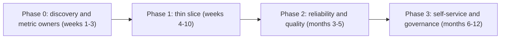
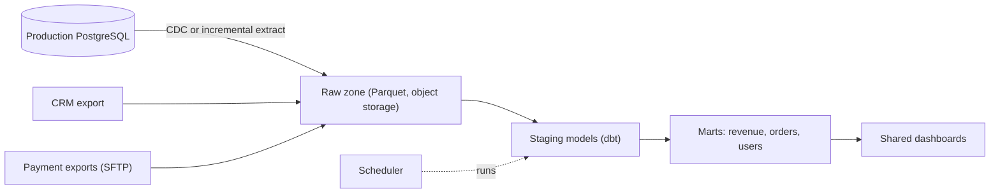

## 🎯 TL;DR

> Building a data platform for a company that has **no platform** is mostly a sequencing problem. Pick the **few data sources and questions that create value first**, deliver a **thin working slice** in weeks, then add reliability, governance and self-service in **phases**, each justified by a real pain.

- Start with **business questions and owners**, not with a tool list. Ten dashboards that finance trusts beat a perfect lakehouse nobody uses.
- Decide **build vs buy** per layer (ingestion, storage, orchestration, BI, quality) using your constraints: team size, skills, and the fact that many environments are on-prem.
- The **team** is the real bottleneck. Plan hiring and ownership alongside the architecture, and name who runs the platform after launch.
- Each phase has an exit criterion you can measure, such as "three sources load daily with a 99% on-time rate and a documented owner".

## 🌱 Start simple (Junior)

> **💡 Analogy:** A new restaurant does not install a full commercial kitchen on day one. It first serves a short menu well, with a small kitchen, then adds stations as the menu grows. Installing everything at once means a kitchen nobody knows how to run.

**The problem.** A mid-size company (an online marketplace with 300 employees) has data spread across a production PostgreSQL database, a CRM, spreadsheets, and a few exports from a payment provider. Analysts copy data by hand. Leadership asks "why do the revenue numbers differ between the finance report and the sales dashboard?" Design the data platform, from zero, and say what you build first.

**Functional requirements (first two years)**

- Load the top business sources into one place, on a schedule, with history.
- Provide a **shared definition** for the key metrics (revenue, active users, orders).
- Give analysts a way to query data and build dashboards without asking engineers to copy files.
- Let the team add a new source in days, not months.

**Non-functional requirements (our assumptions)**

- Data volume today: **about 400 GB** in the production database, growing about **20 GB per month**. The CRM and spreadsheets are small.
- Freshness: **daily** is enough for finance and sales. Two sources need **hourly** freshness for operations.
- Team: **3 data engineers**, **1 analytics engineer**, and no dedicated platform or SRE team. Two backend engineers can help part-time.
- Constraints: data residency and the normal limits of an on-prem environment, with no public cloud for production data. Budget for licences is limited, so open-source or existing tools are preferred.
- Success measure: by month 6, the two revenue numbers come from one model, and the daily load succeeds on at least 98% of days.

## 🔧 How it really works (Mid)

### Estimation

- Initial history: 400 GB in the production database. Compressed in a columnar format, about 4:1, so roughly **100 GB** of Parquet. A full snapshot per day for three years would be 100 GB × 1,095 days ≈ 110 TB, which is why the design uses **incremental loads and change capture**, not daily full copies.
- Monthly growth: 20 GB raw ÷ 4 ≈ **5 GB per month** of new columnar data.
- Daily change volume: suppose 2% of the rows change per day. If the database holds 400 GB, 2% ≈ **8 GB raw per day** of changes, or about 2 GB compressed. This is the volume the incremental pipeline moves.
- Hourly ops source: suppose 50 million events per month at 1 KB each = 50 GB/month. That is about **1.7 GB/day**, small enough for one ingestion worker.
- Capacity for the first year: 100 GB history + 60 GB growth + operational data ≈ **300 GB** compressed. A single well-sized storage bucket and one warehouse cluster are enough. Do not design for petabytes.

The numbers say the platform is small. Sequencing, ownership and the definition of metrics are the hard parts.

### Phased roadmap



**Phase 0 — discovery (weeks 1–3).** Interview the owners of the top 10 questions. For each metric, write the definition, the source table, and the person who signs it off. This is cheap and prevents the most expensive mistake: building pipelines for numbers nobody agrees on.

**Phase 1 — thin slice (weeks 4–10).** Load three sources (production DB, CRM, payment exports) into one warehouse schema, daily, with a simple scheduler. Build one revenue model and one dashboard that finance uses. Accept manual steps for the rare cases, but record them.

**Phase 2 — reliability (months 3–5).** Add incremental loads, backfill tooling, freshness and row-count checks, alerts, and a run book for failures. Move the hourly ops source to streaming or micro-batch only if the business pays for it.

**Phase 3 — self-service (months 6–12).** Add a catalog, documented models, access control, a process for adding sources, and training for analysts. Consider a semantic layer only when metric definitions diverge across tools.

Each phase has an **exit criterion** that is measurable. "We have a platform" is not one. "Three sources load daily, on time for 98% of days, with an owner for each source" is one.

### Build vs buy by layer

Decide each layer separately. Most teams buy the layers that differentiate little and build the parts that encode their business rules.

| Layer | Typical choice in a small team | Why |
|---|---|---|
| Ingestion from databases | Managed CDC or a batch extractor (for example Debezium with Kafka Connect, or a commercial connector) | Writing CDC by hand is a trap. Use an existing tool, then own the configuration. |
| Storage | Object storage with Parquet, plus one warehouse engine (ClickHouse, StarRocks, or Postgres for the first months) | Storage is cheap; the warehouse engine is what analysts touch. |
| Orchestration | Airflow or a simpler scheduler | Pick the tool your team can run on-prem and debug at 2 a.m. |
| Transformation | dbt (SQL models with tests and docs) | Shared definitions live in version-controlled SQL. |
| Quality | Tests in the transformation tool, plus row-count and freshness checks | Start with the checks that catch the expensive failures. |
| BI | An existing dashboard tool the company already licenses | Analysts already know it; a new tool is a training cost. |

The question for each row is: "Would we regret owning this in two years?" Owning a CDC engine usually yes; owning a dashboard server usually no.

### Target architecture for phase 1



Keep three zones even in phase 1: **raw** (as received, never edited), **staging** (typed, renamed, deduplicated), and **marts** (business definitions). This is the minimum of the medallion idea (see [[medallion-architecture]]). It costs almost nothing and makes every later debugging session shorter.

### Incremental loads from the start

The first loader is a daily full copy for small tables. For the large production tables, use an **incremental key** (an `updated_at` column) or CDC from the write-ahead log. Full copies work until the table grows; plan the switch before the first slow load breaks a report. Keep a **load log** with the run ID, the time window and the row counts for each source. This log is the first thing you read when a number is wrong.

```sql
-- Staging model: deduplicate the latest version of each order (dbt-style SQL on the warehouse)
SELECT *
FROM (
  SELECT o.*,
         ROW_NUMBER() OVER (PARTITION BY order_id ORDER BY updated_at DESC, _load_id DESC) AS rn
  FROM raw_orders o
) t
WHERE rn = 1;
```

Keeping a deterministic tiebreaker (`_load_id`) makes the result stable across reruns, a point the interview answer should mention.

### Metric definitions and ownership

The most valuable phase-0 artifact is a **metric register**: one row per metric, with the definition in plain words, the SQL, the owner, and the review date.

| Metric | Definition | Owner | Source model |
|---|---|---|---|
| Net revenue | Paid orders minus refunds, in IRR, by order date | Finance lead | `mart_revenue_daily` |
| Active buyers | Distinct buyers with at least one paid order in the period | Growth PM | `mart_users_monthly` |

When the sales dashboard and the finance report disagree, the register tells you which definition each one uses. Most "data platform" problems in the first year are definition problems in disguise.

## 🧠 Senior depth & trade-offs

- **Thin slice versus platform-first.** A platform-first plan delays value by six months and then discovers the wrong requirements. A thin slice finds the real constraints (credentials, source quirks, business rules) early. The risk of thin slices is shortcuts that become permanent; schedule the reliability phase as a real commitment, not a promise.
- **Build vs buy under on-prem constraints.** SaaS connectors and managed warehouses may be unavailable or unacceptable for data residency. Then "buy" means licensed on-prem software or a supported open-source distribution, and the cost of support contracts is part of the decision. Count the operations hours too: a self-run component with no one who understands it is a future incident.
- **Team shape.** A small platform team of 3 to 5 people can support roughly 20 to 40 analysts and engineers, but only if the platform work is separated from one-off reporting requests. Without that boundary, the platform team is a ticket queue. Name the on-call rotation before the first production load.
- **Security and access from day one.** Retrofitting access control is painful. Decide early: which roles see personal data, how credentials are stored, and how the platform logs queries. Even if phase 1 uses one admin role, separate read and write roles on the warehouse.
- **Cost and capacity.** A single warehouse cluster sized for phase 1 is cheap. The expensive mistakes are unbounded queries from analysts and repeated full loads. Set query timeouts and resource limits early, and monitor the daily load time, not only success.
- **Migration risk.** The first platform will be replaced in two years. Keep the raw zone in open formats (Parquet, SQL), keep transformations in version-controlled code, and avoid logic that lives only inside a dashboard tool. Then the next platform starts from the same data.
- **When not to build a platform.** If the company has three analysts and one database, a scheduled SQL export to a shared spreadsheet and a small read replica may be the right answer for a year. Name the trigger that starts the platform project, such as a second source, a regulatory report, or a failed reconciliation.

### Expectations by level

- **Mid:** explains a raw, staging and marts structure, proposes incremental loads with a key, and names the metric owners. Gives a rough estimate of storage and load time.
- **Senior:** sequences the roadmap with exit criteria, makes build-vs-buy choices per layer with the cost of ownership, and designs the team and on-call before the first load. Identifies the metric definition problem as the first risk.
- **Staff:** connects the platform to company strategy, proposes an operating model (platform team, domain teams, data owners), defines how the platform is funded and measured, and explains when to say no to new sources.

### Follow-ups the interviewer will ask

1. **"You have one engineer and six months. What do you build?"** Phase 0 plus one source and one trusted revenue model. Add a load log, a row-count check and a runbook. Defer the catalog and streaming.
2. **"Finance and sales disagree on revenue. What do you do first?"** Stop building. Hold a metric review, write the definition, record the owner, and then fix the models to match. Tooling comes after agreement.
3. **"Leadership wants real-time dashboards next month."** Ask which decision changes with real-time data and what it is worth. Often hourly freshness is enough, and a streaming path is a later phase with its own on-call cost.
4. **"How do you know the platform is working?"** Measure on-time load rate, time to add a source, the number of metrics with an owner, the share of dashboards built on marts, and the number of incidents per month.

## 🧪 Try it

You are the first data engineer at a company with three sources: `orders` (PostgreSQL, 80 M rows, `updated_at` column), `customers` (CRM export, 2 M rows, full daily file), and `refunds` (payment provider CSV, daily).

1. Write the phase-1 exit criteria as three measurable statements.
2. Design the load log table. Name five columns and explain why each one exists.
3. Write a staging query that returns the latest `orders` row per `order_id`, and explain why the tiebreaker matters.

<details><summary>Show solutions</summary>

**1.** Example criteria:
- The three sources load daily into the raw zone, with on-time completion on at least 98% of days over the last 30 days.
- The `net_revenue` metric in the finance report and the sales dashboard come from the same mart and agree to the rial for the last 30 days.
- Each source and each metric has a named owner in the register, reviewed monthly.

**2.** A minimal load log:
```sql
CREATE TABLE load_log (
  run_id        text,       -- identifies one scheduled run
  source        text,       -- orders, customers, refunds
  window_start  timestamp,  -- incremental window or snapshot date
  window_end    timestamp,
  rows_read     bigint,     -- rows received from the source
  rows_loaded   bigint,     -- rows written to the raw zone
  status        text,       -- success, failed, partial
  finished_at   timestamp
);
```
`rows_read` and `rows_loaded` together detect silent drops. `window_start` and `window_end` make reruns and backfills explicit.

**3.**
```sql
SELECT *
FROM (
  SELECT o.*,
         ROW_NUMBER() OVER (PARTITION BY order_id ORDER BY updated_at DESC, _load_id DESC) AS rn
  FROM raw_orders o
) t
WHERE rn = 1;
```
Two versions of an order can share the same `updated_at` (for example in one batch). Without `_load_id`, `ROW_NUMBER` picks one arbitrarily, and the result can change between reruns. The tiebreaker makes the staging model deterministic.

</details>

## 💬 Interview corner

**Question: "A company has no data platform. Design one."**

> **🎤 Say this in the interview:** "I would start with the top ten business questions and their owners, and write each metric's definition before building pipelines. The first phase is a thin slice: three sources, raw, staging and marts zones, a scheduler, and one trusted revenue model used by finance. Then I add reliability with incremental loads, row-count checks and a runbook, and only later self-service and a catalog. Each phase has a measurable exit criterion. The team and the on-call rota are part of the design, and I choose build or buy per layer based on what we would regret owning."

**Model answer by level:** A mid engineer proposes the zones, incremental loads and a sensible tool list. A senior sequences the phases with exit criteria, decides build vs buy with the cost of operations, and names the team. A staff engineer ties the platform to the operating model, funding and the policy for new sources.

## ⚠️ Common mistakes

> **⚠️ Watch out:** Starting with the tool list. Tools are the last decision, after the questions, owners and team are clear. A stack chosen first usually reflects a vendor demo, not your constraints.

> **⚠️ Watch out:** Declaring success when the pipelines run. A load that succeeds with missing rows is a failure. Measure rows read against rows loaded and check freshness.

- Building pipelines before metric definitions are agreed, so two teams keep two revenue numbers.
- Copying full tables daily until the first slow load breaks a report, with no plan for incremental loads.
- Making one engineer the only person who understands the platform, with no runbook and no on-call rota.
- Adding access control and personal data handling after the first dashboards are shared.
- Leaving transformation logic inside a dashboard tool, where it is hard to version and test.
- Promising real-time freshness without a business decision that needs it.
- Treating the platform team as a ticket queue for one-off reports.

## ✅ Check yourself (quiz)

1. What is the best first deliverable in a phase-1 platform project?
   - A) A complete lakehouse with streaming and a catalog
   - B) A signed-off list of metric definitions with owners, plus one thin slice that uses three sources
   - C) A cluster sized for ten years of data
   - D) A custom ingestion framework for all sources

<details><summary>Answer</summary>

**B** — definitions and owners prevent the most expensive rework, and a thin slice tests the real constraints. A platform built before these exist tends to encode the wrong rules.

</details>

2. A 400 GB production table is copied fully every day. Which change is the right next step, and why not wait?
   - A) Nothing; full copies are always simplest
   - B) Switch to an incremental key or CDC before the load window becomes the bottleneck, because a slow load breaks reports and the change gets harder under pressure
   - C) Delete the historical data to make the copy faster
   - D) Run the copy twice a day

<details><summary>Answer</summary>

**B** — full copies scale with table size, not change size. Switching early, with a load log and a tested backfill, is much safer than switching during an incident.

</details>

3. Finance and sales show different revenue numbers. What should the data engineer do first?
   - A) Rewrite the sales dashboard in the BI tool
   - B) Add a new source to the warehouse
   - C) Compare the metric definitions and their source models with the owners, agree one definition, then fix the models
   - D) Turn off one of the dashboards

<details><summary>Answer</summary>

**C** — the difference is usually a definition (refunds, currency, date basis), not a bug in tooling. Agreement comes before code changes.

</details>

4. **(Senior)** Your team has three engineers and one analyst. Leadership wants a real-time platform for next quarter. How do you respond?

   - A) Accept and start with a streaming cluster
   - B) Ask which decision needs real-time data and its value, propose hourly freshness first, and show the on-call and operations cost of streaming before committing
   - C) Refuse the request without discussion
   - D) Buy the most expensive managed streaming service and skip the design

<details><summary>Answer</summary>

**B** — the right answer depends on the decision and its value. Real-time adds on-call and operational cost that a three-person team may not carry; a phased plan with a measurable trigger is the professional response.

</details>

5. **(Senior)** Which layer is most reasonable to buy rather than build in a small on-prem team, and why?
   - A) The business metric definitions
   - B) Change data capture from a production database
   - C) The custom logic for a fraud rule
   - D) The schema of the marts

<details><summary>Answer</summary>

**B** — CDC is a well-understood problem with failure modes that are costly to learn about alone. The business definitions and marts encode your rules and must be owned in-house, so buying them would hide the knowledge the company needs.

</details>

## 🗂️ Flashcards

| Front | Back |
|---|---|
| What comes first in a platform project? | Business questions, metric definitions and owners |
| What is a thin slice? | A small end-to-end path (few sources, one trusted model) delivered early to test constraints |
| What is an exit criterion? | A measurable condition that ends a phase, such as on-time load rate for 30 days |
| Raw, staging, marts | Raw as received; staging typed and deduplicated; marts with business definitions |
| Why a load log? | Records rows read vs loaded per run, so silent drops and reruns are visible |
| Build vs buy test | Would we regret owning this in two years? |
| Metric register | One row per metric: definition, SQL, owner, review date |
| Why plan the team with the architecture? | A platform without on-call and owners fails at the first incident |

## 🔗 Go further

- **delivery-framework** and **senior-expectations** describe how to talk about scope and trade-offs at senior level.
- **reference-architecture** shows a full target architecture to compare with your phase-3 picture.
- **design-dq-platform** continues the quality work that starts in phase 2.
- **governance-contracts-mesh** covers the ownership model you need in phase 3.
- **iran-de-market** and **onprem-iran** describe the constraints that often shape build-vs-buy decisions.
- **capacity-planning** shows how to size storage and compute before you buy anything.
