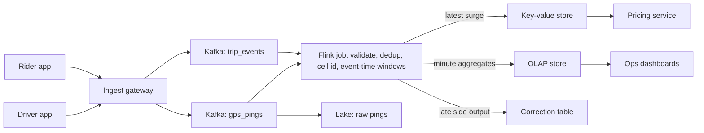

## 🎯 TL;DR

> Design a system that turns a stream of GPS pings from drivers and ride requests from riders into **per-area supply and demand numbers**, updated within about a minute, which feed **surge pricing**, ops dashboards and an analytics history.

- Bucket locations into **geo cells** (hexagons or geohash cells) instead of joining on raw coordinates.
- Aggregate per cell with **event-time windows**, not arrival time, because mobile GPS arrives late and out of order.
- Use a **watermark** plus a correction path for events that miss the window.
- Split the **serving layer**: a key-value store for the latest surge value the pricing service reads, and an OLAP store for dashboards and history. Never let dashboards hit the raw ping stream.

## 📋 Problem statement

Build the real-time analytics platform behind a ride-hailing app. Every 15 to 60 seconds, the system must publish, for each city cell, the number of **open ride requests** (demand) and **available drivers** (supply). The pricing service turns the ratio into a surge multiplier. Ops teams need dashboards with a few minutes of delay, and data scientists need the full history.

### Functional requirements

- Ingest GPS pings from driver apps (driver id, lat/lon, device timestamp, status).
- Ingest ride-request and trip-state events (requested, matched, started, completed, cancelled).
- Maintain, per cell and per minute, demand, supply and the computed surge multiplier.
- Serve the latest surge per cell with p99 read latency under 50 ms for the pricing service.
- Serve historical aggregates for dashboards and backfill with a corrected formula.

### Non-functional requirements

- **Freshness:** surge values reflect events up to roughly 60 seconds old.
- **Accuracy:** no double counting of the same ping after retries; late pings are counted in dashboards within a bounded time.
- **Availability:** pricing reads may fall back to the last known value for a short period, but the pipeline must recover from a crash without losing data.
- **Scale:** peak traffic in one region, with spikes around rain, concerts and airports.

## 📐 Estimation

Assume 1 million drivers online at peak, one ping every 4 seconds, and a 200-byte event after serialization.

- Ping rate: 1,000,000 / 4 = **250,000 pings per second** at peak.
- Daily raw volume: 250,000 × 86,400 s = 21.6 billion pings per day.
- Raw bytes: 21.6 × 10⁹ × 200 B = **4.32 TB per day** uncompressed.
- Columnar compression (Parquet with dictionary and delta encoding) often gives 4–6× on this kind of data. Take 5×: about **0.9 TB per day**, or roughly **330 TB per year** before replication.
- Trip requests: 5 million per day averages 5,000,000 / 86,400 ≈ **58 requests per second**. A 10× peak factor gives about 600 rps. This is small next to the pings; the ping stream dominates the design.
- Cells: 50 cities, about 5,000 active cells each, is **250,000 active cells**. One demand row and one supply row per cell per minute gives 500,000 rows per minute, or 720 million rows per day in the aggregate table.

Two conclusions drive the design. The ping stream is the bottleneck, so pre-aggregation must happen **before** any database. The aggregate table is small enough for an OLAP store, so the serving layer can be simple.

## 🗃️ Data model

| Stream or table | Key | Notes |
|---|---|---|
| `gps_pings` (Kafka) | `driver_id` | Ordered per driver; carries `device_seq` for dedup |
| `trip_events` (Kafka) | `trip_id` | State transitions, idempotent by `(trip_id, state)` |
| `cell_minute_agg` (OLAP) | `(cell_id, window_start)` | Demand, supply, surge; upserted on correction |
| `surge_latest` (key-value) | `cell_id` | Latest surge plus `as_of` timestamp for staleness checks |
| `raw_pings` (lake, Iceberg or Parquet) | partitioned by `dt` and `city` | Replay and ML training source |

The cell id is computed from `(lat, lon)` at ingestion. H3 at resolution 8 gives hexagons of roughly 0.7 km², a good balance between a pricing area and the number of cells. Store the resolution with the cell id so a later change of resolution does not silently mix two schemes.

## 🏗️ High-level design



The gateway authenticates clients, does coarse validation, and writes to Kafka. Partitioning Kafka by `driver_id` keeps each driver's pings in order, which the dedup logic needs. The Flink job then **repartitions by cell id**, because aggregation is per cell. That repartition is a shuffle, and it is the first place where a hot cell can overload one task.

## 🧠 Deep dives

### 1. Geo bucketing

Computing `distance(driver, rider) < 2 km` for every pair is O(drivers × requests) and cannot scale. Instead, each location maps to one cell id and all counts are grouped by that id.

- **Hexagons (H3)** have six equal neighbours, so smoothing across neighbouring cells is simple.
- **Geohash** cells are rectangles with uneven shape near the poles, and their boundaries cause more edge effects. They are fine for simple prefix queries.
- A ping near a border can be counted in one cell only. Pricing accepts that; for a matching problem you would search the 1-ring of neighbours.

**Hot cells.** An airport or stadium can hold 100× the average demand. A single Flink task then becomes the bottleneck. Two fixes work well together:

- **Two-phase aggregation.** Each task pre-aggregates `(cell, minute)` with a random salt on the key (for example `cell + "#" + (hash(driver_id) % 8)`). A second stage removes the salt and sums the partial results. This is the same idea as salting in Spark.
- **Sub-cells for pricing.** Keep the salted partials for dashboards, but compute surge on the merged value only.

### 2. Windowing

Surge needs a short, fixed window, and smoothing needs a longer one.

- **Tumbling window, 1 minute, event time.** Each ping falls into exactly one minute bucket. Output is one row per cell per minute.
- **Sliding window, 5 minutes, slide 1 minute.** Used to smooth the surge and avoid price oscillation. A sliding window stores more state and produces more output, so use it only on the surge computation, not on raw storage.
- **Session windows are not needed.** Trips are not gaps in a ping stream; a trip is a state machine on `trip_events`.

Event time is the **device timestamp**, not the server receive time. If the device clock drifts, reject timestamps that are far in the future or far in the past and fall back to receive time with a flag.

### 3. Late GPS events

Mobile pings arrive late because of tunnels, dead zones and background throttling. A ping from 2 minutes ago is still useful, but it must not change a value that has already been published to pricing.

- Set a **watermark** as `max(event_time) − allowed_lateness`, for example 30 seconds. A window is closed when the watermark passes its end.
- Events that arrive after the close go to a **side output** (the correction path). They do not reopen the window that was already served.
- For dashboards, a nightly or hourly job reads the side output and **upserts** corrected rows into the OLAP table keyed by `(cell_id, window_start)`. Upserts make the correction idempotent.
- Track the **late-event ratio** per city. A sudden rise usually means an app release or a carrier problem, not a data bug.

> **⚠️ Watch out:** Setting the lateness to 10 minutes "to be safe" makes every surge value 10 minutes stale. Freshness and completeness are a trade-off, and the business has to choose it. Document the choice.

### 4. Exactly-once effects

Retries from the mobile app and Kafka redelivery can duplicate pings.

- Dedup on `(driver_id, device_seq)` inside a bounded state window (for example 2 minutes) using keyed state in Flink. Clear the state with a timer so it does not grow forever.
- Flink checkpoints give exactly-once **state** semantics. For the sinks, use either a transactional sink or idempotent writes (upsert by window key). Be honest about which one you use: checkpoints alone do not make an external write exactly-once.
- See [[exactly-once]] and [[idempotency]] for the general pattern.

### 5. Serving layer

- **Pricing** reads `surge_latest` from a key-value store with a TTL. The record includes `as_of`. If `as_of` is older than 2 minutes, pricing falls back to a default multiplier and logs an alert.
- **Dashboards** query the OLAP table, pre-aggregated per city and per 5 minutes. Queries never touch raw pings.
- **Backfill.** When the surge formula changes, replay the raw pings from the lake into a new table version, validate, then switch the serving pointer. This is the kappa-style replay pattern: one code path for live and historical data.

A simple surge formula, used only as an illustration:

```text
ratio      = demand / max(supply, 1)
multiplier = clamp(1.0 + k * max(0, ratio - 1), 1.0, cap)
```

Smooth `ratio` over the sliding window before this step. The cap protects riders from runaway prices, and the business sets `k` and `cap`.

## 🧠 Senior depth & trade-offs

- **Partitioning keys.** Kafka by `driver_id` keeps order for dedup; Flink by `cell_id` gives correct aggregation. Each switch is a shuffle. Count the shuffles in your design and say where they happen.
- **State size.** Keyed state for dedup scales with active drivers × window length. At 250k pings/s and a 2-minute dedup window, state is in the tens of gigabytes, so use RocksDB-backed state and incremental checkpoints.
- **Checkpoint interval.** A short interval means low recovery loss but more I/O. A typical starting point is 30–60 seconds; tune it against checkpoint duration and the freshness target.
- **Backpressure.** If the Flink job falls behind, Kafka consumer lag grows, and surge gets stale. Alert on lag in seconds of event time (watermark lag), not in message count.
- **OLAP choice.** ClickHouse or StarRocks suit high-cardinality time-series aggregates with upserts through `ReplacingMergeTree`-style tables or primary-key models. The exact feature set depends on the version, so check the docs for yours before you commit to a table engine.
- **Multi-region.** Keep the surge computation in the region where the cities are. Replicate aggregates, not raw pings, across regions. Cross-region latency would otherwise sit in the pricing path.
- **What to monitor:** consumer lag (seconds), watermark lag, late-event ratio per city, `as_of` staleness of `surge_latest`, top-10 cell share of total events (skew), checkpoint duration and failures, and the fraction of pricing reads that used the fallback.
- **When not to build this:** if one city, a few thousand drivers and one-minute freshness is enough, a micro-batch job every minute into a warehouse is simpler and easier to debug.

## 🧪 Try it

Predict first, then check your answer.

> A driver's phone sends pings at 10:00:05 and 10:00:09 (device time). The server receives the 10:00:05 ping at 10:01:40 because of a tunnel. The window for 10:00 closed at 10:01:10. Where does the 10:00:05 ping go?

<details><summary>Your guess?</summary>

It goes to the **side output** (correction path). The watermark had already passed the end of the 10:00 window, so the surge value for that minute was published. The ping is still stored in the lake and upserted into the OLAP table by the correction job, so dashboards become correct without changing the value pricing already used.

</details>

## 💬 Interview corner

> **🎤 Say this in the interview:** "I would not join raw GPS to requests. I would bucket locations into H3 cells in the ingestion job, aggregate per cell with one-minute event-time windows, and close windows with a watermark. Late pings go to a correction path. Pricing reads a small key-value store, and dashboards read an OLAP table."

**What a mid answer sounds like:** Kafka, a stream job, windows by event time, a key-value store for the latest value, and an OLAP table for dashboards.

**What a senior answer adds:** the shuffle when repartitioning by cell, hot-cell salting, the freshness versus completeness trade-off set by lateness, how dedup state is bounded, and how a formula change is backfilled by replay.

**What a Staff answer adds:** ownership and SLAs for each output (pricing freshness, dashboard delay), the cost of multi-region replication, and a plan to test the surge formula offline against replayed history before it goes live.

### Likely follow-ups

1. **"A surge update must reach pricing in 10 seconds. What changes?"** Shorten the window or publish partial windows, move the latest value to an in-memory cache near pricing, and accept more noise. Say that the accuracy drops.
2. **"Pings arrive 15 minutes late after a region outage. What happens?"** They go to the correction path. Dashboards are corrected by upsert. Surge does not change retroactively. If the business needs it, run a targeted recomputation for affected cells.
3. **"One airport produces 100× the normal load. How do you keep the job healthy?"** Salted two-phase aggregation, per-key metrics for the top cells, and an alert on the top-cell share.
4. **"How do you test a new surge formula?"** Replay the last 30 days of raw pings into a shadow table, compare the new and old multipliers per cell, and check oscillation and caps before switching the serving pointer.
5. **"Why not compute everything in the OLAP database?"** Ingest volume at 250k events/s with dedup and event-time windows is a stream-processing problem. The OLAP store is the right place for queries, not for correctness logic.

## ⚠️ Common mistakes

- **Windowing by arrival time.** The result changes with network conditions. Use event time and a watermark.
- **Joining raw coordinates.** Pairwise distance joins do not scale. Bucket first.
- **Ignoring hot cells.** Airports and stadiums break the job, not the average. Measure the top-cell share.
- **One table for everything.** Pricing, dashboards and history have different latency and correctness needs. Separate the serving paths.
- **Assuming checkpoints make sinks exactly-once.** They make state consistent. The sink still needs a transactional or idempotent write.
- **Keeping no replay path.** When the formula changes, you need the raw history. Keep raw pings in the lake, partitioned by date and city.
- **Ignoring staleness.** A surge value without `as_of` can silently be hours old.

## ✅ Check yourself (quiz)

1. **Recall.** Which window type should compute the one-minute surge value?
   - A) Session window
   - B) Tumbling window on event time
   - C) Processing-time sliding window
   - D) Global window with a count trigger

   <details><summary>Answer</summary>

   **B** — A tumbling window on event time gives each ping exactly one minute bucket, which is the granularity pricing needs. Processing-time windows change with network delay, and session windows are for activity gaps, which trips are not.

   </details>

2. **Scenario.** A ping arrives 3 minutes after its window was published. Dashboards must be correct within 15 minutes. What should happen?
   - A) Reopen the published window and republish to pricing
   - B) Drop it and log a warning
   - C) Send it to the side output and upsert the correction into the OLAP table
   - D) Increase the watermark to 5 minutes for all windows

   <details><summary>Answer</summary>

   **C** — The side output keeps the data, and an idempotent upsert corrects the dashboard without changing the value pricing already used. Reopening windows (A) changes prices retroactively, and raising the global watermark (D) makes every surge value stale.

   </details>

3. **Scenario.** Why does the design partition Kafka by `driver_id` but aggregate by `cell_id` inside Flink?
   - A) Kafka cannot store cell ids
   - B) Per-driver order is needed for dedup, and per-cell grouping is needed for aggregation, so a repartition (shuffle) sits between them
   - C) Flink only supports one partition key
   - D) Driver ids are more evenly distributed than cell ids

   <details><summary>Answer</summary>

   **B** — Dedup needs pings of one driver in order, so Kafka keeps them together. Aggregation needs all pings of one cell together, so Flink repartitions by cell. That shuffle is a cost you should name and monitor.

   </details>

4. **Senior trade-off.** Lateness is set to 10 minutes "to be safe". What is the main cost?
   - A) Higher Kafka storage cost
   - B) Surge values are published about 10 minutes after the events they describe, so the pricing signal is stale
   - C) Dedup stops working
   - D) The lake cannot store late events

   <details><summary>Answer</summary>

   **B** — A window closes only after the watermark passes its end, so a long lateness delays every published value. The choice trades freshness for completeness and must be a business decision.

   </details>

5. **Recall.** What is the purpose of the `as_of` field in `surge_latest`?
   - A) It is the Kafka offset
   - B) It lets pricing detect stale values and fall back safely
   - C) It is the partition key for the OLAP table
   - D) It stores the surge formula version

   <details><summary>Answer</summary>

   **B** — With `as_of`, the reader can see how old the value is and apply a fallback when it is too old. Without it, a stale value looks fresh.

   </details>

## 🗂️ Flashcards

| Front | Back |
|---|---|
| Why bucket into geo cells? | Turns a pairwise location join into a group-by on one cell id |
| Event time vs processing time | Event time is when the ping was taken; processing time is when the job sees it |
| What closes a window? | The watermark passing the window end (max event time minus allowed lateness) |
| Where do late events go? | A side output that feeds an idempotent correction into the OLAP table |
| Why salt a hot cell? | Spreads one key across several tasks; a second stage merges partial sums |
| Why keep `as_of` with surge? | Lets pricing detect stale values and fall back |
| Why keep raw pings in the lake? | Allows backfill and replay when the surge formula changes |

## 🔗 Go further

- Prerequisite ideas: [[pattern-late-data]], [[pattern-realtime-aggregation]], [[pattern-hot-keys]].
- Related designs: [[design-clickstream-analytics]], [[design-ad-click-aggregator]].
- Serving patterns: [[serving-layer]], [[realtime-olap]].
- Glossary: [[watermark]], [[event-time]], [[tumbling-window]], [[data-skew]].
