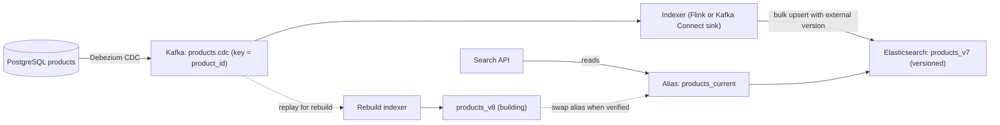

## 🎯 TL;DR

> A **search indexing pipeline** keeps a search engine (Elasticsearch or OpenSearch) in step with the source of truth (a product database). It has three hard parts: **keeping the index fresh** through change data capture (CDC), **rebuilding the index** without downtime when the mapping or analyzers change, and **analyzing Persian text** so that queries find what users mean.

- Treat the search index as a **derived, disposable copy**. If it can be rebuilt from the source and the log, a bad index is an operations task, not a disaster.
- Use **CDC into Kafka**, then an idempotent indexer that writes by document ID with a **version from the source** (for example the log position or `updated_at`), so out-of-order and duplicate events do not overwrite newer data.
- Rebuild into a **new versioned index**, catch up from the log, then **swap an alias** atomically. Readers never see a half-built index.
- Persian search quality depends on **normalization** (Arabic and Persian letter forms, zero-width non-joiner, Persian and Arabic digits) before any ranking tuning.

## 🌱 Start simple (Junior)

> **💡 Analogy:** A library catalog card box. The books live on shelves (the database). The card box (the index) is organized so you can find a book by any word in its title. If a book moves shelves, you update its card. If you decide to reorganize the cards by a new rule, you build a second box beside the first, and only when it is complete do you swap the labels on the drawers.

**The problem.** An Iranian online marketplace has **20 million product listings** in PostgreSQL. Users search by Persian text, often with typos, mixed Persian and English words, and different spellings of the same word. Product, price and stock change all day. The current search reads the database with `LIKE '%term%'`, which is slow and cannot rank results. Build a pipeline that keeps a search index fresh within seconds, and that can be rebuilt when the team changes the analyzers.

**Functional requirements**

- Index every product's title, description, category, brand, attributes, price and stock status.
- Reflect updates (price change, stock out, new listing, delete) in search within **10 seconds** at p95.
- Support full-text search with ranking, filters (category, price range, in-stock) and prefix autocomplete.
- Rebuild the entire index on demand, for example after a change of analyzer, without search downtime.
- Handle Persian queries: different spellings of the same word, Persian and Arabic letter forms, half-spaces, and Persian or Arabic digits.

**Non-functional requirements (our assumptions)**

- Scale: **20 million** listings. Average listing document about **2 KB** of JSON after flattening attributes.
- Write load: **200 updates per second** on average, **1,000 per second** at peak (campaigns, price changes).
- Read load: **500 queries per second** at peak, p95 latency under **150 ms**.
- Availability: search can be **degraded** (stale by minutes) but not down. Writes to the source are never blocked by the index.
- Data freshness target: 95% of updates visible within 10 seconds, 99.9% within 60 seconds.

## 🔧 How it really works (Mid)

### Estimation

- Source data: 20 M × 2 KB = **40 GB** of JSON-equivalent documents.
- Index size: an inverted index plus stored fields is commonly 1 to 2 times the source. Take 1.5×: **60 GB** of primary index data.
- Replicas: one replica doubles storage, so **120 GB** total on disk, before merge overhead. Add 50% headroom for segment merges: about **180 GB**.
- Shards: target 20 to 40 GB per primary shard. 60 GB ÷ 20 GB ≈ 3, so use **4 primary shards** to leave room for growth.
- Update throughput: 1,000 updates per second at peak, each an upsert of one document. A single bulk request of 500 documents means 2 bulk requests per second at peak, which is trivial. The real limit is indexing CPU and refresh cost.
- Full rebuild: 20,000,000 documents ÷ 10,000 documents per second (a measured or estimated rate for a three-node cluster with bulk indexing) = 2,000 s ≈ **33 minutes**. Plan a rebuild window of **2 to 3 hours** including analysis, validation and catch-up.
- Log retention: a rebuild needs the events from the rebuild start time. At 200 events per second, a 12-hour window is 200 × 43,200 ≈ **8.6 million events**. Keep at least **2 days** of log retention (about 35 million events) to allow for a failed rebuild and a retry.

The numbers show the index is small. The design risks are ordering, rebuild correctness and text quality.

### Architecture



The source is the **product service database**. Debezium reads its write-ahead log and writes every change to a Kafka topic keyed by `product_id`, so all changes for one product stay ordered within one partition (see [[cdc]] and [[kafka-architecture]]). The indexer consumes the topic and writes to Elasticsearch. Search queries read through an **alias** (`products_current`), never a physical index name.

### Ordered, idempotent updates

Changes arrive at-least-once: Kafka redelivers after a consumer restart, and CDC can replay after a connector failure. Elasticsearch does not know which version is newer on its own. Two rules keep it correct:

- **Document ID = `product_id`.** Writing the same product twice overwrites the same document instead of creating a duplicate. This makes the indexer idempotent (see [[idempotency]]).
- **External version = source position.** Use the log sequence number (LSN) of the change, or the source `updated_at` plus a tiebreaker, as the document version. Elasticsearch then rejects a write whose version is lower than what is stored.

A bulk request with external versioning looks like this:

```text
POST _bulk
{ "index": { "_index": "products_v7", "_id": "418993", "version_type": "external", "version": 9876543210 } }
{ "product_id": 418993, "title": "کفش ورزشی مردانه", "price_irr": 1890000, "in_stock": true, "updated_lsn": 9876543210 }
```

If an old event (version 9,876,543,000) arrives after a newer one, the write is rejected with a conflict. The indexer should count and log conflicts; they are normal, not errors.

**Deletes** need a tombstone in the index. A CDC delete becomes a delete request with the same version rule, so a stale update cannot resurrect a deleted listing. If the business needs deleted listings searchable for an audit, use a flag field and filter it out in queries instead.

### Reindexing without downtime

Reindexing is needed when the mapping, an analyzer or the number of shards changes. Elasticsearch mappings are mostly immutable for existing fields, so the practical method is a **new index plus an alias swap**:

1. **Create** `products_v8` with the new mapping, analyzers and shard count. Keep `products_v7` serving reads through the alias.
2. **Backfill** `products_v8` from a consistent snapshot of the source (a bulk export from the database at LSN `L`), with the same external version rule.
3. **Catch up** by replaying the Kafka topic from the log position `L` to the current head. Continue until the lag is under the freshness target.
4. **Verify** before the swap: document counts per category, a set of golden queries with expected top results, and a random sample of documents compared with the source.
5. **Swap** atomically with one alias request, so `products_current` moves from `v7` to `v8` in a single operation. Keep `v7` for a day as a rollback.

```text
POST _aliases
{ "actions": [
    { "remove": { "index": "products_v7", "alias": "products_current" } },
    { "add":    { "index": "products_v8", "alias": "products_current" } }
] }
```

The two actions are applied together, so a reader never sees zero or two indexes behind the alias. Note that the replay must use the same rule (external version) as the live indexer, otherwise the catch-up step can overwrite newer documents with older ones.

### Persian text analysis

Search quality is decided in the analyzer, before ranking. Persian text has several traps that a default English analyzer misses:

- **Letter forms.** Users type Arabic `ي` (yeh) and `ك` (kaf) on Arabic keyboards, while Persian uses `ی` and `ک`. Both forms must map to one form in the index and in the query.
- **Zero-width non-joiner (ZWNJ, نیم‌فاصله).** `می‌خواهم` and `میخواهم` are both common. The analyzer must decide whether ZWNJ becomes a space, is removed, or is kept, and it must treat indexed and query text the same way.
- **Digits.** Persian (`۱۲۳`) and Arabic-Indic digits must map to one form, usually ASCII, so `۱۸۹۰۰۰۰` and `1890000` match.
- **Stopwords and stemming.** Common words such as «از» and «را» should be removed or down-weighted; stemming reduces inflected forms. Elasticsearch provides a built-in `persian` analyzer that covers part of this, but check which normalization and stemming filters your version applies, and test them with real queries rather than trusting the defaults (see [[encoding-persian-data]]).
- **Mixed scripts.** Brands and models are often written in Latin letters inside Persian titles. Use a multi-field mapping: one field with the Persian analyzer, one with a standard analyzer, and a query that searches both.

A small analysis test that every release should pass:

```text
POST products_v8/_analyze
{ "analyzer": "persian", "text": "میخواهم کفش‌های ۱۲۳ را ببینم" }
```

Check that the tokens for `میخواهم` and `می‌خواهم` are the same after your filters, and that `۱۲۳` and `123` produce the same token.

### Query and ranking

- Use a `multi_match` over `title` (boosted), `brand`, `category` and `description`, with a `function_score` or `rescore` that boosts in-stock items and recent listings. Keep the number of boosted fields small.
- Filters (`in_stock`, price range, category) go in a `bool.filter` clause. Filters are cached and do not affect scoring.
- Autocomplete uses an `edge_ngram` or `completion` field on the title, not a wildcard query on the main field.
- Measure relevance with **golden queries**: 200 real search terms with the top products that a human expects. Track click-through and "no result" rate per release.

## 🧠 Senior depth & trade-offs

- **Source of truth and derived index.** The index is never authoritative. Price shown at checkout must come from the database, not from the search result. A stale search result that leads to a checkout price change is a design bug, not a search bug.
- **Freshness versus cost.** Ten-second freshness needs a streaming indexer and a short refresh interval. Each refresh creates segments and costs CPU. Tune the refresh interval per index (for example one second for listings, one minute for bulk-loaded catalogs) and measure the indexing rate, not only the latency.
- **Partitioning and shard count.** Shard count is hard to change after creation without a reindex. Choose it from growth: 20 M documents now, and a planned 50 M in three years, means shards sized for the future, which is why the reindex plan matters. See [[partitioning-sharding]].
- **Hot documents.** A viral product gets many updates for its key. Kafka keeps them in one partition, so they stay ordered, but the indexer for that partition can lag. Monitor per-partition lag and consumer throughput, and do not batch so large that one hot key delays others.
- **Schema changes.** Adding a new field is cheap if it is only populated by new writes, but existing documents need a backfill to have it. Plan a backfill as a targeted replay of the affected fields, or a full rebuild if many fields change. See [[pattern-backfill]].
- **Consistency during a rebuild.** Two indexes exist during a rebuild, and users may see different results across requests if the swap is not atomic. The alias swap is atomic; the danger is a long catch-up with the wrong version rule. Test the rebuild on a copy with production-like volume.
- **Failure modes.** The indexer can fall behind, the cluster can reject bulk requests with `429` (rate limiting, queue full), and mapping conflicts can reject one document type. Dead-letter the rejected events with their full payload and the reason, and alert on the count (see [[dlq-bad-records]]).
- **Alternatives.** A search index is not a relational database. Simple lookups by ID or exact code are better served by the database or a key-value cache. Use search only for free text, ranking and faceting, and say so in the design.

### Expectations by level

- **Mid:** explains CDC into Kafka, an indexer that writes by document ID, and the alias. Names the Persian normalization problems (letter forms, ZWNJ, digits) and a test for them.
- **Senior:** designs the external versioning rule, the rebuild with snapshot, catch-up and atomic alias swap, and sizes shards, refresh intervals and log retention with arithmetic. Explains that search results are never a price source.
- **Staff:** defines the ownership between search, catalog and data teams, the relevance evaluation process with golden queries, cost and capacity planning for growth, and the policy for when a rebuild requires a freeze of schema changes.

### Follow-ups the interviewer will ask

1. **"An update event arrives after a delete. What happens?"** With external versioning, the delete has a higher version than the earlier update, so the late update is rejected. If the update has a higher version, it is an actual re-creation and is correct to apply. The version source must be the log position, not the arrival time.
2. **"How do you change the analyzer without downtime?"** Build a new index with the new analyzer, backfill, catch up from the log, verify with golden queries, and swap the alias atomically. Keep the old index for rollback.
3. **"Users search `iphone 15` and get nothing for `آیفون ۱۵`. Why?"** Transliteration and mixed scripts. Add a synonym list maintained by the search team, and a multi-field mapping that indexes both forms. The fix is analysis and data, not a bigger cluster.
4. **"What if Elasticsearch is down for an hour?"** The indexer stops consuming, so Kafka holds the backlog. Search serves stale results or falls back to a limited database query. When the cluster returns, the indexer catches up. Log retention must be longer than the longest outage you plan to tolerate.

## 🧪 Try it

You have these three CDC events for one product, in the order they arrive at the indexer. Each event carries the source LSN as its version.

| Arrival order | Event | `product_id` | `lsn` | `price_irr` |
|---|---|---|---|---|
| 1 | update | 7 | 120 | 500000 |
| 2 | update | 7 | 140 | 450000 |
| 3 | update (late replay of 120) | 7 | 120 | 500000 |

1. Write the expected final stored version and price, assuming external versioning on `lsn`.
2. Explain what happens to event 3 with and without external versioning.
3. Write a bulk-style action for event 2 that is safe to replay, and say why replaying it twice is harmless.

<details><summary>Show solutions</summary>

**1.** The final stored document has `lsn = 140` and `price_irr = 450000`. Event 3 is rejected because version 120 is lower than the stored version 140.

**2.** With external versioning, event 3 is rejected with a version conflict, and the stored document stays at version 140. Without versioning, event 3 overwrites the document with the old price 500000, so search shows a price that is no longer the current one, even though the database has 450000. This is a silent correctness bug that only shows up in production.

**3.**
```text
{ "index": { "_index": "products_v7", "_id": "7", "version_type": "external", "version": 140 } }
{ "product_id": 7, "price_irr": 450000, "updated_lsn": 140 }
```
Replaying it twice is harmless. The first write stores version 140. The second write has the same version, and an external version equal to the stored version is rejected by the external versioning rule (the document is unchanged). The end state is the same either way, which is the definition of an idempotent write.

</details>

## 💬 Interview corner

**Question: "Design a search indexing pipeline for a product catalog."**

> **🎤 Say this in the interview:** "I would treat the search index as a derived copy. Debezium captures changes from the product database into a Kafka topic keyed by product ID, so changes stay ordered per product. An indexer writes to Elasticsearch by document ID with the log position as the external version, which makes replays idempotent and stops old events from overwriting new ones. Queries read through an alias. When the analyzer changes, I build a new versioned index from a snapshot, catch up from the log, verify with golden queries, and swap the alias atomically. For Persian, the analyzer must normalize letter forms, ZWNJ and digits, and I test that with real queries before every release."

**Model answer by level:** A mid engineer names the CDC, the topic key, the document ID and the alias swap. A senior adds the external version rule, the rebuild sequence with arithmetic for shards and log retention, and the Persian normalization test. A staff engineer defines the ownership and relevance process and the rule that search is never a price source.

## ⚠️ Common mistakes

> **⚠️ Watch out:** Writing with auto-generated document IDs. Every replay then creates a duplicate listing. Use the source key as the document ID.

> **⚠️ Watch out:** Rebuilding by writing directly into the live index. A failed rebuild leaves production half-changed. Build a new index and swap the alias.

- Using `LIKE '%term%'` in the database for search, which cannot rank and does not scale.
- Trusting the search result for price or stock at checkout instead of checking the source.
- Without a version rule, letting an old event overwrite a newer document.
- Treating Persian as English text with the default analyzer, then blaming the search engine for poor results.
- Choosing a shard count for today's volume only, then needing a full rebuild to grow.
- Forgetting deletes, so removed listings keep appearing in search.
- Setting log retention shorter than the time needed to rebuild, so the catch-up step cannot complete.

## ✅ Check yourself (quiz)

1. Why does the indexer write with the source `product_id` as the document ID?
   - A) It makes the documents sortable by price
   - B) Replays of the same change overwrite one document instead of creating duplicates
   - C) Elasticsearch requires numeric IDs
   - D) It reduces the number of shards

<details><summary>Answer</summary>

**B** — at-least-once delivery means events can repeat. A stable document ID makes a repeated write an overwrite, so the indexer is idempotent.

</details>

2. Which field should be the external version for a CDC update?
   - A) The time the indexer received the event
   - B) A random number
   - C) The source log position (LSN) or a source sequence that increases per change
   - D) The number of replicas

<details><summary>Answer</summary>

**C** — the version must increase in the order changes happened at the source. Arrival time changes with retries and redelivery, so it cannot tell which change is newer.

</details>

3. You need to change the Persian analyzer. Which sequence avoids downtime?
   - A) Close the index, change the analyzer, reopen it
   - B) Edit the live index mapping and reindex in place
   - C) Build a new versioned index, backfill it, catch up from the log, verify, then swap the alias atomically
   - D) Ask users to search with different spellings

<details><summary>Answer</summary>

**C** — existing field analyzers cannot be changed in place, and a new index keeps the old one serving reads. The atomic alias swap moves readers in one step, and the old index stays as a rollback.

</details>

4. **(Senior)** A product is deleted in the database, but an earlier price update with a higher version than the delete arrives later. What do you expect, and why?

   - A) The delete wins because deletes always win
   - B) The late update is rejected only if its version is lower than the stored version; with a sound version source, the delete's version prevails, so you must check how the delete was versioned
   - C) The product reappears with the old price
   - D) Elasticsearch ignores versions for deletes

<details><summary>Answer</summary>

**B** — the outcome depends on version ordering. A delete must carry a version from the source's log, so that a stale update with a lower version is rejected. If versions are assigned on arrival, the order is wrong and the listing can reappear, which is why the version source matters.

</details>

5. **(Senior)** Your rebuild takes 33 minutes of bulk indexing, but the log retention is 6 hours and the team is planning a 2-day validation. What is the problem, and what do you change?

   - A) Nothing; 33 minutes is short
   - B) The catch-up needs events from the snapshot point through validation, so retention must cover the full rebuild window with margin; increase log retention to at least the rebuild duration plus the validation time and a retry buffer
   - C) Increase the number of replicas to speed up validation
   - D) Remove the Kafka topic after the snapshot

<details><summary>Answer</summary>

**B** — catch-up replays from the snapshot position. If validation takes two days and the log keeps six hours, the events needed for catch-up are gone. Retention must cover the whole window, plus a buffer for a failed attempt.

</details>

## 🗂️ Flashcards

| Front | Back |
|---|---|
| Why treat the search index as derived? | It can be rebuilt from the source and log; it is never the source of truth |
| Document ID for CDC indexing | The source primary key (for example `product_id`), so replays overwrite |
| External versioning | Index writes are rejected when their version is lower than the stored version |
| Version source for CDC | Log position (LSN) or source sequence, not arrival time |
| Rebuild pattern | New versioned index, backfill, catch up from log, verify, atomic alias swap |
| Persian normalization targets | Letter forms (ی/ک vs ي/ك), ZWNJ handling, Persian and Arabic digits |
| Why shard count is a long-term decision | Changing it later means a full reindex |
| Golden queries | A fixed set of real search terms with expected top results, run every release |

## 🔗 Go further

- **cdc** explains the capture mechanism this pipeline depends on, and the ordering guarantees per key.
- **kafka-architecture** covers partitions, keys and retention, which set the ordering and replay limits.
- **pattern-cdc-analytics** shows the same capture pattern feeding an analytical store.
- **pattern-backfill** and **dedup-idempotent-loads** give the vocabulary for rebuilds and repeated writes.
- **serving-layer** and **pattern-serving** place the search index among other read-optimized stores.
- **encoding-persian-data** covers the character-level issues that make Persian analysis hard.
