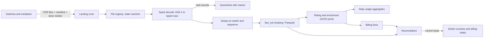

## 🎯 TL;DR

> Design the pipeline that takes about **3 TB per day** of binary call detail records (CDRs) from network switches, decodes them, removes duplicates, rates them against tariffs, and produces **billing aggregates and usage analytics** that reconcile with the switches and the billing system to the record.

- The data arrives as **files**, not a stream: batch by file, with a manifest, a done-marker and a file-level state machine.
- CDRs are **ASN.1 binary** records. Decoding is CPU-heavy and needs a schema-driven decoder, not string parsing.
- **Exactly-once** is achieved by an idempotent key (`switch_id`, `record_sequence`) and atomic commits per file, not by hoping for no retries.
- **Reconciliation** is a first-class output. Counts and sums must match at each hop, or billing does not run.

## 📋 Problem statement

A mobile operator runs several switch clusters (voice, SMS, data). Each switch writes CDR files every few minutes. The operator needs: a complete, de-duplicated usage fact for analytics; invoice line items per billing cycle for the billing system; and a daily proof that the numbers match the switches. Subscribers, tariffs and cell sites change over time.

The planning figure from our roadmap is **3 TB per day** of raw CDR files.

### Functional requirements

- Ingest CDR files from switches and mediation servers from landing storage (SFTP or object storage).
- Decode ASN.1 BER-encoded records into typed fields, and reject or quarantine bad ones with a reason.
- De-duplicate records that appear more than once (for example, a switch re-sends a file after a timeout).
- Enrich records with subscriber, tariff and cell-site dimensions valid at the call time.
- Produce `fact_cdr`, daily usage aggregates per subscriber and tariff, and billing cycle line items.
- Reconcile counts and totals per switch, per hour and per billing cycle, against control totals.

### Non-functional requirements

- **Latency:** the previous day's usage and billing inputs are ready before the morning billing run (for example 04:00).
- **Correctness:** no lost and no double-counted record. Any mismatch is detected, reported and explained.
- **Privacy:** IMSI and MSISDN are personal identifiers. They are pseudonymised before analytics, and raw values are restricted. This is a legal requirement in many jurisdictions and a contractual one for every operator.
- **Retention:** raw CDRs kept for a legal period (commonly months); decoded facts kept longer for analytics.

## 📐 Estimation

Use the roadmap figure: **3 TB per day** of raw CDR file data. Assume an average raw record of about **250 bytes**, including the ASN.1 envelope.

- Records per day: 3 × 10¹² B ÷ 250 B = **12 billion records per day**.
- Average rate: 12 × 10⁹ ÷ 86,400 s ≈ **139,000 records per second**.
- Peak rate: assume 3× the average at the busy hour, so **about 420,000 records per second**.
- Decoded record size on the message bus: assume about 200 bytes after decoding into a typed format. At peak: 420,000 × 200 B = **84 MB per second** of decoded data.
- Kafka partitions: planning rules of thumb often use around 10 MB per second per partition for a single producer and consumer group, so 84 MB/s needs about 9 partitions. Provision **24 partitions** for headroom and consumer parallelism. Verify this against your own benchmark.
- Decode throughput: the batch window for the day is about 1 hour. Required throughput is 3 TB ÷ 3,600 s ≈ **834 MB per second** of raw file data. If one core decodes and parses about **10 MB per second** (an assumption to measure), you need 834 ÷ 10 ≈ **84 cores**, which is about **21 executors with 4 cores each**.
- Storage for decoded facts: 12 × 10⁹ records per day × 60 bytes compressed per record (columnar, dictionary and delta encoding) ≈ **720 GB per day**, so 720 GB × 365 ≈ **263 TB per year** before replication. With 3× HDFS replication that is about **790 TB**. Object storage with erasure coding costs less.
- Raw retention: keeping 30 days of raw files at 3 TB per day is 90 TB before compression. Compressed BER files shrink, but measure it.

The arithmetic matters more than the exact numbers. The key finding: **the decode step needs about 20 executors for one hour a day**, and the raw data is the largest storage item in the first month. Those two numbers drive the design.

## 🗃️ Data model

| Table | Grain or key | Notes |
|---|---|---|
| `raw_cdr_file` | one row per file | `file_id`, `switch_id`, `checksum`, `status`, `record_count_declared` |
| `stg_cdr_decoded` | one row per decoded record | Typed fields, `file_id`, `record_sequence` |
| `fact_cdr` | one row per unique CDR | Key `(switch_id, record_sequence)`; partitioned by `event_date` and `event_hour` |
| `dim_subscriber` | SCD2 | Tariff plan, status, pseudonymised MSISDN; valid ranges |
| `dim_tariff` | Type 2 | Rate plans; valid ranges |
| `dim_cell_site` | Type 1 | Location, technology |
| `agg_usage_daily` | subscriber × tariff × day | Voice seconds, SMS count, data bytes |
| `billing_line` | subscriber × cycle × service | Rated amount; input to the billing system |
| `recon_result` | switch × hour and cycle | Counts and sums: declared, decoded, stored, billed |

`fact_cdr` keeps the **switch-assigned sequence** as part of the key. That is the only identifier that is unique by construction, because the switch increments it for every record it produces. Timestamps are stored in UTC and the source time zone is kept as a column.

A calendar dimension supports two calendars. Billing cycles are often aligned to a Jalali month for Iranian customers, while network reports use Gregorian dates. Store both in `dim_date` and never derive one from the other inside a query.

## 🏗️ High-level design



The file registry is the control plane. Every file moves through `RECEIVED → VALIDATED → DECODED → COMMITTED`, or `QUARANTINED`. A run only picks up files in `RECEIVED` or in a failed state, and only commits a file once. This is what makes reruns safe.

The decode job reads each file as a unit. It does not read the whole day as one stream, so one corrupt file cannot stop others, and retries are per file.

## 🧠 Deep dives

### 1. File ingestion

Switches write files with a naming pattern and, in good setups, a manifest and a done-marker. Build the landing zone around that.

- **Done-marker first.** A file is only eligible when its marker exists. Without it, you may read a file that is still being written.
- **Manifest check.** Compare the declared record count and checksum from the manifest with what you read. A mismatch means a partial or corrupt file, so the file goes to quarantine, not to the fact table.
- **Duplicates at file level.** A switch can re-send a file after a timeout. The registry rejects a second file with the same checksum, or the same `(switch_id, file_sequence)`, and records that it was a duplicate.
- **Late files.** Files can arrive hours or days late. The file registry makes that normal: a late file is processed and its partition is rebuilt.

See [[file-ingestion]] for the general pattern of landing zones and done markers.

### 2. ASN.1 decoding

CDRs are ASN.1 records encoded with BER or a related rule set. The schema defines every field, and the encoding is compact but nested and version-dependent.

- **Use a schema-driven decoder.** Generate the decoder from the ASN.1 schema, or use a maintained library, and run it inside the Spark task (for example through `mapPartitions`). Do not parse with string tools or per-record Python: at 420,000 records per second the overhead decides the cost.
- **Version the schema.** Switches upgrade over time and new fields appear. Keep the schema version in each decoded row, and make decoding fail loudly on an unknown version rather than silently dropping fields.
- **Bad records.** A record that fails decoding goes to a quarantine table with `file_id`, byte offset, error and schema version. The count of quarantined records is part of reconciliation. Never drop them silently.
- **Timestamps.** Decode time fields with their time zone rules. Store UTC plus the offset, and be explicit about what the switch's clock represents.

> **⚠️ Watch out:** A decoder that skips unknown fields "to be safe" changes the amount of data you bill for. Fail or quarantine instead.

### 3. Exactly-once loads

Within a file, a record appears once. Across files, a record may appear twice if a switch re-sends. The goal is that each unique record lands once, however many times the job runs.

- **Key.** `(switch_id, record_sequence)` identifies a record. If the switch reuses sequence numbers after a restart, add a `switch_epoch` or start time to the key, and check this with the switch vendor.
- **Dedup within a run.** Group by the key and keep one row, checking that the duplicates are identical. If they differ, that is a data-quality incident, not a dedup.
- **Commit atomically.** Write the file's output to a staging table, then `MERGE` into `fact_cdr` on the key in one transaction (Iceberg or Delta). Then mark the file `COMMITTED` in the registry in the same pipeline step. If the job dies between steps, the MERGE is idempotent, so the rerun is safe.
- **Replay.** Rerunning a committed file must produce no new rows. The MERGE on the key guarantees that.

For the general pattern, see [[exactly-once]] and [[pattern-dedup]].

### 4. Enrichment with SCD2

A call at 10:00 on the 3rd of the month must be rated with the tariff the subscriber had at 10:00. Joining to the **current** tariff re-prices old calls and creates disputes. Join on the validity range, as in the e-commerce lesson:

```sql
SELECT c.cdr_key, c.volume_bytes, t.rate_per_mb
FROM fact_cdr AS c
JOIN dim_tariff AS t
  ON t.tariff_id = c.tariff_id
 AND c.event_ts >= t.valid_from
 AND c.event_ts <  t.valid_to;
```

Keep rating deterministic: the same CDR and the same dimension versions always produce the same amount. That is what lets you rerun a billing cycle and get the same invoice.

### 5. Reconciliation

Reconciliation is where the design proves itself. For each switch and hour, compare four numbers:

1. **Declared** records (from the manifest or the switch's own counters).
2. **Decoded** records (from the decode job).
3. **Stored** unique records in `fact_cdr`, after dedup and quarantine.
4. **Billed** records or volume in `billing_line`, for the cycle.

The identity is: `declared = stored + quarantined + duplicates_removed`. A non-zero difference is an incident with a reason code. For billing, also compare the sum of rated amounts with the billing system's total for the cycle, allowing zero difference for amounts computed the same way.

Roaming records often arrive in partner files days after the event. Keep them in the same fact with their own arrival time, and decide with finance whether they belong to the current cycle or a restatement.

## 🧠 Senior depth & trade-offs

- **Batch or stream?** The source is files, and billing is daily. A file-batch design with Spark is simpler and cheaper than a streaming design. Use streaming only when a near-real-time usage alarm (fraud, bill shock) is a requirement, and then feed it from a separate, approximate path.
- **Spark tuning for decode.** The decode is CPU-bound, so choose executor cores to match the decoder's thread-safety and memory. Watch for skew: a few large files or one busy switch produce uneven tasks. Repartition after decode, not before, if the decode is per file.
- **Small files.** A switch writing thousands of tiny files creates many small Parquet files after decode. Compact per partition hour, or merge at the file-registry level before decoding. See [[small-files-problem]].
- **Table format.** An Iceberg or Delta table gives you atomic MERGE, snapshots for audit, and time travel for reconciliation. Check the features and limits for your version before relying on them.
- **Storage and cost.** 263 TB per year of decoded data is manageable on-prem with HDFS or object storage, but raw files are larger. Put raw retention and decoded retention in separate policies, and make sure legal retention is not shortened by a cost optimisation.
- **PII.** Pseudonymise the MSISDN and IMSI at decode time with a keyed hash (HMAC with a key held in a secrets store), so analytics can join without seeing the number. Restrict the raw files to a small group. A plain hash is not enough: phone numbers have a small space and can be reversed by brute force.
- **Late and duplicate data from partners.** Roaming and interconnect files arrive late and may overlap. Treat them as a separate source with their own registry entries and their own reconciliation.
- **Iran context.** Many operators run this on-prem with Hadoop, Hive or Iceberg, Spark, Oracle billing and strict data-locality rules. The design is the same; the operational cost (hardware refresh, capacity for peaks such as Nowruz and exam periods) is higher.
- **What to monitor:** files waiting in landing (age and count), quarantine rate per switch, decode throughput (MB per second per executor), duplicate rate, reconciliation difference per hour, and time to billing readiness.
- **When not to build this:** a small operator with one switch and a few hundred GB a day can run the same logic in a nightly SQL job. The registry, reconciliation and SCD2 rules still apply, but Spark and a lakehouse may be overkill.

## 🧪 Try it

Predict first, then check your answer.

> A switch times out while sending file `F-0412` and sends it again as `F-0412b`. Both copies contain records 1000–1999 with the same sequence numbers. What should the pipeline do, and where does the duplicate check live?

<details><summary>Your guess?</summary>

The second file is a **file-level duplicate**: the checksum or `(switch_id, file_sequence)` matches a file already in the registry, so it is marked as a duplicate and not decoded. If it were decoded, the record-level dedup on `(switch_id, record_sequence)` would also drop the duplicate rows, and the reconciliation would count them as `duplicates_removed`. Both checks exist, and the file-level check is cheaper because it avoids decoding at all.

</details>

## 💬 Interview corner

> **🎤 Say this in the interview:** "I treat CDRs as batch files with a registry. Each file is validated against its manifest, decoded with a schema-driven ASN.1 decoder, and committed to an Iceberg table with an idempotent MERGE on switch and sequence. Rating joins the tariff valid at call time. Reconciliation checks declared, decoded, stored and billed counts per switch and hour, and any gap is an incident."

**What a mid answer sounds like:** file ingestion, a Spark decode, a fact table, daily aggregates, and a billing job.

**What a senior answer adds:** the decode cost in executors, the key design for exactly-once, SCD2 rating, the reconciliation identity, PII pseudonymisation with a keyed hash, and small-file control.

**What a Staff answer adds:** the cost and risk model for a 3× growth in two years, the owner and SLA of each control total, a plan for schema changes from switch vendors, and a DR plan that replays raw files for a given cycle.

### Likely follow-ups

1. **"The switch vendor upgrades and adds 12 new fields. What breaks?"** The decoder fails loudly on an unknown schema version. You add the new schema, version the decoded rows, and backfill only if the billing rules use the new fields. Old rows keep their version.
2. **"A billing run found a 0.02% gap in one cycle. Walk me through the investigation."** Check the reconciliation identity per switch and hour. Look at the quarantine reasons, duplicate counts, late files and roaming arrivals. Find the first hop where the numbers diverge.
3. **"Traffic grows 3× in 2 years. What changes?"** Scale the decode executors, raise partitions, consider per-switch parallelism and tiered storage for raw files. Re-run the estimate with the measured decode throughput, not the assumed one.
4. **"How do you make reruns of a billing cycle identical?"** Deterministic rating against versioned dimensions, idempotent MERGE, pinned schema versions and a snapshot of the inputs used for the run.
5. **"Why not use Kafka for CDRs?"** The switches produce files and the billing needs complete batches with control totals. Kafka adds a stream that the reconciliation still has to reason about. Use it only for the near-real-time alarm path.

## ⚠️ Common mistakes

- **Treating CDRs as JSON or text.** ASN.1 is binary and schema-driven. Parse with the schema.
- **Dropping bad records silently.** The reconciliation identity breaks and billing is wrong without anyone noticing.
- **Deduplicating by content hash only.** Two genuine records can have the same content (same duration and volume, same time). Use the switch sequence.
- **Joining to the current tariff.** Old calls are re-priced and disputes follow.
- **Committing a file without a registry state.** A rerun then duplicates or skips records.
- **Storing raw MSISDN in analytics.** It is both a privacy and a legal risk.
- **No control totals.** Without declared counts from the switch, you cannot prove completeness.
- **Sizing from the average.** Billing is driven by the busy hour, so size for the peak and the batch window.

## ✅ Check yourself (quiz)

1. **Recall.** What is the primary key of a unique CDR in `fact_cdr`?
   - A) The MSISDN and the timestamp
   - B) `(switch_id, record_sequence)`
   - C) A hash of the full record content
   - D) The file name

   <details><summary>Answer</summary>

   **B** — The switch assigns a sequence to each record it produces, so `(switch_id, record_sequence)` identifies a record. Content hashes can collide on genuinely different calls, and file names change when a file is re-sent.

   </details>

2. **Scenario.** A file's manifest declares 1,000,000 records, but the decoder reads 999,870. What should happen?
   - A) Load the 999,870 records and continue
   - B) Quarantine the file, report the gap, and do not commit it to `fact_cdr`
   - C) Ask the switch for the missing records and wait indefinitely
   - D) Change the manifest to match the decoded count

   <details><summary>Answer</summary>

   **B** — A count mismatch means a partial or corrupt file. Quarantine keeps the bad data out of billing, and the gap is reported. Changing the manifest (D) destroys the control total you need for reconciliation.

   </details>

3. **Scenario.** Why does the design use an idempotent MERGE on the key instead of a plain append?
   - A) Appends are not supported by Iceberg
   - B) A re-sent file or a rerun would add duplicate rows with an append; a MERGE on the key adds each unique record once
   - C) MERGE is faster than an append
   - D) Appends cannot store decoded timestamps

   <details><summary>Answer</summary>

   **B** — Retries and re-sent files are normal in batch systems. A MERGE on the key makes the load idempotent, so the same input applied twice gives the same table.

   </details>

4. **Senior trade-off.** A customer's tariff changed on the 15th, and billing re-runs for the whole cycle. Joining to the current tariff gives different bills from the originals. What is the fix?
   - A) Always price with the current tariff
   - B) Join on the validity range of the tariff at call time, and keep rating deterministic against versioned dimensions
   - C) Delete old invoices
   - D) Store the tariff in the CDR file

   <details><summary>Answer</summary>

   **B** — Calls must be rated with the tariff that applied when they happened. Versioned dimensions with validity ranges make the rating deterministic, so reruns reproduce the same amounts.

   </details>

5. **Senior design question.** Why should the decoder use a schema-driven library rather than a custom parser?
   - A) Custom parsers cannot read binary data
   - B) A schema-driven decoder follows the ASN.1 definitions, handles nested and optional fields correctly, and makes schema versions explicit, while a custom parser breaks silently when the schema changes
   - C) Schema-driven decoders are always faster than any alternative
   - D) The switch vendor requires a specific library

   <details><summary>Answer</summary>

   **B** — The schema is the contract. A decoder generated or driven by it keeps field positions, optional fields and versions correct, and fails loudly on changes. A hand-written parser tends to fail quietly, which in billing is the worst outcome.

   </details>

## 🗂️ Flashcards

| Front | Back |
|---|---|
| What is an ASN.1 CDR? | A binary, schema-defined call record produced by a switch |
| Why a file registry? | Tracks each file's state so reruns and late files are safe |
| Unique key for a CDR? | `(switch_id, record_sequence)`, plus epoch if sequences reset |
| Why quarantine instead of drop? | Dropping breaks the reconciliation identity and changes billing |
| Why join tariffs by validity range? | Calls must be rated with the tariff valid at call time |
| What is the reconciliation identity? | declared = stored + quarantined + duplicates removed |
| Why pseudonymise with a keyed hash? | Analytics can join without exposing the number; a plain hash can be brute-forced |

## 🔗 Go further

- Prerequisites: [[file-ingestion]], [[dedup-idempotent-loads]].
- Related patterns: [[pattern-exactly-once]], [[pattern-reconciliation]], [[pattern-data-deletion]].
- Related designs: [[design-payment-reconciliation]], [[design-cdc-lake]].
- Background: [[data-estimation]], [[numbers-to-know]], [[lakehouse-table-formats]], [[data-security]].
- Glossary: [[exactly-once]], [[deduplication]], [[small-files-problem]], [[partition]].
