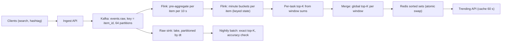

## 🎯 TL;DR

> **Problem:** Build a system that shows the **top K items** (K = 100) by event count over several windows (last 5 minutes, last hour, last 24 hours) for a stream of about a billion events a day, refreshed about every minute, and served in under 100 ms.

- **Partition the stream by item key.** Each item's events land on one task, so the local top-K results are disjoint, and the global top-K is just the best K of the local answers. Exactness comes for free at this scale.
- Count in **minute buckets**, combine buckets for each window, and keep a **heap** of the K best per partition.
- **Count-Min Sketch (CMS)** is the tool when the number of distinct keys explodes (for example item × country × hour). Its error is absolute, `ε × N`, so you size it by the smallest count you must rank correctly, not by memory.
- Serve the result from a **sorted set** that is replaced atomically each minute, so readers never see a half-written list.

## 🌱 Start simple (Junior)

> **💡 Analogy:** A school announces the top 10 most-borrowed books this week. Each librarian counts borrows at their own desk, but each book is assigned to one desk only. At the end of each minute the desks report their own top 10. The head librarian merges the reports, and the result is the true top 10, because no book was counted at two desks.

**Problem statement.** A search platform logs every search and every hashtag use. Product wants a "trending" list: the 100 items with the most events in the last 5 minutes, the last hour, and the last 24 hours. The list is shown on the home page and refreshed about every minute.

**Functional requirements**

1. Ingest search and hashtag events.
2. Return the top 100 items for each window (5 min, 1 h, 24 h).
3. Optionally filter by region or category (mentioned, not required in the core design).
4. Count an event once, even if the producer retried it (approximate duplicates are acceptable for trending, but say so).

**Non-functional requirements**

- **Freshness:** the list is at most about 1 minute old.
- **Latency:** a read returns in under 100 ms at the 99th percentile.
- **Accuracy:** the ranking is exact or within a stated error, and you can measure it against a batch job.
- **Scale:** 1 billion events per day, peaks at 5 times the average.
- **Availability:** a broker or task restart must not lose the list for more than a minute.

The first thing to say is that the hard part is the **windowed** ranking under a large key space and a hot item, not the raw throughput.

## 🔧 How it really works (Mid)

### Step 3: Estimation (show the arithmetic)

| Quantity | Calculation | Result |
|---|---|---|
| Average event rate | 1,000,000,000 / 86,400 s | about 11,600 events/s |
| Peak event rate | 11,600 × 5 | about 58,000 events/s |
| Raw event size | assume 100 bytes | 100 B |
| Raw data per day | 1,000,000,000 × 100 B | 100 GB/day |
| Kafka retention, 7 days, 3 replicas | 100 GB × 7 × 3 | 2.1 TB |
| Distinct items per day | assume | 50 million |
| Distinct items per hour | assume | 10 million |
| Events per item per hour (average) | 41.7 M events/h / 10 M items | about 4 |
| Exact 1-hour state, sparse minute map | 10 M items × about 110 B | about 1.1 GB total |
| Per task (64 tasks) | 1.1 GB / 64 | about 17 MB |

The exact state is small. That changes the design: at this scale you can count exactly, and reach for a sketch only when the key space grows by orders of magnitude.

### Step 4: Data model

- **Raw event** (lake, immutable): `event_id`, `item_id`, `item_type`, `region`, `event_time`, `ingest_time`, `dt` (partition).
- **Minute bucket** (internal state): key `(item_id, minute_start)`, value `count`. Entries are dropped after 24 hours.
- **Serving list** (Redis sorted set): one key per window, for example `trend:1h`, member = `item_id`, score = count. Each refresh writes a temporary key and renames it over the live key.
- **Audit table** (OLAP, for analysis and accuracy checks): `(window, rank, item_id, count, computed_at)`.

### Step 5: High-level design

Walk through it: events are keyed by item, so one item's counts live in one task. Pre-aggregation shrinks the traffic for hot items. Each minute, every task emits its local top-K, and a small merge step picks the global top-K for each window. The lake keeps raw data for recomputation, and a nightly batch job gives the reference answer.

**Windowing.** Count in 1-minute buckets. The 5-minute view sums the last 5 buckets, the 1-hour view sums the last 60, and the 24-hour view sums 24 hourly totals built from the minute buckets. Sliding windows are recomputed each minute from buckets, so an old bucket leaves the sum when it expires.

## 🧠 Senior depth & trade-offs

### Deep dive 1: Exact counting with item-key partitioning

Partitioning by `item_id` is the design decision that matters most. Each partition holds a disjoint set of items, so:

- An item's count is never split across tasks, so no merge of partial counts is needed.
- The local top-K of each partition is the exact top-K of its items. The global top-K is the best K across the 64 local lists (64 × 100 = 6,400 candidates), which is exact.

The cost is **skew**: one viral item sends all its events to one task. Deep dive 4 handles that.

### Deep dive 2: Top-K selection with a heap

To pick the top K from N item counts, keep a min-heap of size K. For each candidate item, if its count is greater than the heap's minimum, replace the minimum. This costs O(N log K). With N = 300,000 items in a partition and K = 100, that is about 300,000 × 7 comparisons per minute, which is trivial.

Be careful with **sliding** windows. Counts can go **down** as old buckets expire. A heap that only handles increases will keep a stale item at the top. Two fixes:

- Recompute the local top-K from the window sums once per minute. This is simple, and cheap at the sizes above.
- Or use an **exponentially decayed score** (`score = score × e^(−λΔt) + 1`). It needs O(1) state per item and only increases between updates, so a heap stays correct. The trade-off is that the window is a half-life, not a hard boundary.

### Deep dive 3: Count-Min Sketch when the key space explodes

Suppose the product now needs top items **per country per hour**, with 200 countries and 10 billion item-country pairs. Exact maps stop fitting. A CMS gives a fixed-size approximation:

- A table of `d` rows and `w` columns of counters. Each event adds 1 to one cell per row, chosen by a different hash per row.
- The estimate for an item is the **minimum** of its `d` cells. Hash collisions only add counts, so the estimate never goes below the true count, and it can only go above by a bounded amount.
- Sizing: `w = ⌈e / ε⌉`, `d = ⌈ln(1/δ)⌉`. The guarantee is: estimate ≤ true + ε·N, with probability at least 1 − δ, where N is the total count in the window.

| ε | w | d | Memory (4-byte counters) | Max error per hour (N = 41.7 M) |
|---|---|---|---|---|
| 10⁻⁴ | 27,183 | 5 | about 0.54 MB | about 4,170 |
| 10⁻⁵ | 271,829 | 5 | about 5.4 MB | about 417 |

(For δ = 0.01, `d = ⌈ln 100⌉ = 5`.)

The key insight is that the error is **absolute**. If the 100th item in the hour has about 20,000 events, an error of 4,170 is about 20 percent, which can reorder the list. With ε = 10⁻⁵ the error is about 2 percent. So choose ε from the smallest count you must rank correctly, then pay for the memory.

Two more points. **Conservative update** (increment only the cells that equal the current minimum) reduces overestimation. And the CMS is **mergeable**: adding two sketches cell by cell gives the sketch of the union, which is how you combine minute sketches into a window. Keep a heap of candidate item IDs next to the sketch, because a CMS can estimate a count but cannot list the heavy items by itself.

If you need **distinct** counts per item (unique users), a CMS is the wrong tool; see [[hyperloglog]] and [[design-unique-counts]].

### Deep dive 4: Hot items and skew

A viral hashtag can take 30 percent of all events. Its partition becomes the bottleneck, and its state is the same as that of the rest.

- **Pre-aggregate before the shuffle.** A 10-second tumbling window per item turns millions of events for the hot item into one record per 10 seconds. This is the cheapest and most effective fix.
- **Two-level aggregation with salting** (for the rare case that pre-aggregation is not enough): split the hot key into sub-keys, aggregate per sub-key, then sum. See [[pattern-hot-keys]] and [[salting]].
- Monitor the largest partition's lag, not the average.

### Deep dive 5: Serving and freshness

Each minute, the job writes the K items for each window into a **temporary** sorted set and then renames it over the live key. `RENAME` replaces the key in one step, so a reader sees the old list or the new list, never a half-written one. The API caches the response for about 60 seconds, so the Redis read rate is much lower than the client request rate.

If the job fails, readers keep the last good list. Surface the list's age (`computed_at`) in the response so the UI can show "updated 4 minutes ago" instead of silently serving stale data.

### Deep dive 6: Recovery and correctness

The Flink job checkpoints its minute buckets and its Kafka offsets. After a failure it replays from the checkpoint, and the minute buckets are overwritten with the same values (an idempotent upsert on `(item_id, minute_start)`). The nightly batch recomputes the exact top-K from the raw lake. Compare the two each day: recall at K (how many of the batch top-100 appear in the streaming top-100) and rank correlation. Alert when recall drops below an agreed threshold.

## 🧪 Try it

1. The product wants the top 100 **per country** (200 countries) in the last hour, with 10 billion item-country pairs per day. Choose between exact maps and a CMS, and give the memory and error for ε = 10⁻⁵.
2. A hot item gets 20 million events per hour. Using 10-second pre-aggregation, how many records does its task receive per hour? Show the arithmetic.
3. Explain why a plain heap of the top K cannot handle a sliding window where counts can decrease.

Show solutions

**1.** Exact maps: 10 billion pairs × tens of bytes is hundreds of gigabytes of state per window, too large for a comfortable design. A CMS with ε = 10⁻⁵ and δ = 0.01 uses about 5.4 MB per sketch (w = 271,829, d = 5, 4-byte counters). Error is at most ε × N per hour, with N = 1 billion / 24 ≈ 41.7 million, so about 417 counts. Keep a candidate heap per country to list the items. If the top items per country have counts well above 417, the ranking is reliable.

**2.** One hour has 3,600 seconds, so 3,600 / 10 = 360 windows. The pre-aggregation emits one record per window, so the task receives 360 records per hour instead of 20 million. That is a reduction of about 55,000 times.

**3.** A heap that only supports increases assumes an item's score never falls. In a sliding window, expired buckets remove counts, so an item can drop below others but still sit at the top of the heap. Fix it by recomputing the local top-K from the window sums each minute, or by using a decayed score that only changes at update time and is monotone between updates.

## 💬 Interview corner

- **Mid:** partition by item key, count in minute buckets, keep a heap of size K, serve from a cache or a sorted set. Explain why exact counts are fine for 50 million items.
- **Senior:** the sliding-window decrement problem and how to fix it, hot-key pre-aggregation, the CMS error trade-off with numbers, atomic publication of results, and the reconciliation with a nightly batch.
- **Staff:** the product definition of "trending" (volume or velocity), the cost of per-region or per-category dimensions (a CMS per dimension, or a hierarchy), abuse and bots (a trending list can be gamed; limit events per user per item), multi-region serving and failover, and how to evolve the window definitions without a full reprocess.

### Follow-ups to expect

- "Why not `GROUP BY item ORDER BY count DESC LIMIT 100` on the warehouse every minute?" Answer: it is correct but scans the whole window each minute at high cost, and it has a latency of minutes, not seconds.
- "How do you handle a delete of a post that was trending?" Answer: publish a compensating event (negative count) into the same keyed stream, or accept the approximation and correct in the nightly batch.
- "Count distinct users per hashtag instead of events?" Answer: use HyperLogLog per bucket, which is mergeable like CMS, and say its error is relative (about 1 percent with the standard register sizes), not absolute.
- "What if the product wants exactly-once counts for billing?" Answer: this design is for trending, not billing. For billing, use the reconciled batch path and the idempotent sink from [[pattern-exactly-once]].

## ⚠️ Common mistakes

> **⚠️ Watch out:** Partitioning the stream randomly (for example round-robin). An item's counts then split across tasks, and the "local top-K" lists can no longer be merged into an exact global answer.

> **⚠️ Watch out:** Using a CMS to rank small counts. Its error is absolute, so a sketch sized for the whole stream can reorder a list where the counts are small.

- Using a plain top-K heap for a sliding window, so expired items stay at the top.
- Storing the top-K in a database row that is updated on every event. That creates a write hot spot and high write amplification. Update the list once per minute instead.
- Ignoring the hot item until the largest partition falls behind.
- Serving a list with no timestamp, so stale data looks fresh.
- Counting bot or repeated events without a per-user limit, then calling the result "trending".
- Claiming exact results without a measured comparison with the batch job.

## ✅ Check yourself (quiz)

1. Why is item-key partitioning useful for top-K?
   - A) It makes the stream faster to write
   - B) Each item's events are on one task, so local top-K lists are disjoint and merge into the exact global top-K
   - C) It removes the need for a window
   - D) It compresses the counts

Answer

**B** — with no item split across tasks, no partial counts need merging, and the best K of the local lists is the global answer.

2. In a Count-Min Sketch, what does a query return?

   - A) The exact count, always
   - B) The minimum of the item's counters across the `d` rows, which is never below the true count
   - C) The maximum of the item's counters
   - D) A random sample of events

Answer

**B** — collisions only add counts, so the minimum over rows is the tightest estimate, and it can overestimate but not underestimate.

3. **(Senior)** You need items ranked correctly when they have around 20,000 events in an hour, and N is 41.7 million. Which ε is safe enough, and why does memory not decide it?

   - A) ε = 10⁻⁴, since it uses less memory
   - B) ε = 10⁻⁵, because its error bound is about 417 counts, which is about 2 percent of 20,000; the error is absolute, so ε must be set from the counts you must rank
   - C) Any ε works, because the error is relative
   - D) ε does not matter for ranking

Answer

**B** — the bound is ε × N in absolute counts. A 4,170-count error at 20,000 is about 20 percent, which can reorder the list. The memory cost of ε = 10⁻⁵ (about 5.4 MB per sketch) is the price of correct ranking here.

4. **(Senior)** A sliding 1-hour top-K heap shows an item that stopped trending 40 minutes ago. What is the most likely cause, and the fix?

   - A) The Kafka partition is too large
   - B) The heap only handles increases, so expired counts were never subtracted from its ordering; recompute from the window sums each minute or use a decayed score
   - C) The Redis key was not renamed
   - D) The CMS width is too small

Answer

**B** — the item's counts fell as old buckets expired, but the heap does not reorder when a score decreases. Recomputing the local top-K from the window sums each minute fixes it.

5. **(Senior)** Why publish the list with a temporary key and `RENAME` rather than updating the live sorted set in place?

   - A) `RENAME` is faster than `ZADD`
   - B) Readers see either the old complete list or the new complete list, never a partly written one
   - C) Sorted sets cannot be updated
   - D) Redis requires a rename for every write

Answer

**B** — the swap is atomic from the reader's point of view. An in-place rewrite can show a mix of old and new items, or an empty list during the update.

## 🗂️ Flashcards

| Front | Back |
|---|---|
| Why partition by item key | Each item's counts sit on one task, so local top-K lists merge exactly |
| Heap for top-K | Min-heap of size K; O(N log K) to pick the top K from N counts |
| Sliding-window problem for heaps | Counts can decrease as buckets expire; recompute or use a decayed score |
| CMS estimate | Minimum over `d` rows; never below the true count; can overestimate |
| CMS error bound | Estimate ≤ true + ε·N with probability ≥ 1 − δ |
| Why size ε by ranked counts | The error is absolute, so small counts need a smaller ε |
| Mergeable sketches | Adding sketches cell by cell gives the sketch of the union |
| Hot item fix | Pre-aggregate in short windows before the shuffle; salt only if needed |
| Atomic publish | Write a temporary key, then `RENAME` it over the live key |
| Accuracy check | Compare the streaming top-K with the nightly batch: recall at K |

## 🔗 Go further

- [[design-unique-counts]] covers distinct counts with HyperLogLog, the right tool when you count users, not events.
- [[design-leaderboard]] solves a related ranking problem with sorted sets and a different update pattern.
- [[pattern-hot-keys]] explains skew mitigation in detail.
- [[pattern-late-data]] and [[streaming-state]] cover the window, lateness and state-size decisions behind the minute buckets.
- [[probabilistic-ds]] summarises Bloom filters, HyperLogLog, Count-Min Sketch and reservoir sampling in one place.
