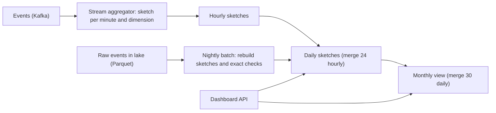

## 🎯 TL;DR

> Build a dashboard that shows **daily active users (DAU)** and **monthly active users (MAU)** for any slice (country, platform, app version), over billions of events per day, with queries that return in under a second.

- A **distinct count** cannot be summed: a user active in three hours is one user, not three. Summing hourly uniques over-counts.
- **HyperLogLog (HLL)** is a sketch of about **12 KB** that estimates a distinct count with about **0.8%** standard error, and sketches **merge** (a union is a register-wise max).
- Roll up sketches hour → day → month, so MAU is a merge of 30 daily sketches, not a rescan of raw events.
- Use exact counting only where money or law depends on it, and reconcile the two paths on a schedule.

## 🌱 Start simple (Junior)

> **💡 Analogy:** A guest list at a conference. If you count "people who came in" at each door, the same person who walks through three doors is counted three times. To count unique people, you need a record of names, and that record grows with the crowd. A sketch is like a clever tally that never stores the names but gets the total roughly right.

**The problem statement** we design for:

> Product managers open a dashboard and see DAU and MAU by country, platform and app version. Data arrives at about 5 billion events per day. Numbers must be fresh within 5 minutes, and a 30-day MAU query must return in about a second.

**Why the naive approaches fail**

- `COUNT(DISTINCT user_id)` over raw events works, but it scans 150 million rows per dashboard tile and shuffles them to deduplicate. Each query is expensive.
- Summing daily counts gives a **wrong MAU**: a user active on 10 days is counted 10 times.
- Keeping a Python `set` of all user IDs per dimension does not fit in memory at scale.

**Functional requirements**

- DAU and MAU for any combination of dimensions, with a rolling 30-day window.
- Retention-style questions later ("how many of this week's users were also active last week"), treated as a stretch goal.
- Late events (up to 24 hours late) are counted in the correct day.

**Non-functional requirements**

- Freshness: 5 minutes for the current day.
- Query latency: p95 under 1 second for any tile.
- Accuracy: within 1% for product dashboards. Finance-grade numbers are reconciled daily against exact batch counts.

**Estimation (show the arithmetic)**

- Events: 5 billion per day, about 5 × 10⁹ / 86,400 = **58,000 events per second** average; peak about 175,000 per second at 3×.
- DAU: 50 million. MAU: 150 million distinct users over 30 days.
- **Exact daily set** per dimension: 50 million user IDs × 8 bytes = **400 MB**. Hash tables add overhead, so roughly 800 MB. For MAU, the exact union is 150 million × 8 B = **1.2 GB**, and every dimension combination multiplies it.
- **HLL sketch**: about **12 KB** per sketch (2^14 registers × 6 bits = 12,288 bytes).
- Dimension combinations: 200 countries × 3 platforms × 50 app versions = 30,000 per day. Daily sketches: 30,000 × 12 KB = **360 MB per day**, about **10.8 GB** for 30 days.
- Hourly sketches for the country dimension only: 200 × 24 × 12 KB = **57.6 MB per day**.
- Error: standard error is 1.04 / √m. With m = 16,384 registers, that is 1.04 / 128 ≈ **0.81%**. On DAU of 50 million, one standard deviation is about 50 M × 0.0081 ≈ **405,000 users**.

> **⚠️ Watch out:** The error is relative, so 0.8% of 50 million is a large absolute number. For small segments (a few thousand users) the relative error is the same in theory, but implementations switch to exact or sparse modes at small cardinalities. Check your engine.

## 🔧 How it really works (Mid)

**HyperLogLog in one paragraph.** Hash each user ID to a 64-bit value. The first bits pick one of m registers. For the remaining bits, count the leading zeros; a long run of zeros is rare, so seeing one suggests many distinct values. Each register keeps the largest run seen. The harmonic mean of the registers, with corrections, estimates the count. Memory is fixed by m, not by the number of users.

Two properties make HLL right for dashboards:

1. **Union is cheap.** The merge of two sketches takes the maximum of each register. Merging 30 daily sketches gives MAU.
2. **Idempotent adds.** Adding the same user twice changes nothing. Duplicated or replayed events do not inflate the count.

**Architecture.**



The stream path updates sketches quickly for the current day. A nightly batch job rebuilds the same sketches from raw Parquet, so late events are included and any drift in the stream path is corrected. The dashboard only ever reads sketches.

**A ClickHouse implementation.** ClickHouse stores aggregate states so that rollups compose:

```sql
CREATE TABLE visitors_daily (
    day      Date,
    country  LowCardinality(String),
    platform LowCardinality(String),
    users    AggregateFunction(uniq, UInt64)
) ENGINE = AggregatingMergeTree
ORDER BY (day, country, platform);

-- Load: store the sketch state, not the final number
INSERT INTO visitors_daily
SELECT toDate(ts), country, platform, uniqState(user_id)
FROM events
GROUP BY toDate(ts), country, platform;

-- MAU for one country: merge 30 daily states
SELECT uniqMerge(users) AS mau
FROM visitors_daily
WHERE country = 'IR' AND day >= today() - 29;
```

`uniqState` produces a mergeable intermediate value; `uniqMerge` turns merged states into a number. The table stores states, so `GROUP BY platform` on top of the daily table is cheap. The same design works in Druid or Pinot with their distinct-count sketch columns, and in Redis with `PFADD`, `PFCOUNT` and `PFMERGE` for real-time keys (about 12 KB per key).

**Hierarchy of rollups.** The rule is simple: roll up **sketches**, never final counts.

- Hour → day: merge 24 hourly sketches per dimension.
- Day → month: merge 30 daily sketches.
- Country → region: merge the country sketches.

A DAU value is always the distinct count of the day's sketch, never the sum of hourly counts.

**Late data.** Events up to 24 hours late update the sketch for their event day. If the stream job has already published the day, the value changes after publish. Show the dashboard a "final after 02:00" marker, and let the nightly batch overwrite the sketch.

## 🧠 Senior depth & trade-offs

**Set operations need a different sketch.** HLL supports union well. Intersection and difference do not work directly: you can estimate `|A ∩ B|` as `|A| + |B| − |A ∪ B|`, but when the intersection is small relative to the sets, the error of each term dominates the result. For retention ("users active this week who were also active last week") use **Theta sketches** (Apache DataSketches), which support intersection and difference with bounded error, or keep an exact bitmap for the cohort you care about. Name this trade-off before the interviewer asks.

**Exact vs approximate is a product decision.**

| Question | Method | Why |
|---|---|---|
| Product dashboard DAU, MAU | HLL sketches | 0.8% error is invisible at the decision level; fast and cheap |
| Retention, cohort overlap | Theta sketches or bitmaps | Set operations need a sketch that supports them |
| Billing, royalties, regulatory reports | Exact batch count, audited | Money and law need exact, reproducible numbers |
| Small, exact segment (a few thousand) | Exact set or bitmap | Cheap at small size; avoid error entirely |

Exact distinct counting at this scale is an expensive shuffle: 5 billion rows hashed on `user_id` to produce 50 million distinct keys. Run it as a nightly batch for the audit numbers, not as the dashboard path.

**Dense IDs and bitmaps.** If user IDs are dense 32-bit integers, a Roaring bitmap is an exact and often compact alternative to HLL for one segment. Its size grows with the number of members, not with a fixed 12 KB, so it is a good fit for small or medium segments and a poor fit for huge sparse ones. Measure the size on your real ID distribution.

**Sketch size and dimension explosion.** The cost is the number of sketches, not the number of events. 30,000 combinations at 12 KB is 360 MB per day; add a dimension with 1,000 values and it becomes 12 GB per day. Keep the cross product small: sketch the common combinations, and answer rare ones from a coarser rollup. Sparse HLL representations save memory for combinations with few users, which is most of them.

**Hashing and identity.** HLL quality depends on a good 64-bit hash of the ID. Do not use a short or sequential ID without hashing it first, or the register statistics are biased. Identity resolution (merging device IDs into one user) is an upstream concern. The sketch counts whatever ID you give it, so a broken identity graph will produce a precise and wrong number.

**Time zones and "day".** A "day" is defined by a timezone chosen in the metric contract (UTC is the usual choice for pipelines). Store `event_time` in UTC, and convert to the reporting zone only at the presentation layer, or both numbers will disagree between dashboards.

**Failure modes.**

- Stream job restarts and replays a window: safe, because HLL adds are idempotent.
- A sketch is written with the wrong dimension value (for example, `NULL` country): counts appear under an "unknown" tile. Monitor the share of "unknown".
- Merges of sketches with different precision (different m) fail or give wrong results. Pin the precision in one place and version it.
- The batch rebuild and the stream path disagree by more than the expected error. That is a bug in one of them, so alert on the gap.

**When not to build this.** If the company has a few million events per day and a single warehouse, `COUNT(DISTINCT)` on a daily partition is fine. Sketches matter when the number of dimensions, the event volume and the freshness requirement combine.

**Operating signals:** freshness of the current day, the gap between stream and batch numbers per dimension, the share of "unknown" dimension values, sketch store size per day, and the query latency of the 30-day tile.

## 🧪 Try it

Use these inputs: 2 billion events per day, 20 million DAU, 60 million MAU over 30 days, 100 countries, 2 platforms, 40 app versions, and daily sketches of 12 KB.

1. What are the events per second on average?
2. How big are the daily sketches for all dimension combinations, and how many megabytes per day?
3. A colleague says: "MAU is the sum of the last 30 DAU values." Give the reason it is wrong, and say what you would store instead.

<details><summary>Show solutions</summary>

**1.** 2 × 10⁹ / 86,400 ≈ **23,150 events per second** on average.

**2.** Combinations: 100 × 2 × 40 = 8,000. Sketch size: 8,000 × 12 KB = 96,000 KB ≈ **96 MB per day** (about 94 MiB).

**3.** A user who is active on 10 of the 30 days is counted 10 times in a sum of DAU values. Summing overstates MAU, often by a large factor, because most users are active on several days. Store a daily sketch per dimension and merge the 30 sketches (register-wise max for HLL) to get the distinct count. The sum of daily distinct counts is not the distinct count of the period.

</details>

## 💬 Interview corner

**How it is asked:** "Design a dashboard that shows DAU and MAU at scale." Expect follow-ups on exactness, rollups and retention.

**Mid-level answer:** "I'd precompute per-day distinct counts per dimension so the dashboard doesn't scan raw events. For MAU I'd use HyperLogLog sketches so that a 30-day union is a merge rather than a recount. Adding the daily counts would double-count users, so I wouldn't do that."

**Senior-level answer:** "I'd keep HLL sketches of about 12 KB per dimension per day, which gives 0.8% error. Stream jobs update the current day within minutes, and a nightly batch rebuilds the sketches from raw Parquet to absorb late events and fix drift. Roll up sketches hour to day to month. For retention I'd switch to Theta sketches because intersections are not stable with HLL, and for billing I'd use an exact, audited batch count and reconcile the two."

> **🎤 Say this in the interview:** "Distinct counts are not additive, so I roll up mergeable sketches, not numbers. HLL gives a fixed-size, idempotent, mergeable answer that is accurate enough for product decisions, and I'd reconcile it with an exact batch path wherever money depends on it."

**Staff-level signals:** a metric contract (definition of "active", timezone, late-data cutoff); cost per dimension combination; governance for the "unknown" bucket; the decision of which dimensions are allowed in the sketch cube; and a plan for the identity graph that feeds the counts.

**Likely follow-ups.** *Why not Redis for everything?* It works for real-time keys, but durability, memory per dimension and cross-dimension queries favour a columnar store with sketch columns. *How do you show a 95% confidence interval?* About two standard errors: 1.96 × 0.81% ≈ 1.6%. *What if the events have no user ID for logged-out users?* That is a product definition problem; decide it in the metric contract, not in the sketch.

## ⚠️ Common mistakes

> **⚠️ Watch out:** Summing daily or hourly uniques to get MAU or DAU. Distinct counts are not additive across time.

> **⚠️ Watch out:** Using HLL for intersections and retention without checking the error. The difference of two large estimates can be dominated by noise.

- Running `COUNT(DISTINCT user_id)` on raw events for every dashboard tile, then wondering why the cost is high.
- Storing final numbers in the rollup table. Once you store a number, you cannot merge it, so you cannot roll it up.
- Mixing sketches of different precision in one column.
- Forgetting that late events change yesterday's number, and not telling the user when the number is final.
- Quoting an HLL result without its error, or treating a 0.8% error as an exact value in a financial report.
- Using a sequential or short ID as input to the sketch without hashing it.

## ✅ Check yourself (quiz)

1. A user is active on 4 of the last 7 days. What is their contribution to a 7-day MAU?
   - A) 4
   - B) 7
   - C) 1
   - D) 0.5

<details><summary>Answer</summary>

**C** — MAU counts distinct users. The user counts once, however many days they were active. The sum of daily counts would give 4 for this user, which is why sums are wrong.

</details>

2. Why is HyperLogLog suitable for a union over 30 daily sketches?

   - A) It stores every user ID, so the union is exact
   - B) Each register keeps a maximum, so merging takes the register-wise max and the result is the sketch of the union
   - C) It stores only the sum of hashes
   - D) It uses a special index that sorts users

<details><summary>Answer</summary>

**B** — the union of two HLL sketches is obtained by taking the maximum of each register. The merged sketch is the same as building one sketch over all the events.

</details>

3. With m = 16,384 registers, what is the standard error, and what is the one-sigma range for a DAU of 40 million?

   - A) About 0.8%, so about ±325,000
   - B) About 8%, so about ±3.2 million
   - C) About 0.08%, so about ±32,000
   - D) Exactly zero, because sketches are exact

<details><summary>Answer</summary>

**A** — 1.04 / √16,384 = 1.04 / 128 ≈ 0.81%. 40 million × 0.0081 ≈ 325,000. Sketches are approximate, never exact.

</details>

4. **(Senior)** Product wants "users active this week who were also active last week" from the same sketches. What is the problem, and what would you use?

   - A) Nothing; HLL intersections are exact
   - B) Intersection from inclusion-exclusion amplifies error when the overlap is small; use Theta sketches or an exact bitmap for the cohort
   - C) Use a larger m to make the intersection exact
   - D) Store daily averages instead

<details><summary>Answer</summary>

**B** — `|A ∩ B| = |A| + |B| − |A ∪ B|` subtracts large estimates, so the error of each term can dominate a small intersection. Theta sketches support intersection and difference directly, and exact bitmaps work when the segment fits.

</details>

5. **(Senior)** A stream job replays a 3-hour window after a crash. Which property of HLL makes this safe, and what still needs checking?

   - A) HLL is exact, so replay changes nothing
   - B) Adding the same user again does not change registers, so duplicates are harmless; you still must check that the replayed window did not drop or mis-assign events to another day
   - C) HLL deletes old users on replay
   - D) Replay is never safe with sketches

<details><summary>Answer</summary>

**B** — adds are idempotent, so duplicate events do not inflate the count. The remaining risk is loss or misassignment of events (for example, to the wrong day), which a reconciliation with the batch path catches.

</details>

## 🗂️ Flashcards

| Front | Back |
|---|---|
| Why can't you sum daily uniques for MAU? | A user active on several days is counted several times; distinct counts are not additive |
| What is an HLL sketch's size and error? | About 12 KB with 2^14 registers; standard error about 0.81% |
| How do two HLL sketches merge? | Register-wise maximum; the result is the sketch of the union |
| Why are HLL adds idempotent? | Re-adding the same user sets the same register values, so replays do not inflate counts |
| Which sketch supports intersection well? | Theta sketches (Apache DataSketches); HLL intersections amplify error |
| Roll up sketches or numbers? | Sketches; a stored final number cannot be merged later |
| When do you need an exact count? | Money, royalties, regulatory reports; use an audited batch count and reconcile |
| Why use UTC for event time? | So every dashboard agrees on day boundaries; convert only for display |

## 🔗 Go further

- **probabilistic-ds** explains HyperLogLog, Bloom filters and other sketches from first principles; read it before the deep dive.
- **data-estimation** gives the sizing habits used in the estimation section.
- **design-top-k** and **design-clickstream-analytics** use related streaming aggregation patterns.
- **pattern-realtime-aggregation** and **realtime-olap** cover the stream path and the serving store for the current day.
- **design-metrics-monitoring** shows another place where rollups must compose correctly.
- Check the distinct-count functions and precision parameters in your engine's documentation, because defaults and sketch types differ between versions.
