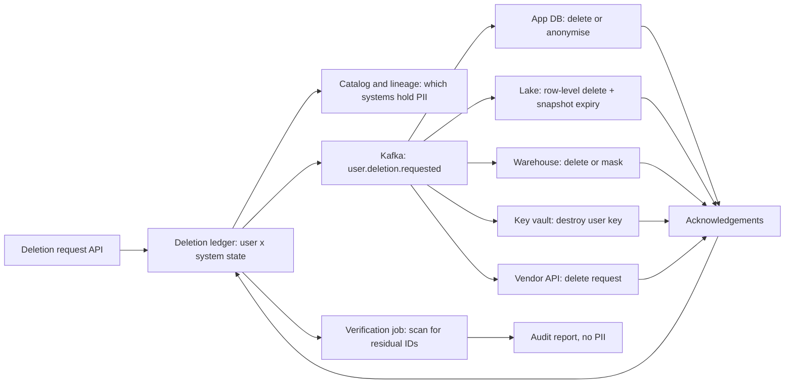

## 🎯 TL;DR

> "Delete this user" is not one `DELETE` statement. It is a **distributed, auditable workflow** that finds every copy of a person's data, removes or renders it unreadable in each system (including the ones you cannot edit, like logs and backups), and **proves** it happened within a legal deadline.

- Start from **lineage**, not from memory: the catalog says which datasets hold personal data, and column-level lineage says where it flows.
- Use a **deletion ledger** with one state per user per system. It is your audit trail and your retry engine.
- Mutable stores get real deletes. **Immutable stores** (Kafka logs, lake snapshots, backups) need **crypto-shredding** (delete the key, not the data) or a documented expiry.
- Derived data (aggregates, ML models) needs an explicit policy, and you must say what you do about it.

## 🌱 Start simple (Junior)

**Problem statement.** A European-style privacy law (GDPR-style) gives a user the **right to erasure**: when they ask, the company must delete their personal data, within a set time, and be able to show that it did. Design the system that handles these requests across the online app database, the analytics warehouse, the data lake, event streams, caches, backups and third-party vendors.

> **💡 Analogy:** A hotel checking out a guest. The front desk has the room key, the restaurant has a tab, the laundry has a bag with the guest's name, the email system has a thread, and a photo album in the archive has their picture. A checkout that only returns the room key leaves all the rest behind. The checklist of "every place this guest touched" must come from a map, not memory.

**Functional requirements**

- Accept a deletion request from a verified user.
- Find all personal data for that user, delete or anonymise it in each system, and tell third parties.
- Keep an audit record of what was done and what could not be done, and why.
- Respect legal exceptions, such as invoices kept for tax reasons, for the fixed period the law requires.

**Non-functional requirements**

- Deadline: GDPR gives one month to respond, extendable in complex cases. Plan an internal target well inside that (for example, 72 hours to finish all internal systems).
- Completeness: a forgotten system is a compliance failure.
- Safety: requests are keyed by a verified user ID, never by free text such as an email typed into a form.

**Estimation (show the arithmetic)**

- Users: 20 million. Assume 0.1% ask for deletion each month → 20,000,000 × 0.001 = **20,000 requests per month ≈ 670 per day**.
- Systems per user: about 40 stores and tables hold some personal data, including logs and third-party copies.
- The big table: a user-event table with 50 billion rows in roughly 400,000 Parquet files of 512 MB each (about 200 TB). One user's rows are spread across about 300 files (their events happen over years, and writes are not sorted by user).
- Naive copy-on-write deletion: each request rewrites 300 files × 512 MB = 153.6 GB. For 670 requests a day: 670 × 153.6 GB ≈ **103 TB rewritten per day**. That is not feasible.
- Batched deletion helps only a little: 670 users × 300 files = 201,000 file touches over 400,000 files, so roughly 40% of the table is still rewritten in a single pass.

The arithmetic rules out "rewrite every file." Mutable stores get row-level deletes and compaction; immutable stores get crypto-shredding. That split is the core of the design.

## 🔧 How it really works (Mid)

**Architecture**

**The deletion ledger.** One row per user and per system:

| user_id (pseudonymous) | system | state | attempts | last_error | updated_at |
|---|---|---|---|---|---|
| u_8f2a | app_db | done | 1 | - | 2026-10-13 09:10 |
| u_8f2a | lake.events | in_progress | 2 | timeout on snapshot commit | 2026-10-13 09:40 |
| u_8f2a | vendor_crm | requested | 0 | - | 2026-10-13 09:00 |

The ledger is a state machine (`requested → in_progress → done → verified`, with `failed` going back to `in_progress` after retry). It lets you answer "is user X finished?" in one query, and it makes every step idempotent: a retry checks the state before acting.

**Finding the data.** Do not hard-code the list of tables. Tag columns in the catalog as personal data (for example `pii=direct` for email, `pii=indirect` for IP address or device ID). Column-level lineage then tells you which downstream tables are derived from those columns, including aggregates that still carry the user ID. Run this as a job at request time and store the result in the ledger, so the list is recorded even if the catalog changes later. See [[data-lineage]] and [[data-catalogs]].

**Mutable stores: real deletes.**

- App database: `DELETE` or anonymise (replace name and email with a placeholder, keep the row for referential integrity). Anonymise when other tables need the foreign key, such as orders needed for tax.
- Warehouse and lake tables in open table formats: row-level delete. In Iceberg, a `DELETE` writes position or equality delete files that mask rows at read time. In Delta, the same idea with deletion vectors or rewrites (check the docs for your version).

A row-level delete is not the end. Old snapshots still contain the rows, which is exactly what [[time-travel]] gives you. Finish with snapshot expiry and orphan file cleanup, for example Iceberg's expire-snapshots and remove-orphan-files procedures, or Delta's `VACUUM` with a retention window. Until these run, the data is logically deleted but physically present. Record that gap in the ledger.

**Immutable stores.**

- **Kafka**: a log keeps records until retention ends. For a compacted topic keyed by user ID, a tombstone (a record with the key and a null value) removes older values after compaction runs. Compaction is not immediate: the active segment and any segment not yet compacted still hold the data ([[log-compaction]], [[tombstone]]). For a non-compacted topic, you cannot delete one user's records. Plan the retention window as the maximum lag.
- **Lake snapshots and backups**: expire snapshots and let backups age out on a documented schedule. The honest answer is "physically gone after N days" with N written into the policy.
- **Crypto-shredding** solves this in general. Encrypt each user's personal fields with a per-user data key stored in a key vault. The data in logs, Kafka, the lake and backups is then ciphertext. Destroy the user's key, and every copy becomes unreadable, including copies you cannot touch. Non-personal fields stay plain. The cost is key management and the need to encrypt before writing, not after.

**Derived data and models.** Aggregates without the user ID are normally fine; aggregates keyed by user ID are personal data and enter the workflow. For ML models trained on a user's data, the policy (for example, "retrained on the normal schedule, documented") is a legal and product decision. Write it down.

**Third parties.** Send the request through the vendor's API, store the vendor's reference ID in the ledger, and escalate when confirmation misses the vendor's SLA.

**Verification.** Deletion without verification is a claim. A verification job scans every system listed in the ledger for the user ID or for any pseudonymous key that maps back to it, and records the count. Zero residual rows (or only keys that are shredded) means verified. Store the verification result, not the data it found.

**Failure handling.** Each step is idempotent and retried with backoff. Permanent failures go to a dead-letter path ([[dead-letter-queue]]) with an owner. A daily report lists requests nearing their deadline.

## 🧠 Senior depth & trade-offs

**Deep dive 1: lineage-driven deletion.**

- The catalog is only as good as its tagging. Make PII tagging part of [[data-contract]] enforcement: a new table with a personal column cannot be merged without the tag. Without this, the system is complete on the day you build it and incomplete the next month.
- Lineage has blind spots (external tools, UDFs, copies made outside the pipeline). Add a periodic scan for the user ID in unexpected places, such as free-text fields and JSON blobs, and treat every hit as a bug.
- Keep the **resolved list** in the ledger at request time. If the lineage changes later, you still know what you promised to delete.

**Deep dive 2: immutable and shared storage.**

- The decision per store is: physical delete, crypto-shredding, or expiry with a documented maximum age. Write this table into the policy. It is more defensible than a vague "we delete everything".
- Replicas, caches and search indexes count too. A TTL is an acceptable answer only when it is short and documented.

**Deep dive 3: the cost of physical deletion at scale.**

- The 103 TB per day estimate is why deletes use merge-on-read plus scheduled compaction. Too many delete files slow reads, so the compaction schedule is an SLO in its own right.
- Sorting big tables by a user-ID bucket puts one user's rows in few files, which cuts rewrite cost sharply. The trade-off: it hurts time-range scans, so measure both.

**Deep dive 4: correctness under concurrency.**

- A request can arrive while a batch job writes the same user's events. Run a final sweep after the batch to catch them.
- A user who signs up again gets a new pseudonymous ID. Never restore deleted data into the new account.
- If a store is down, leave its ledger row in a retrying state. Never mark it done to close the request.

**Staff-level expectations.** Staff candidates usually:

- Start with **lineage and the ledger** before any table, and make completeness measurable (count of systems with status `verified` over systems listed).
- Choose per-store strategies with numbers: rewrite cost, read cost, expiry age.
- Name crypto-shredding as the general answer for immutable data, and its risks: losing the key vault loses everything, and key destruction must be audited.
- Bring legal and product owners in for the exception list and the model policy.

**When not to build this at full scale.** A few thousand users in one database can use a checklist, a script and a verification query. The workflow pays off when systems and requests make manual steps unreliable.

## 🧪 Try it

1. **Estimation.** The company grows to 100 million users and the deletion rate stays at 0.1% per month. How many requests per day now? If each request needs 300 file rewrites of 512 MB, how many TB per day is that without row-level deletes?
2. **Store choice.** For each store, pick the strategy (physical delete, anonymise, crypto-shred, expiry): Postgres orders table, Kafka topic `page_views` (not compacted), Iceberg events table, nightly database backups, a Redis session cache.
3. **Kafka reasoning.** A compacted topic keyed by user ID receives a tombstone at 10:00. Is the user's data gone at 10:00? What do you tell the auditor?

Show solutions

**1.** 100,000,000 × 0.001 = 100,000 per month, which is about 3,333 per day (100,000 / 30). Without row-level deletes: 3,333 × 153.6 GB ≈ 512 TB per day of rewrites. The bigger number makes the case for merge-on-read deletes plus compaction.

**2.** Postgres orders: anonymise the personal fields and keep the row for tax and referential integrity. Kafka `page_views` (not compacted): cannot delete one user's records; use crypto-shredding for the personal fields if they are encrypted at write, or document a retention-based expiry as the maximum age. Iceberg events: row-level delete, then snapshot expiry and orphan file cleanup. Nightly backups: crypto-shredding of the personal fields (if encrypted) or expiry on the backup retention schedule, with the maximum age in the policy. Redis session cache: delete the keys for the user, and rely on the short TTL as the backstop.

**3.** No. A tombstone is a marker. The older values remain in the log until the segment is compacted, and copies in other consumers or in replicas or backups remain until their own retention ends. The honest statement for the auditor: "the tombstone was written at 10:00 and the data is physically removed after compaction and retention, with the maximum date documented." If the personal fields are crypto-shredded, the data is unreadable from 10:00 on, which is the stronger answer.

## 💬 Interview corner

**Question: "Design GDPR-style user deletion across the data platform."**

- **Mid answer:** "I'd add a deletion API that triggers jobs for each system: delete rows in the database, delete rows in the lake table, and call the vendors. I'd track status in a table and run a check at the end."
- **Senior answer:** "I'd start from lineage: PII tags and column-level lineage give the list of systems, which I snapshot into a ledger at request time. Mutable stores get row-level deletes plus snapshot expiry. Immutable stores need crypto-shredding with per-user keys, or tombstones with a documented retention window. Steps are idempotent, the ledger drives retries, and a verification scan runs before the request closes."
- **Staff answer:** adds the cost model (rewrites per day, read cost of delete files), a policy table per store, the race with concurrent writes, and completeness as a measured metric.

**Follow-ups to expect**

- What about data in ML models? (Explicit policy: retrain on schedule, or accept and document it. Do not hide it.)
- How do you prove deletion to an auditor? (Ledger with timestamps, verification counts per system, and the key-destruction audit log. Never the deleted data itself.)
- What if a vendor never confirms? (Escalate after the SLA, record the status, and keep the request open until it is resolved or legally closed.)

> **🎤 Say this in the interview:** "Deletion is a lineage-driven, ledgered workflow, not a script. Mutable stores get real deletes plus snapshot expiry. Immutable stores get crypto-shredding with per-user keys, because rewriting logs and backups does not scale. The ledger drives retries, and a verification scan proves completeness before the request closes."

## ⚠️ Common mistakes

> **⚠️ Watch out:** Hard-coding the table list in the deletion script. The first new table with a user column that is not on the list becomes a compliance finding.

> **⚠️ Watch out:** Saying "we deleted the row" when old snapshots, backups and Kafka segments still hold it. Name the physical state and its maximum age, and record it.

- Treating the request as done when the API returns, before the downstream jobs finish.
- Skipping the verification scan, so completeness is assumed rather than measured.
- Forgetting caches, search indexes and vendors, which hold copies outside the main pipeline.
- Writing unencrypted personal data to immutable logs, then finding in a request that it cannot be removed.

## ✅ Check yourself (quiz)

1. What is the main purpose of the deletion ledger?
   - A) It replaces the need for a catalog
   - B) It records one state per user per system, so you can audit completeness, retry safely, and prove what was done
   - C) It stores the deleted personal data for backup
   - D) It is a cache that speeds up reads

Answer

**B** — the ledger is the workflow's state and its audit trail. It lets each step be retried idempotently and gives a single answer to "is this user finished?". Storing the deleted data would defeat the purpose.

2. A user's rows are spread across 300 files in a 400,000-file table. What is the main reason copy-on-write deletion does not scale for hundreds of requests per day?

   - A) Files cannot be read in parallel
   - B) Each request rewrites every file that holds the user's rows, so the rewrite volume grows with requests times files per user
   - C) Iceberg does not support deletes
   - D) The deletion ledger has too many rows

Answer

**B** — the arithmetic in the estimation shows the rewrite cost. Row-level deletes with merge-on-read, followed by compaction, avoid rewriting every file for every request.

3. A Kafka topic is not compacted. A user asks for deletion. Which approach gives a defensible answer for the records already in the topic?

   - A) Produce a tombstone with the user's key and assume it is deleted
   - B) Encrypt personal fields per user so that destroying the user's key makes all copies unreadable, and document the maximum retention for the rest
   - C) Delete the topic
   - D) Ignore the topic, because Kafka is not a database

Answer

**B** — a non-compacted topic cannot remove one user's records. Crypto-shredding makes the stored data unreadable on key destruction, which covers copies you cannot edit. Tombstones only work in compacted topics and only after compaction runs.

4. **(Senior)** After a deletion, an old Iceberg snapshot still returns the user's rows through time travel. What is missing, and what is the correct next step?

   - A) The row-level delete did not run
   - B) Snapshot expiry and orphan file removal have not run; schedule them with the retention window in the policy and record the status in the ledger
   - C) Time travel should be disabled for everyone forever
   - D) Add a `LIMIT` to the query

Answer

**B** — the row-level delete hides the rows in new snapshots, but old snapshots still reference the data files. Expiring snapshots and removing orphan files makes the removal physical. Until then, the ledger should show "logically deleted".

5. **(Senior)** A deletion request arrives while a batch job is writing the same user's new events. What rule keeps the result correct?

   - A) Ignore the new events, because the batch already started
   - B) Delete events written up to the request time and also run a final sweep after the batch finishes, so events written during the run are removed too
   - C) Delete only the events from last year
   - D) Stop the company's ingestion for everyone

Answer

**B** — the sweep at the end catches anything written during the run. Without it, the request is "done" while new personal data still exists. This is a classic race that verification scans should catch.

## 🗂️ Flashcards

| Front | Back |
|---|---|
| First step of a deletion workflow | Find the systems from catalog tags and column-level lineage, and snapshot the list into the ledger |
| Ledger state machine | `requested → in_progress → done → verified`, with `failed` going back to retry |
| Why a row-level delete is not enough in Iceberg | Old snapshots still reference the files; expire snapshots and remove orphans |
| Tombstone in Kafka | A null-value record with the key; removes older values only after compaction |
| Crypto-shredding | Per-user encryption keys; destroying the key makes all copies unreadable |
| Deadline in the GDPR-style rule | One month, extendable in complex cases; set an internal target well inside it |
| What the audit record should hold | Timestamps, states and verification counts, never the deleted personal data |
| Race with a running batch | Final sweep after the batch to catch events written during the run |

## 🔗 Go further

- Retention and minimisation rules that complement this: [[data-retention]] and [[data-security]].
- Lineage and catalogs that find the data: [[data-lineage]] and [[data-catalogs]].
- Table formats and snapshot cleanup: [[lakehouse-table-formats]] and [[time-travel]].
- Related design lessons: [[design-cdc-lake]] (how changes flow into the lake) and [[design-dq-platform]] (verification jobs and quality checks).

